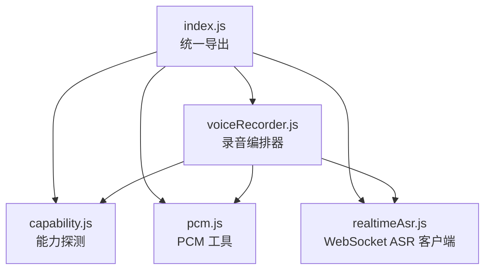
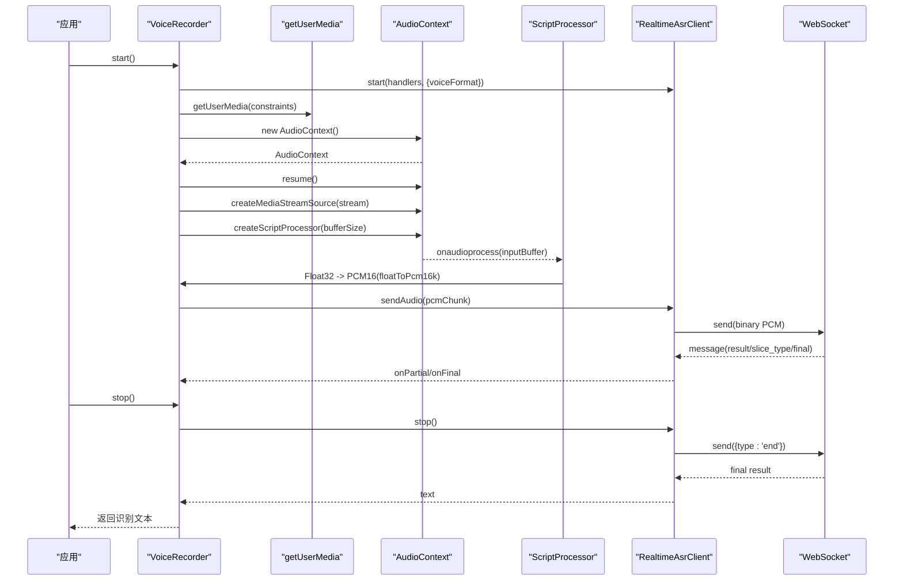
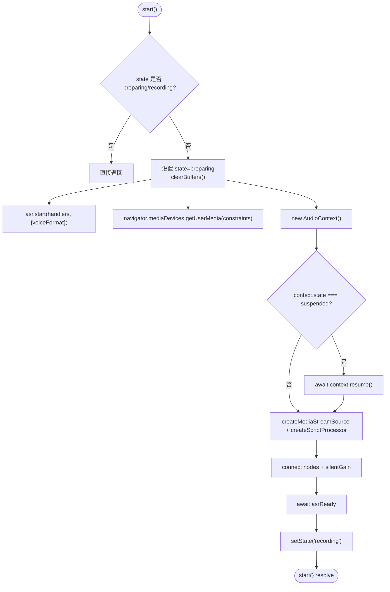
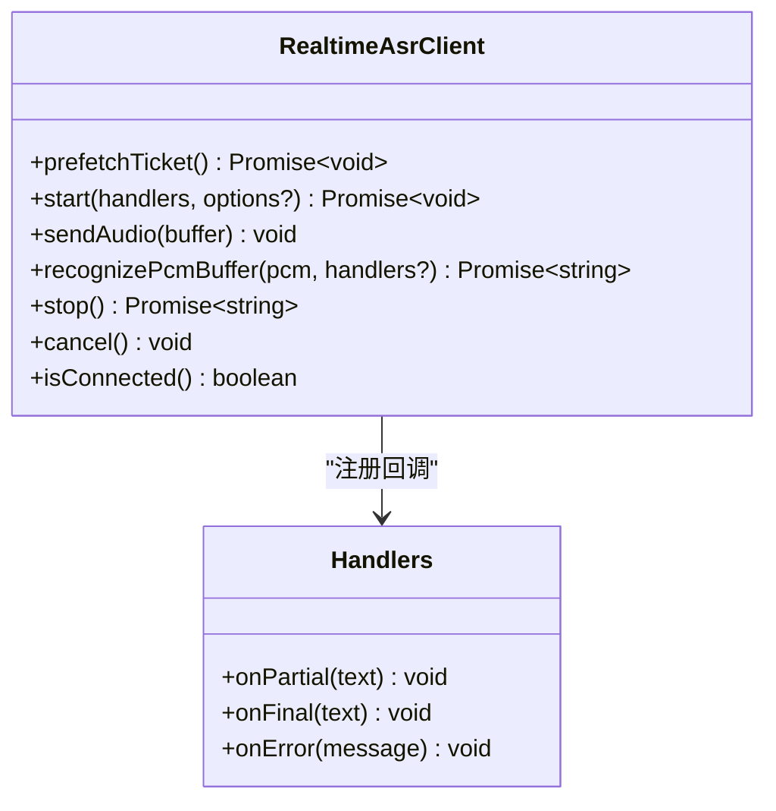
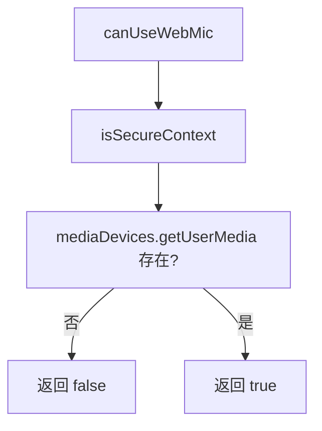
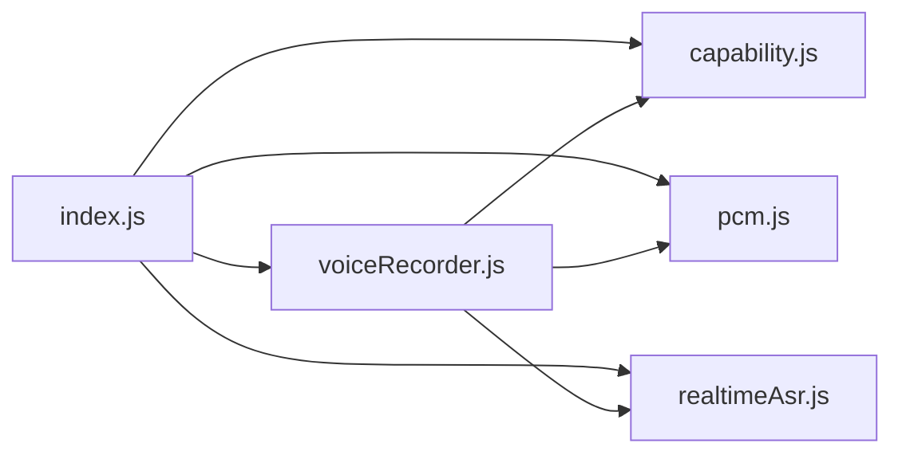
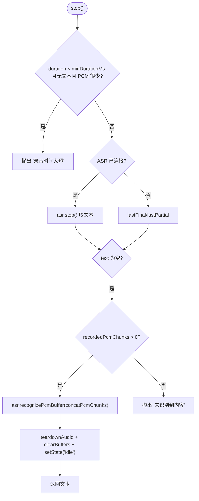

# SDK API 文档

<cite>
**本文引用的文件**   
- [index.js](file://uni_modules/uni-web-voice-input/js_sdk/uni-web-voice/index.js)
- [index.d.ts](file://uni_modules/uni-web-voice-input/js_sdk/uni-web-voice/index.d.ts)
- [capability.js](file://uni_modules/uni-web-voice-input/js_sdk/uni-web-voice/capability.js)
- [voiceRecorder.js](file://uni_modules/uni-web-voice-input/js_sdk/uni-web-voice/voiceRecorder.js)
- [realtimeAsr.js](file://uni_modules/uni-web-voice-input/js_sdk/uni-web-voice/realtimeAsr.js)
- [pcm.js](file://uni_modules/uni-web-voice-input/js_sdk/uni-web-voice/pcm.js)
</cite>

## 目录
1. [简介](#简介)
2. [项目结构](#项目结构)
3. [核心组件](#核心组件)
4. [架构总览](#架构总览)
5. [详细组件分析](#详细组件分析)
6. [依赖关系分析](#依赖关系分析)
7. [性能与稳定性](#性能与稳定性)
8. [错误处理与异常恢复](#错误处理与异常恢复)
9. [使用示例与最佳实践](#使用示例与最佳实践)
10. [结论](#结论)

## 简介
本 SDK 提供纯 Web 能力的语音输入方案，可在 H5、App-vue 以及各端 WebView（包括鸿蒙 ArkWeb）中使用。SDK 通过 getUserMedia 采集音频、Web Audio 转换为 PCM16，再经 WebSocket 实时推送到 ASR 服务；同时提供能力探测、权限探测、音频工具函数和完整的 TypeScript 类型定义，帮助开发者快速实现“按住说话”等自定义语音功能。

## 项目结构
SDK 以模块化的方式组织：
- 统一入口 index.js 暴露所有对外 API。
- capability.js 负责跨端能力与环境探测。
- voiceRecorder.js 封装录音、音频管线与 ASR 编排。
- realtimeAsr.js 管理 WebSocket 连接、音频分片发送与识别结果回调。
- pcm.js 提供 Float32 到 PCM16 的重采样与拼接工具。
- index.d.ts 提供完整 TypeScript 类型声明。

**图表来源**
- [index.js:6-17](file://uni_modules/uni-web-voice-input/js_sdk/uni-web-voice/index.js#L6-L17)
- [voiceRecorder.js:15-17](file://uni_modules/uni-web-voice-input/js_sdk/uni-web-voice/voiceRecorder.js#L15-L17)
- [realtimeAsr.js:84-93](file://uni_modules/uni-web-voice-input/js_sdk/uni-web-voice/realtimeAsr.js#L84-L93)

**章节来源**
- [index.js:1-18](file://uni_modules/uni-web-voice-input/js_sdk/uni-web-voice/index.js#L1-L18)

## 核心组件
- createVoiceRecorder(options): 创建录音编排器，封装从麦克风采集、AudioContext 管线、PCM 转换到实时 ASR 的完整生命周期。
- createRealtimeAsrClient(options): 创建实时 ASR 客户端，管理 WebSocket 连接、签名刷新、音频分片推送与识别结果回调。
- 能力探测函数：isHarmonyWebview、isSecureContext、canUseWebMic、getMicBlockReason、probeMicPermission、isAppPlusAndroid、requestRecordAudioViaPlus。
- 音频工具函数：floatToPcm16k、concatPcmChunks。
- describeMicError(e): 将 getUserMedia 的错误映射为可读中文文案。

**章节来源**
- [index.js:6-17](file://uni_modules/uni-web-voice-input/js_sdk/uni-web-voice/index.js#L6-L17)
- [index.d.ts:81-107](file://uni_modules/uni-web-voice-input/js_sdk/uni-web-voice/index.d.ts#L81-L107)

## 架构总览
整体流程如下：
- 调用方通过 createVoiceRecorder 获取 VoiceRecorder。
- start() 在用户手势同步窗口内触发：并发发起 ASR 连接、getUserMedia 与 AudioContext 初始化。
- ScriptProcessor.onaudioprocess 将 Float32 转为 PCM16，并分片发送到 ASR。
- ASR 返回部分文本与最终文本，VoiceRecorder 聚合并暴露给调用方。
- stop() 结束录音，若实时无结果则用整段 PCM 兜底识别一次。

**图表来源**
- [voiceRecorder.js:156-240](file://uni_modules/uni-web-voice-input/js_sdk/uni-web-voice/voiceRecorder.js#L156-L240)
- [voiceRecorder.js:246-295](file://uni_modules/uni-web-voice-input/js_sdk/uni-web-voice/voiceRecorder.js#L246-L295)
- [realtimeAsr.js:214-272](file://uni_modules/uni-web-voice-input/js_sdk/uni-web-voice/realtimeAsr.js#L214-L272)
- [realtimeAsr.js:298-315](file://uni_modules/uni-web-voice-input/js_sdk/uni-web-voice/realtimeAsr.js#L298-L315)

## 详细组件分析

### createVoiceRecorder 方法
用途：创建录音编排器，统一管理麦克风、音频管线与 ASR 的生命周期。

参数配置（VoiceRecorderOptions）：
- fetchSign(): Promise<AsrSignResult | Record<string, any>>，必填，返回包含 wss URL、过期时间、可选 voiceId 的签名对象。
- handlers?: VoiceRecorderHandlers，包含 onPartial、onFinal、onError、onStateChange。
- voiceFormat?: number，默认 1（16k PCM16）。
- targetSampleRate?: number，默认 16000。
- bufferSize?: number，默认 4096。
- minDurationMs?: number，默认 600ms，小于该时长判定“说得太短”。
- mediaConstraints?: MediaStreamConstraints，默认单声道、开启回声消除与降噪。
- debug?: boolean。
- WebSocketImpl?: typeof WebSocket，可注入自定义 WebSocket。
- _win?, _nav?，用于测试或非标准环境注入 window/navigator。

返回值对象（VoiceRecorder）：
- start(): Promise<void>，必须在用户手势同步窗口内调用。
- stop(): Promise<string>，返回识别文本；太短或无内容会抛出可读错误。
- cancel(): void，主动取消。
- getState(): RecorderState，当前状态。
- getPartialText(): string，最近一次部分或最终文本。
- prefetch(): Promise<void>，预热签名以减少首次按下等待。

状态控制（RecorderState）：
- idle：空闲。
- preparing：准备中（并发踢 ASR、getUserMedia、AudioContext）。
- recording：录音中。
- recognizing：识别收尾阶段。
- canceled：已取消。

生命周期要点：
- start() 内部在同步 tick 内并发执行 ASR.start、getUserMedia、AudioContext 构造，确保 user-activation 有效。
- AudioContext 可能处于 suspended，需显式 resume。
- 实时 WS 未连上时丢弃音频片段；松手若无结果则用整段 PCM 兜底识别。
- stop() 先停止 ASR，取最终或部分文本；若无文本且录制了 PCM，则走整段识别。
- teardownAudio() 安全断开节点、关闭 AudioContext、释放媒体流。

**图表来源**
- [voiceRecorder.js:156-240](file://uni_modules/uni-web-voice-input/js_sdk/uni-web-voice/voiceRecorder.js#L156-L240)

**章节来源**
- [index.d.ts:3-8](file://uni_modules/uni-web-voice-input/js_sdk/uni-web-voice/index.d.ts#L3-L8)
- [index.d.ts:49-82](file://uni_modules/uni-web-voice-input/js_sdk/uni-web-voice/index.d.ts#L49-L82)
- [voiceRecorder.js:60-150](file://uni_modules/uni-web-voice-input/js_sdk/uni-web-voice/voiceRecorder.js#L60-L150)
- [voiceRecorder.js:156-240](file://uni_modules/uni-web-voice-input/js_sdk/uni-web-voice/voiceRecorder.js#L156-L240)
- [voiceRecorder.js:246-313](file://uni_modules/uni-web-voice-input/js_sdk/uni-web-voice/voiceRecorder.js#L246-L313)

### createRealtimeAsrClient 方法
用途：创建实时 ASR 客户端，管理 WebSocket 连接、签名缓存与刷新、音频分片发送与识别结果处理。

参数配置（RealtimeAsrClientOptions）：
- fetchSign(): Promise<AsrSignResult | Record<string, any>>，必填。
- debug?: boolean。
- WebSocketImpl?: typeof WebSocket，可注入自定义实现。

返回值对象（RealtimeAsrClient）：
- prefetchTicket(): Promise<void>，预取签名，减少首次连接延迟。
- start(handlers, options?): Promise<void>，建立连接并注册回调。
- sendAudio(buffer): void，发送 PCM 数据（ArrayBuffer/String/Uint8Array）。
- recognizePcmBuffer(pcm, handlers?): Promise<string>，一次性整段识别。
- stop(): Promise<string>，发送 end 消息并等待最终结果。
- cancel(): void，取消当前识别并关闭连接。
- isConnected(): boolean，判断连接是否可用。

WebSocket 连接管理：
- 连接超时 CONNECT_TIMEOUT_MS（默认 8s），失败自动 reject。
- 收到服务器错误码（如 4001/4002/4003/4004）时格式化错误并清理缓存。
- 支持二进制 ArrayBuffer 传输 PCM。
- 连接关闭或超时时清理定时器与状态。

音频数据传输：
- pushPcmChunks 按 CHUNK_BYTES（默认 3200 字节）切分，每片间隔 CHUNK_INTERVAL_MS（默认 40ms）发送，避免拥塞。

识别结果处理：
- 解析 JSON 消息，区分 partial 与 final（slice_type=2 或 final=1）。
- 维护 finalText/partialText，stop() 返回 bestText()。
- 若服务端提前关闭或未返回 final，STOP_WAIT_MS（默认 6s）后返回已有文本。

**图表来源**
- [index.d.ts:21-47](file://uni_modules/uni-web-voice-input/js_sdk/uni-web-voice/index.d.ts#L21-L47)
- [realtimeAsr.js:84-93](file://uni_modules/uni-web-voice-input/js_sdk/uni-web-voice/realtimeAsr.js#L84-L93)
- [realtimeAsr.js:178-212](file://uni_modules/uni-web-voice-input/js_sdk/uni-web-voice/realtimeAsr.js#L178-L212)
- [realtimeAsr.js:274-296](file://uni_modules/uni-web-voice-input/js_sdk/uni-web-voice/realtimeAsr.js#L274-L296)
- [realtimeAsr.js:298-378](file://uni_modules/uni-web-voice-input/js_sdk/uni-web-voice/realtimeAsr.js#L298-L378)

**章节来源**
- [index.d.ts:21-47](file://uni_modules/uni-web-voice-input/js_sdk/uni-web-voice/index.d.ts#L21-L47)
- [realtimeAsr.js:19-53](file://uni_modules/uni-web-voice-input/js_sdk/uni-web-voice/realtimeAsr.js#L19-L53)
- [realtimeAsr.js:151-176](file://uni_modules/uni-web-voice-input/js_sdk/uni-web-voice/realtimeAsr.js#L151-L176)
- [realtimeAsr.js:214-272](file://uni_modules/uni-web-voice-input/js_sdk/uni-web-voice/realtimeAsr.js#L214-L272)
- [realtimeAsr.js:274-378](file://uni_modules/uni-web-voice-input/js_sdk/uni-web-voice/realtimeAsr.js#L274-L378)

### 能力探测函数
- isHarmonyWebview(win?): boolean
  - 检测是否在鸿蒙 ArkWeb <web-view> 内。优先检查 window.__uniapp_x_，其次排除 plus.webview，最后 UA 兜底。
- isSecureContext(win?): boolean
  - 检测是否为安全上下文（https 或 localhost），getUserMedia 前置条件。
- canUseWebMic(win?, nav?): boolean
  - 检测当前环境能否使用网页麦克风（安全上下文 + mediaDevices.getUserMedia）。
- getMicBlockReason(win?, nav?): string | null
  - 返回无法使用麦克风的原因文案；可用则返回 null。
- probeMicPermission(win?, nav?): Promise<'granted'|'denied'|'prompt'|'unknown'>
  - 异步探测麦克风授权状态；不支持 permissions 的环境静默回落 'unknown'。
- isAppPlusAndroid(win?): boolean
  - 是否运行在 uni-app App-plus 的安卓 webview 内。
- requestRecordAudioViaPlus(win?): Promise<'granted'|'denied'|'unsupported'|'error'>
  - 通过 plus.android.requestPermissions 申请 RECORD_AUDIO 运行时权限；非 App-plus 返回 unsupported。

**图表来源**
- [capability.js:28-46](file://uni_modules/uni-web-voice-input/js_sdk/uni-web-voice/capability.js#L28-L46)

**章节来源**
- [capability.js:14-138](file://uni_modules/uni-web-voice-input/js_sdk/uni-web-voice/capability.js#L14-L138)
- [index.d.ts:84-100](file://uni_modules/uni-web-voice-input/js_sdk/uni-web-voice/index.d.ts#L84-L100)

### 音频处理工具函数
- floatToPcm16k(input: Float32Array, inputRate: number, targetRate?: number): ArrayBuffer
  - 线性重采样并将 Float32 转为 Int16 PCM，默认目标采样率 16000。
- concatPcmChunks(chunks: Uint8Array[]): ArrayBuffer
  - 将多个 PCM 分片拼接为一个 ArrayBuffer，用于整段兜底识别。

复杂度说明：
- floatToPcm16k：O(n)，n 为输入采样数；输出长度约为 input.length / ratio。
- concatPcmChunks：O(m)，m 为分片总数；总字节数为各分片之和。

**章节来源**
- [pcm.js:6-36](file://uni_modules/uni-web-voice-input/js_sdk/uni-web-voice/pcm.js#L6-L36)
- [index.d.ts:102-107](file://uni_modules/uni-web-voice-input/js_sdk/uni-web-voice/index.d.ts#L102-L107)

### describeMicError 函数
用途：将 getUserMedia 抛出的 DOMException/Error 映射为可读中文文案，覆盖权限拒绝、设备缺失、设备占用、约束不满足等常见场景。

**章节来源**
- [voiceRecorder.js:25-41](file://uni_modules/uni-web-voice-input/js_sdk/uni-web-voice/voiceRecorder.js#L25-L41)
- [index.d.ts:93-94](file://uni_modules/uni-web-voice-input/js_sdk/uni-web-voice/index.d.ts#L93-L94)

## 依赖关系分析
- index.js 作为统一出口，导出 capability、pcm、realtimeAsr、voiceRecorder 的所有公开 API。
- voiceRecorder.js 依赖 realtimeAsr.js（ASR 客户端）、pcm.js（PCM 工具）、capability.js（麦克风阻塞原因）。
- realtimeAsr.js 依赖原生 WebSocket 或注入的 WebSocketImpl，并通过 fetchSign 获取签名 URL。
- pcm.js 无外部依赖，仅做数值计算与内存拷贝。

**图表来源**
- [index.js:6-17](file://uni_modules/uni-web-voice-input/js_sdk/uni-web-voice/index.js#L6-L17)
- [voiceRecorder.js:15-17](file://uni_modules/uni-web-voice-input/js_sdk/uni-web-voice/voiceRecorder.js#L15-L17)

**章节来源**
- [index.js:1-18](file://uni_modules/uni-web-voice-input/js_sdk/uni-web-voice/index.js#L1-L18)
- [voiceRecorder.js:15-17](file://uni_modules/uni-web-voice-input/js_sdk/uni-web-voice/voiceRecorder.js#L15-L17)

## 性能与稳定性
- 音频分片大小与间隔：CHUNK_BYTES=3200，CHUNK_INTERVAL_MS=40ms，平衡吞吐与延迟。
- 连接超时：CONNECT_TIMEOUT_MS=8s，防止长时间挂起。
- 识别超时：RECOGNIZE_TIMEOUT_MS=20s，避免长尾请求。
- 停止等待：STOP_WAIT_MS=6s，服务端未返回 final 时兜底返回已有文本。
- 签名缓存与刷新：SIGN_SKEW_SEC=60s，提前刷新以避免过期。
- AudioContext 状态：显式 resume 避免 suspended 导致零 PCM。
- 脚本处理器缓冲：bufferSize 默认 4096，可按设备性能调整。

建议：
- 在高延迟网络下适当增大 CHUNK_INTERVAL_MS。
- 低端设备上降低 bufferSize 或 targetSampleRate 以降低 CPU 压力。
- 对频繁启动的场景使用 prefetchTicket 预热签名。

[本节为通用指导，不直接分析具体文件]

## 错误处理与异常恢复
- getUserMedia 错误映射：describeMicError 将常见错误转为中文文案，便于 UI 提示。
- 麦克风不可用：getMicBlockReason 返回明确原因（非安全环境、缺少 getUserMedia）。
- ASR 连接失败：connect 抛出“连接失败/连接超时/连接已关闭”，调用方可重试。
- 服务器错误码：4001/4002/4003 鉴权失败，4004 额度用尽；清除缓存并通知 onError。
- 识别超时：recognizePcmBuffer 包裹 withTimeout，超时抛出“语音识别超时，请重试”。
- 太短或无内容：VoiceRecorder.stop 抛出“录音时间太短”或“未识别到内容”，调用方可引导用户重试。
- 取消与清理：cancel 清空 pendingError、stopResolve，关闭 socket，避免资源泄漏。

**图表来源**
- [voiceRecorder.js:246-295](file://uni_modules/uni-web-voice-input/js_sdk/uni-web-voice/voiceRecorder.js#L246-L295)

**章节来源**
- [voiceRecorder.js:25-41](file://uni_modules/uni-web-voice-input/js_sdk/uni-web-voice/voiceRecorder.js#L25-L41)
- [voiceRecorder.js:156-240](file://uni_modules/uni-web-voice-input/js_sdk/uni-web-voice/voiceRecorder.js#L156-L240)
- [voiceRecorder.js:246-313](file://uni_modules/uni-web-voice-input/js_sdk/uni-web-voice/voiceRecorder.js#L246-L313)
- [realtimeAsr.js:43-49](file://uni_modules/uni-web-voice-input/js_sdk/uni-web-voice/realtimeAsr.js#L43-L49)
- [realtimeAsr.js:178-212](file://uni_modules/uni-web-voice-input/js_sdk/uni-web-voice/realtimeAsr.js#L178-L212)
- [realtimeAsr.js:298-378](file://uni_modules/uni-web-voice-input/js_sdk/uni-web-voice/realtimeAsr.js#L298-L378)

## 使用示例与最佳实践
以下为典型用法步骤（不包含具体代码内容，仅提供路径参考）：
- 导入 SDK 统一入口，获取 createVoiceRecorder、createRealtimeAsrClient、能力探测与 PCM 工具函数。
  - 参考：[index.js:6-17](file://uni_modules/uni-web-voice-input/js_sdk/uni-web-voice/index.js#L6-L17)
- 在页面挂载前或按钮点击前，调用 probeMicPermission 探测权限，并根据 getMicBlockReason 提示用户。
  - 参考：[capability.js:72-83](file://uni_modules/uni-web-voice-input/js_sdk/uni-web-voice/capability.js#L72-L83)
  - 参考：[capability.js:52-63](file://uni_modules/uni-web-voice-input/js_sdk/uni-web-voice/capability.js#L52-L63)
- 实现 fetchSign，返回包含 url、expired、voiceId 的对象；必要时根据 expired 与 SIGN_SKEW_SEC 逻辑刷新。
  - 参考：[realtimeAsr.js:151-176](file://uni_modules/uni-web-voice-input/js_sdk/uni-web-voice/realtimeAsr.js#L151-L176)
- 创建 VoiceRecorder，并在用户按下（touchstart/mousedown）的同步代码中调用 start()，避免 await 插入破坏 user-activation。
  - 参考：[voiceRecorder.js:156-178](file://uni_modules/uni-web-voice-input/js_sdk/uni-web-voice/voiceRecorder.js#L156-L178)
- 在 onPartial/onFinal 中更新 UI，展示实时识别结果。
  - 参考：[voiceRecorder.js:100-114](file://uni_modules/uni-web-voice-input/js_sdk/uni-web-voice/voiceRecorder.js#L100-L114)
- 在用户松开（touchend/mouseup）时调用 stop()，捕获错误并提示“太短”或“未识别到内容”。
  - 参考：[voiceRecorder.js:246-295](file://uni_modules/uni-web-voice-input/js_sdk/uni-web-voice/voiceRecorder.js#L246-L295)
- 如需一次性整段识别，可使用 createRealtimeAsrClient().recognizePcmBuffer(concatPcmChunks(recordedPcmChunks))。
  - 参考：[realtimeAsr.js:332-364](file://uni_modules/uni-web-voice-input/js_sdk/uni-web-voice/realtimeAsr.js#L332-L364)
  - 参考：[pcm.js:26-36](file://uni_modules/uni-web-voice-input/js_sdk/uni-web-voice/pcm.js#L26-L36)

最佳实践：
- 始终在用户手势同步窗口内调用 start()，保证鸿蒙 ArkWeb 能弹出系统授权框。
- 对低性能设备调小 bufferSize 与 targetSampleRate，降低 CPU 与带宽压力。
- 使用 prefetchTicket 预热签名，减少首次按下等待。
- 对 ASR 错误进行分级处理：鉴权失败提示管理员，额度用尽提示购买资源包，网络问题提示重试。
- 在 App-plus 安卓环境下，结合 isAppPlusAndroid 与 requestRecordAudioViaPlus 申请运行时权限。

[本节为使用指导，不直接分析具体文件]

## 结论
本 SDK 通过模块化设计将能力探测、音频处理、实时 ASR 与录音编排解耦，提供稳定可靠的“按住说话”能力。开发者只需实现 fetchSign 并遵循用户手势同步窗口的约束，即可在不同容器（H5、App-vue、ArkWeb）中实现一致的语音体验。配合完善的错误处理与性能优化策略，可在复杂环境中获得良好的用户体验。

[本节为总结，不直接分析具体文件]