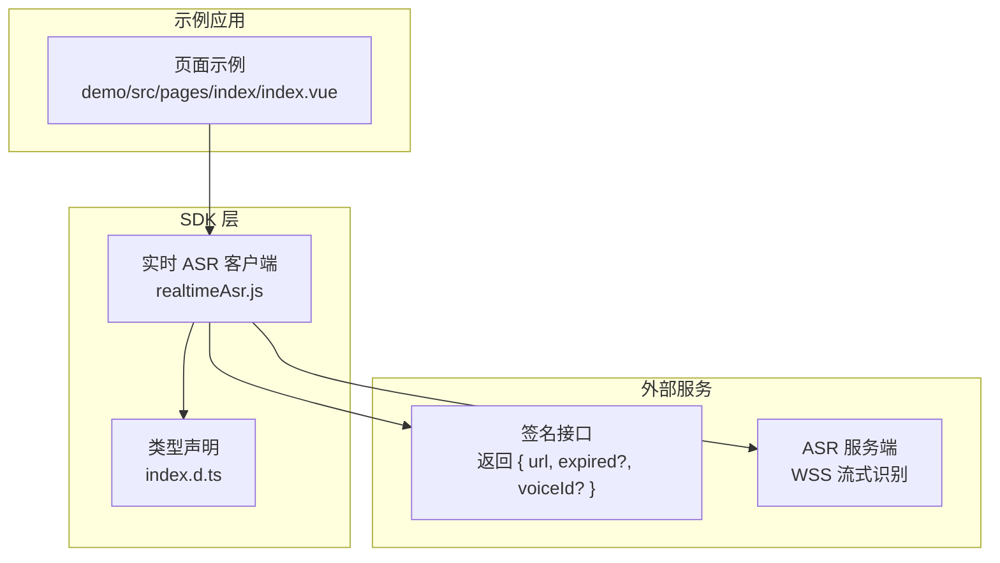
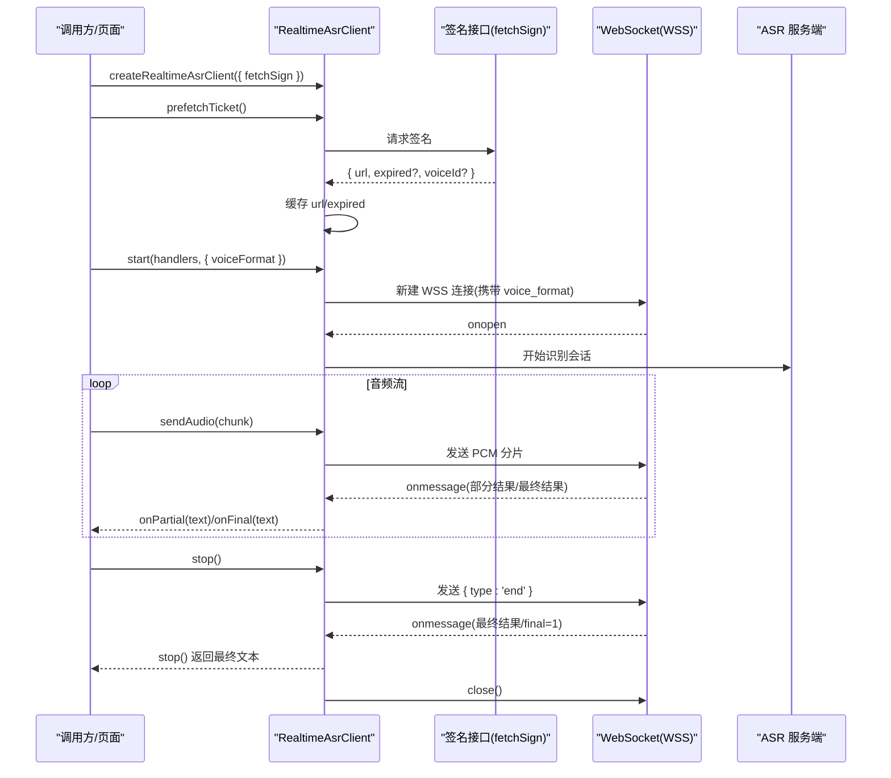
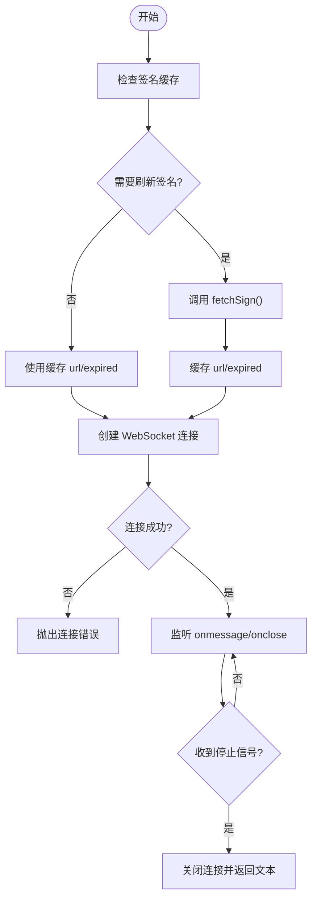
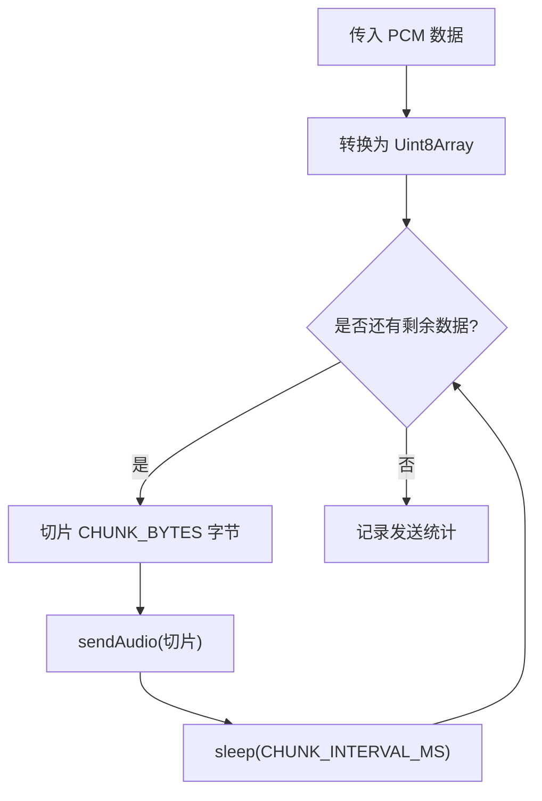
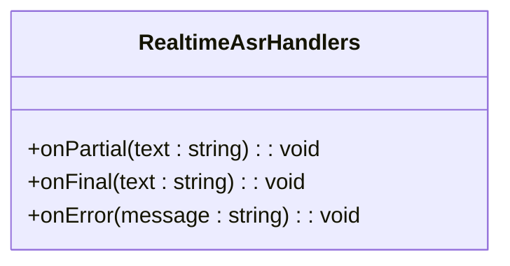
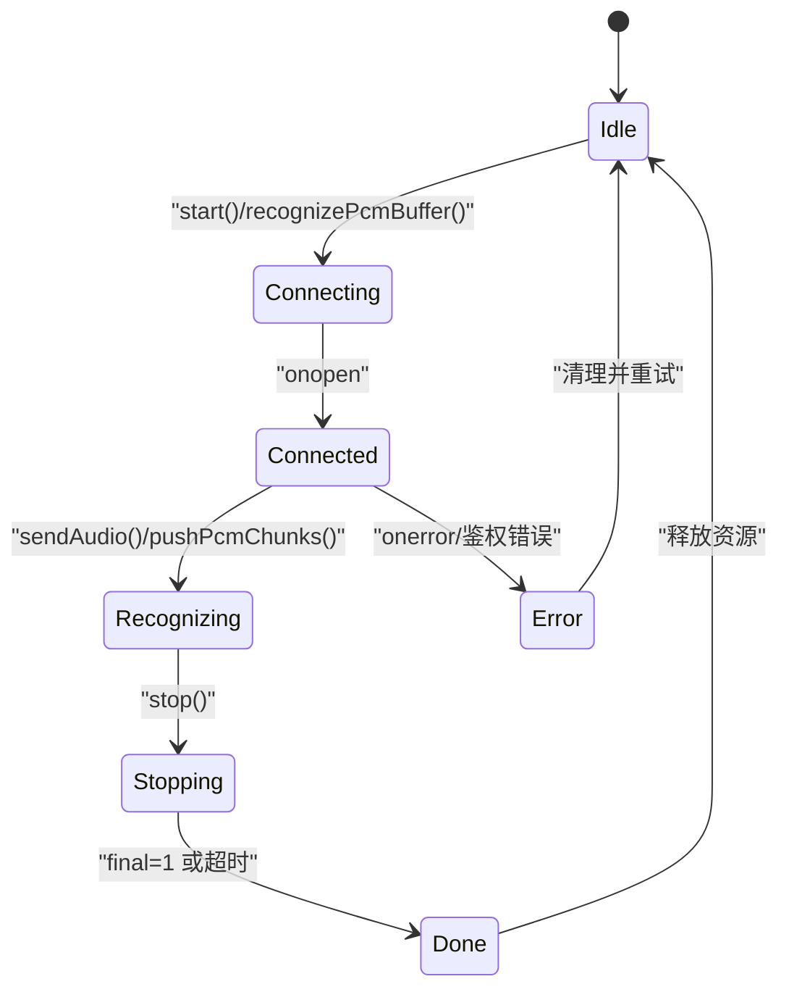
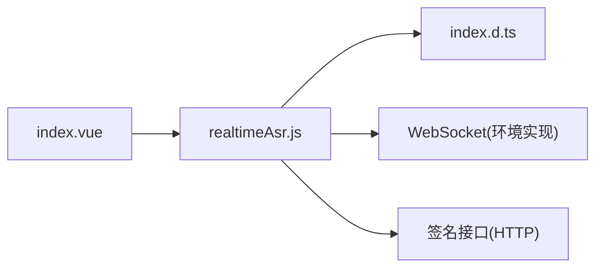

# 实时 ASR 客户端 API

<cite>
**本文引用的文件**   
- [realtimeAsr.js](file://uni_modules/uni-web-voice-input/js_sdk/uni-web-voice/realtimeAsr.js)
- [index.d.ts](file://uni_modules/uni-web-voice-input/js_sdk/uni-web-voice/index.d.ts)
- [index.vue](file://demo/src/pages/index/index.vue)
- [README.md](file://README.md)
</cite>

## 目录
1. [简介](#简介)
2. [项目结构](#项目结构)
3. [核心组件](#核心组件)
4. [架构总览](#架构总览)
5. [详细组件分析](#详细组件分析)
6. [依赖关系分析](#依赖关系分析)
7. [性能与网络优化建议](#性能与网络优化建议)
8. [故障排查指南](#故障排查指南)
9. [结论](#结论)
10. [附录：类型定义速查](#附录类型定义速查)

## 简介
本文件为 `createRealtimeAsrClient` 方法的全面 API 文档，聚焦于基于 WebSocket 的实时语音识别（ASR）客户端。该客户端通过注入签名接口获取已签名的 WSS 地址，直连后端进行 PCM 音频流式传输，并以部分结果、最终结果和错误回调的方式向调用方输出识别文本。其设计强调“后端解耦”，不绑定具体厂商密钥，默认兼容腾讯云 ASR 协议字段。

## 项目结构
围绕实时 ASR 能力，仓库中与本 API 直接相关的代码主要位于 SDK 层与示例页面中：
- SDK 实现：`uni_modules/uni-web-voice-input/js_sdk/uni-web-voice/realtimeAsr.js`
- TypeScript 类型声明：`uni_modules/uni-web-voice-input/js_sdk/uni-web-voice/index.d.ts`
- 示例用法（uni-app 页面）：`demo/src/pages/index/index.vue`
- 项目说明：`README.md`

**图表来源**
- [realtimeAsr.js:84-378](file://uni_modules/uni-web-voice-input/js_sdk/uni-web-voice/realtimeAsr.js#L84-L378)
- [index.d.ts:10-47](file://uni_modules/uni-web-voice-input/js_sdk/uni-web-voice/index.d.ts#L10-L47)
- [index.vue:59-83](file://demo/src/pages/index/index.vue#L59-L83)

**章节来源**
- [realtimeAsr.js:1-18](file://uni_modules/uni-web-voice-input/js_sdk/uni-web-voice/realtimeAsr.js#L1-L18)
- [index.d.ts:1-108](file://uni_modules/uni-web-voice-input/js_sdk/uni-web-voice/index.d.ts#L1-L108)
- [index.vue:1-83](file://demo/src/pages/index/index.vue#L1-L83)
- [README.md:1-24](file://README.md#L1-L24)

## 核心组件
`createRealtimeAsrClient` 是创建实时 ASR 客户端的工厂函数，返回一个具备连接管理、音频发送、识别控制与状态查询能力的对象。

- 关键参数
  - `fetchSign`: 必填，返回包含已签名 WSS URL 的对象；支持多种字段名（如 `url`、`wsUrl`、`wssUrl`、`ws_url`、`wss_url`），并可选 `expired`、`voiceId`。
  - `debug`: 可选，是否打印调试日志。
  - `WebSocketImpl`: 可选，自定义 WebSocket 实现（例如在 App 端注入 uni 提供的实现）。

- 返回对象方法
  - `prefetchTicket()`: 预取签名，提前缓存 WSS URL 与过期时间。
  - `start(handlers, options)`: 建立连接并开始接收识别结果；可指定 `voiceFormat`。
  - `sendAudio(buffer)`: 推送音频数据（ArrayBuffer / Uint8Array / string）。
  - `recognizePcmBuffer(pcm, handlers)`: 一次性整段 PCM 识别，内部自动连接、分片推流、结束并返回最终文本。
  - `stop()`: 发送结束信号并等待最终结果或超时。
  - `cancel()`: 取消当前识别流程并清理资源。
  - `isConnected()`: 查询当前 WebSocket 是否处于打开状态。

**章节来源**
- [realtimeAsr.js:84-378](file://uni_modules/uni-web-voice-input/js_sdk/uni-web-voice/realtimeAsr.js#L84-L378)
- [index.d.ts:27-47](file://uni_modules/uni-web-voice-input/js_sdk/uni-web-voice/index.d.ts#L27-L47)

## 架构总览
实时 ASR 客户端的整体交互流程如下：

**图表来源**
- [realtimeAsr.js:151-272](file://uni_modules/uni-web-voice-input/js_sdk/uni-web-voice/realtimeAsr.js#L151-L272)
- [realtimeAsr.js:274-315](file://uni_modules/uni-web-voice-input/js_sdk/uni-web-voice/realtimeAsr.js#L274-L315)
- [realtimeAsr.js:317-378](file://uni_modules/uni-web-voice-input/js_sdk/uni-web-voice/realtimeAsr.js#L317-L378)

## 详细组件分析

### 连接与会话生命周期
- 连接建立
  - 通过 `refreshSignIfNeeded()` 判断是否需要刷新签名；若缓存未过期则复用。
  - 使用 `new WS(url)` 建立 WebSocket 连接，设置 `binaryType = 'arraybuffer'`。
  - 连接超时由 `CONNECT_TIMEOUT_MS` 控制，默认 8 秒；连接失败会抛出错误。
- 消息处理
  - 解析服务端 JSON 消息，区分部分结果与最终结果；当 `final === 1` 时触发停止逻辑。
  - 对特定错误码（如鉴权失败、额度用尽）进行友好提示，并清空签名缓存以强制刷新。
- 关闭与会话清理
  - `closeSocket()` 统一关闭连接、清理定时器与状态变量。

**图表来源**
- [realtimeAsr.js:151-272](file://uni_modules/uni-web-voice-input/js_sdk/uni-web-voice/realtimeAsr.js#L151-L272)
- [realtimeAsr.js:178-212](file://uni_modules/uni-web-voice-input/js_sdk/uni-web-voice/realtimeAsr.js#L178-L212)

**章节来源**
- [realtimeAsr.js:151-272](file://uni_modules/uni-web-voice-input/js_sdk/uni-web-voice/realtimeAsr.js#L151-L272)

### 音频数据传输
- `sendAudio(buffer)`
  - 支持 ArrayBuffer、Uint8Array、string 三种输入类型。
  - 内部将数据标准化为二进制后通过 WebSocket 发送。
- `pushPcmChunks(pcm)`
  - 将 PCM 数据按固定大小（默认 3200 字节）切分，间隔 40ms 发送，避免拥塞。
- `recognizePcmBuffer(pcm, handlers)`
  - 封装了“连接 → 推流 → 停止 → 返回最终文本”的完整流程，并带有整体超时保护。

**图表来源**
- [realtimeAsr.js:274-296](file://uni_modules/uni-web-voice-input/js_sdk/uni-web-voice/realtimeAsr.js#L274-L296)

**章节来源**
- [realtimeAsr.js:274-296](file://uni_modules/uni-web-voice-input/js_sdk/uni-web-voice/realtimeAsr.js#L274-L296)
- [realtimeAsr.js:332-364](file://uni_modules/uni-web-voice-input/js_sdk/uni-web-voice/realtimeAsr.js#L332-L364)

### 识别结果回调接口
- `onPartial(text)`: 部分识别结果回调，用于实时展示中间文本。
- `onFinal(text)`: 最终识别结果回调，通常在 `final === 1` 或 `slice_type === 2` 时触发。
- `onError(message)`: 错误回调，涵盖签名失败、鉴权失败、额度用尽、连接异常等场景。

**图表来源**
- [index.d.ts:21-25](file://uni_modules/uni-web-voice-input/js_sdk/uni-web-voice/index.d.ts#L21-L25)

**章节来源**
- [realtimeAsr.js:178-212](file://uni_modules/uni-web-voice-input/js_sdk/uni-web-voice/realtimeAsr.js#L178-L212)
- [index.d.ts:21-25](file://uni_modules/uni-web-voice-input/js_sdk/uni-web-voice/index.d.ts#L21-L25)

### 连接状态管理与自动重连机制
- 连接状态
  - `isConnected()` 返回当前 WebSocket 是否处于 OPEN 状态。
- 自动重连
  - 客户端本身不实现指数退避重连；但通过签名缓存与过期策略，结合业务侧重试可实现稳定重连。
  - 当服务端返回鉴权相关错误码（如 4001/4002/4003/4004）时，会清空签名缓存，迫使下次重新获取有效签名。
- 超时与兜底
  - 连接阶段有 `CONNECT_TIMEOUT_MS` 超时。
  - 整段识别有 `RECOGNIZE_TIMEOUT_MS` 超时。
  - 停止阶段有 `STOP_WAIT_MS` 等待最终结果的超时保护。

**图表来源**
- [realtimeAsr.js:10-18](file://uni_modules/uni-web-voice-input/js_sdk/uni-web-voice/realtimeAsr.js#L10-L18)
- [realtimeAsr.js:178-212](file://uni_modules/uni-web-voice-input/js_sdk/uni-web-voice/realtimeAsr.js#L178-L212)
- [realtimeAsr.js:214-272](file://uni_modules/uni-web-voice-input/js_sdk/uni-web-voice/realtimeAsr.js#L214-L272)
- [realtimeAsr.js:298-315](file://uni_modules/uni-web-voice-input/js_sdk/uni-web-voice/realtimeAsr.js#L298-L315)

**章节来源**
- [realtimeAsr.js:10-18](file://uni_modules/uni-web-voice-input/js_sdk/uni-web-voice/realtimeAsr.js#L10-L18)
- [realtimeAsr.js:178-212](file://uni_modules/uni-web-voice-input/js_sdk/uni-web-voice/realtimeAsr.js#L178-L212)
- [realtimeAsr.js:214-272](file://uni_modules/uni-web-voice-input/js_sdk/uni-web-voice/realtimeAsr.js#L214-L272)
- [realtimeAsr.js:298-315](file://uni_modules/uni-web-voice-input/js_sdk/uni-web-voice/realtimeAsr.js#L298-L315)

### 实际代码示例（步骤化说明）
以下示例描述如何在页面中使用 `createRealtimeAsrClient` 实现“按住说话、松手出字”的实时转写功能。为避免泄露实现细节，此处仅给出步骤与路径引用，不直接粘贴源码。

- 步骤一：引入 SDK 与工具函数
  - 参考示例页面导入方式与麦克风权限探测。
  - 参考路径：[index.vue:34-39](file://demo/src/pages/index/index.vue#L34-L39)

- 步骤二：实现签名接口 `getSign`
  - 返回 `{ url, expired?, voiceId? }`，其中 `url` 必须是已签名的 WSS 地址。
  - 参考路径：[index.vue:59-75](file://demo/src/pages/index/index.vue#L59-L75)

- 步骤三：创建客户端并预取签名
  - 调用 `createRealtimeAsrClient({ fetchSign })`，并在用户准备录音前调用 `prefetchTicket()` 预热连接。
  - 参考路径：[realtimeAsr.js:84-115](file://uni_modules/uni-web-voice-input/js_sdk/uni-web-voice/realtimeAsr.js#L84-L115)

- 步骤四：开始识别并处理回调
  - 调用 `start(handlers)`，在 `handlers` 中实现 `onPartial`、`onFinal`、`onError`。
  - 参考路径：[realtimeAsr.js:327-330](file://uni_modules/uni-web-voice-input/js_sdk/uni-web-voice/realtimeAsr.js#L327-L330)

- 步骤五：推送音频数据
  - 在录音过程中持续调用 `sendAudio(chunk)` 推送 PCM 分片。
  - 参考路径：[realtimeAsr.js:274-284](file://uni_modules/uni-web-voice-input/js_sdk/uni-web-voice/realtimeAsr.js#L274-L284)

- 步骤六：结束识别并获取结果
  - 松手时调用 `stop()`，等待最终文本返回。
  - 参考路径：[realtimeAsr.js:298-315](file://uni_modules/uni-web-voice-input/js_sdk/uni-web-voice/realtimeAsr.js#L298-L315)

- 步骤七：错误处理与状态展示
  - 在 `onError` 中显示错误提示；在 `onPartial` 中展示实时文本。
  - 参考路径：[index.vue:77-83](file://demo/src/pages/index/index.vue#L77-L83)

**章节来源**
- [index.vue:34-83](file://demo/src/pages/index/index.vue#L34-L83)
- [realtimeAsr.js:84-378](file://uni_modules/uni-web-voice-input/js_sdk/uni-web-voice/realtimeAsr.js#L84-L378)

## 依赖关系分析
- 模块内依赖
  - `realtimeAsr.js` 导出 `createRealtimeAsrClient`，并通过 `index.d.ts` 提供类型约束。
  - 示例页面 `index.vue` 演示如何注入签名接口与处理回调。
- 外部依赖
  - 浏览器/WebView 环境中的 `WebSocket` 实现。
  - 业务签名接口（HTTP），返回 WSS 地址与过期时间。

**图表来源**
- [index.vue:34-83](file://demo/src/pages/index/index.vue#L34-L83)
- [realtimeAsr.js:84-378](file://uni_modules/uni-web-voice-input/js_sdk/uni-web-voice/realtimeAsr.js#L84-L378)
- [index.d.ts:1-108](file://uni_modules/uni-web-voice-input/js_sdk/uni-web-voice/index.d.ts#L1-L108)

**章节来源**
- [index.vue:34-83](file://demo/src/pages/index/index.vue#L34-L83)
- [realtimeAsr.js:84-378](file://uni_modules/uni-web-voice-input/js_sdk/uni-web-voice/realtimeAsr.js#L84-L378)
- [index.d.ts:1-108](file://uni_modules/uni-web-voice-input/js_sdk/uni-web-voice/index.d.ts#L1-L108)

## 性能与网络优化建议
- 音频分片与间隔
  - 默认分片大小为 3200 字节，间隔 40ms；可根据网络状况调整以提升吞吐或降低延迟。
  - 参考路径：[realtimeAsr.js:16-17](file://uni_modules/uni-web-voice-input/js_sdk/uni-web-voice/realtimeAsr.js#L16-L17)
- 连接与识别超时
  - 连接超时 8 秒，识别超时 20 秒，停止等待 6 秒；建议在弱网环境下适当放宽。
  - 参考路径：[realtimeAsr.js:10-12](file://uni_modules/uni-web-voice-input/js_sdk/uni-web-voice/realtimeAsr.js#L10-L12)
- 签名缓存与刷新
  - 默认签名有效期约 10 分钟，提前 60 秒刷新；可在高频场景中复用缓存以减少签名请求。
  - 参考路径：[realtimeAsr.js:13-15](file://uni_modules/uni-web-voice-input/js_sdk/uni-web-voice/realtimeAsr.js#L13-L15)
- 编码格式
  - 通过 `voiceFormat` 指定音频编码（默认 1，对应 16k PCM16，腾讯云）；确保与后端一致。
  - 参考路径：[index.d.ts:56-57](file://uni_modules/uni-web-voice-input/js_sdk/uni-web-voice/index.d.ts#L56-L57)

**章节来源**
- [realtimeAsr.js:10-18](file://uni_modules/uni-web-voice-input/js_sdk/uni-web-voice/realtimeAsr.js#L10-L18)
- [index.d.ts:56-57](file://uni_modules/uni-web-voice-input/js_sdk/uni-web-voice/index.d.ts#L56-L57)

## 故障排查指南
- 常见问题与定位
  - 签名响应缺少 `url`：检查签名接口返回体结构，确保包含 `url` 字段。
    - 参考路径：[realtimeAsr.js:151-167](file://uni_modules/uni-web-voice-input/js_sdk/uni-web-voice/realtimeAsr.js#L151-L167)
  - 鉴权失败或额度用尽：服务端返回 4001/4002/4003/4004 时，客户端会清空签名缓存并提示错误。
    - 参考路径：[realtimeAsr.js:43-49](file://uni_modules/uni-web-voice-input/js_sdk/uni-web-voice/realtimeAsr.js#L43-L49)
    - 参考路径：[realtimeAsr.js:182-190](file://uni_modules/uni-web-voice-input/js_sdk/uni-web-voice/realtimeAsr.js#L182-L190)
  - 连接超时或失败：检查网络与证书，确认 WSS 地址可达且安全上下文可用。
    - 参考路径：[realtimeAsr.js:236-258](file://uni_modules/uni-web-voice-input/js_sdk/uni-web-voice/realtimeAsr.js#L236-L258)
  - 无识别文本：确认 `getUserMedia` 在用户手势同步窗口内发起，并确保 `AudioContext` 正确恢复。
    - 参考路径：[README.md:17-23](file://README.md#L17-L23)
- 调试建议
  - 开启 `debug: true` 查看连接、消息与错误日志。
  - 在 `onError` 中捕获并展示错误信息，辅助快速定位问题。
  - 参考路径：[realtimeAsr.js:89-103](file://uni_modules/uni-web-voice-input/js_sdk/uni-web-voice/realtimeAsr.js#L89-L103)
  - 参考路径：[index.vue:83-83](file://demo/src/pages/index/index.vue#L83-L83)

**章节来源**
- [realtimeAsr.js:43-49](file://uni_modules/uni-web-voice-input/js_sdk/uni-web-voice/realtimeAsr.js#L43-L49)
- [realtimeAsr.js:151-167](file://uni_modules/uni-web-voice-input/js_sdk/uni-web-voice/realtimeAsr.js#L151-L167)
- [realtimeAsr.js:182-190](file://uni_modules/uni-web-voice-input/js_sdk/uni-web-voice/realtimeAsr.js#L182-L190)
- [realtimeAsr.js:236-258](file://uni_modules/uni-web-voice-input/js_sdk/uni-web-voice/realtimeAsr.js#L236-L258)
- [realtimeAsr.js:89-103](file://uni_modules/uni-web-voice-input/js_sdk/uni-web-voice/realtimeAsr.js#L89-L103)
- [index.vue:83-83](file://demo/src/pages/index/index.vue#L83-L83)
- [README.md:17-23](file://README.md#L17-L23)

## 结论
`createRealtimeAsrClient` 提供了简洁而强大的实时 ASR 客户端能力：通过注入签名接口获取 WSS 地址，直连后端进行 PCM 流式识别，并以部分结果、最终结果与错误回调的形式输出。其设计强调解耦与跨端兼容，适合在 H5、App WebView 与鸿蒙 ArkWeb 等环境中使用。结合合理的超时配置、签名缓存与错误处理，可以在复杂网络条件下获得稳定的实时转写体验。

## 附录：类型定义速查
- `AsrSignResult`
  - `url`: 已签名的 WSS 连接地址
  - `expired`: 过期时间戳（秒），缺省按 10 分钟处理
  - `voiceId`: 会话/请求标识，可选
- `FetchSign`: 返回 `Promise<AsrSignResult | Record<string, any>>`
- `RealtimeAsrHandlers`
  - `onPartial(text: string)`
  - `onFinal(text: string)`
  - `onError(message: string)`
- `RealtimeAsrClientOptions`
  - `fetchSign: FetchSign`
  - `debug?: boolean`
  - `WebSocketImpl?: typeof WebSocket`
- `RealtimeAsrClient`
  - `prefetchTicket(): Promise<void>`
  - `start(handlers?: RealtimeAsrHandlers, options?: { voiceFormat?: number }): Promise<void>`
  - `sendAudio(buffer: ArrayBuffer | string | Uint8Array): void`
  - `recognizePcmBuffer(pcm: ArrayBuffer, handlers?: RealtimeAsrHandlers): Promise<string>`
  - `stop(): Promise<string>`
  - `cancel(): void`
  - `isConnected(): boolean`

**章节来源**
- [index.d.ts:10-47](file://uni_modules/uni-web-voice-input/js_sdk/uni-web-voice/index.d.ts#L10-L47)