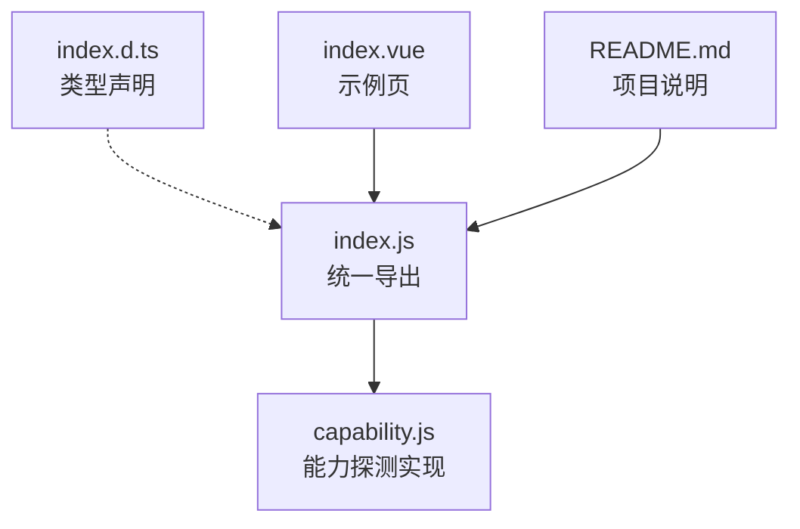
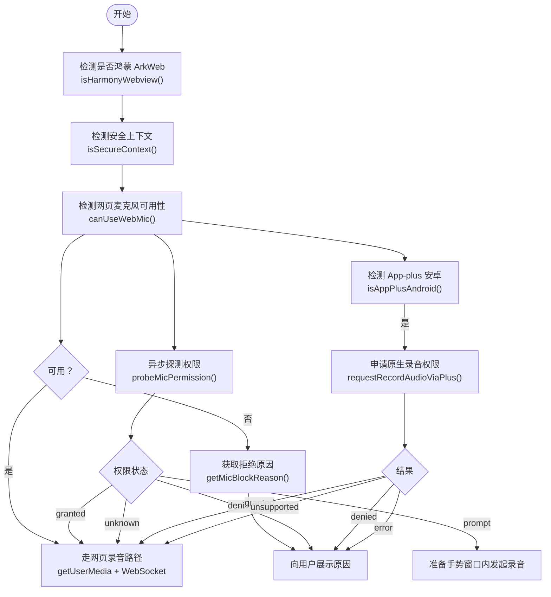
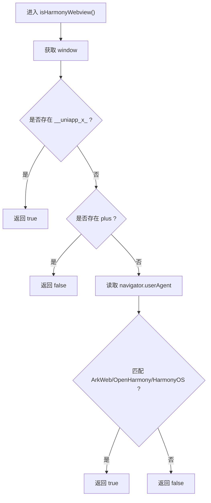
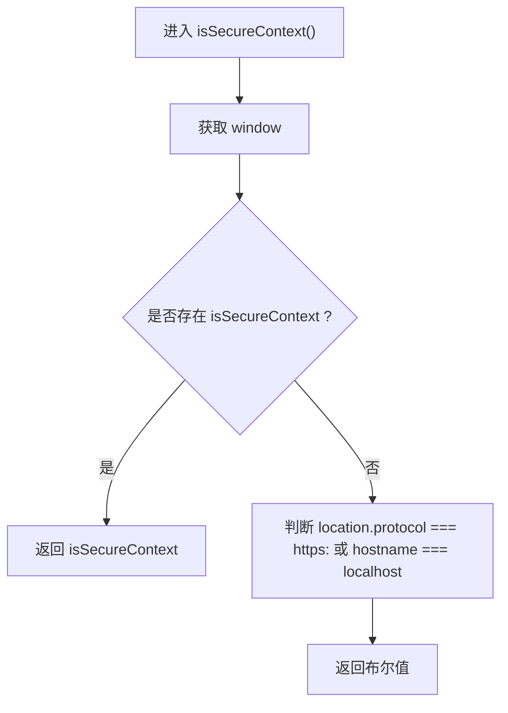
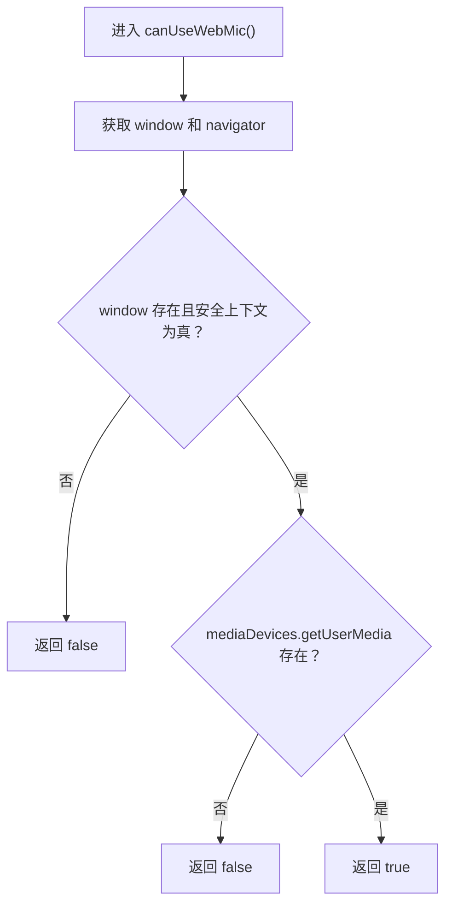
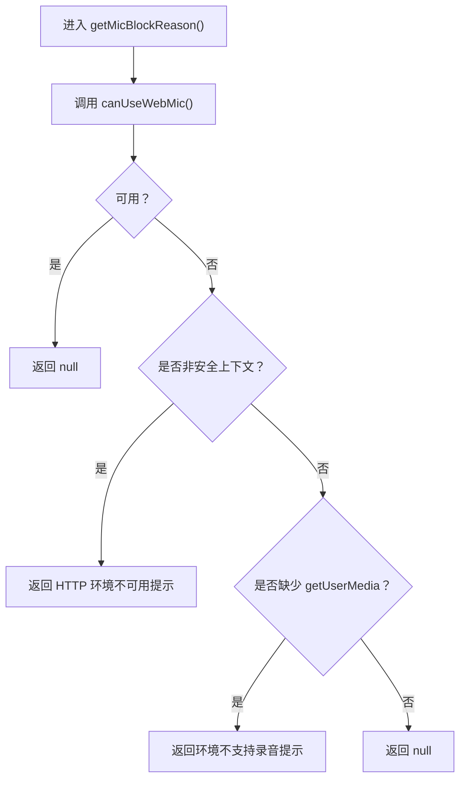
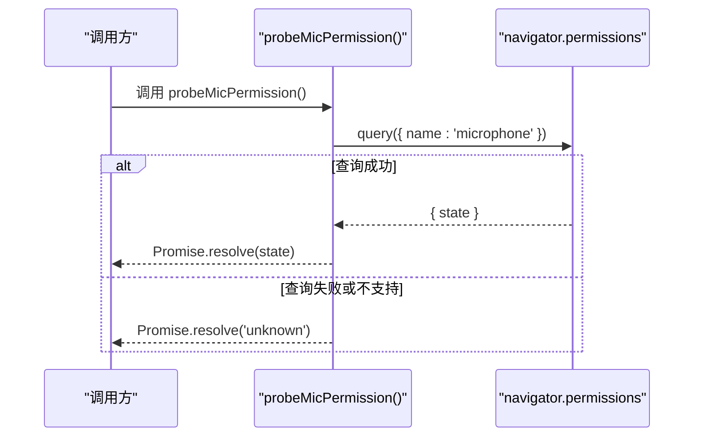
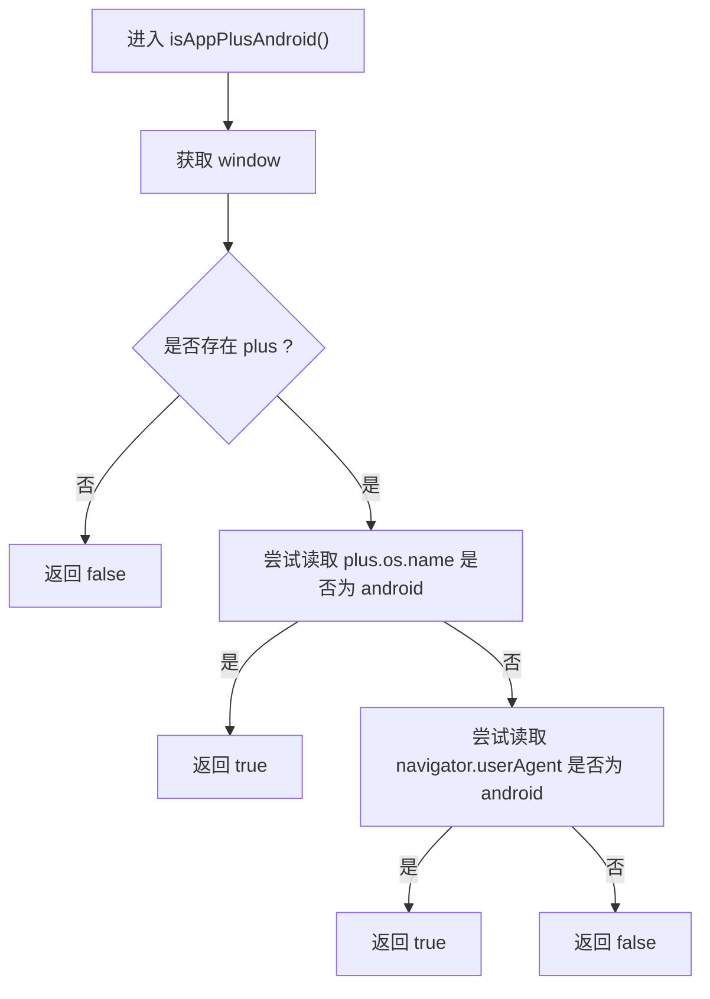
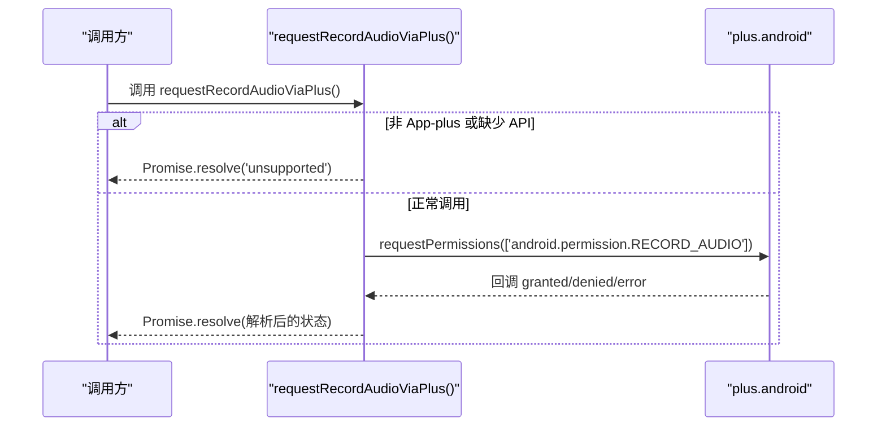
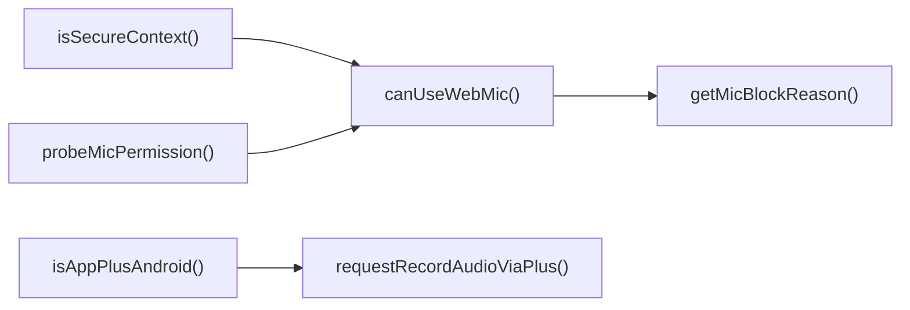

# 能力探测 API

<cite>
**本文引用的文件**   
- [capability.js](file://uni_modules/uni-web-voice-input/js_sdk/uni-web-voice/capability.js)
- [index.d.ts](file://uni_modules/uni-web-voice-input/js_sdk/uni-web-voice/index.d.ts)
- [index.js](file://uni_modules/uni-web-voice-input/js_sdk/uni-web-voice/index.js)
- [index.vue](file://demo/src/pages/index/index.vue)
- [README.md](file://README.md)
</cite>

## 目录
1. [简介](#简介)
2. [项目结构](#项目结构)
3. [核心能力探测函数总览](#核心能力探测函数总览)
4. [架构概览](#架构概览)
5. [详细组件分析](#详细组件分析)
6. [依赖关系分析](#依赖关系分析)
7. [性能与兼容性考虑](#性能与兼容性考虑)
8. [故障排查指南](#故障排查指南)
9. [结论](#结论)
10. [附录：类型定义与调用约定](#附录类型定义与调用约定)

## 简介
本文件面向需要在 H5、App WebView、鸿蒙 ArkWeb、uni-app App-plus 等环境中接入语音输入能力的开发者，系统化说明“设备能力和环境检测”相关 API。重点覆盖以下能力：
- 鸿蒙 ArkWeb 环境检测：`isHarmonyWebview()`
- 安全上下文检测：`isSecureContext()`
- Web 麦克风可用性检测：`canUseWebMic()`
- 麦克风不可用原因分析：`getMicBlockReason()`
- 麦克风权限异步探测：`probeMicPermission()`
- App+ Android 环境检测：`isAppPlusAndroid()`
- 原生录音权限申请（App-plus）：`requestRecordAudioViaPlus()`

这些方法共同构成一套跨端、框架无关的能力探测层，帮助上层录音和实时识别逻辑在不同容器中做出正确决策。

## 项目结构
能力探测相关代码集中在 uni_modules 的 JS SDK 中，并通过统一入口导出：
- `uni_modules/uni-web-voice-input/js_sdk/uni-web-voice/capability.js`：实现所有能力探测函数。
- `uni_modules/uni-web-voice-input/js_sdk/uni-web-voice/index.js`：统一导出能力探测函数。
- `uni_modules/uni-web-voice-input/js_sdk/uni-web-voice/index.d.ts`：TypeScript 类型声明。
- `demo/src/pages/index/index.vue`：示例页面，演示如何调用能力探测并处理错误。

**图表来源**
- [index.js:6-14](file://uni_modules/uni-web-voice-input/js_sdk/uni-web-voice/index.js#L6-L14)
- [capability.js:14-137](file://uni_modules/uni-web-voice-input/js_sdk/uni-web-voice/capability.js#L14-L137)
- [index.d.ts:84-100](file://uni_modules/uni-web-voice-input/js_sdk/uni-web-voice/index.d.ts#L84-L100)
- [index.vue:34-39](file://demo/src/pages/index/index.vue#L34-L39)
- [README.md:1-23](file://README.md#L1-L23)

**章节来源**
- [index.js:1-18](file://uni_modules/uni-web-voice-input/js_sdk/uni-web-voice/index.js#L1-L18)
- [capability.js:1-138](file://uni_modules/uni-web-voice-input/js_sdk/uni-web-voice/capability.js#L1-L138)
- [index.d.ts:1-108](file://uni_modules/uni-web-voice-input/js_sdk/uni-web-voice/index.d.ts#L1-L108)
- [index.vue:1-138](file://demo/src/pages/index/index.vue#L1-L138)
- [README.md:1-52](file://README.md#L1-L52)

## 核心能力探测函数总览
| 函数 | 作用 | 返回值 | 典型使用场景 |
|---|---|---|---|
| `isHarmonyWebview(win?)` | 判断是否运行在鸿蒙 ArkWeb `<web-view>` 内 | `boolean` | 决定是否需要针对 ArkWeb 的特殊时序修复 |
| `isSecureContext(win?)` | 判断当前是否为安全上下文（HTTPS 或 localhost） | `boolean` | 决定是否允许使用 `getUserMedia` |
| `canUseWebMic(win?, nav?)` | 判断当前环境能否走网页麦克风路径 | `boolean` | 选择纯 Web 降级方案还是原生桥方案 |
| `getMicBlockReason(win?, nav?)` | 返回无法使用麦克风的原因文案 | `string \| null` | 向用户展示友好提示 |
| `probeMicPermission(win?, nav?)` | 异步探测麦克风授权状态 | `'granted' \| 'denied' \| 'prompt' \| 'unknown'` | 提前预判权限弹窗时机 |
| `isAppPlusAndroid(win?)` | 判断是否在 uni-app App-plus 的安卓 webview 内 | `boolean` | 决定是否通过 plus 申请运行时权限 |
| `requestRecordAudioViaPlus(win?)` | 通过 plus.android 申请 RECORD_AUDIO 权限 | `'granted' \| 'denied' \| 'unsupported' \| 'error'` | 在 App-plus 安卓上补申请系统录音权限 |

**章节来源**
- [capability.js:14-137](file://uni_modules/uni-web-voice-input/js_sdk/uni-web-voice/capability.js#L14-L137)
- [index.d.ts:84-100](file://uni_modules/uni-web-voice-input/js_sdk/uni-web-voice/index.d.ts#L84-L100)

## 架构概览
能力探测层位于业务录音逻辑之前，负责回答“能不能用麦克风”“为什么不能用”“该走哪条路径”。

**图表来源**
- [capability.js:14-137](file://uni_modules/uni-web-voice-input/js_sdk/uni-web-voice/capability.js#L14-L137)
- [index.d.ts:84-100](file://uni_modules/uni-web-voice-input/js_sdk/uni-web-voice/index.d.ts#L84-L100)

## 详细组件分析

### isHarmonyWebview() —— 鸿蒙 ArkWeb 环境检测
- 目的：判断当前页面是否运行在鸿蒙 ArkWeb `<web-view>` 中。
- 判定策略：
  - 优先检查结构化注入信号 `window.__uniapp_x_`；存在即判定为鸿蒙。
  - 若存在 `window.plus`，则判定为 Html5Plus 容器，不是鸿蒙 web-view。
  - 兜底使用 UA 匹配 ArkWeb / OpenHarmony / HarmonyOS。
- 返回值：`true` 表示鸿蒙 ArkWeb，`false` 表示非鸿蒙。
- 设计要点：不依赖易被宿主覆写的 UA，采用“结构化信号优先”的强确定性判断。

**图表来源**
- [capability.js:14-26](file://uni_modules/uni-web-voice-input/js_sdk/uni-web-voice/capability.js#L14-L26)

**章节来源**
- [capability.js:14-26](file://uni_modules/uni-web-voice-input/js_sdk/uni-web-voice/capability.js#L14-L26)
- [index.d.ts:84-84](file://uni_modules/uni-web-voice-input/js_sdk/uni-web-voice/index.d.ts#L84-L84)

### isSecureContext() —— 安全上下文检测
- 目的：判断当前是否为安全上下文，这是 `getUserMedia` 的前置条件。
- 判定策略：
  - 优先使用 `window.isSecureContext`。
  - 兜底判断协议为 HTTPS 或主机名为 localhost。
- 返回值：`boolean`。
- 注意事项：部分老环境可能没有 `isSecureContext`，因此需要协议兜底。

**图表来源**
- [capability.js:28-39](file://uni_modules/uni-web-voice-input/js_sdk/uni-web-voice/capability.js#L28-L39)

**章节来源**
- [capability.js:28-39](file://uni_modules/uni-web-voice-input/js_sdk/uni-web-voice/capability.js#L28-L39)
- [index.d.ts:85-85](file://uni_modules/uni-web-voice-input/js_sdk/uni-web-voice/index.d.ts#L85-L85)

### canUseWebMic() —— 网页麦克风可用性检测
- 目的：判断当前环境能否走网页麦克风路径（`getUserMedia`）。
- 判定条件：
  - 存在 `window`。
  - 安全上下文为真。
  - `navigator.mediaDevices.getUserMedia` 存在。
- 返回值：`boolean`。
- 适用场景：用于选择“纯 Web 降级路径”，避免在不支持的环境直接调用 `getUserMedia`。

**图表来源**
- [capability.js:41-46](file://uni_modules/uni-web-voice-input/js_sdk/uni-web-voice/capability.js#L41-L46)

**章节来源**
- [capability.js:41-46](file://uni_modules/uni-web-voice-input/js_sdk/uni-web-voice/capability.js#L41-L46)
- [index.d.ts:86-86](file://uni_modules/uni-web-voice-input/js_sdk/uni-web-voice/index.d.ts#L86-L86)

### getMicBlockReason() —— 麦克风不可用原因分析
- 目的：当无法使用网页麦克风时，返回可读中文原因文案，便于直接展示给用户。
- 判断顺序：
  - 如果 `canUseWebMic()` 为真，返回 `null`。
  - 若非安全上下文，返回 HTTP 环境导致不可用的提示。
  - 若缺少 `getUserMedia`，返回环境不支持录音的提示。
- 返回值：`string | null`。

**图表来源**
- [capability.js:48-63](file://uni_modules/uni-web-voice-input/js_sdk/uni-web-voice/capability.js#L48-L63)

**章节来源**
- [capability.js:48-63](file://uni_modules/uni-web-voice-input/js_sdk/uni-web-voice/capability.js#L48-L63)
- [index.d.ts:87-87](file://uni_modules/uni-web-voice-input/js_sdk/uni-web-voice/index.d.ts#L87-L87)
- [index.vue:37-62](file://demo/src/pages/index/index.vue#L37-L62)

### probeMicPermission() —— 麦克风权限异步探测
- 目的：在不阻塞、不触发用户手势的前提下，探测麦克风授权状态。
- 行为：
  - 若环境不支持 `navigator.permissions.query`，静默返回 `'unknown'`。
  - 若查询成功，返回权限状态：`'granted'`、`'denied'`、`'prompt'`。
  - 若查询失败，也返回 `'unknown'`，避免中断流程。
- 返回值：Promise，resolve 值为 `'granted' | 'denied' | 'prompt' | 'unknown'`。
- 最佳实践：建议在组件挂载时调用，提前预判权限弹窗时机。

**图表来源**
- [capability.js:65-83](file://uni_modules/uni-web-voice-input/js_sdk/uni-web-voice/capability.js#L65-L83)
- [index.d.ts:88-92](file://uni_modules/uni-web-voice-input/js_sdk/uni-web-voice/index.d.ts#L88-L92)

**章节来源**
- [capability.js:65-83](file://uni_modules/uni-web-voice-input/js_sdk/uni-web-voice/capability.js#L65-L83)
- [index.d.ts:88-92](file://uni_modules/uni-web-voice-input/js_sdk/uni-web-voice/index.d.ts#L88-L92)

### isAppPlusAndroid() —— App+ Android 环境检测
- 目的：判断是否运行在 uni-app App-plus 的安卓 webview 内。
- 判定策略：
  - 检查 `window.plus` 是否存在。
  - 优先从 `plus.os.name` 判断是否为 android。
  - 兜底从 `navigator.userAgent` 判断是否为 android。
- 返回值：`boolean`。
- 用途：在 App-plus 安卓环境下，webview 的 `getUserMedia` 不会自行弹系统授权框，需宿主先持有 `RECORD_AUDIO`，此函数用于决定是否走 plus 补申请流程。

**图表来源**
- [capability.js:85-104](file://uni_modules/uni-web-voice-input/js_sdk/uni-web-voice/capability.js#L85-L104)

**章节来源**
- [capability.js:85-104](file://uni_modules/uni-web-voice-input/js_sdk/uni-web-voice/capability.js#L85-L104)
- [index.d.ts:95-96](file://uni_modules/uni-web-voice-input/js_sdk/uni-web-voice/index.d.ts#L95-L96)

### requestRecordAudioViaPlus() —— 原生录音权限申请
- 目的：通过 `plus.android.requestPermissions` 申请安卓 `android.permission.RECORD_AUDIO`。
- 行为：
  - 若不存在 `plus`、`plus.android` 或 `requestPermissions`，返回 `'unsupported'`。
  - 根据回调结果解析 granted/denied/error。
- 返回值：Promise，resolve 值为 `'granted' | 'denied' | 'unsupported' | 'error'`。
- 注意：仅在 uni-app App-plus 容器有效；其他环境零副作用。

**图表来源**
- [capability.js:106-137](file://uni_modules/uni-web-voice-input/js_sdk/uni-web-voice/capability.js#L106-L137)
- [index.d.ts:97-100](file://uni_modules/uni-web-voice-input/js_sdk/uni-web-voice/index.d.ts#L97-L100)

**章节来源**
- [capability.js:106-137](file://uni_modules/uni-web-voice-input/js_sdk/uni-web-voice/capability.js#L106-L137)
- [index.d.ts:97-100](file://uni_modules/uni-web-voice-input/js_sdk/uni-web-voice/index.d.ts#L97-L100)

## 依赖关系分析
能力探测函数之间具有明确的依赖关系：
- `canUseWebMic()` 依赖 `isSecureContext()`。
- `getMicBlockReason()` 依赖 `canUseWebMic()` 和 `isSecureContext()`。
- `probeMicPermission()` 独立，但常与 `canUseWebMic()` 配合使用。
- `isAppPlusAndroid()` 与 `requestRecordAudioViaPlus()` 通常成对出现。

**图表来源**
- [capability.js:28-137](file://uni_modules/uni-web-voice-input/js_sdk/uni-web-voice/capability.js#L28-L137)

**章节来源**
- [capability.js:28-137](file://uni_modules/uni-web-voice-input/js_sdk/uni-web-voice/capability.js#L28-L137)

## 性能与兼容性考虑
- 鸿蒙 ArkWeb：
  - 使用结构化信号 `__uniapp_x_` 判端，避免 UA 被宿主覆写导致的误判。
  - 需在用户手势同步窗口内发起 `getUserMedia`，并创建并恢复 `AudioContext`，以解决权限弹窗和 PCM 数据问题。
- App-plus 安卓：
  - webview 的 `getUserMedia` 不会自动弹出系统授权框，需通过 plus 申请运行时权限。
- 通用兼容：
  - 对不支持 `permissions.query` 的环境静默回落到 `'unknown'`，不阻断主流程。
  - 对老环境缺失 `isSecureContext` 的情况，使用协议兜底。

[本节为通用指导，不直接分析具体文件]

## 故障排查指南
常见错误与处理建议：
- HTTP 环境导致无法录音：
  - 现象：`getMicBlockReason()` 返回 HTTP 环境不可用提示。
  - 处理：改用 HTTPS 或在 App 内重试。
- 环境不支持录音：
  - 现象：`getMicBlockReason()` 返回缺少 `getUserMedia` 的提示。
  - 处理：升级浏览器内核或使用支持录音的容器。
- 权限被拒绝：
  - 现象：`probeMicPermission()` 返回 `'denied'`。
  - 处理：引导用户到系统设置开启麦克风权限。
- App-plus 安卓未弹权限：
  - 现象：调用 `getUserMedia` 无权限弹窗。
  - 处理：先调用 `isAppPlusAndroid()` 判断，再调用 `requestRecordAudioViaPlus()` 申请原生权限。
- 签名接口异常：
  - 现象：示例页中签名请求失败。
  - 处理：检查 `SIGN_URL` 和网络连通性，确保返回体包含 `url`。

**章节来源**
- [capability.js:48-63](file://uni_modules/uni-web-voice-input/js_sdk/uni-web-voice/capability.js#L48-L63)
- [capability.js:106-137](file://uni_modules/uni-web-voice-input/js_sdk/uni-web-voice/capability.js#L106-L137)
- [index.vue:59-74](file://demo/src/pages/index/index.vue#L59-L74)

## 结论
能力探测 API 提供了一套稳定、可组合的检测工具链，帮助上层录音和识别逻辑在不同容器中做出正确决策。推荐的最佳实践包括：
- 优先使用结构化信号判端鸿蒙 ArkWeb。
- 在进入录音前检查安全上下文和网页麦克风可用性。
- 使用 `probeMicPermission()` 提前预判权限状态。
- 在 App-plus 安卓环境下通过 plus 申请运行时权限。
- 对用户展示 `getMicBlockReason()` 返回的可读原因，提升体验。

[本节为总结性内容，不直接分析具体文件]

## 附录：类型定义与调用约定
- TypeScript 类型定义位置：`index.d.ts`。
- 关键类型：
  - `RecorderState`：录音状态枚举。
  - `VoiceRecorderOptions`：录音器配置项，包含 ASR 编码、采样率、帧大小、最小时长、媒体约束、调试开关、WebSocket 实现、内部 window/navigator 注入等。
  - `RealtimeAsrClientOptions`：实时识别客户端配置。
  - `RealtimeAsrHandlers`：实时识别回调。
  - `VoiceRecorderHandlers`：录音器回调。
- 能力探测函数类型：
  - `isHarmonyWebwin(win?: Window): boolean`
  - `isSecureContext(win?: Window): boolean`
  - `canUseWebMic(win?: Window, nav?: Navigator): boolean`
  - `getMicBlockReason(win?: Window, nav?: Navigator): string | null`
  - `probeMicPermission(win?: Window, nav?: Navigator): Promise<'granted'|'denied'|'prompt'|'unknown'>`
  - `isAppPlusAndroid(win?: Window): boolean`
  - `requestRecordAudioViaPlus(win?: Window): Promise<'granted'|'denied'|'unsupported'|'error'>`

**章节来源**
- [index.d.ts:1-108](file://uni_modules/uni-web-voice-input/js_sdk/uni-web-voice/index.d.ts#L1-L108)