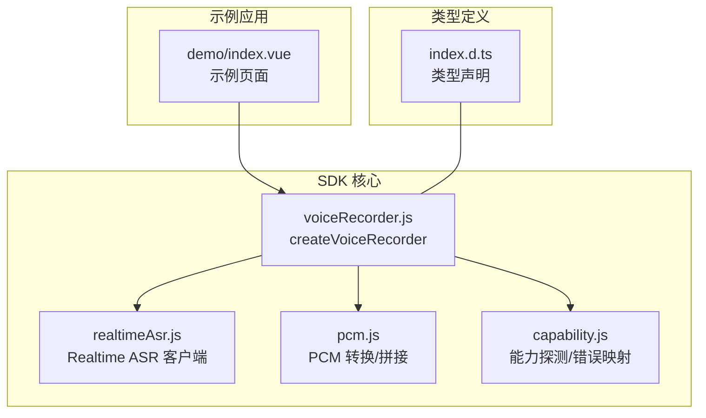
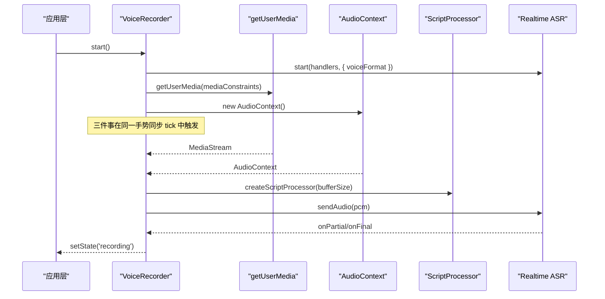
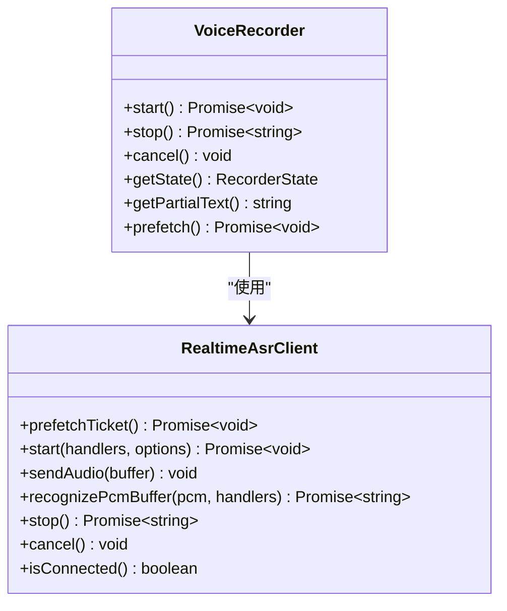
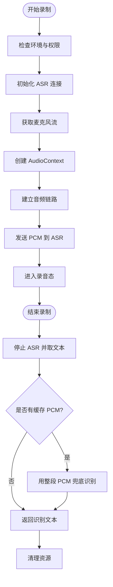
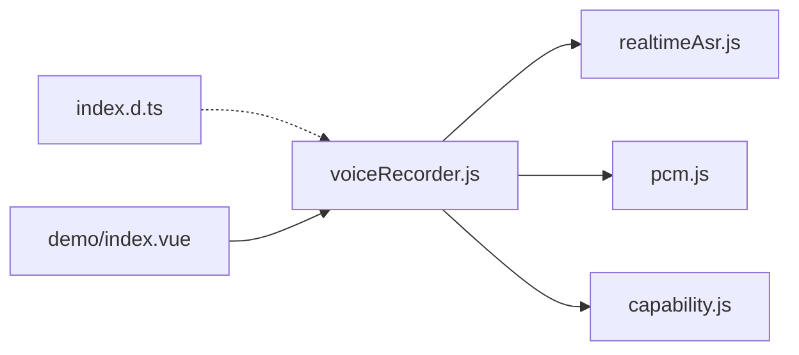
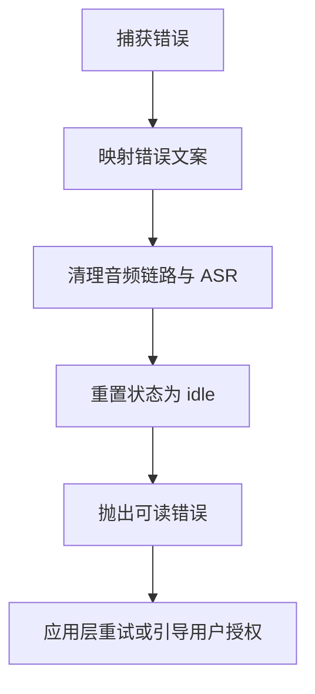

# 语音录制器 API

<cite>
**本文引用的文件**   
- [voiceRecorder.js](file://uni_modules/uni-web-voice-input/js_sdk/uni-web-voice/voiceRecorder.js)
- [index.d.ts](file://uni_modules/uni-web-voice-input/js_sdk/uni-web-voice/index.d.ts)
- [realtimeAsr.js](file://uni_modules/uni-web-voice-input/js_sdk/uni-web-voice/realtimeAsr.js)
- [pcm.js](file://uni_modules/uni-web-voice-input/js_sdk/uni-web-voice/pcm.js)
- [capability.js](file://uni_modules/uni-web-voice-input/js_sdk/uni-web-voice/capability.js)
- [index.vue](file://demo/src/pages/index/index.vue)
</cite>

## 目录
1. [简介](#简介)
2. [项目结构](#项目结构)
3. [核心组件](#核心组件)
4. [架构总览](#架构总览)
5. [详细组件分析](#详细组件分析)
6. [依赖关系分析](#依赖关系分析)
7. [性能与资源管理](#性能与资源管理)
8. [错误处理与异常恢复](#错误处理与异常恢复)
9. [使用示例与集成指南](#使用示例与集成指南)
10. [常见问题排查](#常见问题排查)
11. [结论](#结论)

## 简介
本文件为 `createVoiceRecorder` 方法的完整 API 文档，面向希望在浏览器、WebView 或 uni-app 环境中实现“按住说话”语音识别的开发者。该 API 封装了麦克风权限申请、Web Audio 音频采集、PCM 编码、实时语音识别（ASR）以及完整的录制生命周期管理，并提供状态监控、事件回调和错误处理机制。

## 项目结构
围绕 `createVoiceRecorder` 的核心代码位于 SDK 的 `js_sdk/uni-web-voice` 目录下：
- `voiceRecorder.js`：录制编排器，负责麦克风、AudioContext、ScriptProcessor、ASR 客户端协调。
- `realtimeAsr.js`：实时 ASR WebSocket 客户端。
- `pcm.js`：浮点 PCM 转 16k PCM16 与 PCM 片段拼接工具。
- `capability.js`：环境能力探测与麦克风阻塞原因描述。
- `index.d.ts`：TypeScript 类型定义，导出 `createVoiceRecorder` 及其参数、返回值、事件等类型。
- `demo/src/pages/index/index.vue`：演示页面，展示如何通过组件或 SDK 接入签名与事件。

**图表来源**
- [voiceRecorder.js:15-17](file://uni_modules/uni-web-voice-input/js_sdk/uni-web-voice/voiceRecorder.js#L15-L17)
- [index.d.ts:81-82](file://uni_modules/uni-web-voice-input/js_sdk/uni-web-voice/index.d.ts#L81-L82)
- [index.vue:34-40](file://demo/src/pages/index/index.vue#L34-L40)

**章节来源**
- [voiceRecorder.js:1-315](file://uni_modules/uni-web-voice-input/js_sdk/uni-web-voice/voiceRecorder.js#L1-L315)
- [index.d.ts:1-108](file://uni_modules/uni-web-voice-input/js_sdk/uni-web-voice/index.d.ts#L1-L108)
- [index.vue:1-138](file://demo/src/pages/index/index.vue#L1-L138)

## 核心组件
- `createVoiceRecorder(options)`：创建并返回一个录制器实例，提供 `start()`、`stop()`、`cancel()`、`getState()`、`getPartialText()`、`prefetch()` 等方法。
- `Realtime ASR 客户端`：通过 WebSocket 与远端 ASR 服务通信，支持流式发送 PCM、增量文本回调、最终文本回调与错误回调。
- `PCM 工具`：将 Web Audio 的 Float32 采样转换为 16kHz PCM16，并在需要时拼接多段 PCM 用于兜底识别。
- `能力探测`：检测当前环境是否支持录音、是否存在权限阻塞，并将底层错误映射为可读中文文案。

**章节来源**
- [voiceRecorder.js:19-41](file://uni_modules/uni-web-voice-input/js_sdk/uni-web-voice/voiceRecorder.js#L19-L41)
- [voiceRecorder.js:60-98](file://uni_modules/uni-web-voice-input/js_sdk/uni-web-voice/voiceRecorder.js#L60-L98)
- [index.d.ts:21-47](file://uni_modules/uni-web-voice-input/js_sdk/uni-web-voice/index.d.ts#L21-L47)

## 架构总览
`createVoiceRecorder` 在用户手势同步窗口内并发发起以下关键步骤：
1. 启动实时 ASR 连接（后台异步）。
2. 立即调用 `getUserMedia` 获取麦克风流。
3. 创建并尝试恢复 `AudioContext`。
4. 建立音频链路：MediaStream → ScriptProcessor → GainNode → Destination。
5. 在 `onaudioprocess` 中将 Float32 采样转为 16k PCM16，同时发送给 ASR 并缓存整段 PCM 作为兜底。
6. 等待 ASR 连接成功后进入录音态；若失败则抛出错误。

**图表来源**
- [voiceRecorder.js:156-240](file://uni_modules/uni-web-voice-input/js_sdk/uni-web-voice/voiceRecorder.js#L156-L240)
- [realtimeAsr.js:33-47](file://uni_modules/uni-web-voice-input/js_sdk/uni-web-voice/realtimeAsr.js#L33-L47)

## 详细组件分析

### createVoiceRecorder 方法
- 作用：创建语音录制器实例，统一管理麦克风、音频采集、PCM 编码与实时 ASR。
- 入口位置：[voiceRecorder.js:60-98](file://uni_modules/uni-web-voice-input/js_sdk/uni-web-voice/voiceRecorder.js#L60-L98)
- 返回值：`VoiceRecorder` 对象，包含 `start`、`stop`、`cancel`、`getState`、`getPartialText`、`prefetch`。

#### 配置参数（options）
| 参数 | 类型 | 默认值 | 说明 |
|---|---|---:|---|
| `fetchSign` | `() => Promise<AsrSignResult>` | 必填 | 返回已签名的 WSS URL 等 ASR 连接信息 |
| `handlers` | `VoiceRecorderHandlers` | `{}` | 事件回调集合，包括 `onPartial`、`onFinal`、`onError`、`onStateChange` |
| `voiceFormat` | `number` | `1` | ASR 编码格式，默认 1 表示 16k PCM16（腾讯云） |
| `targetSampleRate` | `number` | `16000` | PCM 目标采样率 |
| `bufferSize` | `number` | `4096` | ScriptProcessor 缓冲帧大小 |
| `minDurationMs` | `number` | `600` | 小于该时长判定为“说得太短”，会拒绝并提示重试 |
| `mediaConstraints` | `MediaStreamConstraints` | `{ audio: { channelCount: 1, echoCancellation: true, noiseSuppression: true } }` | 麦克风约束，控制声道数、回声消除、降噪等 |
| `debug` | `boolean` | `false` | 是否开启调试日志 |
| `WebSocketImpl` | `typeof WebSocket` | 未设置 | 可注入自定义 WebSocket（如 App 端） |
| `_win` / `_nav` | `Window` / `Navigator` | 自动获取 | 注入以便测试或非标准环境 |

**章节来源**
- [voiceRecorder.js:47-71](file://uni_modules/uni-web-voice-input/js_sdk/uni-web-voice/voiceRecorder.js#L47-L71)
- [index.d.ts:53-69](file://uni_modules/uni-web-voice-input/js_sdk/uni-web-voice/index.d.ts#L53-L69)

#### 生命周期方法
- `start()`
  - 行为：在用户手势同步窗口内并发初始化 ASR、麦克风与音频上下文；ASR 连上后进入录音态。
  - 注意：必须在按下按钮的同步代码中直接调用，不要插入 await。
  - 返回：Promise<void>，成功时 resolve。
  - 参考路径：[voiceRecorder.js:152-240](file://uni_modules/uni-web-voice-input/js_sdk/uni-web-voice/voiceRecorder.js#L152-L240)
- `stop()`
  - 行为：停止 ASR、收集最终文本；若无文本且存在缓存 PCM，则用整段 PCM 进行兜底识别。
  - 返回：Promise<string>，识别文本；无内容或太短会 reject。
  - 参考路径：[voiceRecorder.js:242-295](file://uni_modules/uni-web-voice-input/js_sdk/uni-web-voice/voiceRecorder.js#L242-L295)
- `cancel()`
  - 行为：主动取消录制，清理音频链路与 ASR 连接，状态置为 canceled。
  - 返回：void。
  - 参考路径：[voiceRecorder.js:297-303](file://uni_modules/uni-web-voice-input/js_sdk/uni-web-voice/voiceRecorder.js#L297-L303)
- `getState()`
  - 行为：返回当前录制状态。
  - 返回：`RecorderState`。
  - 参考路径：[voiceRecorder.js:305-313](file://uni_modules/uni-web-voice-input/js_sdk/uni-web-voice/voiceRecorder.js#L305-L313)
- `getPartialText()`
  - 行为：返回最近一次部分或最终文本。
  - 返回：string。
  - 参考路径：[voiceRecorder.js:305-313](file://uni_modules/uni-web-voice-input/js_sdk/uni-web-voice/voiceRecorder.js#L305-L313)
- `prefetch()`
  - 行为：预热 ASR 签名，减少首次按下等待。
  - 返回：Promise<void>。
  - 参考路径：[voiceRecorder.js:305-313](file://uni_modules/uni-web-voice-input/js_sdk/uni-web-voice/voiceRecorder.js#L305-L313)

#### 录制状态
- 状态枚举：`idle`、`preparing`、`recording`、`recognizing`、`canceled`。
- 状态变更回调：`handlers.onStateChange(state)`。
- 参考路径：
  - 类型定义：[index.d.ts:3-8](file://uni_modules/uni-web-voice-input/js_sdk/uni-web-voice/index.d.ts#L3-L8)
  - 内部状态机：[voiceRecorder.js:83-98](file://uni_modules/uni-web-voice-input/js_sdk/uni-web-voice/voiceRecorder.js#L83-L98)

#### 事件回调
- `onPartial(text)`：实时增量文本。
- `onFinal(text)`：最终识别文本。
- `onError(message)`：ASR 或系统错误消息。
- `onStateChange(state)`：录制状态变化。
- 参考路径：
  - 类型定义：[index.d.ts:21-25](file://uni_modules/uni-web-voice-input/js_sdk/uni-web-voice/index.d.ts#L21-L25)
  - 内部转发：[voiceRecorder.js:100-114](file://uni_modules/uni-web-voice-input/js_sdk/uni-web-voice/voiceRecorder.js#L100-L114)

#### 返回值对象与方法属性
- `start()`：开始录制。
- `stop()`：结束录制并返回识别文本。
- `cancel()`：取消录制。
- `getState()`：获取当前状态。
- `getPartialText()`：获取最近文本。
- `prefetch()`：预热签名。
- 参考路径：[index.d.ts:71-79](file://uni_modules/uni-web-voice-input/js_sdk/uni-web-voice/index.d.ts#L71-L79)

**图表来源**
- [index.d.ts:33-47](file://uni_modules/uni-web-voice-input/js_sdk/uni-web-voice/index.d.ts#L33-L47)
- [index.d.ts:71-79](file://uni_modules/uni-web-voice-input/js_sdk/uni-web-voice/index.d.ts#L71-L79)

**章节来源**
- [voiceRecorder.js:152-313](file://uni_modules/uni-web-voice-input/js_sdk/uni-web-voice/voiceRecorder.js#L152-L313)
- [index.d.ts:3-8](file://uni_modules/uni-web-voice-input/js_sdk/uni-web-voice/index.d.ts#L3-L8)
- [index.d.ts:21-25](file://uni_modules/uni-web-voice-input/js_sdk/uni-web-voice/index.d.ts#L21-L25)
- [index.d.ts:71-79](file://uni_modules/uni-web-voice-input/js_sdk/uni-web-voice/index.d.ts#L71-L79)

### 麦克风权限与环境处理
- 权限请求：通过 `navigator.mediaDevices.getUserMedia(mediaConstraints)` 获取麦克风流。
- 权限被拒/设备占用/约束不满足：统一映射为可读中文错误文案。
- 环境检测：检测 `window`、`navigator`、`AudioContext`、`WebSocket` 等可用性。
- 参考路径：
  - 错误映射：[voiceRecorder.js:19-41](file://uni_modules/uni-web-voice-input/js_sdk/uni-web-voice/voiceRecorder.js#L19-L41)
  - 环境检查与初始化：[voiceRecorder.js:73-75](file://uni_modules/uni-web-voice-input/js_sdk/uni-web-voice/voiceRecorder.js#L73-L75)
  - 权限捕获与清理：[voiceRecorder.js:179-187](file://uni_modules/uni-web-voice-input/js_sdk/uni-web-voice/voiceRecorder.js#L179-L187)

**章节来源**
- [voiceRecorder.js:19-41](file://uni_modules/uni-web-voice-input/js_sdk/uni-web-voice/voiceRecorder.js#L19-L41)
- [voiceRecorder.js:73-75](file://uni_modules/uni-web-voice-input/js_sdk/uni-web-voice/voiceRecorder.js#L73-L75)
- [voiceRecorder.js:179-187](file://uni_modules/uni-web-voice-input/js_sdk/uni-web-voice/voiceRecorder.js#L179-L187)

### 音频格式与采样率
- 输入：Web Audio 的 Float32 采样。
- 转换：`floatToPcm16k(input, rate, targetSampleRate)` 输出 16k PCM16。
- 目标采样率：可通过 `targetSampleRate` 配置，默认 16000。
- 参考路径：
  - PCM 转换调用：[voiceRecorder.js:208-224](file://uni_modules/uni-web-voice-input/js_sdk/uni-web-voice/voiceRecorder.js#L208-L224)
  - 类型定义：[index.d.ts:102-106](file://uni_modules/uni-web-voice-input/js_sdk/uni-web-voice/index.d.ts#L102-L106)

**章节来源**
- [voiceRecorder.js:208-224](file://uni_modules/uni-web-voice-input/js_sdk/uni-web-voice/voiceRecorder.js#L208-L224)
- [index.d.ts:102-106](file://uni_modules/uni-web-voice-input/js_sdk/uni-web-voice/index.d.ts#L102-L106)

### 录制流程时序图

**图表来源**
- [voiceRecorder.js:156-295](file://uni_modules/uni-web-voice-input/js_sdk/uni-web-voice/voiceRecorder.js#L156-L295)

## 依赖关系分析
- `voiceRecorder.js` 依赖：
  - `realtimeAsr.js`：提供实时 ASR 客户端。
  - `pcm.js`：提供 PCM 转换与拼接。
  - `capability.js`：提供麦克风阻塞原因描述。
- `index.d.ts` 提供 TypeScript 类型定义，确保类型安全。
- 示例页面 `index.vue` 展示了如何注入签名与监听事件。

**图表来源**
- [voiceRecorder.js:15-17](file://uni_modules/uni-web-voice-input/js_sdk/uni-web-voice/voiceRecorder.js#L15-L17)
- [index.d.ts:81-82](file://uni_modules/uni-web-voice-input/js_sdk/uni-web-voice/index.d.ts#L81-L82)
- [index.vue:34-40](file://demo/src/pages/index/index.vue#L34-L40)

**章节来源**
- [voiceRecorder.js:15-17](file://uni_modules/uni-web-voice-input/js_sdk/uni-web-voice/voiceRecorder.js#L15-L17)
- [index.d.ts:81-82](file://uni_modules/uni-web-voice-input/js_sdk/uni-web-voice/index.d.ts#L81-L82)
- [index.vue:34-40](file://demo/src/pages/index/index.vue#L34-L40)

## 性能与资源管理
- 音频链路：使用 `ScriptProcessor` 以固定缓冲帧大小（默认 4096）采集音频，避免频繁 GC。
- PCM 缓存：最多缓存 400 段 PCM 片段，用于兜底识别，防止内存无限增长。
- 资源清理：`teardownAudio()` 统一断开节点、关闭 `AudioContext`、释放 `MediaStream`。
- 建议：
  - 合理设置 `bufferSize`，平衡延迟与 CPU 占用。
  - 在长时间录制场景中，关注 PCM 缓存上限与内存占用。
  - 使用 `prefetch()` 预热签名，降低首次按下延迟。

**章节来源**
- [voiceRecorder.js:116-150](file://uni_modules/uni-web-voice-input/js_sdk/uni-web-voice/voiceRecorder.js#L116-L150)
- [voiceRecorder.js:208-224](file://uni_modules/uni-web-voice-input/js_sdk/uni-web-voice/voiceRecorder.js#L208-L224)
- [voiceRecorder.js:305-313](file://uni_modules/uni-web-voice-input/js_sdk/uni-web-voice/voiceRecorder.js#L305-L313)

## 错误处理与异常恢复
- 麦克风错误映射：
  - 权限被拒：提示“麦克风权限被拒绝”。
  - 设备不存在：提示“未检测到麦克风设备”。
  - 设备占用：提示“麦克风被其它应用占用”。
  - 约束不满足：提示“当前设备不支持所需录音参数”。
- 录制过短或未识别：
  - 小于 `minDurationMs` 且无文本：抛出“录音时间太短，请按住说话”。
  - 未采集到音频：抛出“未采集到音频，请确认麦克风权限后重试”。
  - 未识别到内容：抛出“未识别到内容，请靠近麦克风再说一次”。
- 恢复策略：
  - 捕获错误后清理资源并重置状态。
  - 使用兜底 PCM 识别提升成功率。
  - 通过 `handlers.onError` 向应用层上报错误。

**图表来源**
- [voiceRecorder.js:19-41](file://uni_modules/uni-web-voice-input/js_sdk/uni-web-voice/voiceRecorder.js#L19-L41)
- [voiceRecorder.js:179-187](file://uni_modules/uni-web-voice-input/js_sdk/uni-web-voice/voiceRecorder.js#L179-L187)
- [voiceRecorder.js:256-295](file://uni_modules/uni-web-voice-input/js_sdk/uni-web-voice/voiceRecorder.js#L256-L295)

**章节来源**
- [voiceRecorder.js:19-41](file://uni_modules/uni-web-voice-input/js_sdk/uni-web-voice/voiceRecorder.js#L19-L41)
- [voiceRecorder.js:179-187](file://uni_modules/uni-web-voice-input/js_sdk/uni-web-voice/voiceRecorder.js#L179-L187)
- [voiceRecorder.js:256-295](file://uni_modules/uni-web-voice-input/js_sdk/uni-web-voice/voiceRecorder.js#L256-L295)

## 使用示例与集成指南
- 组件用法：在 uni-app 中直接使用 `<uni-web-voice-input>` 组件，传入签名函数与事件回调。
- SDK 用法：直接引入 `createVoiceRecorder`，手动管理生命周期与事件。
- 签名注入：通过 `fetchSign` 返回包含 `url` 的签名对象，确保 HTTPS 与安全上下文。
- 事件监听：监听 `result`、`partial`、`error`、`state` 等事件，更新 UI 与业务逻辑。

参考路径：
- 组件示例：[index.vue:16-24](file://demo/src/pages/index/index.vue#L16-L24)
- 签名注入与错误处理：[index.vue:59-83](file://demo/src/pages/index/index.vue#L59-L83)

**章节来源**
- [index.vue:16-24](file://demo/src/pages/index/index.vue#L16-L24)
- [index.vue:59-83](file://demo/src/pages/index/index.vue#L59-L83)

## 常见问题排查
- 鸿蒙 WebView 不弹权限框：
  - 确保 `start()` 在用户手势同步窗口内调用。
  - 宿主 WebView 需声明麦克风权限并转发 `onPermissionRequest`。
  - 页面必须为 HTTPS。
- 有权限但零 PCM：
  - 检查 `AudioContext.state`，必要时显式 `resume()`。
- 实时 ASR 未连上：
  - 检查签名接口返回的 `url` 是否正确。
  - 使用兜底 PCM 识别提升成功率。
- 录音时间太短：
  - 调整 `minDurationMs` 或引导用户长按更久。

**章节来源**
- [voiceRecorder.js:152-178](file://uni_modules/uni-web-voice-input/js_sdk/uni-web-voice/voiceRecorder.js#L152-L178)
- [voiceRecorder.js:195-201](file://uni_modules/uni-web-voice-input/js_sdk/uni-web-voice/voiceRecorder.js#L195-L201)
- [voiceRecorder.js:256-295](file://uni_modules/uni-web-voice-input/js_sdk/uni-web-voice/voiceRecorder.js#L256-L295)

## 结论
`createVoiceRecorder` 提供了从麦克风权限、音频采集、PCM 编码到实时 ASR 的一站式解决方案。通过合理的配置参数、清晰的生命周期方法与完善的事件回调，开发者可以在多种环境中快速集成语音录制与识别功能。结合错误处理与异常恢复机制，能够显著提升用户体验与系统稳定性。