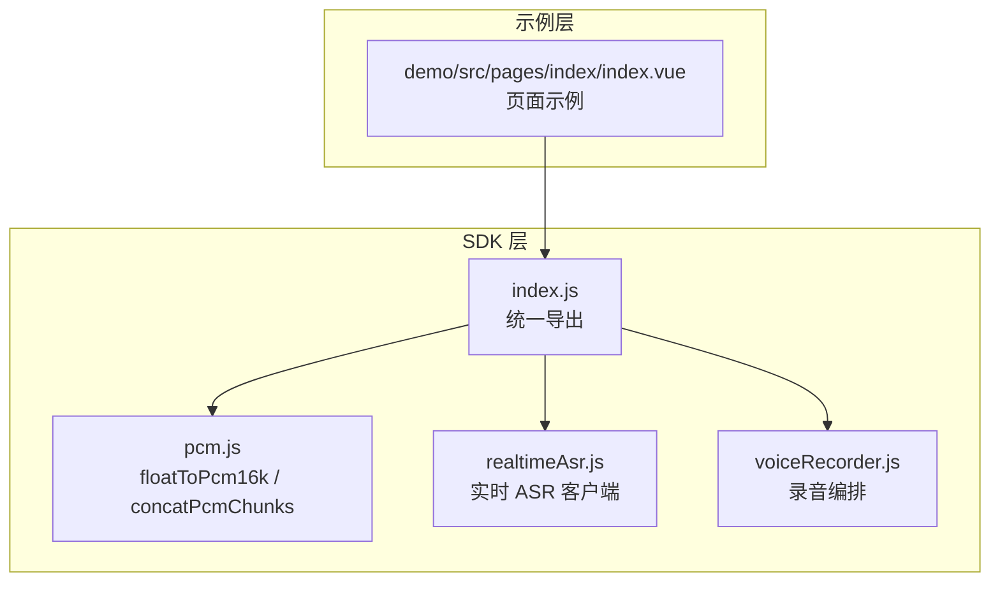
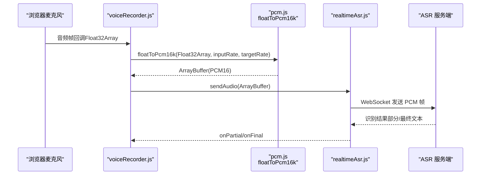
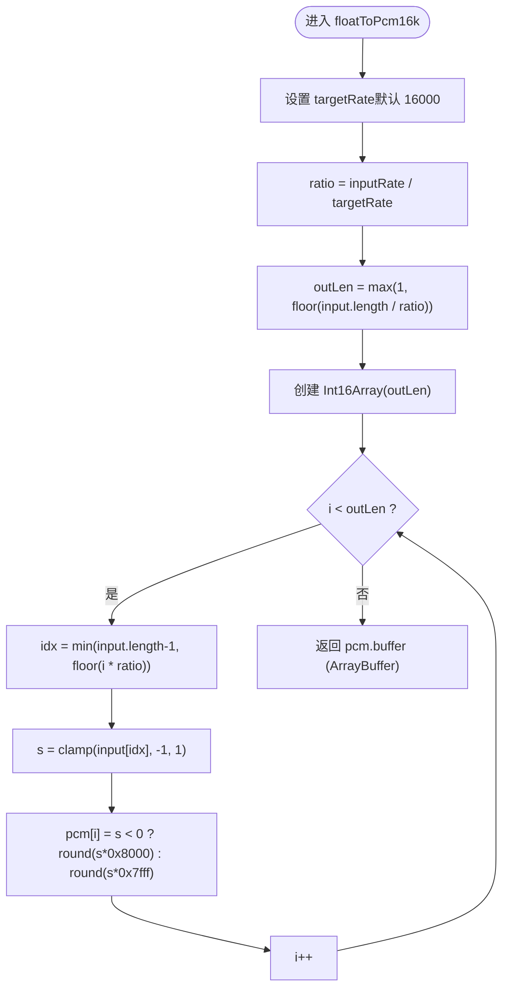
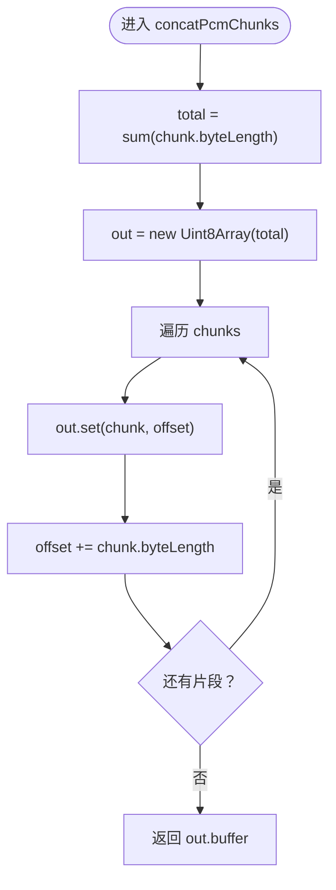
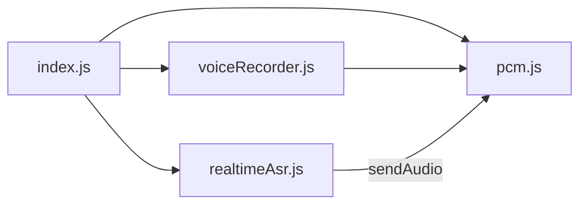

# 音频处理工具 API

<cite>
**本文引用的文件**   
- [pcm.js](file://uni_modules/uni-web-voice-input/js_sdk/uni-web-voice/pcm.js)
- [index.js](file://uni_modules/uni-web-voice-input/js_sdk/uni-web-voice/index.js)
- [index.d.ts](file://uni_modules/uni-web-voice-input/js_sdk/uni-web-voice/index.d.ts)
- [realtimeAsr.js](file://uni_modules/uni-web-voice-input/js_sdk/uni-web-voice/realtimeAsr.js)
- [voiceRecorder.js](file://uni_modules/uni-web-voice-input/js_sdk/uni-web-voice/voiceRecorder.js)
- [index.vue](file://demo/src/pages/index/index.vue)
</cite>

## 目录
1. [简介](#简介)
2. [项目结构](#项目结构)
3. [核心组件](#核心组件)
4. [架构总览](#架构总览)
5. [详细组件分析](#详细组件分析)
6. [依赖关系分析](#依赖关系分析)
7. [性能与内存优化](#性能与内存优化)
8. [故障排查指南](#故障排查指南)
9. [结论](#结论)
10. [附录：使用示例与集成要点](#附录使用示例与集成要点)

## 简介
本文件面向“音频处理工具函数”的 API 文档，聚焦以下两个关键函数：
- floatToPcm16k()：将 Web Audio 的 Float32Array 采样转换为 PCM16（默认 16kHz、单声道），支持目标采样率配置。
- concatPcmChunks()：将多个 PCM 数据片段拼接为一个 ArrayBuffer，用于整段兜底识别或批量传输。

文档涵盖参数说明、返回值格式、技术细节（采样率、位深度、对齐）、性能特点、内存管理策略，以及与语音录制和实时识别模块的集成方式。

## 项目结构
该仓库为 uni-app 插件工程，SDK 位于 uni_modules/uni-web-voice-input/js_sdk/uni-web-voice/ 下。其中 pcm.js 提供音频格式转换与 PCM 拼接能力；index.js 作为统一导出入口；index.d.ts 提供类型声明；realtimeAsr.js 与 voiceRecorder.js 分别负责实时识别与录音编排。

图表来源
- [index.js:6-17](file://uni_modules/uni-web-voice-input/js_sdk/uni-web-voice/index.js#L6-L17)
- [index.vue:34-39](file://demo/src/pages/index/index.vue#L34-L39)

章节来源
- [index.js:1-18](file://uni_modules/uni-web-voice-input/js_sdk/uni-web-voice/index.js#L1-L18)
- [index.vue:34-39](file://demo/src/pages/index/index.vue#L34-L39)

## 核心组件
本节聚焦两个工具函数的 API 定义、行为与约束。

### floatToPcm16k(input, inputRate, targetRate?)
- 功能：线性重采样 + Float32 → Int16，输出小端 PCM16 字节流。
- 参数
  - input: Float32Array，麦克风原始采样（单声道）。
  - inputRate: number，AudioContext 实际采样率（如 44100/48000）。
  - targetRate?: number，可选，目标输出采样率；缺省为 16000。
- 返回值：ArrayBuffer，PCM16 小端字节序列。
- 行为要点
  - 按 ratio = inputRate / targetRate 进行线性插值索引。
  - 对每个输出样本做 [-1, 1] 范围裁剪后映射到 Int16 区间。
  - 输出长度 outLen = floor(input.length / ratio)，至少为 1。
- 复杂度
  - 时间 O(N/ratio)，空间 O(N/ratio)。
- 适用场景
  - 与腾讯云实时语音识别 voice_format=1（16k, 16bit, mono）对齐。
  - 需要自定义目标采样率的场景。

章节来源
- [pcm.js:6-24](file://uni_modules/uni-web-voice-input/js_sdk/uni-web-voice/pcm.js#L6-L24)
- [index.d.ts:102-106](file://uni_modules/uni-web-voice-input/js_sdk/uni-web-voice/index.d.ts#L102-L106)

### concatPcmChunks(chunks)
- 功能：将多个 Uint8Array 分片拼接为单个 ArrayBuffer。
- 参数
  - chunks: Uint8Array[]，待拼接的 PCM 数据片段数组。
- 返回值：ArrayBuffer，拼接后的完整 PCM 字节流。
- 行为要点
  - 先计算总字节数 total = Σ chunk.byteLength。
  - 分配一次 Uint8Array(total)，再顺序 set 各片段。
  - 返回底层 buffer，避免额外拷贝。
- 复杂度
  - 时间 O(TotalBytes)，空间 O(TotalBytes)。
- 适用场景
  - 整段兜底识别、批量上传、断点续传等需要一次性处理的场景。

章节来源
- [pcm.js:26-36](file://uni_modules/uni-web-voice-input/js_sdk/uni-web-voice/pcm.js#L26-L36)
- [index.d.ts:107-107](file://uni_modules/uni-web-voice-input/js_sdk/uni-web-voice/index.d.ts#L107-L107)

## 架构总览
下图展示从浏览器麦克风采集到 PCM 转换、拼接，再到实时识别的数据流转。

图表来源
- [voiceRecorder.js](file://uni_modules/uni-web-voice-input/js_sdk/uni-web-voice/voiceRecorder.js)
- [pcm.js:13-24](file://uni_modules/uni-web-voice-input/js_sdk/uni-web-voice/pcm.js#L13-L24)
- [realtimeAsr.js](file://uni_modules/uni-web-voice-input/js_sdk/uni-web-voice/realtimeAsr.js)

## 详细组件分析

### floatToPcm16k 算法流程
该函数实现线性重采样与位深转换，流程如下：

图表来源
- [pcm.js:13-24](file://uni_modules/uni-web-voice-input/js_sdk/uni-web-voice/pcm.js#L13-L24)

章节来源
- [pcm.js:6-24](file://uni_modules/uni-web-voice-input/js_sdk/uni-web-voice/pcm.js#L6-L24)

### concatPcmChunks 拼接流程

图表来源
- [pcm.js:27-35](file://uni_modules/uni-web-voice-input/js_sdk/uni-web-voice/pcm.js#L27-L35)

章节来源
- [pcm.js:26-36](file://uni_modules/uni-web-voice-input/js_sdk/uni-web-voice/pcm.js#L26-L36)

## 依赖关系分析
- index.js 统一导出 pcm.js 的两个函数，供上层组件与业务代码使用。
- realtimeAsr.js 通过 sendAudio 接收 PCM 数据并发送到服务端。
- voiceRecorder.js 在录音过程中调用 floatToPcm16k 完成格式转换，并将结果送入 ASR 客户端。

图表来源
- [index.js:6-17](file://uni_modules/uni-web-voice-input/js_sdk/uni-web-voice/index.js#L6-L17)

章节来源
- [index.js:1-18](file://uni_modules/uni-web-voice-input/js_sdk/uni-web-voice/index.js#L1-L18)

## 性能与内存优化
- 采样率与位深
  - 线性重采样简单高效，适合实时场景；如需更高音质可替换为更高质量的重采样器。
  - 位深转换采用裁剪+缩放至 Int16 区间，避免溢出。
- 时间与空间复杂度
  - floatToPcm16k：O(N/ratio) 时间，O(N/rudio) 空间。
  - concatPcmChunks：O(TotalBytes) 时间，O(TotalBytes) 空间。
- 内存优化建议
  - 优先复用 Int16Array/Uint8Array 缓冲区，减少频繁分配。
  - 对于长语音，分段处理并限制最大拼接长度，避免一次性大对象导致 GC 抖动。
  - 使用 concatPcmChunks 时，确保传入的 chunks 均为 Uint8Array，避免类型不一致导致的额外拷贝。
- 实时性建议
  - 控制每帧输入长度，保持 ratio 稳定，避免动态变化引起重采样抖动。
  - 在网络不稳定时，结合缓冲队列与丢帧策略，保证低延迟。

[本节为通用性能讨论，不直接分析具体文件]

## 故障排查指南
- 采样率不匹配
  - 现象：识别结果异常或卡顿。
  - 排查：确认 inputRate 与 targetRate 设置正确；若 targetRate 未传，默认为 16000。
- 音量过小或削波
  - 现象：声音太小或出现爆音。
  - 排查：检查前端增益与 clipping；floatToPcm16k 内部已做 [-1, 1] 裁剪。
- 拼接错位或乱码
  - 现象：整段识别失败或乱码。
  - 排查：确保所有 chunks 为同一种 PCM 格式（16kHz、16bit、mono）且顺序一致。
- 内存占用过高
  - 现象：长时间录音后内存飙升。
  - 排查：避免无限累积 chunks；及时释放不再使用的 ArrayBuffer 引用。

章节来源
- [pcm.js:13-24](file://uni_modules/uni-web-voice-input/js_sdk/uni-web-voice/pcm.js#L13-L24)
- [pcm.js:27-35](file://uni_modules/uni-web-voice-input/js_sdk/uni-web-voice/pcm.js#L27-L35)

## 结论
floatToPcm16k 与 concatPcmChunks 提供了轻量、高效的音频格式转换与数据拼接能力，适配主流实时语音识别服务（如腾讯云 voice_format=1）。通过合理的采样率配置、缓冲区复用与分段策略，可在保证实时性的同时降低内存峰值与 GC 压力。

[本节为总结性内容，不直接分析具体文件]

## 附录：使用示例与集成要点

### 在语音录制中使用 floatToPcm16k
- 典型流程
  - 从麦克风回调获取 Float32Array 帧。
  - 调用 floatToPcm16k 转换为 PCM16 ArrayBuffer。
  - 将 ArrayBuffer 传给 ASR 客户端进行实时识别。
- 关键点
  - 传入正确的 inputRate（AudioContext.sampleRate）。
  - 根据后端要求设置 targetRate（通常为 16000）。
  - 将返回的 ArrayBuffer 直接用于 sendAudio。

章节来源
- [pcm.js:13-24](file://uni_modules/uni-web-voice-input/js_sdk/uni-web-voice/pcm.js#L13-L24)
- [index.d.ts:102-106](file://uni_modules/uni-web-voice-input/js_sdk/uni-web-voice/index.d.ts#L102-L106)

### 在整段兜底识别中使用 concatPcmChunks
- 典型流程
  - 在录音过程中收集多段 PCM 片段（Uint8Array）。
  - 结束时调用 concatPcmChunks 拼接为完整 ArrayBuffer。
  - 将该 ArrayBuffer 发送给 ASR 服务端进行整段识别。
- 关键点
  - 确保所有片段格式一致（采样率、位深、声道数）。
  - 合理控制单次拼接的最大长度，避免过大对象。

章节来源
- [pcm.js:27-35](file://uni_modules/uni-web-voice-input/js_sdk/uni-web-voice/pcm.js#L27-L35)
- [index.d.ts:107-107](file://uni_modules/uni-web-voice-input/js_sdk/uni-web-voice/index.d.ts#L107-L107)

### 与 SDK 其他模块的集成
- 统一入口
  - 通过 index.js 暴露 floatToPcm16k 与 concatPcmChunks，便于在业务层直接引入。
- 与实时识别集成
  - realtimeAsr.js 提供 sendAudio 接口，可直接消费 PCM16 ArrayBuffer。
- 与录音编排集成
  - voiceRecorder.js 在录音回调中完成 Float32 → PCM16 转换，并驱动 ASR 客户端。

章节来源
- [index.js:6-17](file://uni_modules/uni-web-voice-input/js_sdk/uni-web-voice/index.js#L6-L17)
- [index.d.ts:33-47](file://uni_modules/uni-web-voice-input/js_sdk/uni-web-voice/index.d.ts#L33-L47)

### 页面示例中的使用位置
- demo/src/pages/index/index.vue 展示了如何引入 SDK 并使用组件进行语音输入；工具函数可通过 SDK 统一入口间接使用。

章节来源
- [index.vue:34-39](file://demo/src/pages/index/index.vue#L34-L39)