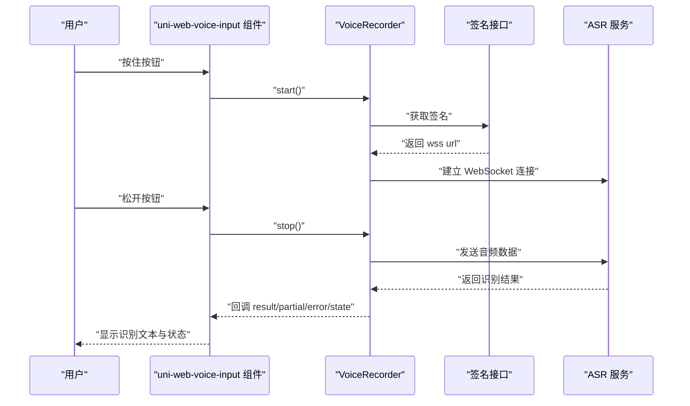

# 快速开始

<cite>
**本文引用的文件**   
- [README.md](file://README.md)
- [package.json](file://package.json)
- [uni_modules/uni-web-voice-input/package.json](file://uni_modules/uni-web-voice-input/package.json)
- [uni_modules/uni-web-voice-input/readme.md](file://uni_modules/uni-web-voice-input/readme.md)
- [uni_modules/uni-web-voice-input/components/uni-web-voice-input/uni-web-voice-input.vue](file://uni_modules/uni-web-voice-input/components/uni-web-voice-input/uni-web-voice-input.vue)
- [uni_modules/uni-web-voice-input/js_sdk/uni-web-voice/index.js](file://uni_modules/uni-web-voice-input/js_sdk/uni-web-voice/index.js)
- [uni_modules/uni-web-voice-input/js_sdk/uni-web-voice/capability.js](file://uni_modules/uni-web-voice-input/js_sdk/uni-web-voice/capability.js)
- [demo/src/pages/index/index.vue](file://demo/src/pages/index/index.vue)
- [examples/demo/demo.vue](file://examples/demo/demo.vue)
</cite>

## 目录
1. [简介](#简介)
2. [安装方式](#安装方式)
3. [基础使用示例](#基础使用示例)
4. [配置选项与回调](#配置选项与回调)
5. [前置条件与环境要求](#前置条件与环境要求)
6. [从简单到自定义的完整流程](#从简单到自定义的完整流程)
7. [常见问题排查](#常见问题排查)
8. [架构与数据流概览](#架构与数据流概览)
9. [结论](#结论)

## 简介
`uni-web-voice-input` 是一个基于纯 Web 能力的跨端语音输入组件与 SDK，核心目标是让「H5 页面被各端 WebView 内嵌」的场景也能正常使用麦克风、按住说话并实时出字。它通过 `getUserMedia` + Web Audio 采集音频，再通过 WebSocket 直连 ASR 服务；ASR 签名以 `getSign` / `signUrl` / `fetchSign` 注入，不绑定具体后端或厂商密钥。

该插件同时提供：
- uni_modules 组件用法：在模板中直接使用 `<uni-web-voice-input>`。
- npm SDK 用法：直接调用录音与识别编排逻辑，自行实现 UI。

**章节来源**
- [README.md:1-15](file://README.md#L1-L15)
- [uni_modules/uni-web-voice-input/readme.md:1-10](file://uni_modules/uni-web-voice-input/readme.md#L1-L10)

## 安装方式
你可以选择以下三种方式之一完成安装。

### 方式一：通过 DCloud 插件市场导入（推荐）
- 在 HBuilderX 中打开插件页面，使用「使用 HBuilderX 导入插件」。
- 插件会自动放入项目的 `uni_modules/uni-web-voice-input/`。
- uni_modules 组件为免注册，直接在模板中使用 `<uni-web-voice-input />` 即可。

适用场景：
- 你希望直接用现成组件，少写样板代码。
- 你在 uni-app 工程中使用，且希望通过插件市场统一管理依赖。

**章节来源**
- [uni_modules/uni-web-voice-input/readme.md:32-36](file://uni_modules/uni-web-voice-input/readme.md#L32-L36)
- [uni_modules/uni-web-voice-input/package.json:17-30](file://uni_modules/uni-web-voice-input/package.json#L17-L30)

### 方式二：通过 npm 安装
```bash
npm i uni-web-voice-input
```

安装后：
- 如果只使用脚本 SDK，可以直接从包名引入。
- 如果使用组件，需要把 `uni_modules/uni-web-voice-input` 整个目录拷贝到你项目的 `uni_modules/` 下，以便 uni-app 正确解析组件路径。

适用场景：
- 你更习惯用 npm 管理依赖。
- 你想复用 SDK 能力，但自己封装 UI。

**章节来源**
- [uni_modules/uni-web-voice-input/readme.md:37-46](file://uni_modules/uni-web-voice-input/readme.md#L37-L46)
- [package.json:22-30](file://package.json#L22-L30)

### 方式三：手动拷贝
- 下载本仓库。
- 将 `uni_modules/uni-web-voice-input` 整个目录拷贝到项目的 `uni_modules/` 下。

适用场景：
- 你不想走 npm 或插件市场。
- 你需要完全控制源码版本。

**章节来源**
- [uni_modules/uni-web-voice-input/readme.md:47-48](file://uni_modules/uni-web-voice-input/readme.md#L47-L48)

## 基础使用示例
下面给出两个可直接参考的示例：一个是组件最小用法，一个是带签名接口和回调的完整示例。

### 示例一：最简组件用法
如果你已经有一个可返回签名的后端接口，可以直接传入 `sign-url`：

- 在页面模板中引入组件标签。
- 传入 `sign-url`。
- 监听 `result`、`error`、`state` 等事件。

参考示例文件：
- [examples/demo/demo.vue:10-12](file://examples/demo/demo.vue#L10-L12)
- [examples/demo/demo.vue:18-26](file://examples/demo/demo.vue#L18-L26)

这个示例适合快速验证：只要你的签名接口能返回包含 `url` 的对象，就能在真机上看到松手出字效果。

### 示例二：带签名注入与多回调的完整示例
更推荐的写法是通过 `get-sign` 注入签名，这样可以：
- 先做权限探测。
- 统一处理请求失败、响应格式异常。
- 同时接收最终结果、实时中间结果、状态变化、错误信息。

参考示例文件：
- [demo/src/pages/index/index.vue:16-24](file://demo/src/pages/index/index.vue#L16-L24)
- [demo/src/pages/index/index.vue:59-83](file://demo/src/pages/index/index.vue#L59-L83)

在这个示例中：
- `getSign` 负责调用你的签名接口。
- `onResult` 接收最终识别文本。
- `onPartial` 接收实时识别文本。
- `onError` 用于提示用户。
- `onState` 用于显示空闲、准备中、录音中、识别中等状态。

**章节来源**
- [examples/demo/demo.vue:10-26](file://examples/demo/demo.vue#L10-L26)
- [demo/src/pages/index/index.vue:16-83](file://demo/src/pages/index/index.vue#L16-L83)

## 配置选项与回调
组件支持多种配置项，帮助你适配不同后端协议、交互体验与调试需求。

### 常用属性
| 名称 | 类型 | 默认值 | 说明 |
| --- | --- | --- | --- |
| `getSign` | Function | 无 | 优先使用的签名注入函数，返回包含 `url` 的对象 |
| `signUrl` | String | 无 | 直接传入一个 GET 地址，组件会自动获取并解析签名 |
| `voiceFormat` | Number | `1` | ASR 编码格式，默认兼容腾讯云 `voice_format=1` |
| `cancelThreshold` | Number | `80` | 上滑取消的像素阈值 |
| `debug` | Boolean | `false` | 是否打印签名与 ASR 相关调试日志 |
| `autoRequestAndroidPermission` | Boolean | `true` | 安卓 App-plus 环境是否在挂载时尝试申请录音权限 |

参考位置：
- [uni_modules/uni-web-voice-input/components/uni-web-voice-input/uni-web-voice-input.vue:46-57](file://uni_modules/uni-web-voice-input/components/uni-web-voice-input/uni-web-voice-input.vue#L46-L57)
- [uni_modules/uni-web-voice-input/readme.md:118-127](file://uni_modules/uni-web-voice-input/readme.md#L118-L127)

### 常用事件
| 名称 | 回调参数 | 说明 |
| --- | --- | --- |
| `result` | `text` | 松手后的最终识别文本 |
| `partial` | `text` | 实时中间识别文本 |
| `error` | `message` | 出错时的可读文案，例如权限不足、太短、无内容、额度问题等 |
| `state` | `state` | 状态机值：`idle`、`preparing`、`recording`、`recognizing`、`canceled` |

参考位置：
- [uni_modules/uni-web-voice-input/readme.md:128-134](file://uni_modules/uni-web-voice-input/readme.md#L128-L134)

### 签名接口的返回格式
签名接口应返回一个包含 `url` 的对象，常见形式包括：
- `{ url }`
- `{ data: { url } }`
- 其他由业务包装过的结构，组件内部会尝试取 `data` 或直接取根对象。

参考位置：
- [uni_modules/uni-web-voice-input/components/uni-web-voice-input/uni-web-voice-input.vue:95-103](file://uni_modules/uni-web-voice-input/components/uni-web-voice-input/uni-web-voice-input.vue#L95-L103)
- [demo/src/pages/index/index.vue:59-75](file://demo/src/pages/index/index.vue#L59-L75)

**章节来源**
- [uni_modules/uni-web-voice-input/components/uni-web-voice-input/uni-web-voice-input.vue:46-103](file://uni_modules/uni-web-voice-input/components/uni-web-voice-input/uni-web-voice-input.vue#L46-L103)
- [uni_modules/uni-web-voice-input/readme.md:118-134](file://uni_modules/uni-web-voice-input/readme.md#L118-L134)
- [demo/src/pages/index/index.vue:59-75](file://demo/src/pages/index/index.vue#L59-L75)

## 前置条件与环境要求
要让语音输入真正可用，除了代码集成，还需要满足一些环境与权限前提。

### HTTPS 安全上下文
- 网页麦克风 API 要求页面运行在安全上下文中。
- 通常意味着需要使用 HTTPS，或者本地开发时使用 `localhost`。

参考位置：
- [uni_modules/uni-web-voice-input/js_sdk/uni-web-voice/capability.js:28-39](file://uni_modules/uni-web-voice-input/js_sdk/uni-web-voice/capability.js#L28-L39)
- [uni_modules/uni-web-voice-input/readme.md:19-25](file://uni_modules/uni-web-voice-input/readme.md#L19-L25)

### 麦克风权限
- 首次按住说话时，浏览器或宿主 WebView 会弹出麦克风授权提示。
- 鸿蒙 ArkWeb、安卓 WebView、iOS WKWebView 的行为略有差异，详见下方平台说明。

参考位置：
- [uni_modules/uni-web-voice-input/readme.md:140-158](file://uni_modules/uni-web-voice-input/readme.md#L140-L158)

### 平台支持概览
| 平台 | 是否支持 | 关键前提 |
| --- | --- | --- |
| H5 · PC Chrome / Edge / Firefox | 支持 | HTTPS 或 localhost |
| H5 · PC IE | 不支持 | 缺少现代 Web 能力 |
| H5 · 安卓浏览器 | 支持 | HTTPS；首次由按住手势触发授权 |
| H5 · iOS Safari | 支持 | iOS 14.3+、HTTPS |
| App · vue 页面 / 内嵌 webview | 支持 | 宿主需持有录音权限；App-plus 下组件会尝试补申请 |
| 鸿蒙 ArkWeb `<web-view>` | 支持 | 宿主需转发权限请求，页面需 HTTPS |
| nvue | 不支持 | 无 DOM 与 WebAudio |
| 小程序 | 不支持 | 无 `getUserMedia` |

参考位置：
- [uni_modules/uni-web-voice-input/readme.md:13-30](file://uni_modules/uni-web-voice-input/readme.md#L13-L30)
- [uni_modules/uni-web-voice-input/package.json:35-72](file://uni_modules/uni-web-voice-input/package.json#L35-L72)

**章节来源**
- [uni_modules/uni-web-voice-input/js_sdk/uni-web-voice/capability.js:28-39](file://uni_modules/uni-web-voice-input/js_sdk/uni-web-voice/capability.js#L28-L39)
- [uni_modules/uni-web-voice-input/readme.md:13-30](file://uni_modules/uni-web-voice-input/readme.md#L13-L30)
- [uni_modules/uni-web-voice-input/readme.md:140-158](file://uni_modules/uni-web-voice-input/readme.md#L140-L158)
- [uni_modules/uni-web-voice-input/package.json:35-72](file://uni_modules/uni-web-voice-input/package.json#L35-L72)

## 从简单到自定义的完整流程
下面按难度递增，给出从“最快跑通”到“生产可用”的集成思路。

### 第一步：确认环境
- 确保页面运行在 HTTPS 或 `localhost`。
- 确保目标环境具备 `navigator.mediaDevices.getUserMedia`。
- 如果是小程序、nvue 或非现代浏览器，请改用其他方案。

参考位置：
- [uni_modules/uni-web-voice-input/js_sdk/uni-web-voice/capability.js:41-46](file://uni_modules/uni-web-voice-input/js_sdk/uni-web-voice/capability.js#L41-L46)

### 第二步：引入组件
- 如果使用 uni_modules，直接写 `<uni-web-voice-input />`。
- 如果使用 npm，确保组件路径能被 uni-app 正确解析。

参考位置：
- [uni_modules/uni-web-voice-input/readme.md:32-48](file://uni_modules/uni-web-voice-input/readme.md#L32-L48)
- [demo/src/pages/index/index.vue:37-39](file://demo/src/pages/index/index.vue#L37-L39)

### 第三步：接入签名接口
你有两种接入方式：

1. 使用 `sign-url`：
   - 组件会 GET 该地址。
   - 返回体可以是 `{ url }` 或 `{ data: { url } }`。

2. 使用 `get-sign`：
   - 你可以在函数里先做权限探测。
   - 再发起网络请求。
   - 最后返回包含 `url` 的对象。

参考位置：
- [uni_modules/uni-web-voice-input/components/uni-web-voice-input/uni-web-voice-input.vue:95-103](file://uni_modules/uni-web-voice-input/components/uni-web-voice-input/uni-web-voice-input.vue#L95-L103)
- [demo/src/pages/index/index.vue:59-75](file://demo/src/pages/index/index.vue#L59-L75)

### 第四步：处理回调
建议至少处理以下回调：
- `result`：保存最终识别文本。
- `partial`：展示实时识别进度。
- `error`：提示用户错误或引导修复。
- `state`：更新界面状态，如空闲、录音中、识别中等。

参考位置：
- [demo/src/pages/index/index.vue:77-83](file://demo/src/pages/index/index.vue#L77-L83)
- [uni_modules/uni-web-voice-input/readme.md:128-134](file://uni_modules/uni-web-voice-input/readme.md#L128-L134)

### 第五步：调试与优化
- 开启 `debug` 查看签名与 ASR 相关日志。
- 调整 `cancelThreshold` 控制上滑取消灵敏度。
- 根据后端协议调整 `voiceFormat`。

参考位置：
- [uni_modules/uni-web-voice-input/components/uni-web-voice-input/uni-web-voice-input.vue:51-56](file://uni_modules/uni-web-voice-input/components/uni-web-voice-input/uni-web-voice-input.vue#L51-L56)
- [uni_modules/uni-web-voice-input/readme.md:118-127](file://uni_modules/uni-web-voice-input/readme.md#L118-L127)

**章节来源**
- [uni_modules/uni-web-voice-input/js_sdk/uni-web-voice/capability.js:41-46](file://uni_modules/uni-web-voice-input/js_sdk/uni-web-voice/capability.js#L41-L46)
- [uni_modules/uni-web-voice-input/readme.md:32-48](file://uni_modules/uni-web-voice-input/readme.md#L32-L48)
- [uni_modules/uni-web-voice-input/components/uni-web-voice-input/uni-web-voice-input.vue:51-103](file://uni_modules/uni-web-voice-input/components/uni-web-voice-input/uni-web-voice-input.vue#L51-L103)
- [demo/src/pages/index/index.vue:59-83](file://demo/src/pages/index/index.vue#L59-L83)

## 常见问题排查
以下是集成过程中最常见的问题及对应解决方向。

### 按下后不弹麦克风权限
可能原因：
- 页面不是 HTTPS。
- 宿主 WebView 没有转发权限请求。
- 在 `getUserMedia` 之前执行了异步操作，消耗了用户手势。

解决方向：
- 确保页面是 HTTPS。
- 鸿蒙 ArkWeb 宿主需转发 `onPermissionRequest`。
- 本 SDK 已保证在用户手势同步窗口内发起录音，避免手势丢失。

参考位置：
- [uni_modules/uni-web-voice-input/readme.md:159-166](file://uni_modules/uni-web-voice-input/readme.md#L159-L166)
- [uni_modules/uni-web-voice-input/components/uni-web-voice-input/uni-web-voice-input.vue:192-206](file://uni_modules/uni-web-voice-input/components/uni-web-voice-input/uni-web-voice-input.vue#L192-L206)

### 安卓报无法启动录音且不弹框
可能原因：
- 宿主未持有 `RECORD_AUDIO` 权限。
- 原生 WebView 没有在前端触发系统权限申请。

解决方向：
- App-plus 环境下，组件挂载时会尝试通过 `plus` 申请权限。
- 原生 WebView 需在 `WebChromeClient.onPermissionRequest` 中申请并授予权限。

参考位置：
- [uni_modules/uni-web-voice-input/readme.md:149-153](file://uni_modules/uni-web-voice-input/readme.md#L149-L153)
- [uni_modules/uni-web-voice-input/js_sdk/uni-web-voice/capability.js:106-137](file://uni_modules/uni-web-voice-input/js_sdk/uni-web-voice/capability.js#L106-L137)

### iOS 无反应或不支持
可能原因：
- 系统版本低于 iOS 14.3。
- 页面非 HTTPS。
- App 内嵌未声明麦克风使用说明。

解决方向：
- 升级系统至 iOS 14.3+。
- 使用 HTTPS。
- 在 `Info.plist` 中声明麦克风使用说明。

参考位置：
- [uni_modules/uni-web-voice-input/readme.md:155-158](file://uni_modules/uni-web-voice-input/readme.md#L155-L158)

### 有权限但没有识别文本
可能原因：
- WebSocket 未成功连接。
- 后端签名接口返回的 `url` 不可用。
- 个别环境中音频帧未正常发出。

解决方向：
- 检查签名接口返回的 `url` 是否正确。
- 开启 `debug` 查看日志。
- 关注后端 ASR 服务的鉴权与额度状态。

参考位置：
- [uni_modules/uni-web-voice-input/readme.md:164-166](file://uni_modules/uni-web-voice-input/readme.md#L164-L166)

**章节来源**
- [uni_modules/uni-web-voice-input/readme.md:159-166](file://uni_modules/uni-web-voice-input/readme.md#L159-L166)
- [uni_modules/uni-web-voice-input/readme.md:149-158](file://uni_modules/uni-web-voice-input/readme.md#L149-L158)
- [uni_modules/uni-web-voice-input/components/uni-web-voice-input/uni-web-voice-input.vue:192-206](file://uni_modules/uni-web-voice-input/components/uni-web-voice-input/uni-web-voice-input.vue#L192-L206)

## 架构与数据流概览
下面的图展示了从用户按住按钮到拿到识别文本的核心流程。



**图表来源**
- [uni_modules/uni-web-voice-input/components/uni-web-voice-input/uni-web-voice-input.vue:130-169](file://uni_modules/uni-web-voice-input/components/uni-web-voice-input/uni-web-voice-input.vue#L130-L169)
- [uni_modules/uni-web-voice-input/components/uni-web-voice-input/uni-web-voice-input.vue:180-228](file://uni_modules/uni-web-voice-input/components/uni-web-voice-input/uni-web-voice-input.vue#L180-L228)
- [uni_modules/uni-web-voice-input/js_sdk/uni-web-voice/index.js:1-18](file://uni_modules/uni-web-voice-input/js_sdk/uni-web-voice/index.js#L1-L18)

组件内部的关键职责包括：
- 处理触摸与鼠标事件。
- 在用户手势同步窗口内调用录音启动。
- 通过 SDK 创建录音器。
- 预热签名以减少首次等待。
- 探测麦克风权限并提示用户。
- 在安卓 App-plus 环境下尝试补申请录音权限。

**章节来源**
- [uni_modules/uni-web-voice-input/components/uni-web-voice-input/uni-web-voice-input.vue:28-57](file://uni_modules/uni-web-voice-input/components/uni-web-voice-input/uni-web-voice-input.vue#L28-L57)
- [uni_modules/uni-web-voice-input/components/uni-web-voice-input/uni-web-voice-input.vue:130-169](file://uni_modules/uni-web-voice-input/components/uni-web-voice-input/uni-web-voice-input.vue#L130-L169)
- [uni_modules/uni-web-voice-input/components/uni-web-voice-input/uni-web-voice-input.vue:180-228](file://uni_modules/uni-web-voice-input/components/uni-web-voice-input/uni-web-voice-input.vue#L180-L228)
- [uni_modules/uni-web-voice-input/js_sdk/uni-web-voice/index.js:1-18](file://uni_modules/uni-web-voice-input/js_sdk/uni-web-voice/index.js#L1-L18)

## 结论
`uni-web-voice-input` 提供了开箱即用的跨端语音输入能力，尤其适合 H5 被各端 WebView 内嵌的场景。对于初学者，建议按以下顺序上手：
1. 先用 `sign-url` 跑通最简示例。
2. 再替换为 `get-sign`，加入权限探测与错误处理。
3. 根据后端协议调整 `voiceFormat` 与签名返回格式。
4. 结合 `debug`、`state`、`partial` 完善用户体验。
5. 针对鸿蒙、安卓、iOS 宿主权限与安全上下文进行专项验证。

只要签名接口可用、页面处于 HTTPS 环境、宿主正确处理麦克风权限，你就可以快速获得“按住说话、松手出字、上滑取消”的语音输入体验。