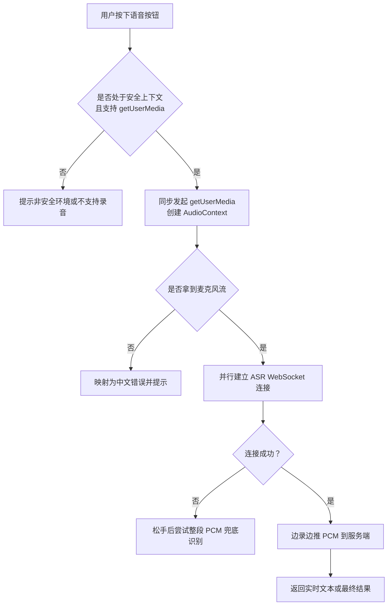
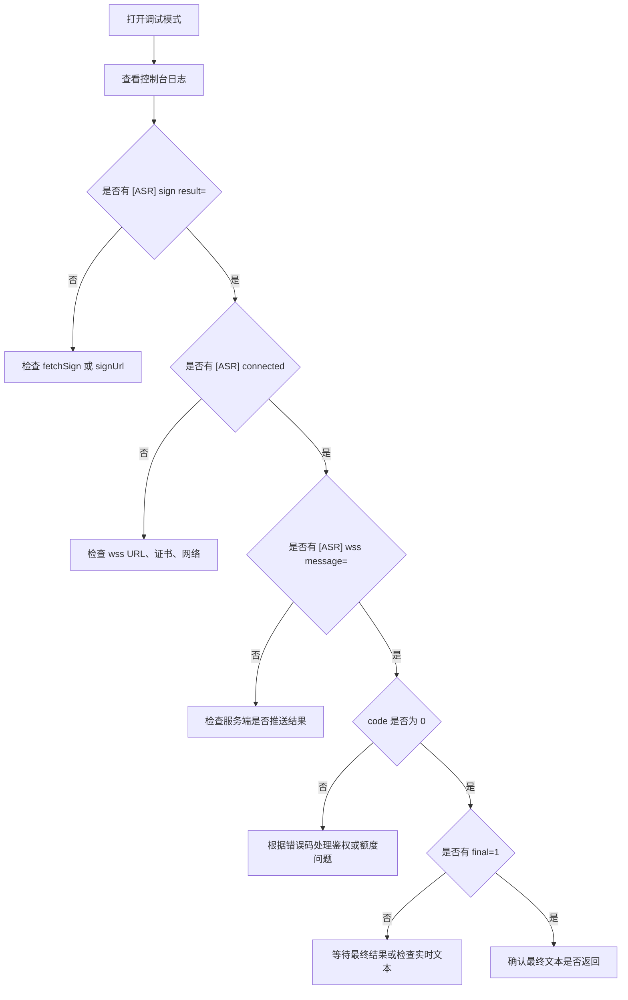

# 故障排除和常见问题

<cite>
**本文引用的文件**   
- [README.md](file://README.md)
- [uni-web-voice-input.vue](file://uni_modules/uni-web-voice-input/components/uni-web-voice-input/uni-web-voice-input.vue)
- [index.js](file://uni_modules/uni-web-voice-input/js_sdk/uni-web-voice/index.js)
- [capability.js](file://uni_modules/uni-web-voice-input/js_sdk/uni-web-voice/capability.js)
- [realtimeAsr.js](file://uni_modules/uni-web-voice-input/js_sdk/uni-web-voice/realtimeAsr.js)
- [voiceRecorder.js](file://uni_modules/uni-web-voice-input/js_sdk/uni-web-voice/voiceRecorder.js)
- [pcm.js](file://uni_modules/uni-web-voice-input/js_sdk/uni-web-voice/pcm.js)
- [index.vue（示例页）](file://demo/src/pages/index/index.vue)
</cite>

## 目录
1. [引言](#引言)
2. [快速定位问题路径](#快速定位问题路径)
3. [环境检查清单](#环境检查清单)
4. [常见问题与解决方案](#常见问题与解决方案)
5. [平台特有问题：鸿蒙 ArkWeb、Android/iOS WebView](#平台特有问题鸿蒙-arkwebandroidios-webview)
6. [错误代码对照表与异常信息解读](#错误代码对照表与异常信息解读)
7. [日志分析与调试方法](#日志分析与调试方法)
8. [性能排查与优化建议](#性能排查与优化建议)
9. [社区支持与反馈渠道](#社区支持与反馈渠道)
10. [结论](#结论)

## 引言
本指南面向使用 `uni-web-voice-input` 的开发者，聚焦「按住说话」在 H5、App-vue、各端 WebView（尤其是鸿蒙 ArkWeb）中的常见故障。SDK 基于纯 Web 能力实现：通过 `getUserMedia` 采集音频、Web Audio 生成 PCM、WebSocket 实时识别，并在 WebSocket 不可用时回退到整段 PCM 兜底识别。因此，典型问题通常集中在麦克风权限、安全上下文、音频链路、签名与 WebSocket 连接、以及平台差异上。

**图示来源**
- [voiceRecorder.js:156-240](file://uni_modules/uni-web-voice-input/js_sdk/uni-web-voice/voiceRecorder.js#L156-L240)
- [realtimeAsr.js:214-272](file://uni_modules/uni-web-voice-input/js_sdk/uni-web-voice/realtimeAsr.js#L214-L272)
- [voiceRecorder.js:246-295](file://uni_modules/uni-web-voice-input/js_sdk/uni-web-voice/voiceRecorder.js#L246-L295)

**章节来源**
- [README.md:1-24](file://README.md#L1-L24)
- [voiceRecorder.js:1-13](file://uni_modules/uni-web-voice-input/js_sdk/uni-web-voice/voiceRecorder.js#L1-L13)

## 快速定位问题路径
遇到语音输入异常时，建议按以下顺序排查：

1. **确认页面是否为 HTTPS 或 localhost**  
   若为 HTTP，浏览器会拒绝 `getUserMedia`。SDK 会通过 `isSecureContext` 判断并提供可读提示。

2. **确认麦克风权限是否已授权**  
   组件会在挂载时异步探测 `navigator.permissions`；若状态为 `denied`，按钮文案会变为“麦克风未授权，点击重试”。

3. **确认是否在用户手势同步窗口内调用录音**  
   SDK 要求 `start()` 必须在按下事件的同步代码中直接调用，否则鸿蒙 ArkWeb 可能不触发系统麦克风授权弹窗。

4. **确认 ASR 签名接口是否正常返回 wss URL**  
   组件支持两种注入方式：`getSign` 函数或直接传入 `signUrl`。签名响应必须包含 `url`。

5. **确认 WebSocket 可连通**  
   若 WS 连接失败，SDK 会在松手后尝试用整段 PCM 兜底识别一次；仍无结果则提示“未识别到内容”。

6. **开启 debug 模式查看控制台日志**  
   组件和 ASR 客户端均支持 `debug` 开关，便于观察握手、消息、超时等关键节点。

**章节来源**
- [capability.js:28-46](file://uni_modules/uni-web-voice-input/js_sdk/uni-web-voice/capability.js#L28-L46)
- [uni-web-voice-input.vue:157-168](file://uni_modules/uni-web-voice-input/components/uni-web-voice-input/uni-web-voice-input.vue#L157-L168)
- [uni-web-voice-input.vue:180-207](file://uni_modules/uni-web-voice-input/components/uni-web-voice-input/uni-web-voice-input.vue#L180-L207)
- [index.vue（示例页）:59-75](file://demo/src/pages/index/index.vue#L59-L75)

## 环境检查清单
| 检查项 | 期望值 | 不符合时的现象 | 处理建议 |
|---|---|---|---|
| 页面协议 | HTTPS 或 localhost | 无法获取麦克风、提示非安全环境 | 改用 HTTPS 部署，或在 App 内打开 |
| `mediaDevices.getUserMedia` | 存在 | 提示当前环境不支持录音 | 升级内核或改用原生录音桥 |
| 麦克风权限 | granted / prompt | 提示权限被拒或未检测到设备 | 引导用户允许，或在 Android App-plus 中补申请运行时权限 |
| `AudioContext` | 存在并可 resume | 有权限但零 PCM、无识别文本 | 确保在用户手势内创建并显式 resume |
| ASR 签名接口 | 返回含 `url` 的对象 | 提示签名请求失败或缺少 url | 检查后端接口、网络、响应结构 |
| WebSocket | 可连接 wss | 连接超时、连接失败、连接关闭 | 检查域名白名单、证书、防火墙、ASR 服务状态 |
| 采样率与编码 | 与后端一致（默认 16k PCM16） | 识别结果为空或乱码 | 调整 `voiceFormat` 与后端对齐 |

**章节来源**
- [capability.js:28-63](file://uni_modules/uni-web-voice-input/js_sdk/uni-web-voice/capability.js#L28-L63)
- [voiceRecorder.js:60-75](file://uni_modules/uni-web-voice-input/js_sdk/uni-web-voice/voiceRecorder.js#L60-L75)
- [realtimeAsr.js:151-176](file://uni_modules/uni-web-voice-input/js_sdk/uni-web-voice/realtimeAsr.js#L151-L176)

## 常见问题与解决方案

### 1. 麦克风权限问题
**现象**
- 按住按钮无反应，或弹出系统权限框后仍无法录音。
- 按钮显示“麦克风未授权，点击重试”。
- 控制台出现 `NotAllowedError`、`PermissionDenied`、`SecurityError`。

**原因**
- 页面不是 HTTPS 或 localhost。
- 用户拒绝了麦克风权限。
- Android App-plus WebView 不会自动弹系统录音权限框，需宿主先持有 `RECORD_AUDIO`。
- 鸿蒙 ArkWeb 未在用户手势同步窗口内发起 `getUserMedia`，导致不触发授权弹窗。

**解决方案**
- 确保页面为 HTTPS 或 localhost。
- 使用组件内置的权限探测：挂载时调用 `probeMicPermission`，若为 `denied` 则预显示引导文案。
- 在 Android App-plus 中启用 `autoRequestAndroidPermission`，组件会在挂载时尝试通过 `plus.android.requestPermissions` 申请录音权限。
- 保证 `recorder.start()` 在 `touchstart` 的同步代码中直接调用，不要在其前插入 `await`。

**章节来源**
- [capability.js:65-83](file://uni_modules/uni-web-voice-input/js_sdk/uni-web-voice/capability.js#L65-L83)
- [capability.js:90-137](file://uni_modules/uni-web-voice-input/js_sdk/uni-web-voice/capability.js#L90-L137)
- [uni-web-voice-input.vue:157-168](file://uni_modules/uni-web-voice-input/components/uni-web-voice-input/uni-web-voice-input.vue#L157-L168)
- [uni-web-voice-input.vue:180-207](file://uni_modules/uni-web-voice-input/components/uni-web-voice-input/uni-web-voice-input.vue#L180-L207)
- [voiceRecorder.js:152-187](file://uni_modules/uni-web-voice-input/js_sdk/uni-web-voice/voiceRecorder.js#L152-L187)

### 2. 音频采集失败
**现象**
- 提示“未检测到麦克风设备”“麦克风被其它应用占用”“当前设备不支持所需录音参数”。
- 能拿到权限，但无实时文本，也没有最终结果。

**原因**
- 设备没有可用麦克风。
- 其他应用占用了麦克风。
- `AudioContext` 以 `suspended` 状态启动，导致 `onaudioprocess` 不回调。
- 约束条件过于严格，设备无法满足。

**解决方案**
- 使用 `describeMicError` 将底层 DOMException 映射为中文提示。
- 确保 `AudioContext` 创建后立即 `resume()`。
- 适当放宽 `mediaConstraints`，例如保留单声道、回声消除、降噪即可。
- 若仍无 PCM，检查是否因 ASR 未连上而丢弃了早期音频；SDK 已在松手后尝试整段 PCM 兜底识别。

**章节来源**
- [voiceRecorder.js:25-41](file://uni_modules/uni-web-voice-input/js_sdk/uni-web-voice/voiceRecorder.js#L25-L41)
- [voiceRecorder.js:195-224](file://uni_modules/uni-web-voice-input/js_sdk/uni-web-voice/voiceRecorder.js#L195-L224)
- [voiceRecorder.js:276-278](file://uni_modules/uni-web-voice-input/js_sdk/uni-web-voice/voiceRecorder.js#L276-L278)

### 3. WebSocket 连接异常
**现象**
- 提示“语音识别连接超时”“语音识别连接失败，请检查网络后重试”“语音识别连接已关闭”。
- 实时文本一直不更新，松手后也无结果。

**原因**
- ASR 签名接口返回的 `url` 为空或无效。
- wss 地址不可达、证书异常、域名未白名单。
- 服务端鉴权失败或额度耗尽。
- 网络波动导致连接中断。

**解决方案**
- 检查 `fetchSign` 或 `signUrl` 返回的数据是否包含 `url`。
- 在 debug 模式下观察 `[ASR] connecting...`、`[ASR] connected`、`[ASR] wss message=` 等日志。
- 若服务端返回鉴权类错误码，SDK 会清空缓存签名并提示重试。
- 若 WS 始终连不上，松手后 SDK 会自动尝试整段 PCM 兜底识别；若仍无结果，说明音频链路或后端识别本身存在问题。

**章节来源**
- [realtimeAsr.js:151-176](file://uni_modules/uni-web-voice-input/js_sdk/uni-web-voice/realtimeAsr.js#L151-L176)
- [realtimeAsr.js:214-272](file://uni_modules/uni-web-voice-input/js_sdk/uni-web-voice/realtimeAsr.js#L214-L272)
- [realtimeAsr.js:317-378](file://uni_modules/uni-web-voice-input/js_sdk/uni-web-voice/realtimeAsr.js#L317-L378)

### 4. 识别结果不准确
**现象**
- 能出字，但错别字多、语义不通。
- 有时只有部分文本，没有最终结果。
- 同一段话在不同设备上结果差异大。

**原因**
- 说话距离过远、环境噪音大。
- 采样率或编码与后端不一致。
- 实时文本只是中间结果，最终结果依赖服务端 `final` 标志。
- 网络延迟导致部分片段丢失。

**解决方案**
- 保持靠近麦克风，减少背景噪音。
- 确认 `voiceFormat` 与后端一致（默认 1，对应 16k PCM16）。
- 关注 `onFinal` 作为最终结果，`onPartial` 仅用于实时展示。
- 若 WS 不稳定，可结合整段 PCM 兜底结果做二次校验。
- 对长语音，建议分段录制，避免单次过长导致丢包或超时。

**章节来源**
- [realtimeAsr.js:178-212](file://uni_modules/uni-web-voice-input/js_sdk/uni-web-voice/realtimeAsr.js#L178-L212)
- [voiceRecorder.js:100-114](file://uni_modules/uni-web-voice-input/js_sdk/uni-web-voice/voiceRecorder.js#L100-L114)
- [voiceRecorder.js:266-295](file://uni_modules/uni-web-voice-input/js_sdk/uni-web-voice/voiceRecorder.js#L266-L295)

### 5. 松手后无结果
**现象**
- 按住说话正常，松手后既不返回最终文本，也不报错。
- 控制台无明显错误，但 UI 停留在“识别中”。

**原因**
- 录音时间太短，被判定为无效操作。
- 未采集到有效 PCM。
- ASR 未连上且兜底识别也未返回文本。
- 用户触发了“上滑取消”。

**解决方案**
- 检查是否满足最小时长阈值（默认约 600ms）。
- 检查是否真的采集到了 PCM（可通过 `receivedPcmBytes` 或日志间接判断）。
- 若 WS 未连上，确认兜底识别是否执行。
- 若上滑超过阈值，组件会主动 `cancel()`，不会返回结果。

**章节来源**
- [voiceRecorder.js:246-295](file://uni_modules/uni-web-voice-input/js_sdk/uni-web-voice/voiceRecorder.js#L246-L295)
- [uni-web-voice-input.vue:236-253](file://uni_modules/uni-web-voice-input/components/uni-web-voice-input/uni-web-voice-input.vue#L236-L253)

### 6. 组件状态异常
**现象**
- 状态卡在 `preparing`、`recording` 或 `recognizing`。
- 多次按住后状态混乱。

**原因**
- 上一次录音未正确释放资源。
- 组件卸载前未调用 `cancel()`。
- 异常路径未走到清理逻辑。

**解决方案**
- 组件在 `onBeforeUnmount` 中会尝试 `recorder.cancel()`。
- 所有异常分支都会调用 `teardownAudio()` 释放 MediaStream、AudioContext、ScriptProcessor。
- 建议在业务层监听 `state` 事件，若长时间停留在异常状态，主动重置 UI。

**章节来源**
- [uni-web-voice-input.vue:171-178](file://uni_modules/uni-web-voice-input/components/uni-web-voice-input/uni-web-voice-input.vue#L171-L178)
- [voiceRecorder.js:116-150](file://uni_modules/uni-web-voice-input/js_sdk/uni-web-voice/voiceRecorder.js#L116-L150)

## 平台特有问题：鸿蒙 ArkWeb、Android/iOS WebView

### 鸿蒙 ArkWeb
**已知限制**
- UA 可能被宿主覆写，不能只靠 UA 判断是否运行在 ArkWeb。
- 若 `getUserMedia` 不在用户手势同步窗口内发起，系统不会触发麦克风授权弹窗。
- `AudioContext` 可能以 `suspended` 状态启动，导致零 PCM。

**绕过方法**
- 使用结构化信号 `window.__uniapp_x_` 判断 ArkWeb，而非 UA。
- 在 `touchstart` 同步代码中直接调用 `recorder.start()`。
- 创建 `AudioContext` 后立即 `resume()`。
- 组件已封装这些修复，无需业务层重复实现。

**章节来源**
- [capability.js:14-26](file://uni_modules/uni-web-voice-input/js_sdk/uni-web-voice/capability.js#L14-L26)
- [voiceRecorder.js:1-13](file://uni_modules/uni-web-voice-input/js_sdk/uni-web-voice/voiceRecorder.js#L1-L13)
- [voiceRecorder.js:168-201](file://uni_modules/uni-web-voice-input/js_sdk/uni-web-voice/voiceRecorder.js#L168-L201)
- [uni-web-voice-input.vue:28-36](file://uni_modules/uni-web-voice-input/components/uni-web-voice-input/uni-web-voice-input.vue#L28-L36)

### Android WebView（uni-app App-plus）
**已知限制**
- WebView 内的 `getUserMedia` 不会自动弹系统录音权限框。
- 需要宿主持有 `RECORD_AUDIO` 运行时权限。

**绕过方法**
- 启用组件属性 `autoRequestAndroidPermission`。
- 组件挂载时调用 `requestRecordAudioViaPlus` 申请权限。
- 若首次按住失败，组件会提示“请先允许麦克风权限”，并再次尝试申请。

**章节来源**
- [capability.js:85-137](file://uni_modules/uni-web-voice-input/js_sdk/uni-web-voice/capability.js#L85-L137)
- [uni-web-voice-input.vue:161-168](file://uni_modules/uni-web-voice-input/components/uni-web-voice-input/uni-web-voice-input.vue#L161-L168)
- [uni-web-voice-input.vue:192-206](file://uni_modules/uni-web-voice-input/components/uni-web-voice-input/uni-web-voice-input.vue#L192-L206)

### iOS WebView
**已知限制**
- 同样受安全上下文和用户手势限制。
- `AudioContext` 可能需要显式 resume。

**绕过方法**
- 确保 HTTPS。
- 在用户手势内创建并 resume `AudioContext`。
- 组件内部已处理 resume，业务层无需额外干预。

**章节来源**
- [capability.js:28-46](file://uni_modules/uni-web-voice-input/js_sdk/uni-web-voice/capability.js#L28-L46)
- [voiceRecorder.js:195-201](file://uni_modules/uni-web-voice-input/js_sdk/uni-web-voice/voiceRecorder.js#L195-L201)

## 错误代码对照表与异常信息解读

### WebSocket 与服务端错误码
| 错误码 | 含义 | SDK 行为 | 建议处理 |
|---|---|---|---|
| 4001 | 鉴权失败 | 提示鉴权失败，清空缓存签名 | 重新获取签名，检查密钥配置 |
| 4002 | 鉴权失败 | 提示鉴权失败，清空缓存签名 | 重新获取签名，检查密钥配置 |
| 4003 | 鉴权失败 | 提示鉴权失败，清空缓存签名 | 重新获取签名，检查密钥配置 |
| 4004 | 额度已用尽 | 提示额度不足 | 联系管理员开通后付费或购买资源包 |
| 非 0 的其他 code | 服务端错误 | 格式化错误信息并抛出 | 查看服务端日志，核对请求参数 |

**章节来源**
- [realtimeAsr.js:43-49](file://uni_modules/uni-web-voice-input/js_sdk/uni-web-voice/realtimeAsr.js#L43-L49)
- [realtimeAsr.js:178-190](file://uni_modules/uni-web-voice-input/js_sdk/uni-web-voice/realtimeAsr.js#L178-L190)

### 麦克风相关异常
| 异常名称或关键词 | 含义 | SDK 中文提示 | 建议处理 |
|---|---|---|---|
| `NotAllowedError` / `PermissionDenied` / `SecurityError` | 权限被拒绝或非安全环境 | “麦克风权限被拒绝…” | 检查 HTTPS、用户授权、容器权限 |
| `NotFoundError` / `DevicesNotFound` | 未检测到麦克风 | “未检测到麦克风设备” | 检查设备、驱动、权限 |
| `NotReadableError` / `AbortError` / `InUse` | 设备被占用 | “麦克风被其它应用占用…” | 关闭占用设备的应用 |
| `OverconstrainedError` | 约束不满足 | “当前设备不支持所需录音参数” | 放宽 `mediaConstraints` |

**章节来源**
- [voiceRecorder.js:25-41](file://uni_modules/uni-web-voice-input/js_sdk/uni-web-voice/voiceRecorder.js#L25-L41)

### 组件与 SDK 抛出的典型错误
| 错误信息 | 触发位置 | 含义 | 建议处理 |
|---|---|---|---|
| “当前为非安全环境（HTTP），无法使用网页麦克风…” | `getMicBlockReason` | 页面不是 HTTPS 或 localhost | 改用 HTTPS |
| “当前环境不支持录音（缺少 getUserMedia）” | `getMicBlockReason` | 环境不支持 Web 录音 | 升级内核或使用原生录音 |
| “当前环境不支持音频处理（缺少 AudioContext）” | `createVoiceRecorder` | 不支持 Web Audio | 升级内核 |
| “录音时间太短，请按住说话” | `stop` | 小于最小时长且无文本 | 延长录音时间 |
| “未采集到音频，请确认麦克风权限后重试” | `stop` | 完全没有 PCM | 检查权限和设备 |
| “未识别到内容，请靠近麦克风再说一次” | `stop` | 有音频但未识别出文本 | 改善发音、环境或后端识别质量 |
| “语音识别签名失败…” | `resolveAsrSign` | 签名接口异常或缺少 url | 检查 `fetchSign` 或 `signUrl` |
| “语音识别连接超时” | `connect` | WS 连接超时 | 检查网络和服务端 |
| “语音识别连接失败，请检查网络后重试” | `connect` | WS 连接失败 | 检查证书、域名、防火墙 |
| “语音识别连接已关闭” | `connect` | WS 提前关闭 | 检查服务端状态 |
| “语音识别超时，请重试” | `recognizePcmBuffer` | 整体识别耗时过长 | 缩短语音或优化网络 |

**章节来源**
- [capability.js:52-63](file://uni_modules/uni-web-voice-input/js_sdk/uni-web-voice/capability.js#L52-L63)
- [voiceRecorder.js:73-75](file://uni_modules/uni-web-voice-input/js_sdk/uni-web-voice/voiceRecorder.js#L73-L75)
- [voiceRecorder.js:256-295](file://uni_modules/uni-web-voice-input/js_sdk/uni-web-voice/voiceRecorder.js#L256-L295)
- [realtimeAsr.js:151-176](file://uni_modules/uni-web-voice-input/js_sdk/uni-web-voice/realtimeAsr.js#L151-L176)
- [realtimeAsr.js:214-272](file://uni_modules/uni-web-voice-input/js_sdk/uni-web-voice/realtimeAsr.js#L214-L272)
- [realtimeAsr.js:332-364](file://uni_modules/uni-web-voice-input/js_sdk/uni-web-voice/realtimeAsr.js#L332-L364)

## 日志分析与调试方法

### 开启调试日志
- 组件层：传入 `debug=true`。
- SDK 层：`createVoiceRecorder` 和 `createRealtimeAsrClient` 都支持 `debug`。
- 示例页演示了如何把 `debug` 透传到组件。

**章节来源**
- [uni-web-voice-input.vue:52](file://uni_modules/uni-web-voice-input/components/uni-web-voice-input/uni-web-voice-input.vue#L52)
- [voiceRecorder.js:67](file://uni_modules/uni-web-voice-input/js_sdk/uni-web-voice/voiceRecorder.js#L67)
- [realtimeAsr.js:89-103](file://uni_modules/uni-web-voice-input/js_sdk/uni-web-voice/realtimeAsr.js#L89-L103)
- [index.vue（示例页）:17-24](file://demo/src/pages/index/index.vue#L17-L24)

### 关键日志字段
| 日志关键字 | 含义 | 排查重点 |
|---|---|---|
| `[ASR] sign result=` | 签名响应对象 | 检查是否包含 `url`、`expired`、`voiceId` |
| `[ASR] connecting...` | 开始建立 WebSocket | 检查 URL 是否正确 |
| `[ASR] connected` | WebSocket 已连接 | 若未出现，检查网络和服务端 |
| `[ASR] wss message=` | 服务端返回的消息 | 检查 `code`、`result.voice_text_str`、`final` |
| `[ASR] pcm chunks sent=` | 推送 PCM 分片数量 | 若为 0，检查音频链路 |
| `[uni-web-voice] plus RECORD_AUDIO:` | Android 运行时权限结果 | 若非 `granted`，引导用户授权 |

**章节来源**
- [realtimeAsr.js:151-176](file://uni_modules/uni-web-voice-input/js_sdk/uni-web-voice/realtimeAsr.js#L151-L176)
- [realtimeAsr.js:214-272](file://uni_modules/uni-web-voice-input/js_sdk/uni-web-voice/realtimeAsr.js#L214-L272)
- [realtimeAsr.js:286-296](file://uni_modules/uni-web-voice-input/js_sdk/uni-web-voice/realtimeAsr.js#L286-L296)
- [uni-web-voice-input.vue:163-167](file://uni_modules/uni-web-voice-input/components/uni-web-voice-input/uni-web-voice-input.vue#L163-L167)

### 调试流程图

**图示来源**
- [realtimeAsr.js:178-212](file://uni_modules/uni-web-voice-input/js_sdk/uni-web-voice/realtimeAsr.js#L178-L212)
- [realtimeAsr.js:214-272](file://uni_modules/uni-web-voice-input/js_sdk/uni-web-voice/realtimeAsr.js#L214-L272)

## 性能排查与优化建议

### 首按延迟优化
- 使用 `prefetchTicket` 预热签名，减少首次按下等待。
- 组件在挂载时已调用 `recorder.prefetch()`。
- 若签名接口较慢，可在进入语音页面前主动预热。

**章节来源**
- [realtimeAsr.js:317-326](file://uni_modules/uni-web-voice-input/js_sdk/uni-web-voice/realtimeAsr.js#L317-L326)
- [uni-web-voice-input.vue:155-156](file://uni_modules/uni-web-voice-input/components/uni-web-voice-input/uni-web-voice-input.vue#L155-L156)

### 音频传输优化
- SDK 默认每 40ms 推送一个 3200 字节的 PCM 分片，兼顾实时性与稳定性。
- 若网络较差，可适当增大分片间隔或降低采样率（需与后端协商）。
- 避免在 `onaudioprocess` 中执行重计算，SDK 已将 PCM 转换和发送逻辑放在 SDK 层。

**章节来源**
- [realtimeAsr.js:10-17](file://uni_modules/uni-web-voice-input/js_sdk/uni-web-voice/realtimeAsr.js#L10-L17)
- [realtimeAsr.js:286-296](file://uni_modules/uni-web-voice-input/js_sdk/uni-web-voice/realtimeAsr.js#L286-L296)
- [pcm.js:13-24](file://uni_modules/uni-web-voice-input/js_sdk/uni-web-voice/pcm.js#L13-L24)

### 内存与资源释放
- SDK 在停止、取消、异常路径中释放 MediaStream、AudioContext、ScriptProcessor。
- 组件在卸载前也会调用 `recorder.cancel()`。
- 若发现内存增长，检查是否存在自定义音频处理逻辑未及时释放。

**章节来源**
- [voiceRecorder.js:116-150](file://uni_modules/uni-web-voice-input/js_sdk/uni-web-voice/voiceRecorder.js#L116-L150)
- [uni-web-voice-input.vue:171-178](file://uni_modules/uni-web-voice-input/components/uni-web-voice-input/uni-web-voice-input.vue#L171-L178)

## 社区支持与反馈渠道
- 插件市场与 uni_modules：仓库根目录提供了插件目录结构和发布说明。
- npm 包名：`uni-web-voice-input`。
- 详细用法见插件文档：`uni_modules/uni-web-voice-input/readme.md`。
- 示例工程位于 `examples/demo/demo.vue`，Demo 页面位于 `demo/src/pages/index/index.vue`。
- 许可证为 MIT，可自由集成与二次开发。

**章节来源**
- [README.md:13-15](file://README.md#L13-L15)
- [README.md:25-33](file://README.md#L25-L33)
- [README.md:35-47](file://README.md#L35-L47)
- [index.vue（示例页）:34-43](file://demo/src/pages/index/index.vue#L34-L43)

## 结论
`uni-web-voice-input` 的核心难点在于跨端 WebView 的权限时序、安全上下文、音频链路和 WebSocket 连接。SDK 已通过结构化判端、用户手势同步、AudioContext resume、WS 超时保护、整段 PCM 兜底识别等机制，显著降低了接入成本。实际排障时，建议优先确认 HTTPS、麦克风权限、签名接口、WebSocket 连通性，再结合 debug 日志定位具体环节。对于鸿蒙 ArkWeb 和 Android App-plus，应特别注意平台特有的权限与手势限制，并充分利用组件提供的自动化修复能力。