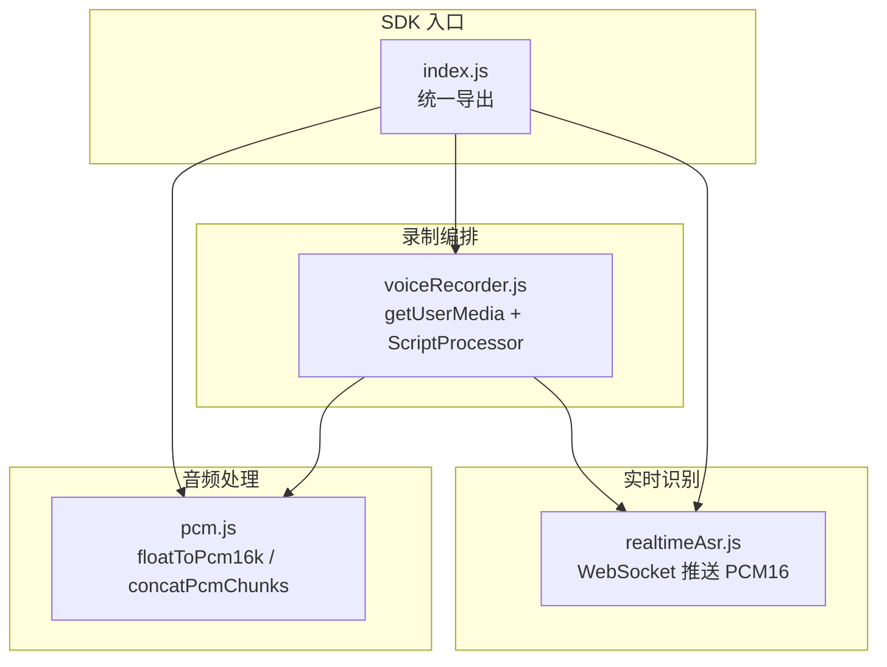
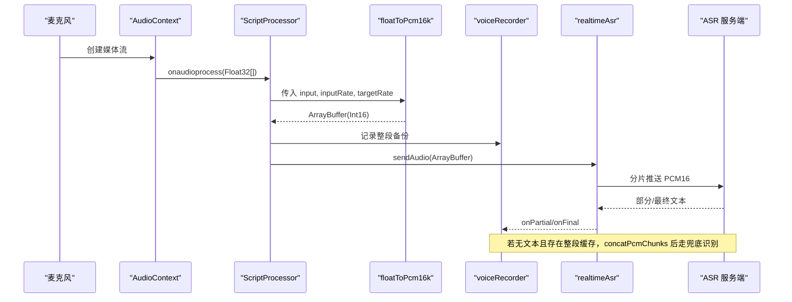
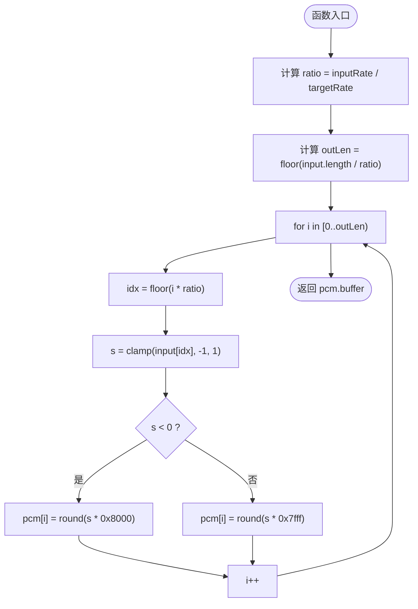
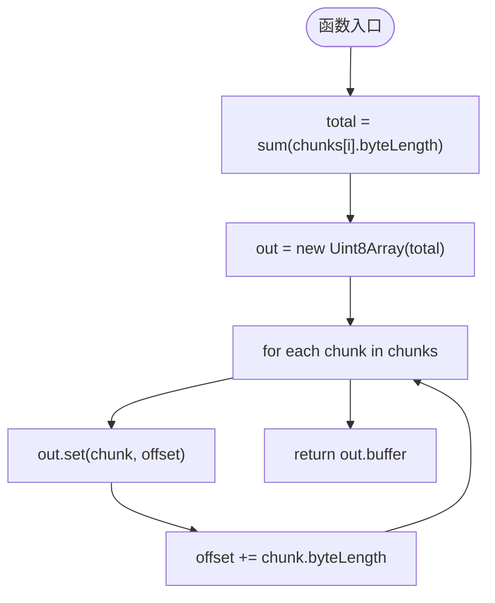
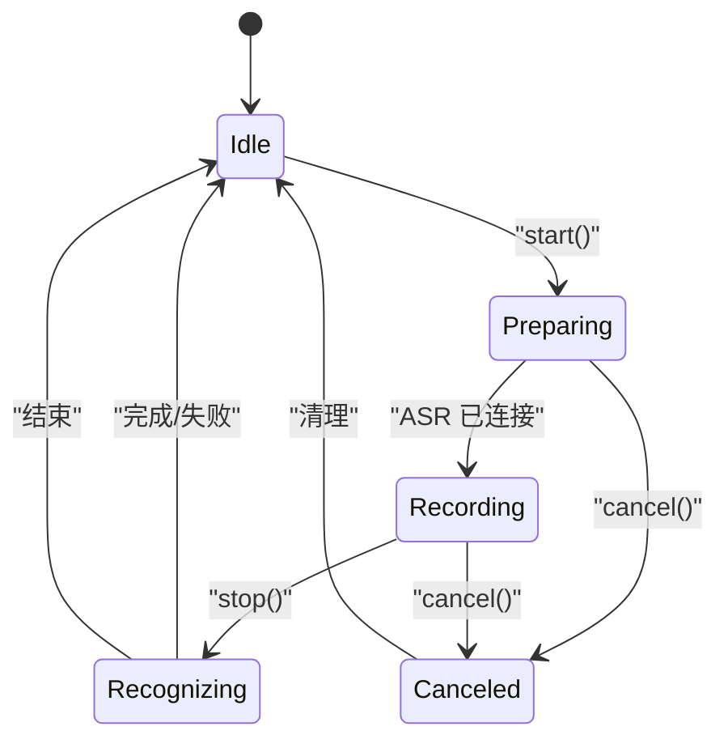
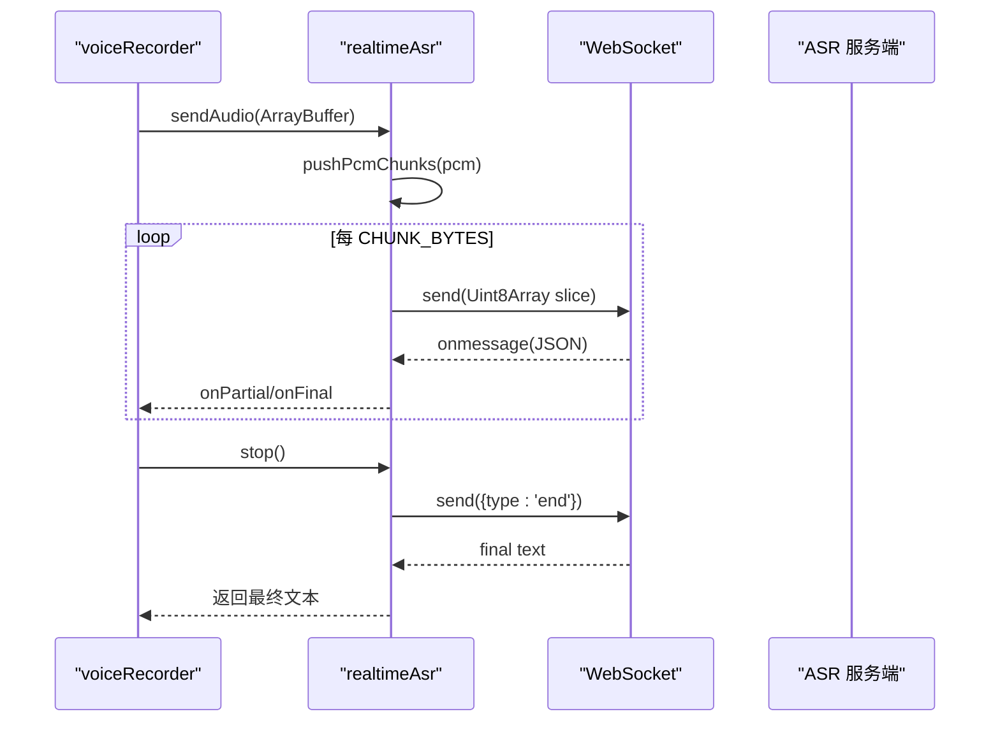
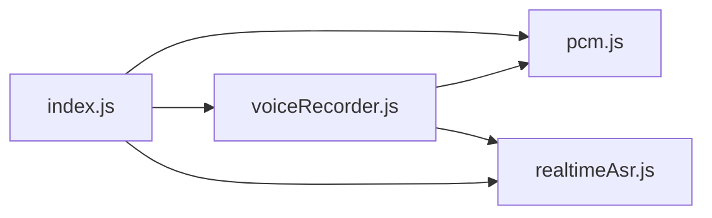

# PCM 音频处理

<cite>
**本文引用的文件**   
- [pcm.js](file://uni_modules/uni-web-voice-input/js_sdk/uni-web-voice/pcm.js)
- [index.js](file://uni_modules/uni-web-voice-input/js_sdk/uni-web-voice/index.js)
- [voiceRecorder.js](file://uni_modules/uni-web-voice-input/js_sdk/uni-web-voice/voiceRecorder.js)
- [realtimeAsr.js](file://uni_modules/uni-web-voice-input/js_sdk/uni-web-voice/realtimeAsr.js)
- [README.md](file://README.md)
</cite>

## 目录
1. [引言](#引言)
2. [项目结构](#项目结构)
3. [核心组件](#核心组件)
4. [架构总览](#架构总览)
5. [详细组件分析](#详细组件分析)
6. [依赖关系分析](#依赖关系分析)
7. [性能与内存优化](#性能与内存优化)
8. [故障排查指南](#故障排查指南)
9. [结论](#结论)
10. [附录：数据格式与转换示例](#附录数据格式与转换示例)

## 引言
本文件聚焦于仓库中的 PCM 音频处理实现，重点解析以下目标：
- floatToPcm16k 函数的 Float32Array 到 PCM16 位格式的转换算法，包括采样率重采样、幅度归一化与字节序。
- concatPcmChunks 函数的音频片段拼接逻辑，包括缓冲区管理、边界处理与性能优化。
- 音频格式规范：PCM 16-bit little-endian 的结构定义与数据排列方式。
- 采样率转换：从浏览器默认采样率到 16kHz 标准采样率的实现思路。
- 音频质量优化：动态范围压缩、噪声抑制与增强处理的现状与建议。
- 内存管理机制：TypedArray 的高效使用、缓冲区复用与垃圾回收优化。
- 音频处理流程图与数据转换示例，展示原始音频数据到 PCM 格式的完整流程。
- 性能基准测试方法与优化建议，帮助开发者理解不同处理方式的差异。

## 项目结构
该仓库是一个跨端语音输入 SDK，PCM 处理位于 uni-web-voice 子模块中，被录音编排器与实时 ASR 客户端共同消费。

图表来源
- [index.js:6-17](file://uni_modules/uni-web-voice-input/js_sdk/uni-web-voice/index.js#L6-L17)
- [pcm.js:1-37](file://uni_modules/uni-web-voice-input/js_sdk/uni-web-voice/pcm.js#L1-L37)
- [voiceRecorder.js:15-17](file://uni_modules/uni-web-voice-input/js_sdk/uni-web-voice/voiceRecorder.js#L15-L17)
- [realtimeAsr.js:1-18](file://uni_modules/uni-web-voice-input/js_sdk/uni-web-voice/realtimeAsr.js#L1-L18)

章节来源
- [README.md:1-33](file://README.md#L1-L33)
- [index.js:1-18](file://uni_modules/uni-web-voice-input/js_sdk/uni-web-voice/index.js#L1-L18)

## 核心组件
- pcm.js：提供 floatToPcm16k（Float32 → PCM16）与 concatPcmChunks（分片拼接）。
- voiceRecorder.js：封装 getUserMedia + Web Audio 管线，负责采集、重采样、发送 PCM 与兜底整段识别。
- realtimeAsr.js：基于 WebSocket 的实时 ASR 客户端，按固定大小分片推流并接收识别结果。
- index.js：统一导出能力，便于上层调用。

章节来源
- [pcm.js:1-37](file://uni_modules/uni-web-voice-input/js_sdk/uni-web-voice/pcm.js#L1-L37)
- [voiceRecorder.js:15-17](file://uni_modules/uni-web-voice-input/js_sdk/uni-web-voice/voiceRecorder.js#L15-L17)
- [realtimeAsr.js:1-18](file://uni_modules/uni-web-voice-input/js_sdk/uni-web-voice/realtimeAsr.js#L1-L18)
- [index.js:6-17](file://uni_modules/uni-web-voice-input/js_sdk/uni-web-voice/index.js#L6-L17)

## 架构总览
整体数据流如下：麦克风经 getUserMedia 进入 AudioContext，ScriptProcessor 回调输出 Float32 单声道采样；floatToPcm16k 进行线性重采样与量化为 Int16；voiceRecorder 将 PCM 以 Uint8Array 形式通过 realtimeAsr 推送到服务端；若实时未返回文本，则用 concatPcmChunks 拼接整段 PCM 进行兜底识别。

图表来源
- [voiceRecorder.js:203-228](file://uni_modules/uni-web-voice-input/js_sdk/uni-web-voice/voiceRecorder.js#L203-L228)
- [pcm.js:13-24](file://uni_modules/uni-web-voice-input/js_sdk/uni-web-voice/pcm.js#L13-L24)
- [realtimeAsr.js:274-296](file://uni_modules/uni-web-voice-input/js_sdk/uni-web-voice/realtimeAsr.js#L274-L296)

## 详细组件分析

### floatToPcm16k：Float32 → PCM16 转换
- 功能概述
  - 输入：Float32Array 单声道采样、实际采样率 inputRate、目标采样率 targetRate（默认 16000）。
  - 输出：ArrayBuffer，内容为 Int16 小端序 PCM 数据。
- 关键步骤
  - 计算重采样比例 ratio = inputRate / targetRate。
  - 计算输出长度 outLen = floor(input.length / ratio)。
  - 遍历输出索引 i，映射回输入索引 idx = floor(i * ratio)，取 input[idx]。
  - 幅度裁剪至 [-1, 1]，再量化为 Int16：负数乘以 0x8000，正数乘以 0x7fff。
  - 返回 Int16Array.buffer（底层 ArrayBuffer）。
- 复杂度
  - 时间 O(outLen)，空间 O(outLen) 用于 Int16Array。
- 字节序
  - 返回的是 ArrayBuffer，具体字节序由平台决定；在主流 x86/x64/ARM 上通常为小端序，符合常见 PCM16 LE 需求。
- 采样率转换
  - 采用最近邻线性采样（无插值），简单高效但可能引入轻微混叠；适合短语音实时场景。
- 幅度处理
  - 先裁剪到 [-1, 1]，再进行定点量化，避免溢出。

图表来源
- [pcm.js:13-24](file://uni_modules/uni-web-voice-input/js_sdk/uni-web-voice/pcm.js#L13-L24)

章节来源
- [pcm.js:1-24](file://uni_modules/uni-web-voice-input/js_sdk/uni-web-voice/pcm.js#L1-L24)

### concatPcmChunks：音频片段拼接
- 功能概述
  - 将多个 Uint8Array 分片拼接为一个连续 ArrayBuffer，用于整段兜底识别。
- 关键步骤
  - 计算总字节数 total = sum(chunk.byteLength)。
  - 分配一次性大缓冲 out = new Uint8Array(total)。
  - 顺序拷贝每个 chunk 到 out，维护 offset。
  - 返回 out.buffer。
- 边界处理
  - reduce 求和保证不越界；set 偏移累加确保无覆盖。
- 性能
  - 单次分配 + 顺序 set，避免多次 realloc；总体 O(N) 时间与 O(N) 额外空间。

图表来源
- [pcm.js:27-36](file://uni_modules/uni-web-voice-input/js_sdk/uni-web-voice/pcm.js#L27-L36)

章节来源
- [pcm.js:26-36](file://uni_modules/uni-web-voice-input/js_sdk/uni-web-voice/pcm.js#L26-L36)

### voiceRecorder：录制编排与 PCM 集成
- 职责
  - 管理 getUserMedia、AudioContext、ScriptProcessor 生命周期。
  - 在 onaudioprocess 回调中调用 floatToPcm16k 生成 PCM16，并同步发送到 ASR。
  - 维护 recordedPcmChunks 作为整段备份，供兜底识别使用。
- 关键路径
  - start()：并发发起 ASR 连接、获取麦克风、创建 AudioContext 并 resume。
  - onaudioprocess：读取 inputBuffer.getChannelData(0)，调用 floatToPcm16k，记录整段备份，sendAudio。
  - stop()：优先走实时 ASR；若无文本且存在整段缓存，则 concatPcmChunks 后走 recognizePcmBuffer。
- 状态机
  - idle → preparing → recording → recognizing → idle（或 canceled）。

图表来源
- [voiceRecorder.js:83-98](file://uni_modules/uni-web-voice-input/js_sdk/uni-web-voice/voiceRecorder.js#L83-L98)
- [voiceRecorder.js:156-240](file://uni_modules/uni-web-voice-input/js_sdk/uni-web-voice/voiceRecorder.js#L156-L240)
- [voiceRecorder.js:246-295](file://uni_modules/uni-web-voice-input/js_sdk/uni-web-voice/voiceRecorder.js#L246-L295)

章节来源
- [voiceRecorder.js:15-17](file://uni_modules/uni-web-voice-input/js_sdk/uni-web-voice/voiceRecorder.js#L15-L17)
- [voiceRecorder.js:156-240](file://uni_modules/uni-web-voice-input/js_sdk/uni-web-voice/voiceRecorder.js#L156-L240)
- [voiceRecorder.js:246-295](file://uni_modules/uni-web-voice-input/js_sdk/uni-web-voice/voiceRecorder.js#L246-L295)

### realtimeAsr：实时 ASR 客户端与 PCM 推送
- 职责
  - 管理 WebSocket 连接、签名刷新、消息解析与错误处理。
  - 将 PCM 数据按 CHUNK_BYTES 切分并以 CHUNK_INTERVAL_MS 间隔推送。
- 关键路径
  - connect：注入 voice_format=1（16k PCM16），建立 WS 连接。
  - pushPcmChunks：将 ArrayBuffer 转为 Uint8Array 切片发送。
  - stop：发送 {type:'end'}，等待服务端 final 或超时。
- 与 PCM 的关系
  - 期望输入为 PCM16 二进制数据；voiceRecorder 通过 floatToPcm16k 生成并直接送入。

图表来源
- [realtimeAsr.js:214-272](file://uni_modules/uni-web-voice-input/js_sdk/uni-web-voice/realtimeAsr.js#L214-L272)
- [realtimeAsr.js:274-296](file://uni_modules/uni-web-voice-input/js_sdk/uni-web-voice/realtimeAsr.js#L274-L296)
- [realtimeAsr.js:298-315](file://uni_modules/uni-web-voice-input/js_sdk/uni-web-voice/realtimeAsr.js#L298-L315)

章节来源
- [realtimeAsr.js:1-18](file://uni_modules/uni-web-voice-input/js_sdk/uni-web-voice/realtimeAsr.js#L1-L18)
- [realtimeAsr.js:214-296](file://uni_modules/uni-web-voice-input/js_sdk/uni-web-voice/realtimeAsr.js#L214-L296)
- [realtimeAsr.js:298-315](file://uni_modules/uni-web-voice-input/js_sdk/uni-web-voice/realtimeAsr.js#L298-L315)

## 依赖关系分析
- index.js 统一导出 pcm.js 的两个函数，供外部与 voiceRecorder.js 使用。
- voiceRecorder.js 依赖 pcm.js 进行重采样与量化，并依赖 realtimeAsr.js 进行实时传输。
- realtimeAsr.js 不直接依赖 pcm.js，但约定输入为 PCM16 二进制数据。

图表来源
- [index.js:6-17](file://uni_modules/uni-web-voice-input/js_sdk/uni-web-voice/index.js#L6-L17)
- [voiceRecorder.js:15-17](file://uni_modules/uni-web-voice-input/js_sdk/uni-web-voice/voiceRecorder.js#L15-L17)

章节来源
- [index.js:1-18](file://uni_modules/uni-web-voice-input/js_sdk/uni-web-voice/index.js#L1-L18)
- [voiceRecorder.js:15-17](file://uni_modules/uni-web-voice-input/js_sdk/uni-web-voice/voiceRecorder.js#L15-L17)

## 性能与内存优化
- floatToPcm16k
  - 优点：线性扫描、无插值开销，适合低延迟实时场景。
  - 风险：最近邻采样可能产生轻微混叠；对高频成分保留有限。
  - 优化建议：如需更高音质，可引入线性插值或 sinc 重采样；注意 CPU 与延迟权衡。
- concatPcmChunks
  - 优点：一次分配、顺序拷贝，减少碎片与 GC 压力。
  - 风险：当分片数量极大时，total 求和与一次性分配可能带来峰值内存。
  - 优化建议：对超大音频可采用分段写入流式编码器，或限制 recordedPcmChunks 上限（当前已限制 400 条）。
- TypedArray 使用
  - 使用 Int16Array/Uint8Array 避免频繁装箱，提升吞吐。
  - 通过 .buffer 传递 ArrayBuffer，减少二次拷贝。
- 缓冲区管理
  - voiceRecorder 仅保存最多 400 个分片作为整段备份，避免无限增长。
  - 在 stop() 后清理 buffers 与状态，降低泄漏风险。
- 垃圾回收
  - 尽量复用 TypedArray 视图，避免重复分配；必要时显式置空引用。
- 网络分片
  - realtimeAsr 使用固定 CHUNK_BYTES 与 CHUNK_INTERVAL_MS，控制带宽与抖动。

章节来源
- [pcm.js:13-36](file://uni_modules/uni-web-voice-input/js_sdk/uni-web-voice/pcm.js#L13-L36)
- [voiceRecorder.js:208-228](file://uni_modules/uni-web-voice-input/js_sdk/uni-web-voice/voiceRecorder.js#L208-L228)
- [voiceRecorder.js:276-278](file://uni_modules/uni-web-voice-input/js_sdk/uni-web-voice/voiceRecorder.js#L276-L278)
- [realtimeAsr.js:16-18](file://uni_modules/uni-web-voice-input/js_sdk/uni-web-voice/realtimeAsr.js#L16-L18)
- [realtimeAsr.js:286-296](file://uni_modules/uni-web-voice-input/js_sdk/uni-web-voice/realtimeAsr.js#L286-L296)

## 故障排查指南
- 无 PCM 数据
  - 检查 AudioContext 是否处于 suspended 状态并已 resume。
  - 确认 getUserMedia 权限与设备可用。
- 识别结果为空
  - 检查 ASR 连接是否成功；若未连上，会触发整段兜底识别。
  - 确认 recordedPcmChunks 非空且 concatPcmChunks 能正确拼接。
- 声音异常或失真
  - 检查 floatToPcm16k 的幅度裁剪与量化是否正确。
  - 评估采样率转换是否合适（inputRate 与 targetRate）。
- 内存占用过高
  - 检查 recordedPcmChunks 上限策略是否生效。
  - 避免在热路径中重复分配大数组。

章节来源
- [voiceRecorder.js:195-201](file://uni_modules/uni-web-voice-input/js_sdk/uni-web-voice/voiceRecorder.js#L195-L201)
- [voiceRecorder.js:276-278](file://uni_modules/uni-web-voice-input/js_sdk/uni-web-voice/voiceRecorder.js#L276-L278)
- [pcm.js:18-23](file://uni_modules/uni-web-voice-input/js_sdk/uni-web-voice/pcm.js#L18-L23)

## 结论
- floatToPcm16k 提供了轻量高效的 Float32 → PCM16 转换，满足实时语音识别的低延迟需求。
- concatPcmChunks 以最小开销完成分片拼接，支撑整段兜底识别。
- voiceRecorder 将采集、重采样、发送与兜底识别串联，形成完整的“按住说话”体验。
- realtimeAsr 以固定分片与间隔稳定推送 PCM16，并与服务端协议对齐。
- 建议在音质与延迟之间做权衡，按需升级重采样算法；同时持续优化内存与 GC 行为。

## 附录：数据格式与转换示例

### PCM 16-bit little-endian 格式说明
- 位宽：16 位（Int16）。
- 字节序：小端序（低位在前）。
- 声道：单声道（mono）。
- 采样率：目标 16kHz（可通过 targetRate 配置）。
- 取值范围：[-32768, 32767]，对应浮点 [-1, 1]。
- 数据排列：连续 Int16 样本，无头信息。

### 转换流程示例（概念性）
- 输入：Float32Array 单声道采样，例如长度为 N。
- 重采样：ratio = inputRate / 16000，输出长度 M = floor(N / ratio)。
- 量化：对每个样本 s ∈ [-1, 1]，映射为 Int16：
  - s < 0 → round(s * -32768)
  - s ≥ 0 → round(s * 32767)
- 输出：ArrayBuffer，包含 M 个 Int16 样本，按小端序排列。

[本节为概念性说明，不直接分析具体代码文件]