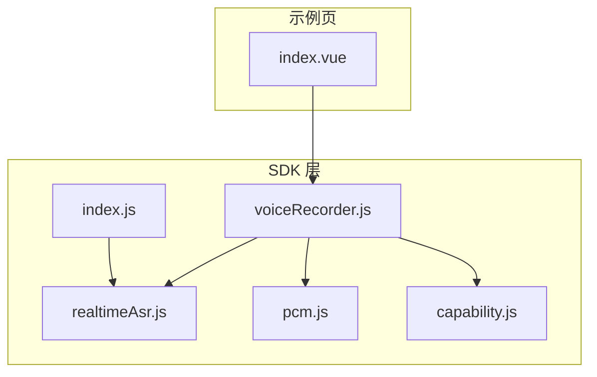
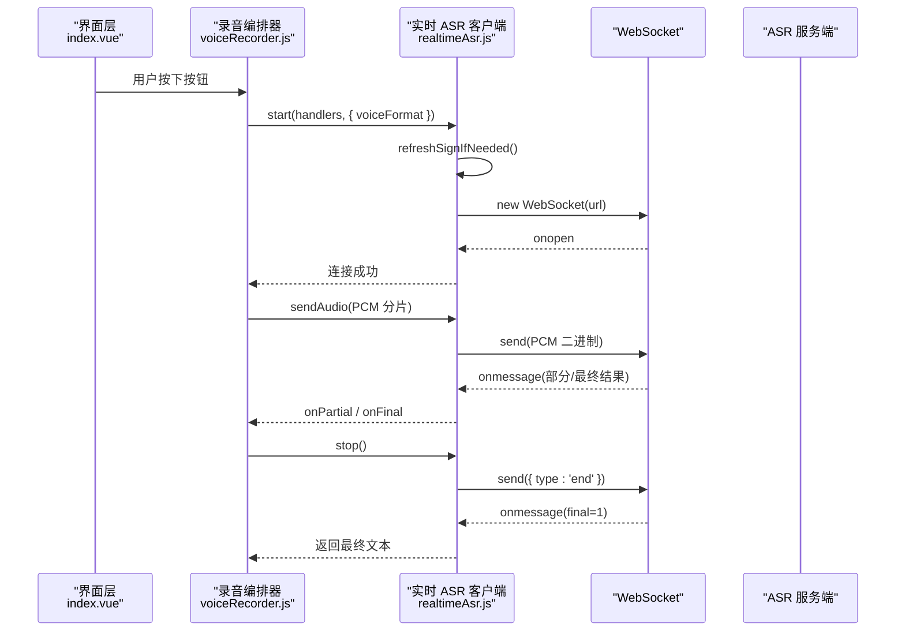
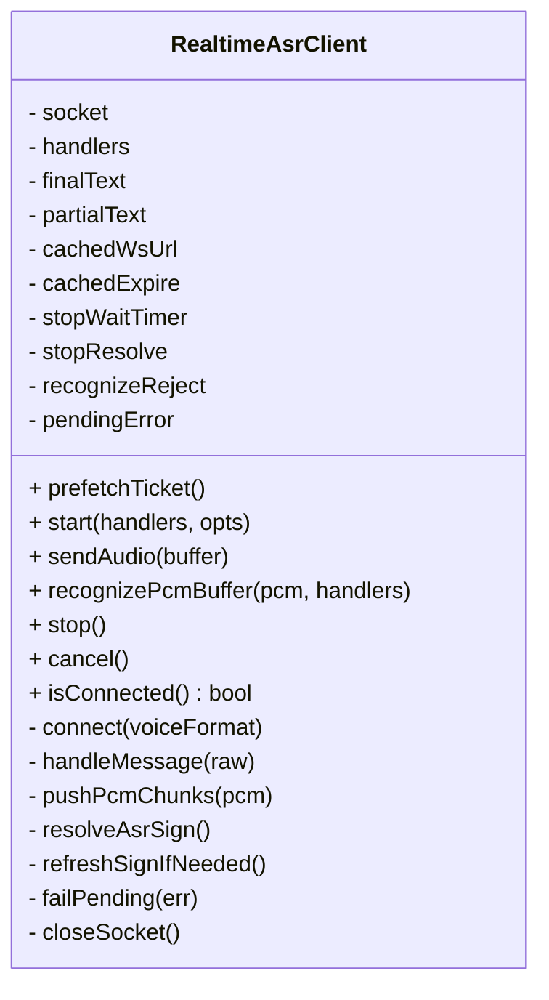
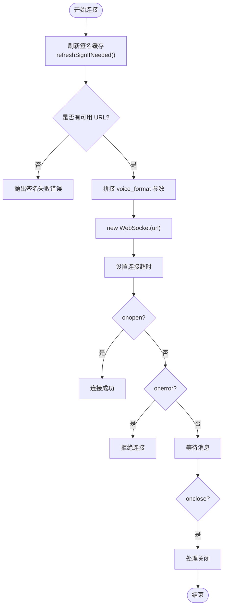
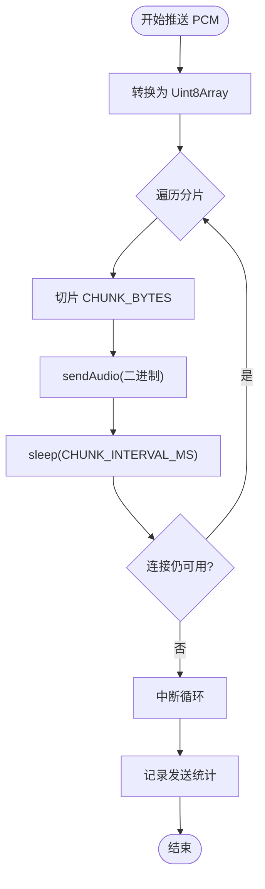
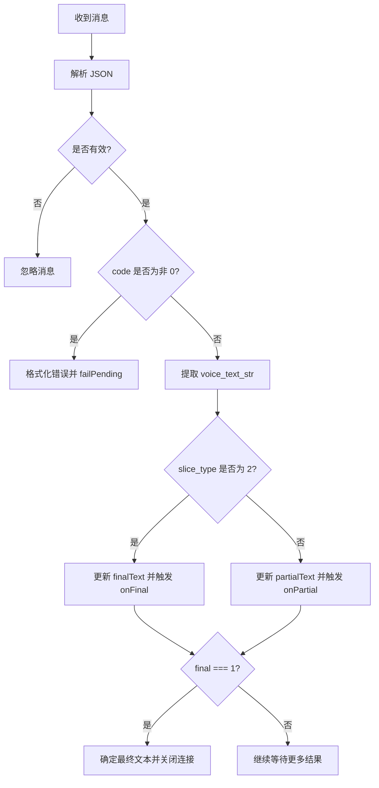
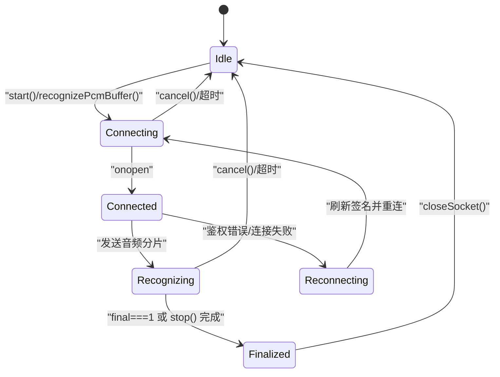
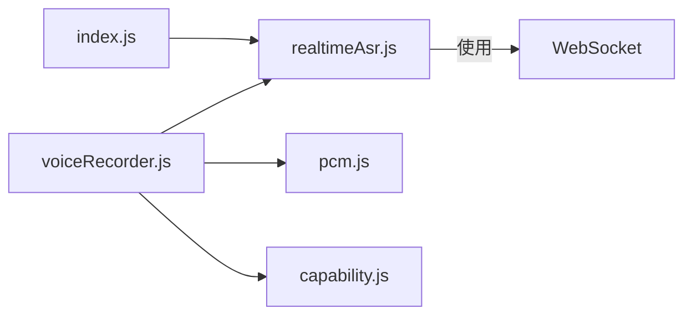

# 实时 ASR 客户端

<cite>
**本文引用的文件**   
- [realtimeAsr.js](file://uni_modules/uni-web-voice-input/js_sdk/uni-web-voice/realtimeAsr.js)
- [index.js](file://uni_modules/uni-web-voice-input/js_sdk/uni-web-voice/index.js)
- [voiceRecorder.js](file://uni_modules/uni-web-voice-input/js_sdk/uni-web-voice/voiceRecorder.js)
- [pcm.js](file://uni_modules/uni-web-voice-input/js_sdk/uni-web-voice/pcm.js)
- [capability.js](file://uni_modules/uni-web-voice-input/js_sdk/uni-web-voice/capability.js)
- [index.vue](file://demo/src/pages/index/index.vue)
</cite>

## 目录
1. [简介](#简介)
2. [项目结构](#项目结构)
3. [核心组件](#核心组件)
4. [架构总览](#架构总览)
5. [详细组件分析](#详细组件分析)
6. [依赖关系分析](#依赖关系分析)
7. [性能与优化](#性能与优化)
8. [故障排查指南](#故障排查指南)
9. [结论](#结论)
10. [附录：使用示例路径](#附录使用示例路径)

## 简介
本文件聚焦于 `realtimeAsr.js` 中实现的 WebSocket 实时语音识别客户端。该客户端以工厂函数 `createRealtimeAsrClient` 暴露，负责：
- 通过调用方注入的 `fetchSign()` 获取已签名的 WSS URL；
- 建立原生 WebSocket 连接；
- 将 PCM16 音频流分片发送；
- 处理部分识别结果与最终识别结果；
- 提供超时、错误处理、资源清理等生命周期管理能力。

该实现兼容腾讯云 ASR 协议，并与上层录音编排器 `voiceRecorder.js` 解耦，便于在 H5、App WebView、鸿蒙 ArkWeb 等多端复用。

## 项目结构
围绕实时 ASR 的核心文件组织如下：
- `realtimeAsr.js`：WebSocket 实时 ASR 客户端实现；
- `index.js`：SDK 统一导出入口，对外暴露 `createRealtimeAsrClient`；
- `voiceRecorder.js`：基于 `getUserMedia` + Web Audio 的录制编排器，内部组合 ASR 客户端；
- `pcm.js`：PCM 采样率转换与缓冲拼接工具；
- `capability.js`：麦克风能力探测与环境判断；
- `index.vue`：演示页面，展示如何注入签名并消费识别结果。

**图表来源**
- [index.js:1-18](file://uni_modules/uni-web-voice-input/js_sdk/uni-web-voice/index.js#L1-L18)
- [realtimeAsr.js:1-380](file://uni_modules/uni-web-voice-input/js_sdk/uni-web-voice/realtimeAsr.js#L1-L380)
- [voiceRecorder.js:1-315](file://uni_modules/uni-web-voice-input/js_sdk/uni-web-voice/voiceRecorder.js#L1-L315)
- [pcm.js](file://uni_modules/uni-web-voice-input/js_sdk/uni-web-voice/pcm.js)
- [capability.js](file://uni_modules/uni-web-voice-input/js_sdk/uni-web-voice/capability.js)
- [index.vue:1-138](file://demo/src/pages/index/index.vue#L1-L138)

**章节来源**
- [index.js:1-18](file://uni_modules/uni-web-voice-input/js_sdk/uni-web-voice/index.js#L1-L18)
- [realtimeAsr.js:1-380](file://uni_modules/uni-web-voice-input/js_sdk/uni-web-voice/realtimeAsr.js#L1-L380)
- [voiceRecorder.js:1-315](file://uni_modules/uni-web-voice-input/js_sdk/uni-web-voice/voiceRecorder.js#L1-L315)
- [index.vue:1-138](file://demo/src/pages/index/index.vue#L1-L138)

## 核心组件
- `createRealtimeAsrClient(options)`：创建实时 ASR 客户端实例，返回包含以下方法的对象：
  - `prefetchTicket()`：预热签名，提前缓存 WSS URL 与过期时间；
  - `start(handlers, opts)`：建立连接并开始监听，支持传入 `voiceFormat`；
  - `sendAudio(buffer)`：向已连接的 WebSocket 发送音频或文本消息；
  - `recognizePcmBuffer(pcm, handlers)`：一次性识别 PCM 缓冲，内部自动完成连接、推流、结束与超时控制；
  - `stop()`：发送结束信号并等待最终结果；
  - `cancel()`：取消当前识别流程并释放资源；
  - `isConnected()`：查询连接状态。

关键配置参数：
- `options.fetchSign`：必填，返回含 WSS URL 的签名对象；
- `options.debug`：是否输出调试日志；
- `options.WebSocketImpl`：可注入自定义 WebSocket 实现（例如 App 端 uni 的 WebSocket）。

内部常量：
- `STOP_WAIT_MS = 6000`：等待服务器最终结果的超时；
- `CONNECT_TIMEOUT_MS = 8000`：连接握手超时；
- `RECOGNIZE_TIMEOUT_MS = 20000`：整次识别流程超时；
- `SIGN_SKEW_SEC = 60`：签名刷新提前量；
- `DEFAULT_SIGN_TTL_SEC = 600`：默认签名有效期；
- `CHUNK_BYTES = 3200`：音频分片大小；
- `CHUNK_INTERVAL_MS = 40`：分片发送间隔。

**章节来源**
- [realtimeAsr.js:10-17](file://uni_modules/uni-web-voice-input/js_sdk/uni-web-voice/realtimeAsr.js#L10-L17)
- [realtimeAsr.js:78-93](file://uni_modules/uni-web-voice-input/js_sdk/uni-web-voice/realtimeAsr.js#L78-L93)
- [realtimeAsr.js:317-378](file://uni_modules/uni-web-voice-input/js_sdk/uni-web-voice/realtimeAsr.js#L317-L378)

## 架构总览
实时 ASR 客户端采用“工厂函数 + 闭包状态”的设计模式，将 WebSocket 连接、音频分片、识别回调、错误处理与资源清理封装在一个实例内。上层录音编排器通过 `voiceRecorder.js` 组合该客户端，形成完整的“按住说话”体验。

**图表来源**
- [realtimeAsr.js:151-176](file://uni_modules/uni-web-voice-input/js_sdk/uni-web-voice/realtimeAsr.js#L151-L176)
- [realtimeAsr.js:214-272](file://uni_modules/uni-web-voice-input/js_sdk/uni-web-voice/realtimeAsr.js#L214-L272)
- [realtimeAsr.js:286-315](file://uni_modules/uni-web-voice-input/js_sdk/uni-web-voice/realtimeAsr.js#L286-L315)
- [voiceRecorder.js:156-240](file://uni_modules/uni-web-voice-input/js_sdk/uni-web-voice/voiceRecorder.js#L156-L240)
- [voiceRecorder.js:246-295](file://uni_modules/uni-web-voice-input/js_sdk/uni-web-voice/voiceRecorder.js#L246-L295)

## 详细组件分析

### createRealtimeAsrClient 工厂函数设计
- 输入校验：要求必须提供 `fetchSign`，否则抛出错误；检测环境是否具备 WebSocket 实现。
- 日志系统：根据 `debug` 开关输出 `log/warn/errLog`。
- 状态变量：维护 `socket`、`handlers`、`finalText`、`partialText`、签名缓存 `cachedWsUrl/cachedExpire`、停止等待定时器与 Promise 引用等。
- 资源清理：`closeSocket()` 统一关闭连接、清除定时器，避免内存泄漏。
- 失败传播：`failPending(err)` 设置 `pendingError`，触发 `onError`，拒绝进行中的 `recognizePcmBuffer` 和 `stop` Promise，并关闭连接。

**图表来源**
- [realtimeAsr.js:84-149](file://uni_modules/uni-web-voice-input/js_sdk/uni-web-voice/realtimeAsr.js#L84-L149)
- [realtimeAsr.js:151-212](file://uni_modules/uni-web-voice-input/js_sdk/uni-web-voice/realtimeAsr.js#L151-L212)
- [realtimeAsr.js:214-315](file://uni_modules/uni-web-voice-input/js_sdk/uni-web-voice/realtimeAsr.js#L214-L315)
- [realtimeAsr.js:317-378](file://uni_modules/uni-web-voice-input/js_sdk/uni-web-voice/realtimeAsr.js#L317-L378)

**章节来源**
- [realtimeAsr.js:84-149](file://uni_modules/uni-web-voice-input/js_sdk/uni-web-voice/realtimeAsr.js#L84-L149)
- [realtimeAsr.js:317-378](file://uni_modules/uni-web-voice-input/js_sdk/uni-web-voice/realtimeAsr.js#L317-L378)

### 配置参数与生命周期管理
- 配置参数：
  - `fetchSign`：返回 `{ url, expired?, voiceId? }` 的异步函数；
  - `debug`：布尔值，控制日志输出；
  - `WebSocketImpl`：可选，用于替换底层 WebSocket 实现。
- 生命周期：
  - `prefetchTicket()`：预热签名，减少首次连接延迟；
  - `start()`：建立连接并注册事件处理器；
  - `sendAudio()`：持续推送音频数据；
  - `recognizePcmBuffer()`：端到端识别流程，包含连接、推流、结束与超时；
  - `stop()`：发送结束信号并等待最终结果；
  - `cancel()`：取消进行中任务并释放资源；
  - `isConnected()`：查询连接状态。

**章节来源**
- [realtimeAsr.js:78-93](file://uni_modules/uni-web-voice-input/js_sdk/uni-web-voice/realtimeAsr.js#L78-L93)
- [realtimeAsr.js:317-378](file://uni_modules/uni-web-voice-input/js_sdk/uni-web-voice/realtimeAsr.js#L317-L378)

### WebSocket 连接建立过程
- 签名解析：
  - `resolveAsrSign()` 调用 `fetchSign()`，解析出 `url`、`expired`、`voiceId`；
  - `pickWsUrl()` 兼容多种字段命名（`url/wsUrl/wssUrl/ws_url/wss_url`）；
  - `pickExpired()` 解析过期时间，若无效则回退到当前时间 + 默认 TTL。
- 连接构建：
  - `connect()` 先刷新签名缓存，再构造 WSS URL，追加 `voice_format` 参数；
  - 使用原生 `new WS(url)` 创建连接，设置 `binaryType='arraybuffer'`；
  - 连接超时由 `CONNECT_TIMEOUT_MS` 控制；
  - 事件绑定：`onopen/onerror/onmessage/onclose`。
- 认证与重连策略：
  - 当服务端返回鉴权相关错误码（4001/4002/4003/4004），会清空签名缓存，迫使下次重新获取签名；
  - 当前实现未内置指数退避重连逻辑，但可通过上层重试包装实现。

**图表来源**
- [realtimeAsr.js:151-176](file://uni_modules/uni-web-voice-input/js_sdk/uni-web-voice/realtimeAsr.js#L151-L176)
- [realtimeAsr.js:214-272](file://uni_modules/uni-web-voice-input/js_sdk/uni-web-voice/realtimeAsr.js#L214-L272)

**章节来源**
- [realtimeAsr.js:151-176](file://uni_modules/uni-web-voice-input/js_sdk/uni-web-voice/realtimeAsr.js#L151-L176)
- [realtimeAsr.js:214-272](file://uni_modules/uni-web-voice-input/js_sdk/uni-web-voice/realtimeAsr.js#L214-L272)

### 音频数据分片传输机制
- 分片大小：`CHUNK_BYTES = 3200` 字节；
- 发送频率：每片之间间隔 `CHUNK_INTERVAL_MS = 40` 毫秒；
- 实现方式：
  - `pushPcmChunks(pcm)` 将 PCM 缓冲转为 `Uint8Array`，按固定步长切片；
  - 每次切片后调用 `sendAudio()` 发送，并通过 `sleep(CHUNK_INTERVAL_MS)` 控制节奏；
  - 若连接断开或不可用，立即中断循环。
- 优化建议：
  - 可根据网络带宽与设备性能调整 `CHUNK_BYTES` 与 `CHUNK_INTERVAL_MS`；
  - 在高丢包场景可适当增大分片间隔，降低拥塞风险；
  - 在低延迟场景可适当减小分片大小，提升实时性。

**图表来源**
- [realtimeAsr.js:286-296](file://uni_modules/uni-web-voice-input/js_sdk/uni-web-voice/realtimeAsr.js#L286-L296)

**章节来源**
- [realtimeAsr.js:286-296](file://uni_modules/uni-web-voice-input/js_sdk/uni-web-voice/realtimeAsr.js#L286-L296)

### 识别结果处理流程
- 消息解析：
  - `parseSocketData()` 支持字符串与 ArrayBuffer，统一解析为 JSON；
  - 若解析失败，返回 `null` 并忽略该消息。
- 部分识别结果：
  - 当 `msg.result.slice_type !== 2` 时，视为部分结果，更新 `partialText` 并触发 `onPartial`；
- 最终识别结果：
  - 当 `msg.result.slice_type === 2` 时，视为最终结果，更新 `finalText` 并触发 `onFinal`；
  - 当 `msg.final === 1` 时，确保 `finalText` 有值（若无则回退到 `partialText`），调用 `stopResolve` 返回最佳文本，并关闭连接。
- 最佳文本计算：
  - `bestText()` 优先返回 `finalText`，其次 `partialText`，均空则返回空串。

**图表来源**
- [realtimeAsr.js:19-27](file://uni_modules/uni-web-voice-input/js_sdk/uni-web-voice/realtimeAsr.js#L19-L27)
- [realtimeAsr.js:178-212](file://uni_modules/uni-web-voice-input/js_sdk/uni-web-voice/realtimeAsr.js#L178-L212)

**章节来源**
- [realtimeAsr.js:178-212](file://uni_modules/uni-web-voice-input/js_sdk/uni-web-voice/realtimeAsr.js#L178-L212)

### 错误处理与重试逻辑
- 服务端错误：
  - `formatAsrServerError()` 针对特定错误码（4001/4002/4003/4004）给出可读中文提示；
  - 鉴权类错误会清空签名缓存，强制下次重新获取签名。
- 网络异常：
  - 连接超时：`CONNECT_TIMEOUT_MS` 控制；
  - 连接失败：`onerror` 拒绝连接；
  - 连接关闭：`onclose` 在未 settle 前拒绝连接，或在停止等待期间返回最佳文本。
- 音频格式错误：
  - 当前实现未对 PCM 格式做严格校验，依赖上层 `voiceRecorder.js` 保证 16k PCM16；
  - 若格式不匹配，服务端可能返回鉴权或业务错误，由 `formatAsrServerError()` 统一处理。
- 重试策略：
  - 当前未内置指数退避重连；
  - 可在上层调用 `recognizePcmBuffer()` 时自行包装重试逻辑。

**章节来源**
- [realtimeAsr.js:43-49](file://uni_modules/uni-web-voice-input/js_sdk/uni-web-voice/realtimeAsr.js#L43-L49)
- [realtimeAsr.js:182-190](file://uni_modules/uni-web-voice-input/js_sdk/uni-web-voice/realtimeAsr.js#L182-L190)
- [realtimeAsr.js:236-270](file://uni_modules/uni-web-voice-input/js_sdk/uni-web-voice/realtimeAsr.js#L236-L270)

### 连接状态管理与状态机
虽然代码未显式定义枚举状态，但可从实现中抽象出如下状态机：

- `Idle`：无活动连接；
- `Connecting`：正在建立 WebSocket 连接；
- `Connected`：连接已建立，可接收消息；
- `Recognizing`：正在发送音频并等待结果；
- `Finalized`：已收到最终结果或停止等待完成；
- `Reconnecting`：因鉴权错误或连接失败进入重连准备阶段。

**图表来源**
- [realtimeAsr.js:214-272](file://uni_modules/uni-web-voice-input/js_sdk/uni-web-voice/realtimeAsr.js#L214-L272)
- [realtimeAsr.js:298-315](file://uni_modules/uni-web-voice-input/js_sdk/uni-web-voice/realtimeAsr.js#L298-L315)
- [realtimeAsr.js:366-377](file://uni_modules/uni-web-voice-input/js_sdk/uni-web-voice/realtimeAsr.js#L366-L377)

**章节来源**
- [realtimeAsr.js:214-272](file://uni_modules/uni-web-voice-input/js_sdk/uni-web-voice/realtimeAsr.js#L214-L272)
- [realtimeAsr.js:298-315](file://uni_modules/uni-web-voice-input/js_sdk/uni-web-voice/realtimeAsr.js#L298-L315)
- [realtimeAsr.js:366-377](file://uni_modules/uni-web-voice-input/js_sdk/uni-web-voice/realtimeAsr.js#L366-L377)

## 依赖关系分析
- `realtimeAsr.js` 不直接依赖任何业务 API，仅通过 `options.fetchSign` 注入签名获取逻辑；
- `voiceRecorder.js` 组合 `createRealtimeAsrClient`，负责麦克风采集、PCM 转换与 ASR 编排；
- `pcm.js` 提供 `floatToPcm16k` 与 `concatPcmChunks`；
- `capability.js` 提供麦克风能力探测与错误描述；
- `index.js` 统一导出 SDK 能力。

**图表来源**
- [index.js:1-18](file://uni_modules/uni-web-voice-input/js_sdk/uni-web-voice/index.js#L1-L18)
- [voiceRecorder.js:15-17](file://uni_modules/uni-web-voice-input/js_sdk/uni-web-voice/voiceRecorder.js#L15-L17)
- [realtimeAsr.js:84-93](file://uni_modules/uni-web-voice-input/js_sdk/uni-web-voice/realtimeAsr.js#L84-L93)

**章节来源**
- [index.js:1-18](file://uni_modules/uni-web-voice-input/js_sdk/uni-web-voice/index.js#L1-L18)
- [voiceRecorder.js:15-17](file://uni_modules/uni-web-voice-input/js_sdk/uni-web-voice/voiceRecorder.js#L15-L17)
- [realtimeAsr.js:84-93](file://uni_modules/uni-web-voice-input/js_sdk/uni-web-voice/realtimeAsr.js#L84-L93)

## 性能与优化
- 分片大小与频率：
  - 当前 `CHUNK_BYTES=3200`、`CHUNK_INTERVAL_MS=40` 在移动端与 H5 环境下较为均衡；
  - 高带宽低延迟场景可尝试减小分片大小以提升实时性；
  - 弱网环境可增大分片间隔以降低丢包与重传压力。
- 签名缓存：
  - 通过 `cachedWsUrl/cachedExpire` 与 `SIGN_SKEW_SEC` 提前刷新，减少重复请求；
  - 鉴权失败时主动清空缓存，确保下次重新获取。
- 超时控制：
  - 连接超时 `CONNECT_TIMEOUT_MS`、识别超时 `RECOGNIZE_TIMEOUT_MS`、停止等待 `STOP_WAIT_MS` 共同保障用户体验；
  - 建议在业务层增加重试与降级策略。
- 资源清理：
  - `closeSocket()` 统一关闭连接与定时器，避免内存泄漏；
  - `cancel()` 主动清理进行中的 Promise 引用与状态。

[本节为通用性能讨论，不直接分析具体文件]

## 故障排查指南
- 无法获取签名：
  - 检查 `fetchSign()` 是否正确返回含 `url` 的对象；
  - 查看控制台日志 `[ASR] sign result=` 与 `[ASR] sign fail`。
- 连接失败或超时：
  - 检查网络环境与 HTTPS/WSS 配置；
  - 确认 `CONNECT_TIMEOUT_MS` 是否过短；
  - 查看 `onerror` 与 `onclose` 抛出的错误信息。
- 鉴权失败：
  - 关注错误码 4001/4002/4003/4004；
  - 确认签名接口返回的 `expired` 是否合理；
  - 鉴权失败会自动清空签名缓存，需重新获取。
- 无识别结果：
  - 检查 `voice_format` 是否与后端一致；
  - 确认 PCM 数据是否为 16k PCM16；
  - 查看 `onPartial`/`onFinal` 是否被触发。
- 麦克风权限问题：
  - 使用 `describeMicError()` 获取可读错误文案；
  - 确保页面为 HTTPS 且用户手势触发录音。

**章节来源**
- [realtimeAsr.js:43-49](file://uni_modules/uni-web-voice-input/js_sdk/uni-web-voice/realtimeAsr.js#L43-L49)
- [realtimeAsr.js:151-176](file://uni_modules/uni-web-voice-input/js_sdk/uni-web-voice/realtimeAsr.js#L151-L176)
- [voiceRecorder.js:25-41](file://uni_modules/uni-web-voice-input/js_sdk/uni-web-voice/voiceRecorder.js#L25-L41)

## 结论
`realtimeAsr.js` 提供了一个轻量、可插拔的实时 ASR 客户端实现，通过工厂函数封装 WebSocket 连接、音频分片、识别回调与资源清理，便于在多端环境中复用。其设计强调与业务解耦、签名注入与错误处理的可控性。结合 `voiceRecorder.js`，可实现完整的“按住说话”体验，并在 H5、App WebView、鸿蒙 ArkWeb 等场景中稳定运行。

[本节为总结性内容，不直接分析具体文件]

## 附录：使用示例路径
- 工厂函数导出：
  - [index.js:16](file://uni_modules/uni-web-voice-input/js_sdk/uni-web-voice/index.js#L16)
- 录音编排器组合 ASR 客户端：
  - [voiceRecorder.js:77-81](file://uni_modules/uni-web-voice-input/js_sdk/uni-web-voice/voiceRecorder.js#L77-L81)
- 演示页面注入签名与消费结果：
  - [index.vue:59-84](file://demo/src/pages/index/index.vue#L59-L84)

**章节来源**
- [index.js:16](file://uni_modules/uni-web-voice-input/js_sdk/uni-web-voice/index.js#L16)
- [voiceRecorder.js:77-81](file://uni_modules/uni-web-voice-input/js_sdk/uni-web-voice/voiceRecorder.js#L77-L81)
- [index.vue:59-84](file://demo/src/pages/index/index.vue#L59-L84)