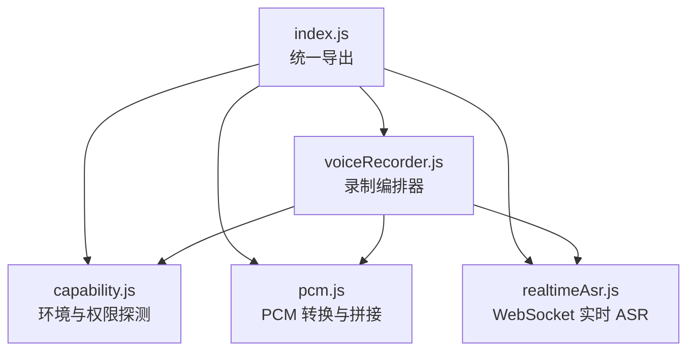
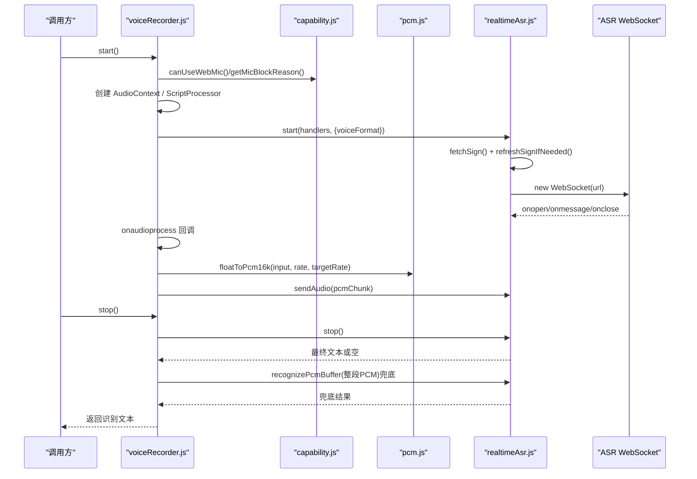
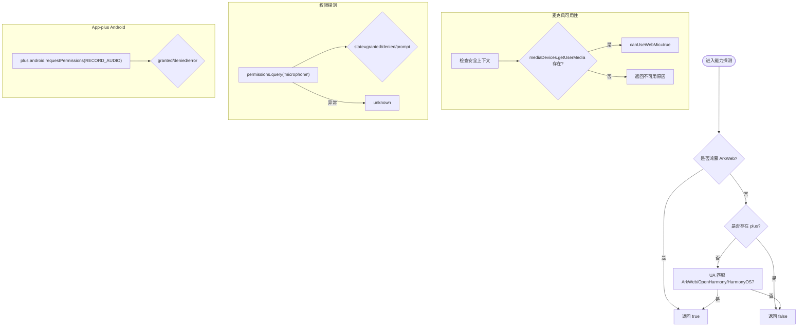
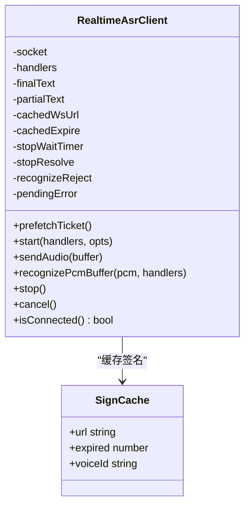
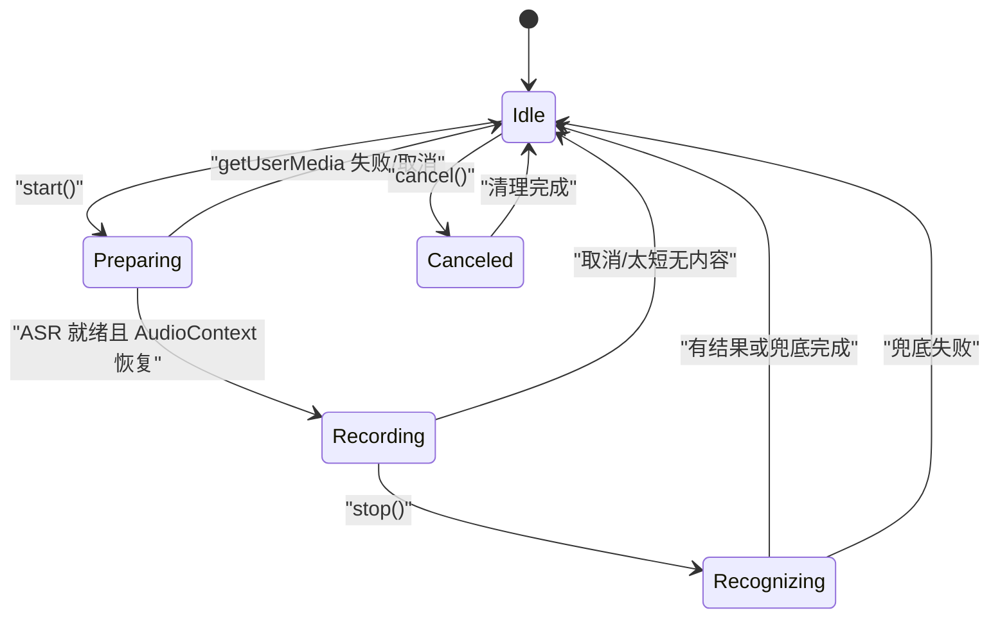
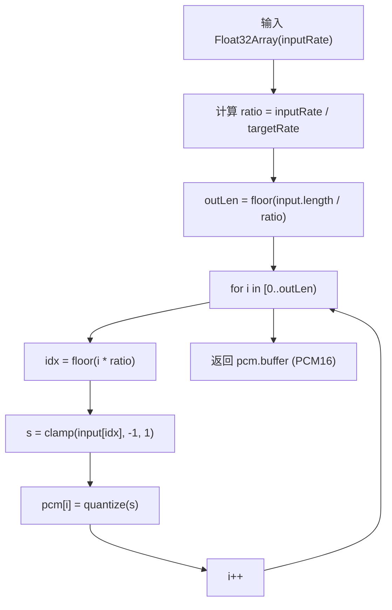
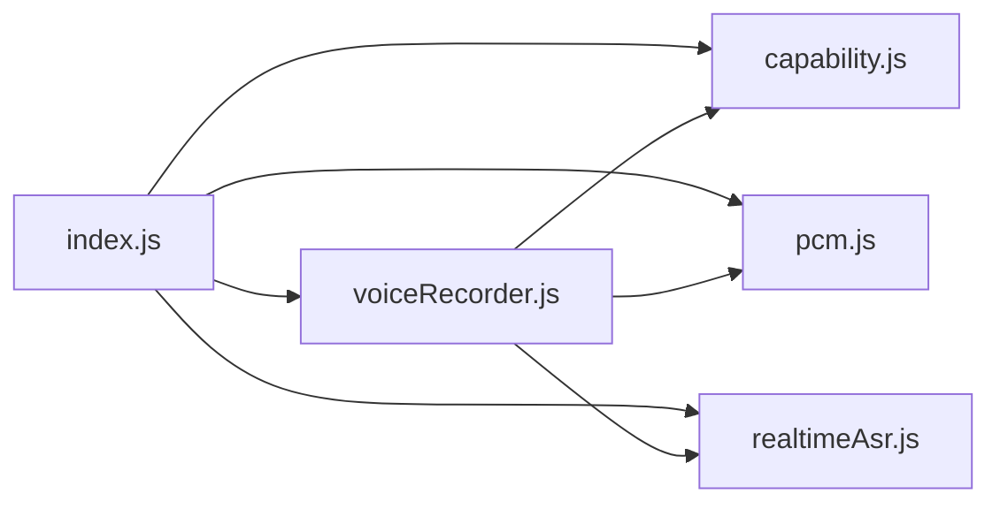

# 核心模块详解

<cite>
**本文引用的文件**   
- [capability.js](file://uni_modules/uni-web-voice-input/js_sdk/uni-web-voice/capability.js)
- [realtimeAsr.js](file://uni_modules/uni-web-voice-input/js_sdk/uni-web-voice/realtimeAsr.js)
- [voiceRecorder.js](file://uni_modules/uni-web-voice-input/js_sdk/uni-web-voice/voiceRecorder.js)
- [pcm.js](file://uni_modules/uni-web-voice-input/js_sdk/uni-web-voice/pcm.js)
- [index.js](file://uni_modules/uni-web-voice-input/js_sdk/uni-web-voice/index.js)
</cite>

## 目录
1. [引言](#引言)
2. [项目结构](#项目结构)
3. [核心组件](#核心组件)
4. [架构总览](#架构总览)
5. [详细组件分析](#详细组件分析)
6. [依赖关系分析](#依赖关系分析)
7. [性能与稳定性考量](#性能与稳定性考量)
8. [故障排查指南](#故障排查指南)
9. [结论](#结论)

## 引言
本仓库提供一套面向 uni-app 的纯 Web 语音输入能力：在浏览器、H5、App WebView（含鸿蒙 ArkWeb）中，通过 getUserMedia + Web Audio 采集 PCM，再经 WebSocket 实时推送到 ASR 服务完成实时识别。文档聚焦四个核心模块：

- capability.js：跨平台环境检测与权限管理
- realtimeAsr.js：WebSocket 实时识别客户端
- voiceRecorder.js：音频录制编排器与状态机
- pcm.js：Float32 → PCM16 重采样与分片拼接

目标是帮助开发者理解各模块的职责边界、数据流、错误处理与可观测点，以便在复杂容器环境中稳定集成。

## 项目结构
SDK 位于 uni_modules 下的 js_sdk 路径，对外统一由 index.js 暴露能力；业务侧只需引入 index.js 即可使用。

图表来源
- [index.js:6-17](file://uni_modules/uni-web-voice-input/js_sdk/uni-web-voice/index.js#L6-L17)
- [voiceRecorder.js:15-17](file://uni_modules/uni-web-voice-input/js_sdk/uni-web-voice/voiceRecorder.js#L15-L17)

章节来源
- [index.js:1-18](file://uni_modules/uni-web-voice-input/js_sdk/uni-web-voice/index.js#L1-L18)

## 核心组件
- capability.js：提供 isHarmonyWebview、isSecureContext、canUseWebMic、getMicBlockReason、probeMicPermission、isAppPlusAndroid、requestRecordAudioViaPlus 等能力探测与权限辅助函数，屏蔽不同容器差异。
- realtimeAsr.js：封装 WebSocket 连接、签名缓存与刷新、音频分片推送、错误码映射、超时控制、最终文本聚合。
- voiceRecorder.js：编排 getUserMedia、AudioContext、ScriptProcessor 与 ASR 客户端，实现“按住说话”生命周期、状态机、兜底整段识别。
- pcm.js：将 Float32 音频线性重采样到目标采样率并转为 PCM16，同时提供分片拼接工具。

章节来源
- [capability.js:14-137](file://uni_modules/uni-web-voice-input/js_sdk/uni-web-voice/capability.js#L14-L137)
- [realtimeAsr.js:78-379](file://uni_modules/uni-web-voice-input/js_sdk/uni-web-voice/realtimeAsr.js#L78-L379)
- [voiceRecorder.js:47-313](file://uni_modules/uni-web-voice-input/js_sdk/uni-web-voice/voiceRecorder.js#L47-L313)
- [pcm.js:6-36](file://uni_modules/uni-web-voice-input/js_sdk/uni-web-voice/pcm.js#L6-L36)

## 架构总览
整体流程如下：用户按下触发 start()，SDK 同步发起麦克风授权、创建 AudioContext 并启动 ASR 连接；录音过程中按固定时间间隔发送 PCM 分片；松手后先尝试从 ASR 获取结果，若无则用整段 PCM 兜底识别一次。

图表来源
- [voiceRecorder.js:156-295](file://uni_modules/uni-web-voice-input/js_sdk/uni-web-voice/voiceRecorder.js#L156-L295)
- [realtimeAsr.js:151-379](file://uni_modules/uni-web-voice-input/js_sdk/uni-web-voice/realtimeAsr.js#L151-L379)
- [pcm.js:13-23](file://uni_modules/uni-web-voice-input/js_sdk/uni-web-voice/pcm.js#L13-L23)

## 详细组件分析

### capability.js：环境检测与权限管理
职责
- 判断是否运行在鸿蒙 ArkWeb <web-view>，避免仅依赖 UA 误判。
- 判断安全上下文（HTTPS/localhost），保障 getUserMedia 可用。
- 判断当前环境能否使用网页麦克风，并提供不可用原因文案。
- 异步探测麦克风权限状态（permissions API），兼容不支持的环境。
- 针对 App-plus Android 场景，提供运行时权限申请入口。

关键逻辑要点
- 结构化信号优先：通过注入对象判定鸿蒙，其次排除 plus.webview，最后 UA 兜底。
- 安全上下文优先：优先使用 isSecureContext，否则回退协议判断。
- 权限探测容错：permissions.query 失败或不存在时返回 unknown，不阻塞主流程。
- App-plus Android 权限：仅在存在 plus.android.requestPermissions 时调用，其他环境返回 unsupported。

图表来源
- [capability.js:14-26](file://uni_modules/uni-web-voice-input/js_sdk/uni-web-voice/capability.js#L14-L26)
- [capability.js:28-63](file://uni_modules/uni-web-voice-input/js_sdk/uni-web-voice/capability.js#L28-L63)
- [capability.js:65-83](file://uni_modules/uni-web-voice-input/js_sdk/uni-web-voice/capability.js#L65-L83)
- [capability.js:85-104](file://uni_modules/uni-web-voice-input/js_sdk/uni-web-voice/capability.js#L85-L104)
- [capability.js:106-137](file://uni_modules/uni-web-voice-input/js_sdk/uni-web-voice/capability.js#L106-L137)

章节来源
- [capability.js:14-137](file://uni_modules/uni-web-voice-input/js_sdk/uni-web-voice/capability.js#L14-L137)

### realtimeAsr.js：WebSocket 实时识别客户端
职责
- 通过 options.fetchSign 获取已签名的 wss URL，支持多种字段命名。
- 缓存签名与过期时间，提前刷新避免鉴权失败。
- 建立 WebSocket 连接，设置二进制类型，处理 open/message/close/error。
- 将 PCM 音频按固定大小和时间间隔分片推送。
- 解析服务端消息，区分部分结果与最终结果，聚合最终文本。
- 提供超时控制、错误码映射、取消与连接状态查询。

关键数据结构与常量
- STOP_WAIT_MS、CONNECT_TIMEOUT_MS、RECOGNIZE_TIMEOUT_MS：控制停止等待、连接超时、识别超时。
- SIGN_SKEW_SEC、DEFAULT_SIGN_TTL_SEC：签名刷新策略与默认有效期。
- CHUNK_BYTES、CHUNK_INTERVAL_MS：音频分片大小与推送节奏。

核心流程
- 签名解析：pickWsUrl/pickExpired 兼容多字段，统一返回 url/expired/voiceId。
- 连接建立：withTimeout 包裹连接 Promise，onerror/onclose 统一拒绝。
- 消息处理：非 0 code 视为错误，特定错误码清空缓存并上报；根据 slice_type 区分 partial/final。
- 音频推送：pushPcmChunks 循环切片并按间隔 sleep 发送。
- 停止与结束：发送 {type:'end'}，等待 final 或超时，返回最佳文本。

图表来源
- [realtimeAsr.js:105-176](file://uni_modules/uni-web-voice-input/js_sdk/uni-web-voice/realtimeAsr.js#L105-L176)
- [realtimeAsr.js:317-379](file://uni_modules/uni-web-voice-input/js_sdk/uni-web-voice/realtimeAsr.js#L317-L379)

章节来源
- [realtimeAsr.js:19-53](file://uni_modules/uni-web-voice-input/js_sdk/uni-web-voice/realtimeAsr.js#L19-L53)
- [realtimeAsr.js:78-176](file://uni_modules/uni-web-voice-input/js_sdk/uni-web-voice/realtimeAsr.js#L78-L176)
- [realtimeAsr.js:178-315](file://uni_modules/uni-web-voice-input/js_sdk/uni-web-voice/realtimeAsr.js#L178-L315)
- [realtimeAsr.js:317-379](file://uni_modules/uni-web-voice-input/js_sdk/uni-web-voice/realtimeAsr.js#L317-L379)

### voiceRecorder.js：音频录制编排器
职责
- 统一管理“按住说话”的生命周期：preparing → recording → recognizing → idle/canceled。
- 在用户手势同步窗口内并发发起 ASR 连接与 getUserMedia，确保权限弹窗正常触发。
- 通过 AudioContext + ScriptProcessor 捕获音频帧，转换为 PCM16 并发送到 ASR。
- 松手后优先取实时 ASR 结果，若无则用整段 PCM 兜底识别。
- 提供 describeMicError 将底层错误映射为可读中文提示。

状态机设计
- idle：初始空闲
- preparing：准备阶段（并发初始化）
- recording：正在录音并推送 PCM
- recognizing：等待最终结果或执行兜底识别
- canceled：主动取消

图表来源
- [voiceRecorder.js:43-45](file://uni_modules/uni-web-voice-input/js_sdk/uni-web-voice/voiceRecorder.js#L43-L45)
- [voiceRecorder.js:156-295](file://uni_modules/uni-web-voice-input/js_sdk/uni-web-voice/voiceRecorder.js#L156-L295)

关键时序
- start() 必须在用户手势同步代码中直接调用，内部并发：
  - 后台启动 ASR 连接（不 await）
  - 立即 getUserMedia（保 user-activation）
  - 立即创建 AudioContext（必要时 resume）
- onaudioprocess 回调中将 Float32 转 PCM16，并分片发送到 ASR。
- stop() 先尝试 ASR.stop()，若未连接或无结果，则用 concatPcmChunks 拼接整段 PCM 走 recognizePcmBuffer 兜底。

章节来源
- [voiceRecorder.js:15-17](file://uni_modules/uni-web-voice-input/js_sdk/uni-web-voice/voiceRecorder.js#L15-L17)
- [voiceRecorder.js:25-41](file://uni_modules/uni-web-voice-input/js_sdk/uni-web-voice/voiceRecorder.js#L25-L41)
- [voiceRecorder.js:47-98](file://uni_modules/uni-web-voice-input/js_sdk/uni-web-voice/voiceRecorder.js#L47-L98)
- [voiceRecorder.js:116-150](file://uni_modules/uni-web-voice-input/js_sdk/uni-web-voice/voiceRecorder.js#L116-L150)
- [voiceRecorder.js:156-240](file://uni_modules/uni-web-voice-input/js_sdk/uni-web-voice/voiceRecorder.js#L156-L240)
- [voiceRecorder.js:246-313](file://uni_modules/uni-web-voice-input/js_sdk/uni-web-voice/voiceRecorder.js#L246-L313)

### pcm.js：音频格式转换与重采样
职责
- floatToPcm16k：将 Float32Array 线性重采样到目标采样率（默认 16kHz），并转为 Int16 PCM16 小端字节。
- concatPcmChunks：将多个 Uint8Array 分片拼接成单个 ArrayBuffer，用于整段兜底识别。

算法说明
- 线性重采样：按 inputRate/targetRate 计算 ratio，逐点映射索引并缩放至 [-1,1]，再量化为 Int16。
- 复杂度：O(N)，N 为输出样本数；空间 O(N)。

图表来源
- [pcm.js:13-23](file://uni_modules/uni-web-voice-input/js_sdk/uni-web-voice/pcm.js#L13-L23)

章节来源
- [pcm.js:6-36](file://uni_modules/uni-web-voice-input/js_sdk/uni-web-voice/pcm.js#L6-L36)

## 依赖关系分析
模块间依赖如下：
- index.js 作为统一出口，导出 capability、pcm、realtimeAsr、voiceRecorder 的能力。
- voiceRecorder 依赖 realtimeAsr（ASR 客户端）、pcm（PCM 转换与拼接）、capability（麦克风限制原因）。
- realtimeAsr 不依赖业务 API，通过 options.fetchSign 注入签名获取逻辑，保持解耦。
- pcm 为纯函数库，无外部依赖。

图表来源
- [index.js:6-17](file://uni_modules/uni-web-voice-input/js_sdk/uni-web-voice/index.js#L6-L17)
- [voiceRecorder.js:15-17](file://uni_modules/uni-web-voice-input/js_sdk/uni-web-voice/voiceRecorder.js#L15-L17)

章节来源
- [index.js:1-18](file://uni_modules/uni-web-voice-input/js_sdk/uni-web-voice/index.js#L1-L18)
- [voiceRecorder.js:15-17](file://uni_modules/uni-web-voice-input/js_sdk/uni-web-voice/voiceRecorder.js#L15-L17)

## 性能与稳定性考量
- 音频分片与节奏：realtimeAsr.js 使用 CHUNK_BYTES=3200、CHUNK_INTERVAL_MS=40，平衡延迟与网络压力；voiceRecorder.js 的 ScriptProcessor bufferSize 默认 4096，可根据设备调整。
- 连接与识别超时：CONNECT_TIMEOUT_MS=8000、RECOGNIZE_TIMEOUT_MS=20000，防止长时间挂起；STOP_WAIT_MS=6000 保证停止后合理等待最终结果。
- 签名缓存与刷新：SIGN_SKEW_SEC=60 提前刷新，减少鉴权失败概率；特定错误码（4001/4002/4003/4004）会清空缓存强制重新签名。
- 兜底机制：当实时 WS 未连上或未返回结果时，voiceRecorder.js 自动拼接整段 PCM 进行一次性识别，提升成功率。
- 资源释放：teardownAudio 与 closeSocket 确保 MediaStream、AudioContext、ScriptProcessor、WebSocket 正确关闭，避免内存泄漏。

[本节为通用指导，不直接分析具体文件]

## 故障排查指南
常见问题与定位建议
- 无法弹出麦克风权限（鸿蒙 ArkWeb）
  - 现象：按下无反应，系统不弹授权框。
  - 原因：未在用户手势同步窗口内发起 getUserMedia。
  - 解决：确保 start() 在 touchstart/mousedown 同步代码中直接调用，不要前置 await。
  - 参考：voiceRecorder.js 对 start() 的约束与并发初始化逻辑。

- 有权限但零 PCM 数据
  - 现象：能授权但 onaudioprocess 不回调。
  - 原因：AudioContext 以 suspended 状态启动。
  - 解决：创建后立即 resume()，voiceRecorder.js 已内置该逻辑。

- 实时识别无结果
  - 现象：松手后无文字返回。
  - 可能原因：WS 未连上、服务端返回错误码、网络抖动。
  - 排查：查看 onError 回调与 console 调试日志；确认 fetchSign 返回的 url 有效；检查错误码映射（4001/4002/4003/4004）。
  - 兜底：voiceRecorder.js 会自动用整段 PCM 识别一次。

- 签名失效或鉴权失败
  - 现象：连接成功但很快断开，或返回鉴权错误。
  - 原因：签名过期或服务器返回鉴权失败码。
  - 解决：确保 fetchSign 返回正确的 expired 字段；realtimeAsr.js 会在接近过期前刷新。

- 麦克风被占用或不支持参数
  - 现象：报错“麦克风被其它应用占用”或“不支持所需录音参数”。
  - 解决：检查 mediaConstraints 配置，降低约束或更换设备。
  - 参考：describeMicError 的错误映射。

章节来源
- [voiceRecorder.js:25-41](file://uni_modules/uni-web-voice-input/js_sdk/uni-web-voice/voiceRecorder.js#L25-L41)
- [voiceRecorder.js:156-240](file://uni_modules/uni-web-voice-input/js_sdk/uni-web-voice/voiceRecorder.js#L156-L240)
- [voiceRecorder.js:246-313](file://uni_modules/uni-web-voice-input/js_sdk/uni-web-voice/voiceRecorder.js#L246-L313)
- [realtimeAsr.js:43-49](file://uni_modules/uni-web-voice-input/js_sdk/uni-web-voice/realtimeAsr.js#L43-L49)
- [realtimeAsr.js:178-212](file://uni_modules/uni-web-voice-input/js_sdk/uni-web-voice/realtimeAsr.js#L178-L212)

## 结论
本 SDK 通过清晰的分层与解耦设计，实现了跨平台、高可用的语音输入能力：
- capability.js 屏蔽容器差异，提供稳健的环境与权限探测。
- realtimeAsr.js 专注 WebSocket 实时识别，具备签名缓存、错误映射与超时保护。
- voiceRecorder.js 编排完整生命周期，兼顾用户体验与成功率。
- pcm.js 提供轻量高效的音频转换工具。

在实际集成中，建议：
- 在用户手势同步窗口内调用 start()，确保权限弹窗正常。
- 合理配置 mediaConstraints 与 bufferSize，适配不同设备性能。
- 关注 onError 与 onStateChange，完善用户提示与重试策略。
- 在 App-plus Android 环境下，按需调用 requestRecordAudioViaPlus 补申请运行时权限。