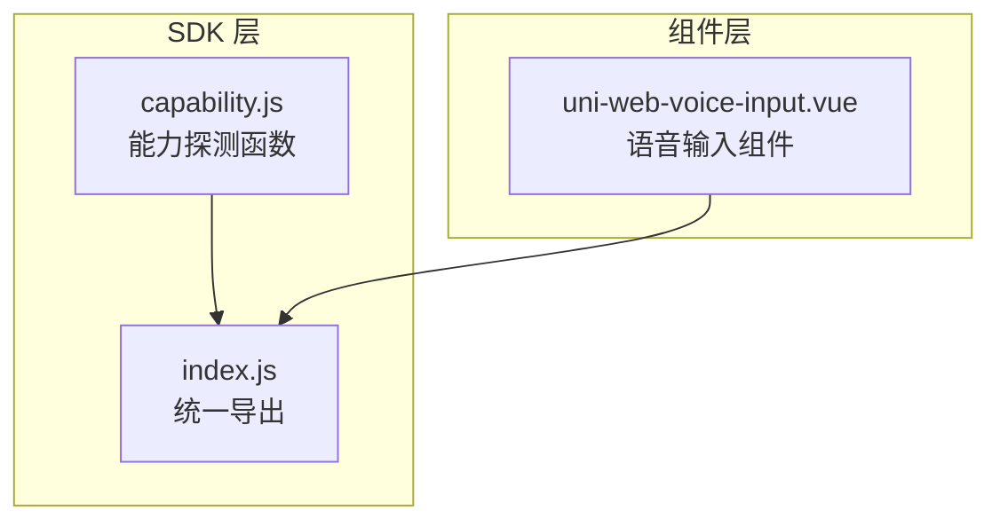
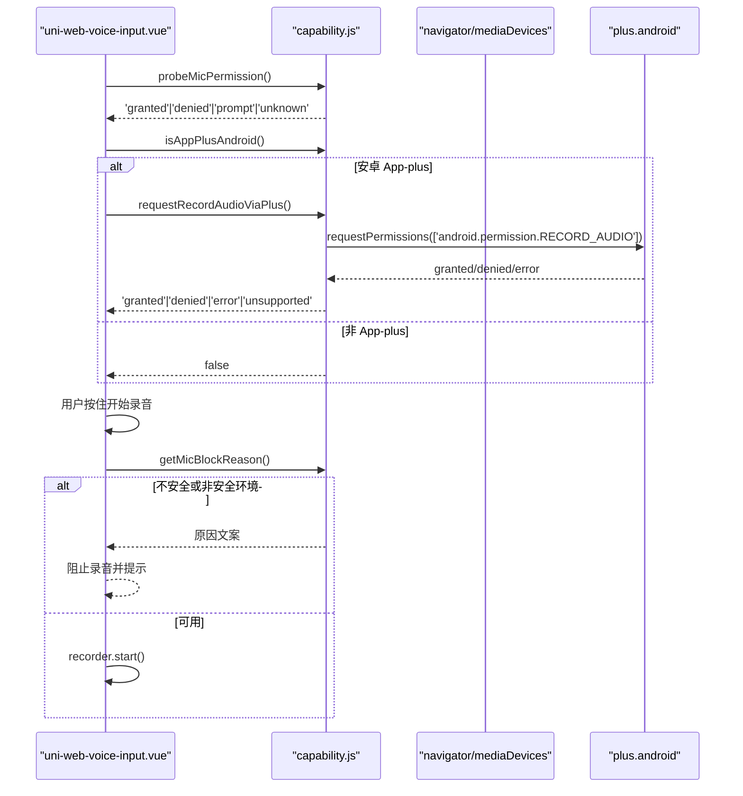
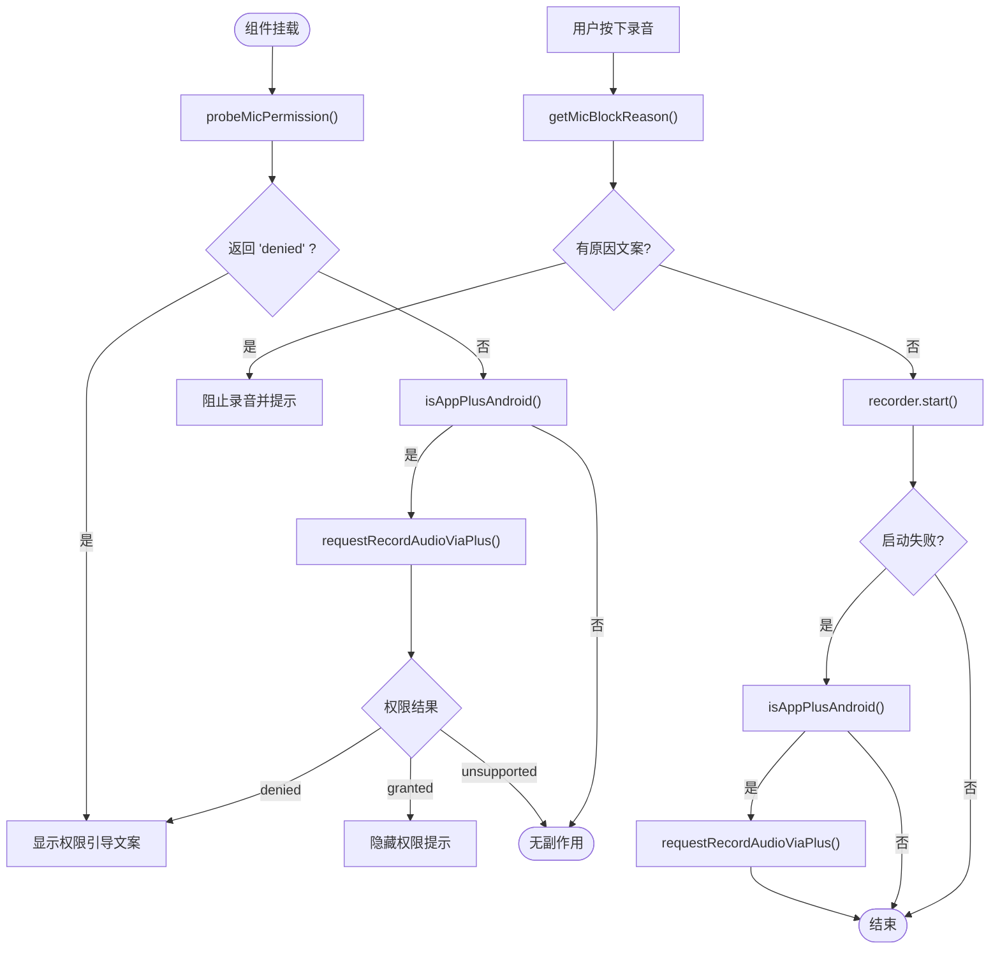
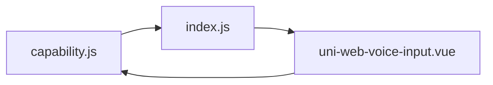

# 能力探测模块

<cite>
**本文引用的文件**   
- [capability.js](file://uni_modules/uni-web-voice-input/js_sdk/uni-web-voice/capability.js)
- [index.js](file://uni_modules/uni-web-voice-input/js_sdk/uni-web-voice/index.js)
- [uni-web-voice-input.vue](file://demo/src/uni_modules/uni-web-voice-input/components/uni-web-voice-input/uni-web-voice-input.vue)
</cite>

## 目录
1. [引言](#引言)
2. [项目结构](#项目结构)
3. [核心组件](#核心组件)
4. [架构总览](#架构总览)
5. [详细组件分析](#详细组件分析)
6. [依赖关系分析](#依赖关系分析)
7. [性能与兼容性](#性能与兼容性)
8. [故障排查指南](#故障排查指南)
9. [结论](#结论)

## 引言
本文件聚焦于跨端能力探测模块，目标是解释如何在不同容器（普通浏览器、H5、App WebView、鸿蒙 ArkWeb）中稳定地判断麦克风可用性、安全上下文、权限状态，并在安卓 App-plus 环境下通过宿主 API 申请运行时录音权限。该模块的设计原则是“框架无关、纯 Web/WebView 可用”，避免对具体 UI 框架或宿主实现做强耦合假设。

## 项目结构
能力探测相关代码集中在 uni_modules 的 js_sdk 下，并通过统一入口对外暴露：

**图表来源**
- [capability.js:1-138](file://uni_modules/uni-web-voice-input/js_sdk/uni-web-voice/capability.js#L1-L138)
- [index.js:1-18](file://uni_modules/uni-web-voice-input/js_sdk/uni-web-voice/index.js#L1-L18)

**章节来源**
- [capability.js:1-138](file://uni_modules/uni-web-voice-input/js_sdk/uni-web-voice/capability.js#L1-L138)
- [index.js:1-18](file://uni_modules/uni-web-voice-input/js_sdk/uni-web-voice/index.js#L1-L18)

## 核心组件
能力探测模块提供以下关键函数：
- isHarmonyWebview：识别是否运行在鸿蒙 ArkWeb <web-view> 内
- isSecureContext：判断当前是否为安全上下文（HTTPS 或 localhost）
- canUseWebMic：判断当前环境能否使用网页麦克风
- getMicBlockReason：返回不可用原因文案（便于直接展示）
- probeMicPermission：异步探测麦克风授权状态
- isAppPlusAndroid：判断是否在 uni-app App-plus 的安卓 webview 内
- requestRecordAudioViaPlus：通过 plus.android.requestPermissions 申请安卓录音权限

这些函数均不依赖具体 UI 框架，可在 H5、App-vue、各端 WebView（含鸿蒙 ArkWeb）中使用。

**章节来源**
- [capability.js:14-137](file://uni_modules/uni-web-voice-input/js_sdk/uni-web-voice/capability.js#L14-L137)
- [index.js:6-14](file://uni_modules/uni-web-voice-input/js_sdk/uni-web-voice/index.js#L6-L14)

## 架构总览
下图展示了能力探测在语音输入流程中的位置：组件在挂载时进行权限预热和平台检测；用户按下时同步触发录音；失败时根据平台差异给出提示并尝试补申请权限。

**图表来源**
- [uni-web-voice-input.vue:130-169](file://demo/src/uni_modules/uni-web-voice-input/components/uni-web-voice-input/uni-web-voice-input.vue#L130-L169)
- [uni-web-voice-input.vue:180-228](file://demo/src/uni_modules/uni-web-voice-input/components/uni-web-voice-input/uni-web-voice-input.vue#L180-L228)
- [capability.js:52-137](file://uni_modules/uni-web-voice-input/js_sdk/uni-web-voice/capability.js#L52-L137)

## 详细组件分析

### isHarmonyWebview：结构化信号优先的结构化环境识别
isHarmonyWebview 的核心思路是“结构化信号优先，UA 兜底”：
- 首选信号：window.__uniapp_x_ 是否存在。这是鸿蒙 ArkWeb <web-view> 注入的 JS 代理，安卓/iOS 的 plus.webview 不会注入，因此具有强确定性。
- 排除信号：若 window.plus 存在，则判定为 Html5Plus 容器，直接返回 false，避免误判。
- UA 兜底：当上述两个条件都不满足时，再回退到 navigator.userAgent 匹配 ArkWeb/OpenHarmony/HarmonyOS。

这种设计比传统 UA 检测更可靠的原因：
- UA 可被宿主 setCustomUserAgent 覆盖，导致关键字缺失或变化，从而误判。
- 结构化信号由宿主主动注入，具备更强的确定性和稳定性。
- 先排除 plus 容器，再结合 UA 兜底，降低误报率。

返回值说明：
- true：运行在鸿蒙 ArkWeb <web-view> 内
- false：非鸿蒙 ArkWeb <web-view>

错误处理：
- 函数内部对 window/navigator 的存在性做了防御性检查，避免空引用异常。

使用示例（概念性描述）：
- 在组件初始化时调用 isHarmonyWebview(window)，若返回 true，则可按需调整交互策略（例如确保录音启动发生在用户手势回调中）。

**章节来源**
- [capability.js:14-26](file://uni_modules/uni-web-voice-input/js_sdk/uni-web-voice/capability.js#L14-L26)

### isSecureContext：安全上下文检测逻辑
isSecureContext 用于判断当前是否为安全上下文，这是 getUserMedia 的前置条件：
- 优先使用浏览器提供的 isSecureContext 布尔值。
- 兜底逻辑：若未暴露该字段，则通过 location.protocol === 'https:' 或 location.hostname === 'localhost' 判断。
- 捕获异常：若访问 location 抛出异常，返回 false。

特殊处理：
- https 协议：明确视为安全上下文。
- localhost：开发环境常见，允许作为安全上下文，便于本地调试。

返回值说明：
- true：当前处于安全上下文
- false：非安全上下文

错误处理：
- 对 isSecureContext 和 location 访问做了 try/catch，保证鲁棒性。

使用示例（概念性描述）：
- 在录音前调用 isSecureContext(window)，若非安全上下文，应提示用户改用 HTTPS 或在 App 内重试。

**章节来源**
- [capability.js:28-39](file://uni_modules/uni-web-voice-input/js_sdk/uni-web-voice/capability.js#L28-L39)

### canUseWebMic：麦克风可用性判断
canUseWebMic 综合判断当前环境是否可以使用网页麦克风：
- 必须存在 window。
- 必须处于安全上下文（调用 isSecureContext）。
- 必须支持 navigator.mediaDevices.getUserMedia。

返回值说明：
- true：可以走网页降级路径（getUserMedia + WebSocket ASR）
- false：不可用

错误处理：
- 对 window 和 navigator 的存在性做防御性检查。

使用示例（概念性描述）：
- 在组件挂载或用户首次交互前调用 canUseWebMic(window, navigator)，若返回 false，应禁用录音按钮并提示原因。

**章节来源**
- [capability.js:41-46](file://uni_modules/uni-web-voice-input/js_sdk/uni-web-voice/capability.js#L41-L46)

### getMicBlockReason：不可用原因文案
getMicBlockReason 用于返回无法使用麦克风的原因文案，便于直接展示给用户：
- 若 canUseWebMic 返回 true，则返回 null（表示可用）。
- 若非安全上下文，返回 HTTP 相关的提示文案。
- 若缺少 getUserMedia，返回不支持录音的提示文案。

返回值说明：
- null：可用
- string：不可用原因文案

错误处理：
- 对 window 和 navigator 的存在性做防御性检查。

使用示例（概念性描述）：
- 在用户按下录音前调用 getMicBlockReason(window, navigator)，若有文案则阻止录音并展示。

**章节来源**
- [capability.js:48-63](file://uni_modules/uni-web-voice-input/js_sdk/uni-web-voice/capability.js#L48-L63)

### probeMicPermission：异步权限探测与降级策略
probeMicPermission 用于异步探测麦克风授权状态：
- 优先使用 navigator.permissions.query({ name: 'microphone' })。
- 若不存在 permissions 或 query 方法，直接返回 'unknown'。
- 成功获取结果后取 r.state，否则默认 'unknown'。
- 任何异常都 catch 为 'unknown'，避免阻塞流程。

返回值说明：
- Promise<'granted'|'denied'|'prompt'|'unknown'>

降级策略：
- 老内核（包括部分 ArkWeb）可能不支持 'microphone' 或没有 permissions，一律静默回落到 'unknown'，由调用方当作未知处理，继续走 getUserMedia 自然弹窗。

使用示例（概念性描述）：
- 在组件挂载时调用 probeMicPermission(window, navigator)，若返回 'denied'，可预显示引导文案，提升用户体验。

**章节来源**
- [capability.js:65-83](file://uni_modules/uni-web-voice-input/js_sdk/uni-web-voice/capability.js#L65-L83)

### isAppPlusAndroid：安卓 App-plus 环境识别
isAppPlusAndroid 用于判断是否运行在 uni-app App-plus 的安卓 webview 内：
- 首先检查 window.plus 是否存在。
- 其次尝试读取 w.plus.os.name 并匹配 android。
- 最后回退到 navigator.userAgent 匹配 android。
- 所有读取操作包裹 try/catch，避免宿主 API 不稳定导致的异常。

返回值说明：
- true：安卓 App-plus 环境
- false：非安卓 App-plus 环境

使用示例（概念性描述）：
- 在组件挂载时调用 isAppPlusAndroid(window)，若为真，可考虑自动申请 RECORD_AUDIO 权限。

**章节来源**
- [capability.js:85-104](file://uni_modules/uni-web-voice-input/js_sdk/uni-web-voice/capability.js#L85-L104)

### requestRecordAudioViaPlus：安卓运行时权限申请
requestRecordAudioViaPlus 通过 plus.android.requestPermissions 申请安卓录音运行时权限：
- 若不存在 plus 或 plus.android.requestPermissions，返回 'unsupported'。
- 调用 plus.android.requestPermissions(['android.permission.RECORD_AUDIO'])。
- 成功回调中解析 res.granted、res.deniedPresent、res.deniedAlways：
  - 若 granted 列表非空，返回 'granted'。
  - 若 denied 列表长度大于 0，返回 'denied'。
  - 其他情况默认返回 'granted'。
- 失败回调或异常捕获返回 'error'。

返回值说明：
- Promise<'granted'|'denied'|'unsupported'|'error'>

错误处理：
- 对宿主 API 的不存在、异常回调、try/catch 做了全面保护，确保零副作用。

使用示例（概念性描述）：
- 在组件挂载时调用 requestRecordAudioViaPlus(window)，若返回 'granted'，可隐藏权限提示；若 'denied'，可显示引导文案；若 'unsupported'，不做任何操作。

**章节来源**
- [capability.js:106-137](file://uni_modules/uni-web-voice-input/js_sdk/uni-web-voice/capability.js#L106-L137)

### 组件侧的使用示例与错误处理
uni-web-voice-input.vue 展示了能力探测在实际组件中的用法：
- 组件挂载时：
  - 调用 probeMicPermission(window, navigator)，若返回 'denied'，设置 deniedHint 以预显示“麦克风未授权，点击重试”。
  - 若 isAppPlusAndroid(window) 为真且 autoRequestAndroidPermission 为真，调用 requestRecordAudioViaPlus(window) 自动申请权限。
- 用户按下录音时：
  - 先调用 getMicBlockReason(window, navigator)，若有原因文案则阻止录音并提示。
  - 同步调用 recorder.start()，确保在用户手势回调中触发（鸿蒙/安卓才会弹麦克风权限）。
  - 若 start 失败且检测到安卓 App-plus 环境，将错误信息转为人话并再次尝试申请权限。

**图表来源**
- [uni-web-voice-input.vue:130-169](file://demo/src/uni_modules/uni-web-voice-input/components/uni-web-voice-input/uni-web-voice-input.vue#L130-L169)
- [uni-web-voice-input.vue:180-228](file://demo/src/uni_modules/uni-web-voice-input/components/uni-web-voice-input/uni-web-voice-input.vue#L180-L228)

**章节来源**
- [uni-web-voice-input.vue:130-169](file://demo/src/uni_modules/uni-web-voice-input/components/uni-web-voice-input/uni-web-voice-input.vue#L130-L169)
- [uni-web-voice-input.vue:180-228](file://demo/src/uni_modules/uni-web-voice-input/components/uni-web-voice-input/uni-web-voice-input.vue#L180-L228)

## 依赖关系分析
能力探测模块与组件之间的依赖关系如下：

- capability.js 提供能力探测函数。
- index.js 统一导出这些函数。
- uni-web-voice-input.vue 从 index.js 导入并使用这些函数。

**图表来源**
- [capability.js:1-138](file://uni_modules/uni-web-voice-input/js_sdk/uni-web-voice/capability.js#L1-L138)
- [index.js:1-18](file://uni_modules/uni-web-voice-input/js_sdk/uni-web-voice/index.js#L1-L18)
- [uni-web-voice-input.vue:38-44](file://demo/src/uni_modules/uni-web-voice-input/components/uni-web-voice-input/uni-web-voice-input.vue#L38-L44)

**章节来源**
- [capability.js:1-138](file://uni_modules/uni-web-voice-input/js_sdk/uni-web-voice/capability.js#L1-L138)
- [index.js:1-18](file://uni_modules/uni-web-voice-input/js_sdk/uni-web-voice/index.js#L1-L18)
- [uni-web-voice-input.vue:38-44](file://demo/src/uni_modules/uni-web-voice-input/components/uni-web-voice-input/uni-web-voice-input.vue#L38-L44)

## 性能与兼容性
- 性能特性：
  - probeMicPermission 使用异步方式，不阻塞主线程，建议在组件挂载时调用。
  - isHarmonyWebview、isSecureContext、canUseWebMic 等均为同步轻量判断，开销极低。
  - requestRecordAudioViaPlus 仅在安卓 App-plus 环境调用，避免不必要的宿主 API 调用。
- 兼容性矩阵（概念性总结）：
  - 普通浏览器/H5：依赖 isSecureContext（HTTPS 或 localhost）和 mediaDevices.getUserMedia。
  - App WebView（安卓/iOS）：可能存在 plus 容器，需区分平台行为。
  - 鸿蒙 ArkWeb：<web-view> 注入 __uniapp_x_，UA 可能被覆写，需结构化信号优先。
  - 安卓 App-plus：getUserMedia 不自动弹系统授权框，需通过 plus.android.requestPermissions 申请 RECORD_AUDIO。

[本节为通用指导，不涉及具体文件分析]

## 故障排查指南
常见问题与处理建议：
- 非安全环境（HTTP）：
  - 现象：getMicBlockReason 返回 HTTP 相关文案。
  - 处理：改用 HTTPS 或在 App 内重试。
- 缺少 getUserMedia：
  - 现象：getMicBlockReason 返回不支持录音文案。
  - 处理：升级浏览器或宿主版本，或改用原生录音桥。
- 权限被拒绝：
  - 现象：probeMicPermission 返回 'denied'。
  - 处理：预显示权限引导文案，引导用户手动授权。
- 安卓 App-plus 权限问题：
  - 现象：recorder.start() 失败，错误信息包含 audio/permission/notreadable/notallowed/denied/start。
  - 处理：调用 requestRecordAudioViaPlus 申请 RECORD_AUDIO，并根据结果更新提示。

**章节来源**
- [capability.js:48-63](file://uni_modules/uni-web-voice-input/js_sdk/uni-web-voice/capability.js#L48-L63)
- [capability.js:65-83](file://uni_modules/uni-web-voice-input/js_sdk/uni-web-voice/capability.js#L65-L83)
- [capability.js:106-137](file://uni_modules/uni-web-voice-input/js_sdk/uni-web-voice/capability.js#L106-L137)
- [uni-web-voice-input.vue:180-228](file://demo/src/uni_modules/uni-web-voice-input/components/uni-web-voice-input/uni-web-voice-input.vue#L180-L228)

## 结论
能力探测模块通过结构化信号优先、UA 兜底的策略，准确识别鸿蒙 ArkWeb 环境；通过 isSecureContext 严格保障安全上下文；通过 canUseWebMic 和 getMicBlockReason 提供清晰的可用性判断与用户提示；通过 probeMicPermission 异步探测权限状态并提供降级策略；通过 isAppPlusAndroid 和 requestRecordAudioViaPlus 在安卓 App-plus 环境下补申请运行时权限。整体设计稳健、兼容性强，适合在多端 WebView 环境中复用。

[本节为总结性内容，不涉及具体文件分析]