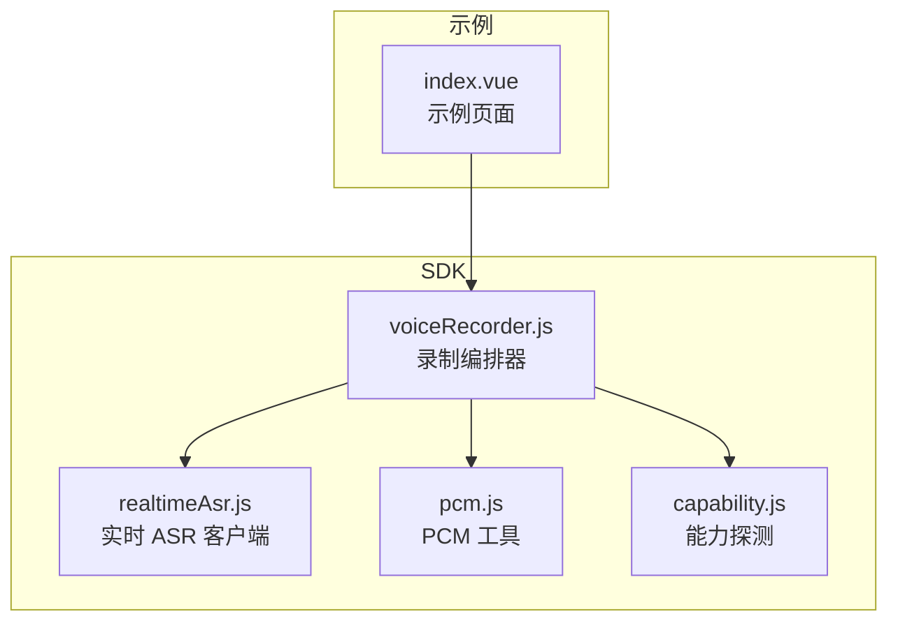
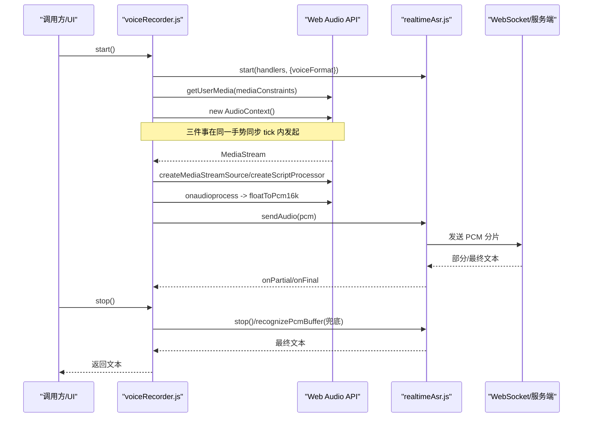
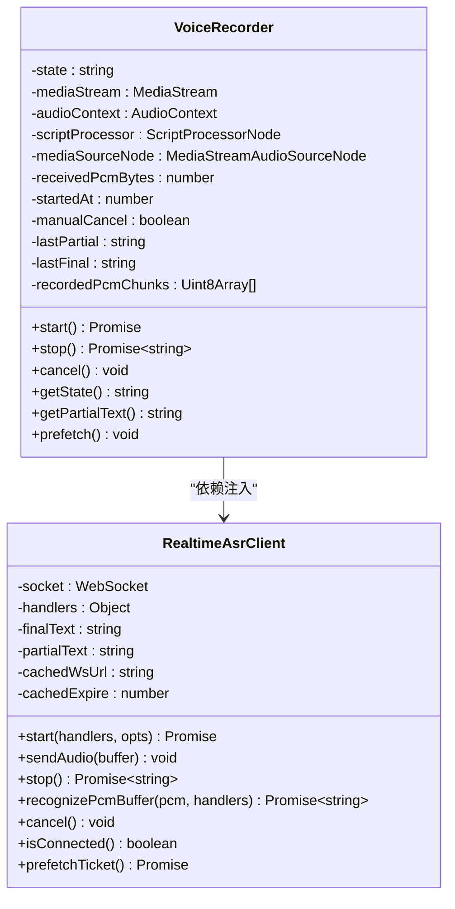
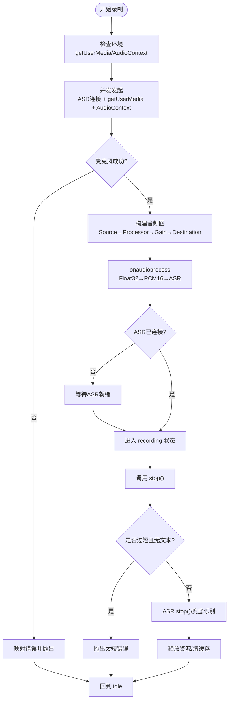
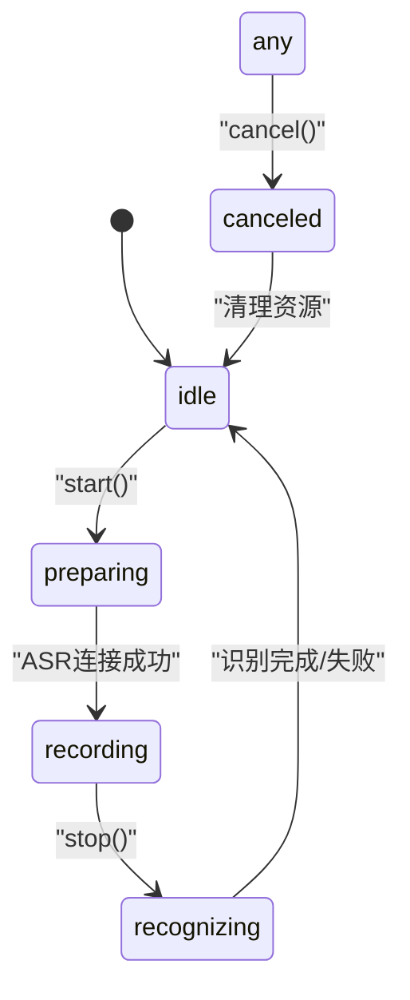
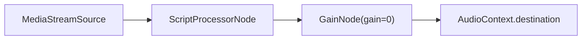
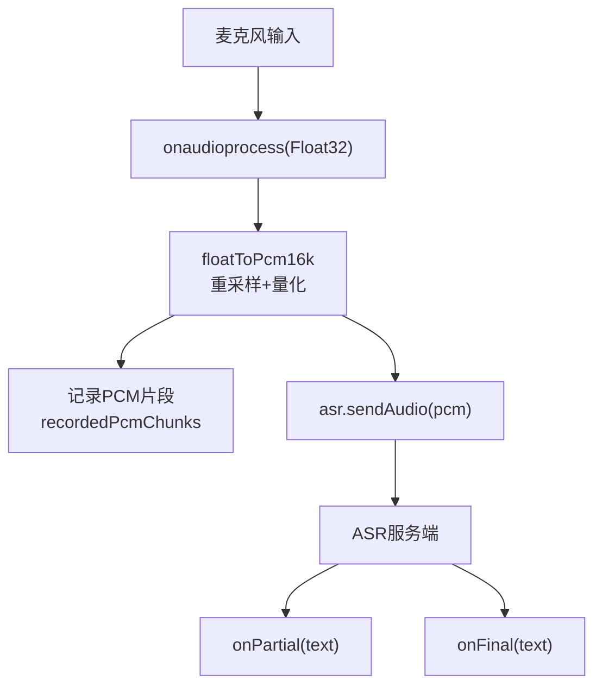
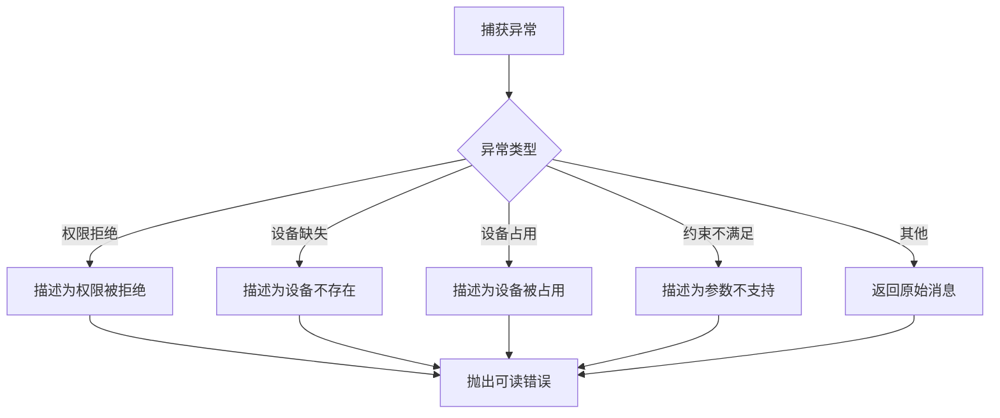
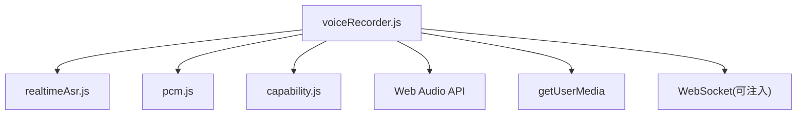

# 语音录制编排器

<cite>
**本文引用的文件**   
- [voiceRecorder.js](file://uni_modules/uni-web-voice-input/js_sdk/uni-web-voice/voiceRecorder.js)
- [realtimeAsr.js](file://uni_modules/uni-web-voice-input/js_sdk/uni-web-voice/realtimeAsr.js)
- [pcm.js](file://uni_modules/uni-web-voice-input/js_sdk/uni-web-voice/pcm.js)
- [capability.js](file://uni_modules/uni-web-voice-input/js_sdk/uni-web-voice/capability.js)
- [index.vue](file://demo/src/pages/index/index.vue)
- [README.md](file://README.md)
</cite>

## 目录
1. [引言](#引言)
2. [项目结构](#项目结构)
3. [核心组件](#核心组件)
4. [架构总览](#架构总览)
5. [详细组件分析](#详细组件分析)
6. [依赖关系分析](#依赖关系分析)
7. [性能与优化](#性能与优化)
8. [故障排查指南](#故障排查指南)
9. [API 参考](#api-参考)
10. [结论](#结论)

## 引言
本文件聚焦于 `voiceRecorder.js` 中「语音录制编排器」的设计与实现。它封装了从麦克风采集、Web Audio 处理、PCM 转换到实时 ASR 传输的完整「按住说话」生命周期，并通过工厂函数 `createVoiceRecorder` 提供模块化组合与依赖注入能力。文档将系统阐述状态机、音频管线、错误处理、性能优化以及 API 使用方式，帮助开发者在浏览器、H5、App WebView（含鸿蒙 ArkWeb）等环境中稳定落地语音输入。

## 项目结构
围绕语音录制编排器的关键代码位于 SDK 目录：
- `voiceRecorder.js`：录制编排器工厂、状态机、音频链路、ASR 集成。
- `realtimeAsr.js`：基于 WebSocket 的实时 ASR 客户端，负责签名获取、连接管理、分片发送与结果回调。
- `pcm.js`：Float32 到 PCM16 的重采样与拼接工具。
- `capability.js`：跨端能力探测与安全上下文判断，辅助权限与环境诊断。
- `demo/src/pages/index/index.vue`：示例页面，演示组件用法与签名注入。
- `README.md`：项目说明与关键修复点。

**图表来源**
- [voiceRecorder.js:15-17](file://uni_modules/uni-web-voice-input/js_sdk/uni-web-voice/voiceRecorder.js#L15-L17)
- [realtimeAsr.js:84-93](file://uni_modules/uni-web-voice-input/js_sdk/uni-web-voice/realtimeAsr.js#L84-L93)
- [pcm.js:13-23](file://uni_modules/uni-web-voice-input/js_sdk/uni-web-voice/pcm.js#L13-L23)
- [capability.js:15-46](file://uni_modules/uni-web-voice-input/js_sdk/uni-web-voice/capability.js#L15-L46)
- [index.vue:34-84](file://demo/src/pages/index/index.vue#L34-L84)

**章节来源**
- [voiceRecorder.js:1-17](file://uni_modules/uni-web-voice-input/js_sdk/uni-web-voice/voiceRecorder.js#L1-L17)
- [README.md:1-24](file://README.md#L1-L24)

## 核心组件
- `createVoiceRecorder(options)`：工厂函数，返回具备 `start`、`stop`、`cancel`、`getState`、`getPartialText`、`prefetch` 能力的录制器实例。
- `describeMicError(e)`：将底层 DOMException/Error 映射为可读中文提示。
- `createRealtimeAsrClient(options)`：实时 ASR 客户端，封装 WebSocket 连接、分片发送、超时控制与结果回调。
- `floatToPcm16k(input, inputRate, targetRate)`：Float32 线性重采样并量化为 PCM16。
- `concatPcmChunks(chunks)`：将多段 PCM 片段拼接为整段 Buffer，用于兜底识别。
- `isHarmonyWebview` / `canUseWebMic` / `probeMicPermission` / `getMicBlockReason`：跨端能力探测与权限诊断。

**章节来源**
- [voiceRecorder.js:25-41](file://uni_modules/uni-web-voice-input/js_sdk/uni-web-voice/voiceRecorder.js#L25-L41)
- [voiceRecorder.js:60-98](file://uni_modules/uni-web-voice-input/js_sdk/uni-web-voice/voiceRecorder.js#L60-L98)
- [realtimeAsr.js:84-93](file://uni_modules/uni-web-voice-input/js_sdk/uni-web-voice/realtimeAsr.js#L84-L93)
- [pcm.js:13-36](file://uni_modules/uni-web-voice-input/js_sdk/uni-web-voice/pcm.js#L13-L36)
- [capability.js:15-63](file://uni_modules/uni-web-voice-input/js_sdk/uni-web-voice/capability.js#L15-L63)

## 架构总览
录制编排器采用「模块化组合 + 依赖注入」模式：
- 通过 `options.fetchSign` 注入 ASR 签名逻辑，不绑定具体后端。
- 通过 `options.WebSocketImpl` 注入 WebSocket 实现，适配 App 端容器。
- 通过 `options._win` / `options._nav` 注入宿主环境对象，便于测试与非标准环境。
- 内部以状态机驱动录音流程，结合 Web Audio 管线与 ASR 客户端完成端到端识别。

**图表来源**
- [voiceRecorder.js:156-240](file://uni_modules/uni-web-voice-input/js_sdk/uni-web-voice/voiceRecorder.js#L156-L240)
- [realtimeAsr.js:214-284](file://uni_modules/uni-web-voice-input/js_sdk/uni-web-voice/realtimeAsr.js#L214-L284)
- [pcm.js:13-23](file://uni_modules/uni-web-voice-input/js_sdk/uni-web-voice/pcm.js#L13-L23)

## 详细组件分析

### 工厂函数与依赖注入
`createVoiceRecorder` 接收配置项，内部创建 ASR 客户端、维护状态与资源句柄，并暴露录制生命周期方法。关键设计点：
- 依赖注入：`fetchSign`、`WebSocketImpl`、`_win`、`_nav` 均可外部注入，解耦环境与后端。
- 默认参数：目标采样率 16kHz、缓冲帧 4096、最小时长 600ms、降噪与回声消除开启。
- 状态管理：内部 `state` 变量配合 `setState` 触发 `onStateChange` 回调。

**图表来源**
- [voiceRecorder.js:60-98](file://uni_modules/uni-web-voice-input/js_sdk/uni-web-voice/voiceRecorder.js#L60-L98)
- [realtimeAsr.js:84-114](file://uni_modules/uni-web-voice-input/js_sdk/uni-web-voice/realtimeAsr.js#L84-L114)

**章节来源**
- [voiceRecorder.js:60-98](file://uni_modules/uni-web-voice-input/js_sdk/uni-web-voice/voiceRecorder.js#L60-L98)
- [realtimeAsr.js:84-93](file://uni_modules/uni-web-voice-input/js_sdk/uni-web-voice/realtimeAsr.js#L84-L93)

### 音频录制生命周期
录制器生命周期由 `start`、`stop`、`cancel` 驱动，核心时序如下：
- `start()`：
  - 校验环境（`navigator.mediaDevices.getUserMedia`、`AudioContext`）。
  - 并发发起 ASR 连接、`getUserMedia`、创建 `AudioContext`，确保用户手势激活窗口有效。
  - 构建音频图：`MediaStreamSource` → `ScriptProcessor` → 静音 Gain → `destination`。
  - 在 `onaudioprocess` 中将 Float32 转 PCM16，并推送到 ASR。
  - 等待 ASR 连接成功后进入 `recording` 状态。
- `stop()`：
  - 若已取消或空闲则快速返回。
  - 短录音且无文本时抛出“太短”错误。
  - 优先走实时 ASR 结束流程；若无文本则用整段 PCM 兜底识别。
  - 释放音频资源，清理缓冲区，回到 `idle`。
- `cancel()`：
  - 标记手动取消，置状态为 `canceled`，关闭 ASR 与音频资源。

**图表来源**
- [voiceRecorder.js:156-240](file://uni_modules/uni-web-voice-input/js_sdk/uni-web-voice/voiceRecorder.js#L156-L240)
- [voiceRecorder.js:246-295](file://uni_modules/uni-web-voice-input/js_sdk/uni-web-voice/voiceRecorder.js#L246-L295)

**章节来源**
- [voiceRecorder.js:156-240](file://uni_modules/uni-web-voice-input/js_sdk/uni-web-voice/voiceRecorder.js#L156-L240)
- [voiceRecorder.js:246-295](file://uni_modules/uni-web-voice-input/js_sdk/uni-web-voice/voiceRecorder.js#L246-L295)

### 状态机设计
状态定义与转换规则：
- 状态集合：`idle`、`preparing`、`recording`、`recognizing`、`canceled`。
- 转换规则：
  - `idle` → `preparing`：调用 `start()`。
  - `preparing` → `recording`：ASR 连接成功且音频链路就绪。
  - `recording` → `recognizing`：调用 `stop()` 后进入收尾识别阶段。
  - `*` → `canceled`：调用 `cancel()`。
  - `recognizing` → `idle`：识别完成或失败后清理资源。
  - `canceled` → `idle`：取消后清理资源。

**图表来源**
- [voiceRecorder.js:83-98](file://uni_modules/uni-web-voice-input/js_sdk/uni-web-voice/voiceRecorder.js#L83-L98)
- [voiceRecorder.js:156-240](file://uni_modules/uni-web-voice-input/js_sdk/uni-web-voice/voiceRecorder.js#L156-L240)
- [voiceRecorder.js:246-295](file://uni_modules/uni-web-voice-input/js_sdk/uni-web-voice/voiceRecorder.js#L246-L295)

**章节来源**
- [voiceRecorder.js:83-98](file://uni_modules/uni-web-voice-input/js_sdk/uni-web-voice/voiceRecorder.js#L83-L98)
- [voiceRecorder.js:156-240](file://uni_modules/uni-web-voice-input/js_sdk/uni-web-voice/voiceRecorder.js#L156-L240)
- [voiceRecorder.js:246-295](file://uni_modules/uni-web-voice-input/js_sdk/uni-web-voice/voiceRecorder.js#L246-L295)

### Web Audio API 深度集成
- `AudioContext` 创建与恢复：在用户手势同步窗口内创建，必要时显式 `resume()`，避免 `suspended` 导致 `onaudioprocess` 不回调。
- `MediaStreamSource`：从 `getUserMedia` 获取的流创建源节点。
- `ScriptProcessorNode`：设置缓冲大小，监听 `onaudioprocess`，读取单声道 Float32 数据。
- 静音输出链：Processor → Gain(gain=0) → destination，避免播放声音但保留音频采集。

**图表来源**
- [voiceRecorder.js:195-228](file://uni_modules/uni-web-voice-input/js_sdk/uni-web-voice/voiceRecorder.js#L195-L228)

**章节来源**
- [voiceRecorder.js:195-228](file://uni_modules/uni-web-voice-input/js_sdk/uni-web-voice/voiceRecorder.js#L195-L228)

### 音频数据处理管道
从麦克风到 ASR 的完整流程：
1. 采集：`getUserMedia` 获取单声道音频流。
2. 处理：`ScriptProcessor.onaudioprocess` 读取 Float32 数据。
3. 转换：`floatToPcm16k` 进行线性重采样与量化为 PCM16。
4. 备份：将 PCM 片段拷贝到 `recordedPcmChunks`，用于兜底识别。
5. 传输：`asr.sendAudio(pcm)` 分片发送到 ASR 服务端。
6. 结果：ASR 回调 `onPartial`/`onFinal`，录制器转发给调用方。

**图表来源**
- [voiceRecorder.js:208-224](file://uni_modules/uni-web-voice-input/js_sdk/uni-web-voice/voiceRecorder.js#L208-L224)
- [pcm.js:13-23](file://uni_modules/uni-web-voice-input/js_sdk/uni-web-voice/pcm.js#L13-L23)
- [realtimeAsr.js:274-296](file://uni_modules/uni-web-voice-input/js_sdk/uni-web-voice/realtimeAsr.js#L274-L296)

**章节来源**
- [voiceRecorder.js:208-224](file://uni_modules/uni-web-voice-input/js_sdk/uni-web-voice/voiceRecorder.js#L208-L224)
- [pcm.js:13-23](file://uni_modules/uni-web-voice-input/js_sdk/uni-web-voice/pcm.js#L13-L23)
- [realtimeAsr.js:274-296](file://uni_modules/uni-web-voice-input/js_sdk/uni-web-voice/realtimeAsr.js#L274-L296)

### 错误处理机制
- 麦克风权限拒绝：`describeMicError` 将 `NotAllowedError`/`SecurityError` 等映射为中文提示。
- 设备不可用：`NotFoundError`/`DevicesNotFound` 映射为“未检测到麦克风设备”。
- 设备占用：`NotReadableError`/`AbortError`/`InUse` 映射为“被其它应用占用”。
- 约束不满足：`OverconstrainedError` 映射为“不支持所需录音参数”。
- 环境不支持：`getMicBlockReason` 检测非安全上下文或缺少 `getUserMedia`，返回原因文案。
- ASR 网络异常：连接超时、鉴权失败、额度耗尽等错误统一格式化并通知调用方。

**图表来源**
- [voiceRecorder.js:25-41](file://uni_modules/uni-web-voice-input/js_sdk/uni-web-voice/voiceRecorder.js#L25-L41)
- [capability.js:52-63](file://uni_modules/uni-web-voice-input/js_sdk/uni-web-voice/capability.js#L52-L63)
- [realtimeAsr.js:43-49](file://uni_modules/uni-web-voice-input/js_sdk/uni-web-voice/realtimeAsr.js#L43-L49)

**章节来源**
- [voiceRecorder.js:25-41](file://uni_modules/uni-web-voice-input/js_sdk/uni-web-voice/voiceRecorder.js#L25-L41)
- [capability.js:52-63](file://uni_modules/uni-web-voice-input/js_sdk/uni-web-voice/capability.js#L52-L63)
- [realtimeAsr.js:43-49](file://uni_modules/uni-web-voice-input/js_sdk/uni-web-voice/realtimeAsr.js#L43-L49)

## 依赖关系分析
- `voiceRecorder.js` 依赖：
  - `realtimeAsr.js`：实时 ASR 客户端，负责 WebSocket 连接与文本回调。
  - `pcm.js`：PCM 工具，提供 Float32→PCM16 与片段拼接。
  - `capability.js`：能力探测，辅助环境诊断与权限提示。
- 外部依赖：
  - Web Audio API：`AudioContext`、`MediaStreamSource`、`ScriptProcessorNode`、`GainNode`。
  - Media Capture：`navigator.mediaDevices.getUserMedia`。
  - WebSocket：可注入自定义实现。

**图表来源**
- [voiceRecorder.js:15-17](file://uni_modules/uni-web-voice-input/js_sdk/uni-web-voice/voiceRecorder.js#L15-L17)
- [realtimeAsr.js:84-93](file://uni_modules/uni-web-voice-input/js_sdk/uni-web-voice/realtimeAsr.js#L84-L93)
- [pcm.js:13-36](file://uni_modules/uni-web-voice-input/js_sdk/uni-web-voice/pcm.js#L13-L36)
- [capability.js:15-46](file://uni_modules/uni-web-voice-input/js_sdk/uni-web-voice/capability.js#L15-L46)

**章节来源**
- [voiceRecorder.js:15-17](file://uni_modules/uni-web-voice-input/js_sdk/uni-web-voice/voiceRecorder.js#L15-L17)
- [realtimeAsr.js:84-93](file://uni_modules/uni-web-voice-input/js_sdk/uni-web-voice/realtimeAsr.js#L84-L93)
- [pcm.js:13-36](file://uni_modules/uni-web-voice-input/js_sdk/uni-web-voice/pcm.js#L13-L36)
- [capability.js:15-46](file://uni_modules/uni-web-voice-input/js_sdk/uni-web-voice/capability.js#L15-L46)

## 性能与优化
- 音频缓冲管理：
  - `bufferSize` 默认 4096，平衡延迟与 CPU 占用。
  - `recordedPcmChunks` 限制长度（最多 400 段），避免内存无限增长。
- 内存使用：
  - 每次 `onaudioprocess` 拷贝 PCM 片段，避免底层 buffer 复用导致数据覆盖。
  - 兜底识别前使用 `concatPcmChunks` 一次性拼接，减少多次 IO。
- CPU 占用：
  - 静音 Gain 节点避免播放音频，降低额外开销。
  - ASR 分片发送间隔 `CHUNK_INTERVAL_MS` 控制推送频率，避免拥塞。
- 预热优化：
  - `prefetch()` 提前获取签名，减少首次按下等待时间。

[本节为通用性能建议，不直接分析具体文件]

## 故障排查指南
- 按了没反应（鸿蒙 ArkWeb）：
  - 确保 `start()` 在用户手势同步窗口内调用，并在同一 tick 内并发发起 `getUserMedia`、创建 `AudioContext`。
  - 参考关键注释与实现：[voiceRecorder.js:1-13](file://uni_modules/uni-web-voice-input/js_sdk/uni-web-voice/voiceRecorder.js#L1-L13)、[voiceRecorder.js:168-177](file://uni_modules/uni-web-voice-input/js_sdk/uni-web-voice/voiceRecorder.js#L168-L177)。
- 有权限却零 PCM：
  - 检查 `AudioContext.state`，必要时显式 `resume()`。
  - 参考：[voiceRecorder.js:195-201](file://uni_modules/uni-web-voice-input/js_sdk/uni-web-voice/voiceRecorder.js#L195-L201)。
- 实时 WS 未连上：
  - 松手后若实时无结果，自动使用整段 PCM 兜底识别。
  - 参考：[voiceRecorder.js:276-278](file://uni_modules/uni-web-voice-input/js_sdk/uni-web-voice/voiceRecorder.js#L276-L278)。
- 权限与环境问题：
  - 使用 `getMicBlockReason` 获取原因文案，展示给用户。
  - 参考：[capability.js:52-63](file://uni_modules/uni-web-voice-input/js_sdk/uni-web-voice/capability.js#L52-L63)。

**章节来源**
- [voiceRecorder.js:1-13](file://uni_modules/uni-web-voice-input/js_sdk/uni-web-voice/voiceRecorder.js#L1-L13)
- [voiceRecorder.js:168-177](file://uni_modules/uni-web-voice-input/js_sdk/uni-web-voice/voiceRecorder.js#L168-L177)
- [voiceRecorder.js:195-201](file://uni_modules/uni-web-voice-input/js_sdk/uni-web-voice/voiceRecorder.js#L195-L201)
- [voiceRecorder.js:276-278](file://uni_modules/uni-web-voice-input/js_sdk/uni-web-voice/voiceRecorder.js#L276-L278)
- [capability.js:52-63](file://uni_modules/uni-web-voice-input/js_sdk/uni-web-voice/capability.js#L52-L63)

## API 参考

### 工厂函数：createVoiceRecorder
- 入参 options：
  - `fetchSign`：必填，返回包含 wss url 的签名对象的异步函数。
  - `handlers`：可选，包含 `onPartial`、`onFinal`、`onError`、`onStateChange`。
  - `voiceFormat`：可选，ASR 编码格式，默认 1（16k PCM16）。
  - `targetSampleRate`：可选，PCM 目标采样率，默认 16000。
  - `bufferSize`：可选，ScriptProcessor 缓冲帧，默认 4096。
  - `minDurationMs`：可选，最短录音时长阈值，默认 600ms。
  - `mediaConstraints`：可选，getUserMedia 音频约束。
  - `debug`：可选，是否打印调试日志。
  - `WebSocketImpl`：可选，自定义 WebSocket 实现。
  - `_win` / `_nav`：可选，注入 window/navigator 以便测试或非标准环境。
- 返回值：
  - `start()`：Promise，在 ASR 连上且进入录音态后 resolve。
  - `stop()`：Promise<string>，返回识别文本；无内容/太短会 reject。
  - `cancel()`：主动取消录制。
  - `getState()`：当前状态字符串。
  - `getPartialText()`：最近一次部分或最终文本。
  - `prefetch()`：预热签名，减少首次按下等待。

**章节来源**
- [voiceRecorder.js:47-59](file://uni_modules/uni-web-voice-input/js_sdk/uni-web-voice/voiceRecorder.js#L47-L59)
- [voiceRecorder.js:305-313](file://uni_modules/uni-web-voice-input/js_sdk/uni-web-voice/voiceRecorder.js#L305-L313)

### 实时 ASR 客户端：createRealtimeAsrClient
- 入参 options：
  - `fetchSign`：必填，返回签名 wss URL 的异步函数。
  - `debug`：可选，是否打印调试日志。
  - `WebSocketImpl`：可选，自定义 WebSocket 实现。
- 主要方法：
  - `start(handlers, opts)`：建立连接并注册回调。
  - `sendAudio(buffer)`：发送 PCM 分片。
  - `stop()`：结束识别并返回最终文本。
  - `recognizePcmBuffer(pcm, handlers)`：整段 PCM 兜底识别。
  - `cancel()`：取消当前操作并关闭连接。
  - `isConnected()`：是否已连接。
  - `prefetchTicket()`：预热签名。

**章节来源**
- [realtimeAsr.js:78-93](file://uni_modules/uni-web-voice-input/js_sdk/uni-web-voice/realtimeAsr.js#L78-L93)
- [realtimeAsr.js:317-378](file://uni_modules/uni-web-voice-input/js_sdk/uni-web-voice/realtimeAsr.js#L317-L378)

### PCM 工具
- `floatToPcm16k(input, inputRate, targetRate)`：Float32 线性重采样并量化为 PCM16。
- `concatPcmChunks(chunks)`：拼接多个 PCM 片段为单个 ArrayBuffer。

**章节来源**
- [pcm.js:13-36](file://uni_modules/uni-web-voice-input/js_sdk/uni-web-voice/pcm.js#L13-L36)

### 能力探测
- `isHarmonyWebview(win)`：是否运行在鸿蒙 ArkWeb `<web-view>`。
- `isSecureContext(win)`：是否处于安全上下文。
- `canUseWebMic(win, nav)`：当前环境能否使用网页麦克风。
- `getMicBlockReason(win, nav)`：返回无法使用麦克风的原因文案。
- `probeMicPermission(win, nav)`：异步探测麦克风授权状态。
- `isAppPlusAndroid(win)`：是否运行在 uni-app App-plus 安卓 webview。
- `requestRecordAudioViaPlus(win)`：通过 plus.android 申请录音运行时权限。

**章节来源**
- [capability.js:15-138](file://uni_modules/uni-web-voice-input/js_sdk/uni-web-voice/capability.js#L15-L138)

### 使用示例
- 组件用法：
  - 在 Vue 页面中使用 `<uni-web-voice-input>` 组件，传入 `getSign` 注入签名逻辑，监听 `@result`、`@partial`、`@error`、`@state`。
  - 参考示例页面：[index.vue:16-24](file://demo/src/pages/index/index.vue#L16-L24)、[index.vue:59-84](file://demo/src/pages/index/index.vue#L59-L84)。
- 脚本 SDK 用法：
  - 直接引入 `createVoiceRecorder`，调用 `start()`、`stop()`、`cancel()`，监听 `handlers` 回调。
  - 参考 SDK 导出与用法说明：[README.md:13-15](file://README.md#L13-L15)。

**章节来源**
- [index.vue:16-24](file://demo/src/pages/index/index.vue#L16-L24)
- [index.vue:59-84](file://demo/src/pages/index/index.vue#L59-L84)
- [README.md:13-15](file://README.md#L13-L15)

## 结论
`voiceRecorder.js` 通过工厂函数与模块化组合，将麦克风采集、Web Audio 处理、PCM 转换与实时 ASR 传输整合为统一的「按住说话」体验。其状态机清晰、错误处理完善、性能优化到位，并能通过依赖注入适配多种环境与后端。开发者只需注入签名逻辑与必要的 WebSocket 实现，即可在多端环境中稳定落地语音输入功能。