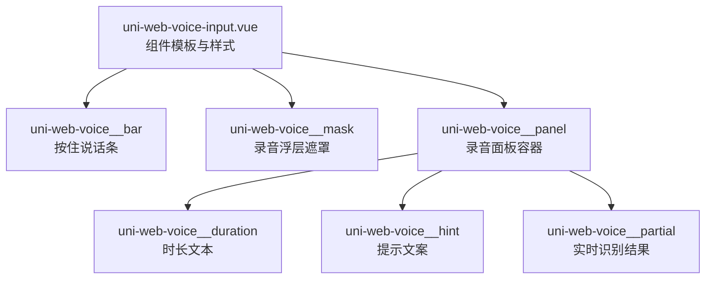
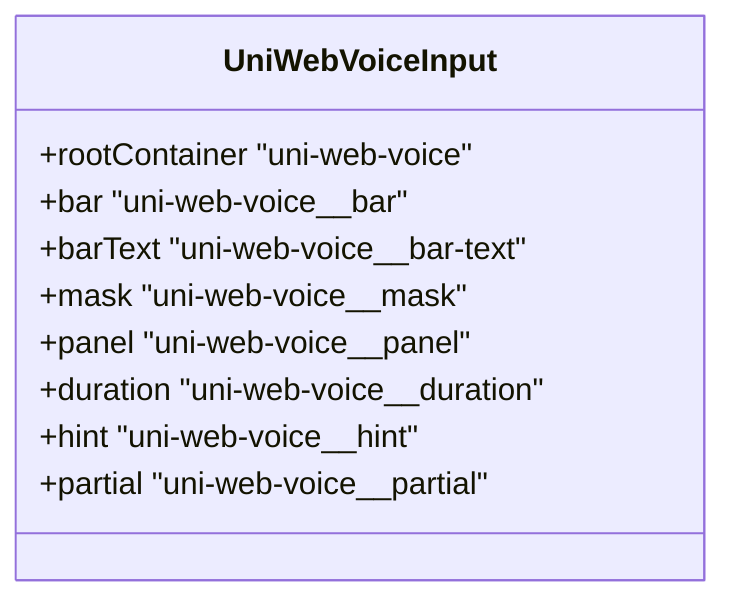

# 样式定制（Styling）

<cite>
**本文引用的文件**   
- [uni-web-voice-input.vue](file://uni_modules/uni-web-voice-input/components/uni-web-voice-input/uni-web-voice-input.vue)
- [index.vue](file://demo/src/pages/index/index.vue)
- [demo.vue](file://examples/demo/demo.vue)
</cite>

## 目录
1. [简介](#简介)
2. [项目结构与样式位置](#项目结构与样式位置)
3. [核心样式类总览](#核心样式类总览)
4. [架构与渲染结构](#架构与渲染结构)
5. [详细样式说明](#详细样式说明)
6. [主题定制示例](#主题定制示例)
7. [响应式适配方案](#响应式适配方案)
8. [样式覆盖最佳实践](#样式覆盖最佳实践)
9. [不同风格外观示例](#不同风格外观示例)
10. [常见问题排查](#常见问题排查)
11. [结论](#结论)

## 简介
本章节面向需要深度定制 uni-web-voice-input 组件外观的开发者，系统梳理组件暴露的所有 CSS 类名、用途、可定制属性，并给出主题定制、响应式适配、样式覆盖注意事项以及多种视觉风格的实现思路。文档中的样式分析均基于组件源码中内置的样式定义，确保与实际渲染结构一一对应。

## 项目结构与样式位置
组件的核心模板与样式集中在组件文件中：
- 组件模板定义了语音条、遮罩层、面板等结构。
- 组件内部使用 scoped SCSS 定义默认样式。
- 示例页面展示了如何引入和使用组件，但并未覆盖组件样式。

**图表来源**
- [uni-web-voice-input.vue:1-26](file://uni_modules/uni-web-voice-input/components/uni-web-voice-input/uni-web-voice-input.vue#L1-L26)

**章节来源**
- [uni-web-voice-input.vue:1-26](file://uni_modules/uni-web-voice-input/components/uni-web-voice-input/uni-web-voice-input.vue#L1-L26)

## 核心样式类总览
以下表格列出组件对外暴露的 CSS 类名、作用与常见可定制属性。所有类名均来自组件模板与样式定义。

| 类名 | 作用 | 常见可定制属性 |
|---|---|---|
| `.uni-web-voice` | 组件根容器，包裹语音条与浮层 | `width`、布局相关属性 |
| `.uni-web-voice__bar` | 按住说话条按钮 | `height`、`border-radius`、`background`、`touch-action`、`user-select` |
| `.uni-web-voice__bar.is-active` | 录音或准备中的激活态 | `background` |
| `.uni-web-voice__bar-text` | 语音条内文字 | `font-size`、`color`、`user-select` |
| `.uni-web-voice__mask` | 全屏遮罩层，用于展示录音面板 | `position`、`display`、`background`、`z-index` |
| `.uni-web-voice__panel` | 录音面板容器 | `width`、`padding`、`border-radius`、`background`、`text-align` |
| `.uni-web-voice__duration` | 录音时长显示 | `font-size`、`font-weight`、`color` |
| `.uni-web-voice__hint` | 操作提示文案 | `margin-top`、`font-size`、`color` |
| `.uni-web-voice__hint.is-cancel` | 取消状态下的提示文案颜色 | `color` |
| `.uni-web-voice__partial` | 实时识别结果文本 | `margin-top`、`font-size`、`color`、`max-height`、`overflow` |

**章节来源**
- [uni-web-voice-input.vue:269-338](file://uni_modules/uni-web-voice-input/components/uni-web-voice-input/uni-web-voice-input.vue#L269-L338)

## 架构与渲染结构
组件通过 Vue 模板渲染出三层结构：
- 根容器 `.uni-web-voice`
- 语音条 `.uni-web-voice__bar`，包含文字 `.uni-web-voice__bar-text`
- 遮罩层 `.uni-web-voice__mask`，内部包含面板 `.uni-web-voice__panel`
  - 面板内包含时长 `.uni-web-voice__duration`、提示 `.uni-web-voice__hint`、实时文本 `.uni-web-voice__partial`

**图表来源**
- [uni-web-voice-input.vue:1-26](file://uni_modules/uni-web-voice-input/components/uni-web-voice-input/uni-web-voice-input.vue#L1-L26)

**章节来源**
- [uni-web-voice-input.vue:1-26](file://uni_modules/uni-web-voice-input/components/uni-web-voice-input/uni-web-voice-input.vue#L1-L26)

## 详细样式说明
### 根容器 `.uni-web-voice`
- 宽度占满父容器，禁用用户选择与长按菜单，避免移动端误触。
- 适合在父级控制整体布局与间距。

可定制建议：
- 调整 `width` 以适配不同布局。
- 如需全局统一禁用选择行为，可在父级设置 `user-select`。

**章节来源**
- [uni-web-voice-input.vue:269-275](file://uni_modules/uni-web-voice-input/components/uni-web-voice-input/uni-web-voice-input.vue#L269-L275)

### 语音条 `.uni-web-voice__bar`
- 居中布局，固定高度与圆角，背景色为浅灰。
- 禁用触摸动作与用户选择，提升交互体验。

可定制建议：
- 修改 `height`、`border-radius` 以匹配品牌按钮风格。
- 替换 `background` 为品牌主色或渐变。
- 若需更细粒度控制点击反馈，可结合伪元素或动画。

**章节来源**
- [uni-web-voice-input.vue:276-288](file://uni_modules/uni-web-voice-input/components/uni-web-voice-input/uni-web-voice-input.vue#L276-L288)

### 激活态 `.uni-web-voice__bar.is-active`
- 当组件处于录音或准备状态时，切换背景色为浅绿色系。
- 可通过覆盖该类的 `background` 实现自定义激活反馈。

可定制建议：
- 使用品牌强调色作为激活态背景。
- 配合过渡动画增强按压反馈。

**章节来源**
- [uni-web-voice-input.vue:289-291](file://uni_modules/uni-web-voice-input/components/uni-web-voice-input/uni-web-voice-input.vue#L289-L291)

### 语音条文字 `.uni-web-voice__bar-text`
- 字号适中，深色文字，禁用选择与长按菜单。
- 文案由组件根据状态动态计算。

可定制建议：
- 调整 `font-size`、`color` 以匹配字体规范。
- 如需加粗或斜体，可添加 `font-weight`、`font-style`。

**章节来源**
- [uni-web-voice-input.vue:292-298](file://uni_modules/uni-web-voice-input/components/uni-web-voice-input/uni-web-voice-input.vue#L292-L298)

### 遮罩层 `.uni-web-voice__mask`
- 全屏固定定位，半透明黑色背景，层级较高。
- 居中对齐，承载录音面板。

可定制建议：
- 调整 `background` 透明度以改变遮罩深浅。
- 修改 `z-index` 避免被其他弹窗遮挡。
- 如需动画入场，可在外层包裹动画容器。

**章节来源**
- [uni-web-voice-input.vue:299-310](file://uni_modules/uni-web-voice-input/components/uni-web-voice-input/uni-web-voice-input.vue#L299-L310)

### 面板容器 `.uni-web-voice__panel`
- 固定宽度，内边距适中，圆角背景，文字居中。
- 作为时长、提示、实时文本的容器。

可定制建议：
- 调整 `width`、`padding`、`border-radius`、`background` 以匹配卡片风格。
- 如需阴影效果，可添加 `box-shadow`。

**章节来源**
- [uni-web-voice-input.vue:311-317](file://uni_modules/uni-web-voice-input/components/uni-web-voice-input/uni-web-voice-input.vue#L311-L317)

### 时长文本 `.uni-web-voice__duration`
- 较大字号、中等字重、深色文字。
- 显示当前录音时长。

可定制建议：
- 调整 `font-size`、`font-weight`、`color` 以突出时间信息。
- 如需等宽数字显示，可设置 `font-family` 为等宽字体。

**章节来源**
- [uni-web-voice-input.vue:318-322](file://uni_modules/uni-web-voice-input/components/uni-web-voice-input/uni-web-voice-input.vue#L318-L322)

### 提示文案 `.uni-web-voice__hint`
- 顶部留白，较小字号，灰色文字。
- 根据是否取消切换颜色。

可定制建议：
- 调整 `margin-top`、`font-size`、`color` 以匹配文案层级。
- 取消态颜色可通过 `.is-cancel` 覆盖。

**章节来源**
- [uni-web-voice-input.vue:323-330](file://uni_modules/uni-web-voice-input/components/uni-web-voice-input/uni-web-voice-input.vue#L323-L330)

### 实时识别文本 `.uni-web-voice__partial`
- 顶部留白，较小字号，强调色文字，限制最大高度并隐藏溢出。
- 显示实时识别结果。

可定制建议：
- 调整 `margin-top`、`font-size`、`color` 以区分主次信息。
- 如需滚动显示长文本，可调整 `max-height` 与 `overflow`。

**章节来源**
- [uni-web-voice-input.vue:331-337](file://uni_modules/uni-web-voice-input/components/uni-web-voice-input/uni-web-voice-input.vue#L331-L337)

## 主题定制示例
以下为常见主题定制方向与实现思路（不直接粘贴代码，仅给出路径与要点）：

- 颜色主题
  - 修改 `.uni-web-voice__bar` 与 `.uni-web-voice__bar.is-active` 的背景色，以品牌主色与强调色区分常态与激活态。
  - 修改 `.uni-web-voice__partial` 的文字颜色，使其与品牌强调色一致。
  - 参考路径：[uni-web-voice-input.vue:276-291](file://uni_modules/uni-web-voice-input/components/uni-web-voice-input/uni-web-voice-input.vue#L276-L291)、[uni-web-voice-input.vue:331-337](file://uni_modules/uni-web-voice-input/components/uni-web-voice-input/uni-web-voice-input.vue#L331-L337)

- 字体主题
  - 调整 `.uni-web-voice__bar-text`、`.uni-web-voice__duration`、`.uni-web-voice__hint`、`.uni-web-voice__partial` 的字号与字重，统一字体家族。
  - 参考路径：[uni-web-voice-input.vue:292-298](file://uni_modules/uni-web-voice-input/components/uni-web-voice-input/uni-web-voice-input.vue#L292-L298)、[uni-web-voice-input.vue:318-337](file://uni_modules/uni-web-voice-input/components/uni-web-voice-input/uni-web-voice-input.vue#L318-L337)

- 尺寸主题
  - 调整 `.uni-web-voice__bar` 的高度与圆角，使按钮更大或更圆润。
  - 调整 `.uni-web-voice__panel` 的宽度与内边距，使面板更紧凑或更宽松。
  - 参考路径：[uni-web-voice-input.vue:276-288](file://uni_modules/uni-web-voice-input/components/uni-web-voice-input/uni-web-voice-input.vue#L276-L288)、[uni-web-voice-input.vue:311-317](file://uni_modules/uni-web-voice-input/components/uni-web-voice-input/uni-web-voice-input.vue#L311-L317)

- 动画效果
  - 为 `.uni-web-voice__bar.is-active` 添加过渡动画，如背景色渐变或缩放。
  - 为 `.uni-web-voice__mask` 添加淡入淡出动画，提升浮层出现体验。
  - 参考路径：[uni-web-voice-input.vue:289-291](file://uni_modules/uni-web-voice-input/components/uni-web-voice-input/uni-web-voice-input.vue#L289-L291)、[uni-web-voice-input.vue:299-310](file://uni_modules/uni-web-voice-input/components/uni-web-voice-input/uni-web-voice-input.vue#L299-L310)

**章节来源**
- [uni-web-voice-input.vue:276-337](file://uni_modules/uni-web-voice-input/components/uni-web-voice-input/uni-web-voice-input.vue#L276-L337)

## 响应式适配方案
- 使用 rpx 单位：组件默认样式已采用 rpx，便于在不同屏幕密度下自适应。
- 面板宽度：`.uni-web-voice__panel` 使用固定 rpx 宽度，可在小屏设备上考虑媒体查询缩小宽度或改为百分比宽度。
- 字号适配：对 `.uni-web-voice__duration`、`.uni-web-voice__hint`、`.uni-web-voice__partial` 可根据屏幕宽度调整字号。
- 遮罩层级：`.uni-web-voice__mask` 的 `z-index` 较高，需确保与其他弹窗层级协调。

建议：
- 在小屏设备（如手机竖屏）上，适当减小面板宽度与字号，保证内容可读性。
- 在大屏设备（如平板或桌面）上，可适当增大面板宽度与字号，提升视觉层次。

**章节来源**
- [uni-web-voice-input.vue:299-337](file://uni_modules/uni-web-voice-input/components/uni-web-voice-input/uni-web-voice-input.vue#L299-L337)

## 样式覆盖最佳实践
- 使用更高优先级选择器：在应用样式中直接使用相同类名进行覆盖，必要时增加父级限定符提高优先级。
- 避免破坏交互：不要移除 `touch-action`、`user-select`、`-webkit-touch-callout` 等关键属性，以免影响手势与长按行为。
- 保持语义化：仅覆盖必要属性，保留组件默认布局与结构，避免影响状态切换（如 `.is-active`、`.is-cancel`）。
- 注意层级冲突：遮罩层 `z-index` 较高，覆盖时需确保不被其他弹窗遮挡或被其遮挡。
- 使用变量管理主题：将颜色、字号、圆角等提取为 CSS 变量，便于多主题切换与维护。

**章节来源**
- [uni-web-voice-input.vue:269-338](file://uni_modules/uni-web-voice-input/components/uni-web-voice-input/uni-web-voice-input.vue#L269-L338)

## 不同风格外观示例
以下为几种常见风格的外观定制思路（不直接粘贴代码，仅给出实现要点与参考路径）：

- 扁平风格
  - 去除圆角与阴影，使用纯色背景。
  - 调整 `.uni-web-voice__bar` 的 `border-radius` 为 0，背景使用品牌主色。
  - 参考路径：[uni-web-voice-input.vue:276-288](file://uni_modules/uni-web-voice-input/components/uni-web-voice-input/uni-web-voice-input.vue#L276-L288)

- 玻璃拟态风格
  - 为 `.uni-web-voice__panel` 添加半透明背景与模糊效果（如 backdrop-filter），营造玻璃质感。
  - 调整 `.uni-web-voice__mask` 的背景透明度，使遮罩更柔和。
  - 参考路径：[uni-web-voice-input.vue:299-317](file://uni_modules/uni-web-voice-input/components/uni-web-voice-input/uni-web-voice-input.vue#L299-L317)

- 高对比度无障碍风格
  - 提高文字颜色对比度，使用深色背景与亮色文字。
  - 调整 `.uni-web-voice__bar-text`、`.uni-web-voice__duration`、`.uni-web-voice__hint`、`.uni-web-voice__partial` 的颜色与字号。
  - 参考路径：[uni-web-voice-input.vue:292-298](file://uni_modules/uni-web-voice-input/components/uni-web-voice-input/uni-web-voice-input.vue#L292-L298)、[uni-web-voice-input.vue:318-337](file://uni_modules/uni-web-voice-input/components/uni-web-voice-input/uni-web-voice-input.vue#L318-L337)

- 品牌主题风格
  - 使用品牌主色与强调色替换默认背景与文字颜色。
  - 为激活态添加品牌强调色的过渡动画。
  - 参考路径：[uni-web-voice-input.vue:289-291](file://uni_modules/uni-web-voice-input/components/uni-web-voice-input/uni-web-voice-input.vue#L289-L291)、[uni-web-voice-input.vue:331-337](file://uni_modules/uni-web-voice-input/components/uni-web-voice-input/uni-web-voice-input.vue#L331-L337)

**章节来源**
- [uni-web-voice-input.vue:276-337](file://uni_modules/uni-web-voice-input/components/uni-web-voice-input/uni-web-voice-input.vue#L276-L337)

## 常见问题排查
- 遮罩层被遮挡
  - 检查其他弹窗的 `z-index` 是否高于 `.uni-web-voice__mask`。
  - 参考路径：[uni-web-voice-input.vue:299-310](file://uni_modules/uni-web-voice-input/components/uni-web-voice-input/uni-web-voice-input.vue#L299-L310)

- 按钮点击无反馈
  - 确认未移除 `touch-action`、`user-select`、`-webkit-touch-callout` 等关键属性。
  - 检查 `.uni-web-voice__bar.is-active` 是否被错误覆盖导致背景不变。
  - 参考路径：[uni-web-voice-input.vue:276-291](file://uni_modules/uni-web-voice-input/components/uni-web-voice-input/uni-web-voice-input.vue#L276-L291)

- 实时文本溢出
  - 调整 `.uni-web-voice__partial` 的 `max-height` 与 `overflow`，确保长文本可滚动显示。
  - 参考路径：[uni-web-voice-input.vue:331-337](file://uni_modules/uni-web-voice-input/components/uni-web-voice-input/uni-web-voice-input.vue#L331-L337)

- 文案不可见或颜色过浅
  - 检查 `.uni-web-voice__bar-text`、`.uni-web-voice__duration`、`.uni-web-voice__hint`、`.uni-web-voice__partial` 的 `color` 是否与背景对比度不足。
  - 参考路径：[uni-web-voice-input.vue:292-298](file://uni_modules/uni-web-voice-input/components/uni-web-voice-input/uni-web-voice-input.vue#L292-L298)、[uni-web-voice-input.vue:318-337](file://uni_modules/uni-web-voice-input/components/uni-web-voice-input/uni-web-voice-input.vue#L318-L337)

**章节来源**
- [uni-web-voice-input.vue:276-337](file://uni_modules/uni-web-voice-input/components/uni-web-voice-input/uni-web-voice-input.vue#L276-L337)

## 结论
通过对 uni-web-voice-input 组件样式类的系统梳理，开发者可以精准覆盖与扩展组件外观，实现品牌化主题、响应式适配与多样化风格。建议在覆盖样式时遵循最小改动原则，保留关键交互属性，并使用变量统一管理主题，以提升可维护性与一致性。