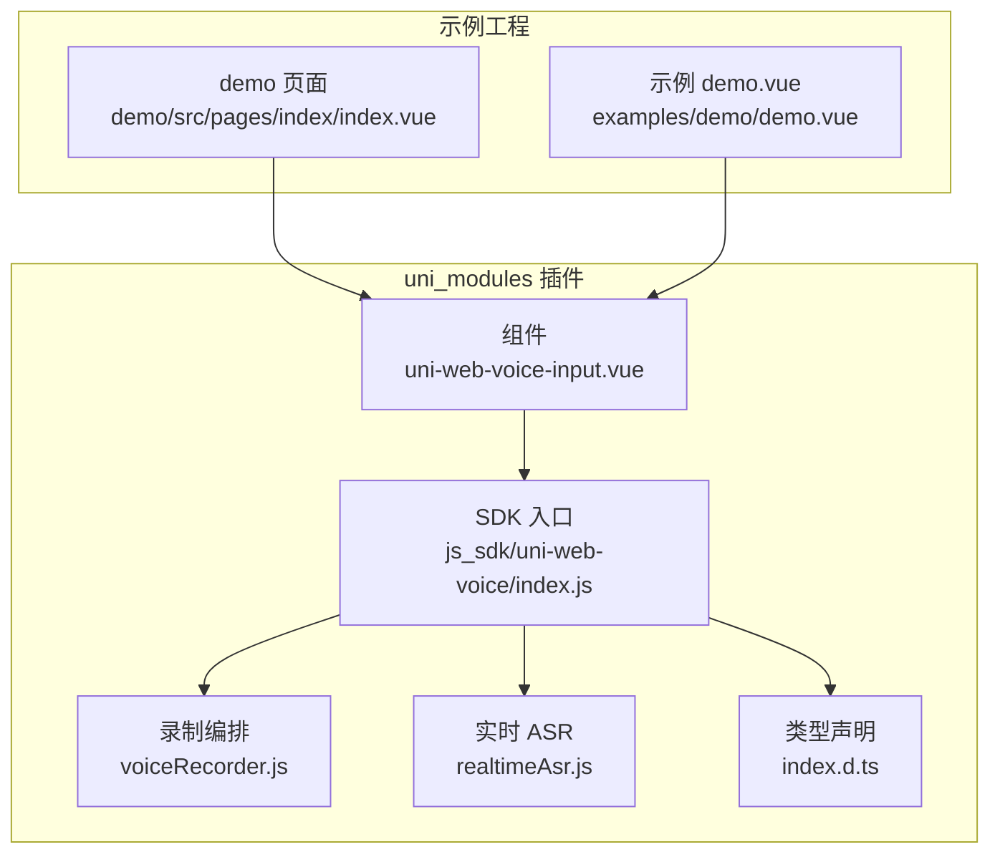
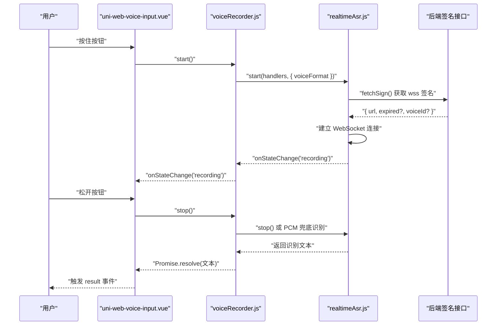
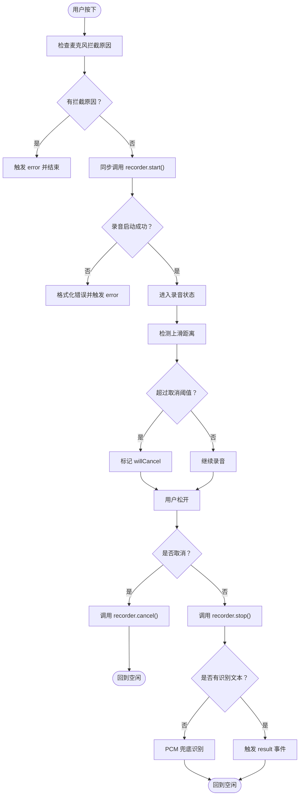
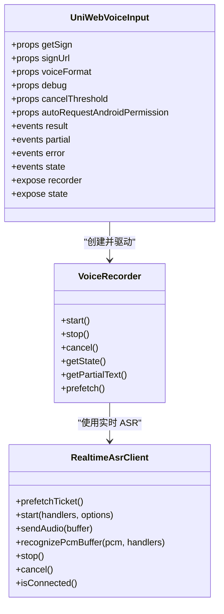

# 组件 API 参考

<cite>
**本文引用的文件**   
- [uni-web-voice-input.vue](file://uni_modules/uni-web-voice-input/components/uni-web-voice-input/uni-web-voice-input.vue)
- [index.js](file://uni_modules/uni-web-voice-input/js_sdk/uni-web-voice/index.js)
- [index.d.ts](file://uni_modules/uni-web-voice-input/js_sdk/uni-web-voice/index.d.ts)
- [voiceRecorder.js](file://uni_modules/uni-web-voice-input/js_sdk/uni-web-voice/voiceRecorder.js)
- [realtimeAsr.js](file://uni_modules/uni-web-voice-input/js_sdk/uni-web-voice/realtimeAsr.js)
- [demo 页面 index.vue](file://demo/src/pages/index/index.vue)
- [示例 demo.vue](file://examples/demo/demo.vue)
- [README.md](file://README.md)
</cite>

## 目录
1. [简介](#简介)
2. [项目结构](#项目结构)
3. [核心组件总览](#核心组件总览)
4. [架构概览](#架构概览)
5. [详细 API 文档](#详细-api-文档)
6. [生命周期与交互行为](#生命周期与交互行为)
7. [依赖关系分析](#依赖关系分析)
8. [性能与稳定性要点](#性能与稳定性要点)
9. [使用示例与最佳实践](#使用示例与最佳实践)
10. [常见问题与排错](#常见问题与排错)
11. [结论](#结论)

## 简介
`uni-web-voice-input` 是一个基于纯 Web 能力的「按住说话」语音输入组件，面向 H5、App-vue 以及各端 WebView（包括鸿蒙 ArkWeb）场景。它通过 `getUserMedia` + Web Audio + WebSocket 实时 ASR 实现录音与识别，并通过 `getSign` / `signUrl` / `fetchSign` 注入后端签名，不绑定具体厂商密钥。

组件对外暴露：
- 一组属性用于配置签名来源、音频格式、调试开关、取消阈值等；
- 一组事件用于接收最终结果、实时识别文本、错误信息和内部状态变化；
- 一套默认 UI，支持通过样式类名覆盖外观；
- 一个通过 `defineExpose` 暴露的实例句柄，包含底层录音器与当前状态。

## 项目结构
本仓库同时提供 uni_modules 插件结构与示例工程：
- `uni_modules/uni-web-voice-input`：组件与 SDK 源码；
- `demo/src`：基于 uni-app 的演示页面；
- `examples/demo`：更精简的示例页；
- `README.md`：项目说明与亮点。

**图表来源**
- [uni-web-voice-input.vue:28-44](file://uni_modules/uni-web-voice-input/components/uni-web-voice-input/uni-web-voice-input.vue#L28-L44)
- [index.js:6-17](file://uni_modules/uni-web-voice-input/js_sdk/uni-web-voice/index.js#L6-L17)
- [voiceRecorder.js:15-17](file://uni_modules/uni-web-voice-input/js_sdk/uni-web-voice/voiceRecorder.js#L15-L17)
- [realtimeAsr.js:1-8](file://uni_modules/uni-web-voice-input/js_sdk/uni-web-voice/realtimeAsr.js#L1-L8)
- [index.d.ts:1-18](file://uni_modules/uni-web-voice-input/js_sdk/uni-web-voice/index.d.ts#L1-L18)

**章节来源**
- [README.md:1-24](file://README.md#L1-L24)

## 核心组件总览
`uni-web-voice-input.vue` 是用户直接使用的 Vue 组件。它负责：
- 渲染「按住说话」按钮与录音浮层；
- 处理触摸与鼠标事件，维护按下、滑动取消、松手等手势逻辑；
- 调用 SDK 的 `createVoiceRecorder` 完成录音、实时识别与兜底整段 PCM 识别；
- 将内部状态和识别结果以事件形式向上抛出；
- 在挂载时预热签名并探测麦克风权限。

组件对外暴露的实例方法可通过 `ref` 获取，便于高级用法中主动控制或读取状态。

**章节来源**
- [uni-web-voice-input.vue:28-59](file://uni_modules/uni-web-voice-input/components/uni-web-voice-input/uni-web-voice-input.vue#L28-L59)
- [uni-web-voice-input.vue:266-267](file://uni_modules/uni-web-voice-input/components/uni-web-voice-input/uni-web-voice-input.vue#L266-L267)

## 架构概览
组件与 SDK 的协作流程如下：

**图表来源**
- [uni-web-voice-input.vue:130-169](file://uni_modules/uni-web-voice-input/components/uni-web-voice-input/uni-web-voice-input.vue#L130-L169)
- [voiceRecorder.js:156-240](file://uni_modules/uni-web-voice-input/js_sdk/uni-web-voice/voiceRecorder.js#L156-L240)
- [realtimeAsr.js:151-176](file://uni_modules/uni-web-voice-input/js_sdk/uni-web-voice/realtimeAsr.js#L151-L176)
- [realtimeAsr.js:214-272](file://uni_modules/uni-web-voice-input/js_sdk/uni-web-voice/realtimeAsr.js#L214-L272)

## 详细 API 文档

### 属性（Props）
| 属性名 | 类型 | 默认值 | 是否必填 | 用途说明 |
|---|---:|---:|---:|---|
| `getSign` | `Function` | `null` | 否 | 自定义签名函数，优先于 `signUrl`。应返回 Promise，解析为包含 `url` 的对象。 |
| `signUrl` | `String` | `''` | 否 | 直接传入可返回签名的 GET 地址。组件会 `fetch` 该地址并解析响应体中的 `url` 或 `data.url`。 |
| `voiceFormat` | `Number` | `1` | 否 | ASR 编码格式，默认对应 16k PCM16，兼容腾讯云 ASR 协议。 |
| `debug` | `Boolean` | `false` | 否 | 开启后打印更多调试日志，便于联调。 |
| `cancelThreshold` | `Number` | `80` | 否 | 上滑超过该像素判定为取消录音。 |
| `autoRequestAndroidPermission` | `Boolean` | `true` | 否 | 在安卓 App-plus WebView 内，组件挂载时尝试申请 `RECORD_AUDIO` 运行时权限；非 App-plus 环境无副作用。 |

#### 签名返回值约定
签名函数或签名接口应返回类似以下结构的对象：
- `url`：已签名的 WebSocket 地址；
- `expired`：可选，过期时间戳（秒），未提供则按约 10 分钟处理；
- `voiceId`：可选，会话或请求标识。

组件内部对 `signUrl` 的响应体做了兼容处理：若响应体存在 `data` 字段，会取 `data` 作为实际数据对象，再从中取 `url`。

**章节来源**
- [uni-web-voice-input.vue:46-57](file://uni_modules/uni-web-voice-input/components/uni-web-voice-input/uni-web-voice-input.vue#L46-L57)
- [uni-web-voice-input.vue:95-103](file://uni_modules/uni-web-voice-input/components/uni-web-voice-input/uni-web-voice-input.vue#L95-L103)
- [index.d.ts:10-19](file://uni_modules/uni-web-voice-input/js_sdk/uni-web-voice/index.d.ts#L10-L19)
- [realtimeAsr.js:29-41](file://uni_modules/uni-web-voice-input/js_sdk/uni-web-voice/realtimeAsr.js#L29-L41)

### 事件（Events）
| 事件名 | 回调参数 | 触发时机与用途 |
|---|---|---|
| `result` | `(text: string)` | 松手后成功识别到内容时触发，适合写入最终结果。 |
| `partial` | `(text: string)` | 实时识别过程中持续触发，适合展示滚动字幕或中间结果。 |
| `error` | `(message: string)` | 录音启动失败、网络异常、鉴权失败、识别超时等错误时触发。 |
| `state` | `(state: RecorderState)` | 组件内部状态变化时触发，可用于显示“准备中”“录音中”“识别中”等提示。 |

#### 状态枚举
组件内部状态类型为：
- `idle`：空闲；
- `preparing`：准备中；
- `recording`：录音中；
- `recognizing`：识别中；
- `canceled`：已取消。

这些状态由 SDK 的 `onStateChange` 回调驱动，并在组件中统一通过 `state` 事件向外广播。

**章节来源**
- [uni-web-voice-input.vue:59-61](file://uni_modules/uni-web-voice-input/components/uni-web-voice-input/uni-web-voice-input.vue#L59-L61)
- [uni-web-voice-input.vue:135-153](file://uni_modules/uni-web-voice-input/components/uni-web-voice-input/uni-web-voice-input.vue#L135-L153)
- [index.d.ts:3-8](file://uni_modules/uni-web-voice-input/js_sdk/uni-web-voice/index.d.ts#L3-L8)
- [index.d.ts:49-51](file://uni_modules/uni-web-voice-input/js_sdk/uni-web-voice/index.d.ts#L49-L51)

### 插槽（Slots）
组件模板中没有显式定义具名插槽或默认插槽。UI 文案如“按住说话”“抬起发送”“正在识别”等由组件内部计算属性生成，可通过外部监听 `state` 事件并结合自身布局进行二次表达。

如果你需要完全自定义按钮形态，建议：
- 隐藏组件默认按钮区域（通过外层容器样式控制）；
- 使用 `defineExpose` 暴露的实例句柄，手动调用 `recorder.start()` / `recorder.stop()` / `recorder.cancel()`；
- 通过监听 `state`、`partial`、`result`、`error` 事件同步你的 UI。

**章节来源**
- [uni-web-voice-input.vue:1-26](file://uni_modules/uni-web-voice-input/components/uni-web-voice-input/uni-web-voice-input.vue#L1-L26)
- [uni-web-voice-input.vue:266-267](file://uni_modules/uni-web-voice-input/components/uni-web-voice-input/uni-web-voice-input.vue#L266-L267)

### 样式定制选项
组件使用 scoped SCSS 定义样式，关键类名如下：
- `.uni-web-voice`：根容器；
- `.uni-web-voice__bar`：按住说话按钮条；
- `.uni-web-voice__bar.is-active`：录音或准备中的激活态；
- `.uni-web-voice__mask`：录音浮层遮罩；
- `.uni-web-voice__panel`：录音浮层面板；
- `.uni-web-voice__duration`：时长显示；
- `.uni-web-voice__hint`：操作提示；
- `.uni-web-voice__hint.is-cancel`：取消态提示；
- `.uni-web-voice__partial`：实时识别文本。

你可以通过覆盖这些类名实现主题定制，例如修改背景色、圆角、字号、提示颜色等。

**章节来源**
- [uni-web-voice-input.vue:269-338](file://uni_modules/uni-web-voice-input/components/uni-web-voice-input/uni-web-voice-input.vue#L269-L338)

### 实例句柄与公共方法
组件通过 `defineExpose` 暴露：
- `recorder`：底层 `VoiceRecorder` 实例；
- `state`：当前组件状态。

`VoiceRecorder` 实例提供的方法包括：
- `start()`：开始录音；
- `stop()`：结束录音并返回识别文本；
- `cancel()`：取消录音；
- `getState()`：获取内部状态；
- `getPartialText()`：获取最近一次识别文本；
- `prefetch()`：预热签名，减少首次按下等待。

注意：`start()` 必须在用户手势的同步代码窗口内调用，否则可能无法触发系统麦克风授权弹窗。

**章节来源**
- [uni-web-voice-input.vue:266-267](file://uni_modules/uni-web-voice-input/components/uni-web-voice-input/uni-web-voice-input.vue#L266-L267)
- [index.d.ts:71-79](file://uni_modules/uni-web-voice-input/js_sdk/uni-web-voice/index.d.ts#L71-L79)
- [voiceRecorder.js:305-313](file://uni_modules/uni-web-voice-input/js_sdk/uni-web-voice/voiceRecorder.js#L305-L313)

## 生命周期与交互行为

### 组件挂载阶段
- 创建 `createVoiceRecorder`，注入 `fetchSign`、`voiceFormat`、`debug` 以及识别回调；
- 调用 `recorder.prefetch()` 预热签名；
- 异步探测麦克风权限，若已拒绝则预显示引导文案；
- 在安卓 App-plus 环境下，根据 `autoRequestAndroidPermission` 决定是否主动申请运行时权限。

### 手势交互阶段
- **按下**：检查麦克风拦截原因，同步调用 `recorder.start()`；
- **移动**：计算上滑距离，超过 `cancelThreshold` 标记为取消；
- **松开**：若取消则调用 `recorder.cancel()`，否则调用 `recorder.stop()` 并处理结果；
- **H5 桌面兜底**：监听鼠标按下与松开，复用同一套按下/松开逻辑。

### 识别与兜底阶段
- 实时 ASR 通过 WebSocket 推送部分结果和最终结果；
- 若实时连接未连上或没有返回文本，SDK 会使用缓存的 PCM 片段进行整段兜底识别；
- 若录音过短且无有效文本，会抛出“说得太短”的错误。

**图表来源**
- [uni-web-voice-input.vue:180-253](file://uni_modules/uni-web-voice-input/components/uni-web-voice-input/uni-web-voice-input.vue#L180-L253)
- [voiceRecorder.js:246-295](file://uni_modules/uni-web-voice-input/js_sdk/uni-web-voice/voiceRecorder.js#L246-L295)

**章节来源**
- [uni-web-voice-input.vue:130-178](file://uni_modules/uni-web-voice-input/components/uni-web-voice-input/uni-web-voice-input.vue#L130-L178)
- [uni-web-voice-input.vue:180-267](file://uni_modules/uni-web-voice-input/components/uni-web-voice-input/uni-web-voice-input.vue#L180-L267)
- [voiceRecorder.js:156-240](file://uni_modules/uni-web-voice-input/js_sdk/uni-web-voice/voiceRecorder.js#L156-L240)
- [voiceRecorder.js:246-313](file://uni_modules/uni-web-voice-input/js_sdk/uni-web-voice/voiceRecorder.js#L246-L313)

## 依赖关系分析

**图表来源**
- [uni-web-voice-input.vue:37-44](file://uni_modules/uni-web-voice-input/components/uni-web-voice-input/uni-web-voice-input.vue#L37-L44)
- [index.d.ts:71-82](file://uni_modules/uni-web-voice-input/js_sdk/uni-web-voice/index.d.ts#L71-L82)
- [index.d.ts:33-47](file://uni_modules/uni-web-voice-input/js_sdk/uni-web-voice/index.d.ts#L33-L47)

**章节来源**
- [index.js:6-17](file://uni_modules/uni-web-voice-input/js_sdk/uni-web-voice/index.js#L6-L17)
- [index.d.ts:1-108](file://uni_modules/uni-web-voice-input/js_sdk/uni-web-voice/index.d.ts#L1-L108)

## 性能与稳定性要点
- **签名预热**：组件挂载时调用 `prefetch()`，减少首次按下时的签名请求延迟。
- **手势时序修复**：`start()` 在用户手势同步窗口内发起，确保鸿蒙 ArkWeb 能弹出麦克风授权框。
- **AudioContext 恢复**：避免 `suspended` 导致无声采集。
- **实时与兜底双通道**：WebSocket 实时识别为主，PCM 整段识别兜底，提升弱网或连接失败时的可用性。
- **最小录音时长保护**：过短录音且无文本时直接报错，避免无效请求。
- **连接超时与停止等待**：ASR 客户端内置连接超时、停止等待等机制，防止长时间挂起。

**章节来源**
- [uni-web-voice-input.vue:155-169](file://uni_modules/uni-web-voice-input/components/uni-web-voice-input/uni-web-voice-input.vue#L155-L169)
- [voiceRecorder.js:156-201](file://uni_modules/uni-web-voice-input/js_sdk/uni-web-voice/voiceRecorder.js#L156-L201)
- [voiceRecorder.js:246-295](file://uni_modules/uni-web-voice-input/js_sdk/uni-web-voice/voiceRecorder.js#L246-L295)
- [realtimeAsr.js:10-18](file://uni_modules/uni-web-voice-input/js_sdk/uni-web-voice/realtimeAsr.js#L10-L18)
- [realtimeAsr.js:298-315](file://uni_modules/uni-web-voice-input/js_sdk/uni-web-voice/realtimeAsr.js#L298-L315)

## 使用示例与最佳实践

### 基础用法：通过 `signUrl` 注入签名地址
适用于快速接入，只需提供一个可返回 `{ url }` 或 `{ data:{ url } }` 的地址。

推荐做法：
- 将 `signUrl` 指向你的后端签名接口；
- 监听 `result` 保存最终文本；
- 监听 `error` 做用户提示；
- 监听 `state` 更新界面状态标签。

参考示例路径：
- [示例 demo.vue:10-12](file://examples/demo/demo.vue#L10-L12)
- [示例 demo.vue:18-26](file://examples/demo/demo.vue#L18-L26)

### 进阶用法：通过 `getSign` 注入签名函数
适用于需要复杂鉴权、重试、埋点或动态参数的场景。

推荐做法：
- 在 `getSign` 中先检查麦克风拦截原因；
- 调用你的签名接口，校验响应体是否包含 `url`；
- 返回标准签名对象；
- 在 `error` 中统一处理网络错误、鉴权错误和业务错误。

参考示例路径：
- [demo 页面 index.vue:17-24](file://demo/src/pages/index/index.vue#L17-L24)
- [demo 页面 index.vue:59-75](file://demo/src/pages/index/index.vue#L59-L75)
- [demo 页面 index.vue:77-83](file://demo/src/pages/index/index.vue#L77-L83)

### 实时识别与状态管理最佳实践
- 使用 `partial` 事件更新滚动字幕；
- 使用 `result` 事件清空临时文本并写入最终结果；
- 使用 `state` 事件更新“空闲/准备中/录音中/识别中/已取消”的状态标签；
- 使用 `debug` 打开调试日志，配合浏览器控制台或 uni 调试工具定位问题。

参考示例路径：
- [demo 页面 index.vue:11-14](file://demo/src/pages/index/index.vue#L11-L14)
- [demo 页面 index.vue:48-57](file://demo/src/pages/index/index.vue#L48-L57)
- [demo 页面 index.vue:77-83](file://demo/src/pages/index/index.vue#L77-L83)

### 响应式数据绑定建议
- 将 `result`、`partial`、`state` 分别绑定到响应式变量；
- 使用计算属性将内部状态映射为用户可读文案；
- 在 `error` 中使用 `uni.showToast` 或业务提示组件反馈错误；
- 如需禁用重复点击，可在 `state` 为 `preparing`、`recording`、`recognizing` 时禁用外层交互。

**章节来源**
- [demo 页面 index.vue:34-83](file://demo/src/pages/index/index.vue#L34-L83)
- [examples/demo/demo.vue:15-27](file://examples/demo/demo.vue#L15-L27)

## 常见问题与排错

### 常见错误与含义
| 现象 | 可能原因 | 处理建议 |
|---|---|---|
| 按住没反应 | 麦克风权限未授予或拦截 | 检查 `getMicBlockReason`，引导用户授权；在安卓 App-plus 中启用 `autoRequestAndroidPermission`。 |
| 有权限但无声音 | AudioContext 未恢复或设备不支持 | 确认环境支持 `AudioContext`，组件内部已尝试 `resume()`；可开启 `debug` 查看日志。 |
| 识别结果为空 | 录音太短、未采集到音频、服务端无返回 | 延长录音时长；靠近麦克风；检查后端签名与 ASR 服务状态。 |
| 鉴权失败 | 签名接口返回错误或 token 失效 | 检查 `getSign` / `signUrl` 返回的 `url` 是否正确；关注错误码 4001/4002/4003。 |
| 连接超时 | 网络不稳定或 WebSocket 不可达 | 检查网络、代理、证书；必要时增加重试与降级策略。 |

### 错误处理策略
- 在 `error` 事件中统一捕获并提示用户；
- 对于鉴权相关错误，清除缓存签名并重新请求；
- 对于网络错误，提供重试按钮；
- 对于权限被拒，引导用户前往系统设置开启麦克风；
- 在安卓 App-plus 中，若 `start()` 失败且提示与权限相关，可再次调用运行时权限申请逻辑。

**章节来源**
- [uni-web-voice-input.vue:105-114](file://uni_modules/uni-web-voice-input/components/uni-web-voice-input/uni-web-voice-input.vue#L105-L114)
- [uni-web-voice-input.vue:192-207](file://uni_modules/uni-web-voice-input/components/uni-web-voice-input/uni-web-voice-input.vue#L192-L207)
- [voiceRecorder.js:25-41](file://uni_modules/uni-web-voice-input/js_sdk/uni-web-voice/voiceRecorder.js#L25-L41)
- [realtimeAsr.js:43-49](file://uni_modules/uni-web-voice-input/js_sdk/uni-web-voice/realtimeAsr.js#L43-L49)
- [realtimeAsr.js:182-190](file://uni_modules/uni-web-voice-input/js_sdk/uni-web-voice/realtimeAsr.js#L182-L190)

## 结论
`uni-web-voice-input` 将复杂的跨端录音与实时识别流程封装为简单的 Vue 组件 API。通过 `getSign` / `signUrl` / `fetchSign` 解耦后端签名，通过 `result` / `partial` / `error` / `state` 事件提供完整的交互反馈，并通过默认 UI 与样式类名支持快速集成与主题定制。在生产环境中，建议结合签名预热、权限探测、错误提示与状态管理，获得稳定、可观测、用户体验良好的语音输入能力。