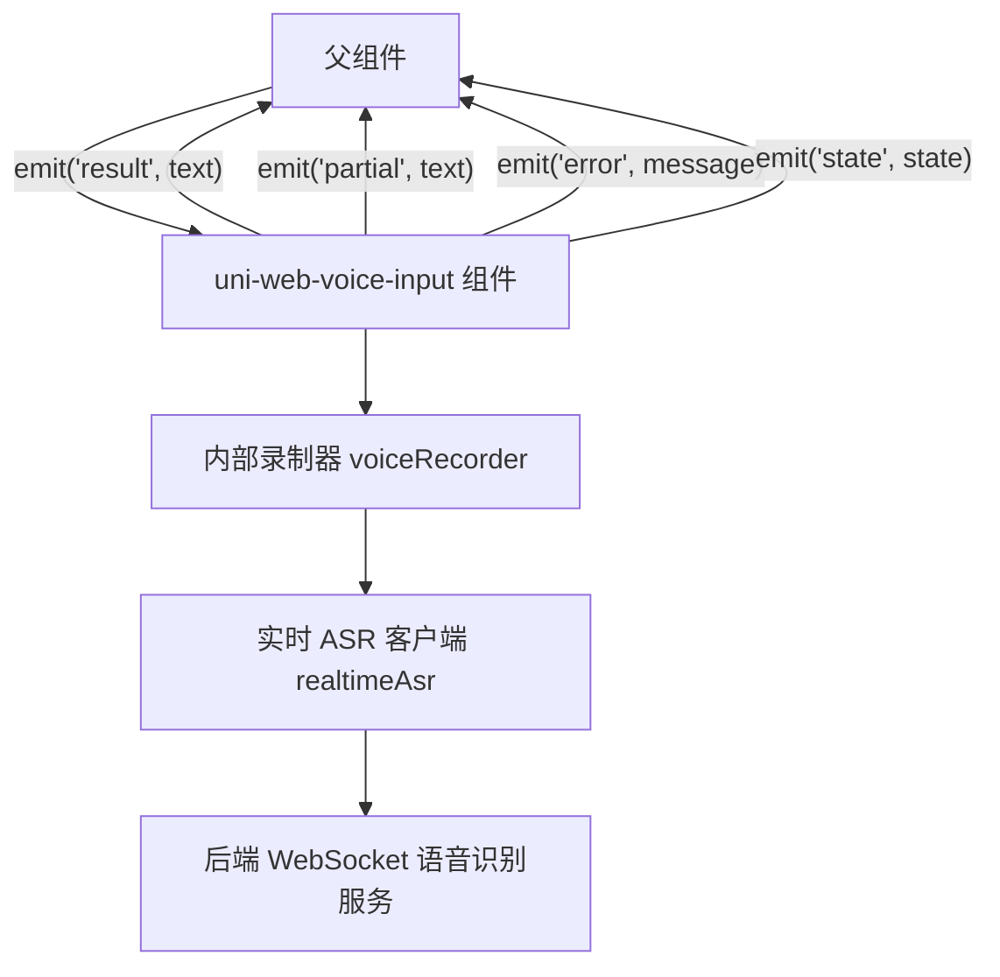
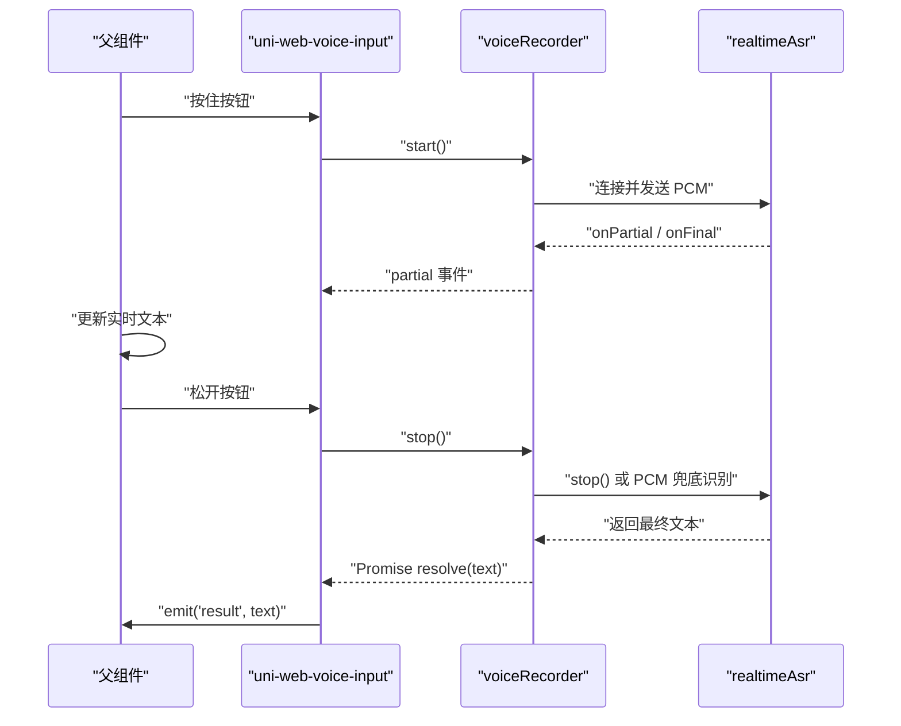
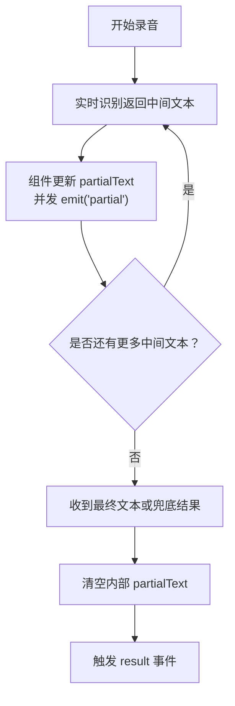
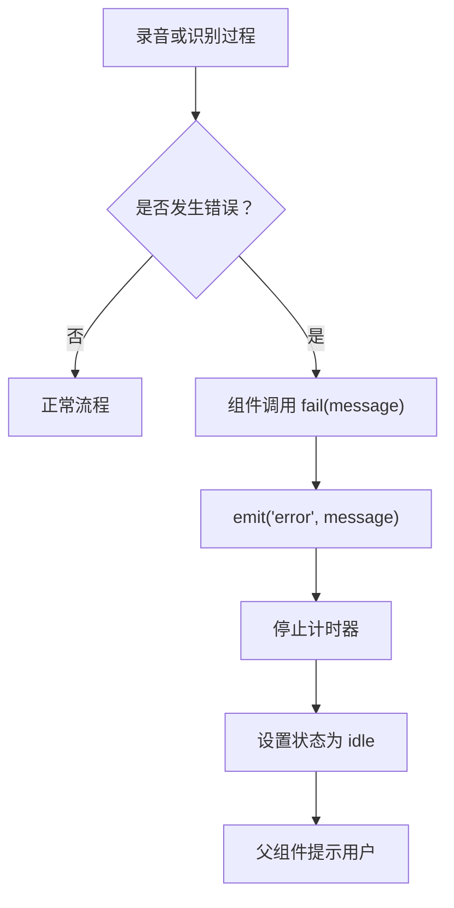
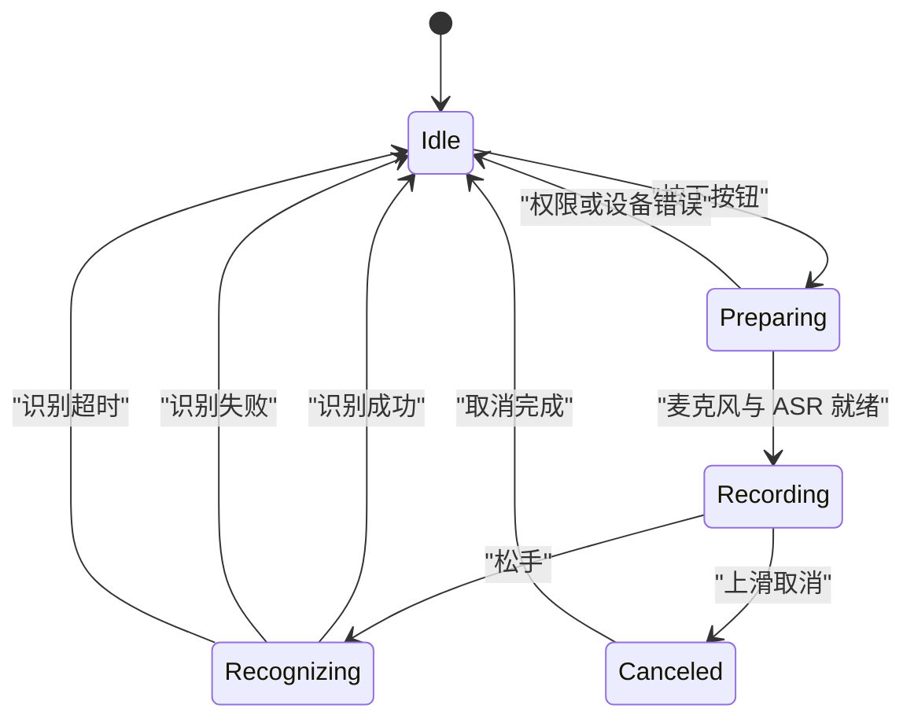
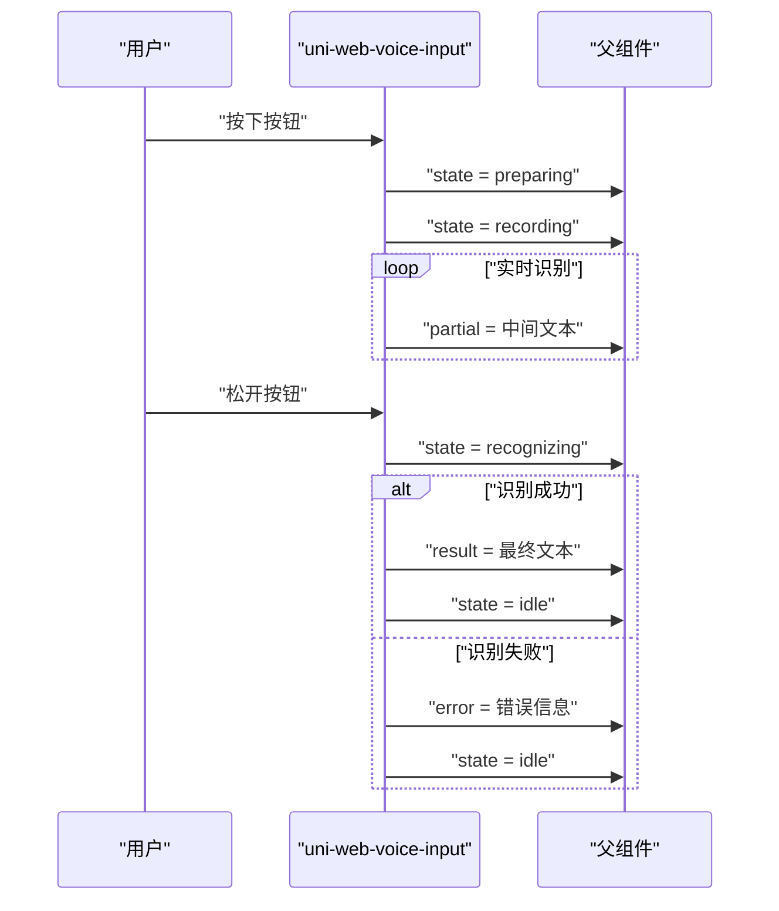
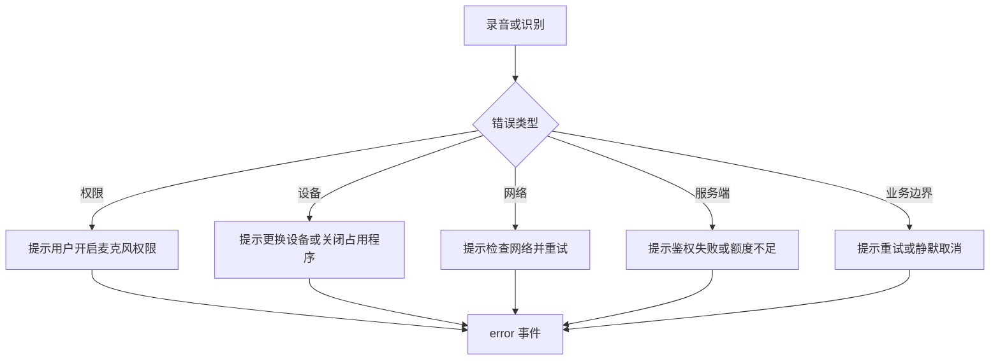

# 组件事件（Events）

<cite>
**本文引用的文件**   
- [uni-web-voice-input.vue](file://uni_modules/uni-web-voice-input/components/uni-web-voice-input/uni-web-voice-input.vue)
- [index.js](file://uni_modules/uni-web-voice-input/js_sdk/uni-web-voice/index.js)
- [realtimeAsr.js](file://uni_modules/uni-web-voice-input/js_sdk/uni-web-voice/realtimeAsr.js)
- [voiceRecorder.js](file://uni_modules/uni-web-voice-input/js_sdk/uni-web-voice/voiceRecorder.js)
- [demo 示例页 index.vue](file://demo/src/pages/index/index.vue)
- [examples demo.vue](file://examples/demo/demo.vue)
</cite>

## 目录
1. [事件总览](#事件总览)
2. [result 事件：完整识别结果回调](#result-事件完整识别结果回调)
3. [partial 事件：实时识别文本回调](#partial-事件实时识别文本回调)
4. [error 事件：错误信息回调](#error-事件错误信息回调)
5. [state 事件：状态变化回调](#state-事件状态变化回调)
6. [事件生命周期与调用顺序](#事件生命周期与调用顺序)
7. [父组件监听与处理最佳实践](#父组件监听与处理最佳实践)
8. [错误处理策略与异常情况](#错误处理策略与异常情况)
9. [常见问题排查](#常见问题排查)
10. [结论](#结论)

## 事件总览

`uni-web-voice-input` 是一个「按住说话、松手出字、上滑取消」的语音输入组件。它通过内部 SDK 完成麦克风采集、PCM 编码、WebSocket 实时语音识别，并把关键业务信号以 Vue 组件事件的形式暴露给父组件。

组件对外暴露四个核心事件：

| 事件名 | 触发时机 | 回调参数类型 | 主要用途 |
|---|---|---:|---|
| `result` | 一次录音结束且成功识别到内容时 | `string` | 接收最终识别文本 |
| `partial` | 实时识别过程中不断产出中间文本时 | `string` | 展示实时识别文案 |
| `error` | 录音启动失败、权限问题、网络或 ASR 服务异常、识别超时等 | `string` | 向用户提示错误原因 |
| `state` | 组件内部状态发生变化时 | `string` | 同步 UI 状态、统计、埋点 |

这四个事件的定义位于组件脚本中，并通过 `defineEmits` 声明：

**图表来源**
- [uni-web-voice-input.vue:59-154](file://uni_modules/uni-web-voice-input/components/uni-web-voice-input/uni-web-voice-input.vue#L59-L154)
- [voiceRecorder.js:95-114](file://uni_modules/uni-web-voice-input/js_sdk/uni-web-voice/voiceRecorder.js#L95-L114)
- [realtimeAsr.js:178-211](file://uni_modules/uni-web-voice-input/js_sdk/uni-web-voice/realtimeAsr.js#L178-L211)

**章节来源**
- [uni-web-voice-input.vue:46-59](file://uni_modules/uni-web-voice-input/components/uni-web-voice-input/uni-web-voice-input.vue#L46-L59)

## result 事件：完整识别结果回调

### 触发时机

`result` 事件在以下流程完成后触发：

1. 用户按住按钮开始录音；
2. 组件进入 `preparing` → `recording` → `recognizing` 状态；
3. 实时识别可能先返回中间文本，再返回最终文本；
4. 松手后，组件调用录制器的 `stop()`；
5. 如果实时识别有结果，则使用实时结果；
6. 如果实时识别没有结果但录到了 PCM，则用整段 PCM 兜底识别；
7. 最终得到非空文本后，组件发出 `result` 事件。

需要注意：**如果识别结果为空，组件不会触发 `result` 事件**，而是可能触发 `error` 事件，例如“未识别到内容”或“录音时间太短”。

### 回调参数格式

| 字段 | 类型 | 说明 |
|---|---:|---|
| `text` | `string` | 本次录音的最终识别文本，已去除首尾空白 |

该文本来自实时识别的最终结果，或兜底 PCM 识别的结果。SDK 内部会优先取最终文本，其次取最后一段部分文本，再尝试整段 PCM 兜底。

### 处理逻辑要点

- 只有当最终文本非空时才触发 `result`；
- 触发 `result` 前，组件会清理内部临时状态；
- 触发 `result` 后，组件状态回到 `idle`；
- 父组件收到 `result` 后，通常应清空实时文本，避免把中间文本误当作最终结果。

**图表来源**
- [uni-web-voice-input.vue:210-228](file://uni_modules/uni-web-voice-input/components/uni-web-voice-input/uni-web-voice-input.vue#L210-L228)
- [voiceRecorder.js:246-294](file://uni_modules/uni-web-voice-input/js_sdk/uni-web-voice/voiceRecorder.js#L246-L294)
- [realtimeAsr.js:298-315](file://uni_modules/uni-web-voice-input/js_sdk/uni-web-voice/realtimeAsr.js#L298-L315)

**章节来源**
- [uni-web-voice-input.vue:210-228](file://uni_modules/uni-web-voice-input/components/uni-web-voice-input/uni-web-voice-input.vue#L210-L228)
- [voiceRecorder.js:246-294](file://uni_modules/uni-web-voice-input/js_sdk/uni-web-voice/voiceRecorder.js#L246-L294)

## partial 事件：实时识别文本回调

### 触发时机

`partial` 事件在实时识别过程中持续触发。典型场景是用户按住说话时，服务端逐句返回中间识别结果。

组件内部会把 SDK 返回的部分文本保存到本地状态，并同时发出 `partial` 事件。同时，组件也会显示当前录音时长和实时文案浮层。

### 回调参数格式

| 字段 | 类型 | 说明 |
|---|---:|---|
| `text` | `string` | 当前实时识别到的中间文本 |

该文本可能是片段，也可能被后续更完整的文本覆盖。因此，`partial` 更适合用于“边说边出字”的展示，而不是直接作为最终提交数据。

### 处理逻辑要点

- 每次收到 `partial`，组件都会更新内部 `partialText`；
- 组件同时发出 `partial` 事件，供父组件展示实时文本；
- 当最终结果到达后，组件通常会清空内部 `partialText`；
- 父组件在 `result` 回调中建议清空实时文本变量，避免残留中间结果。

**图表来源**
- [uni-web-voice-input.vue:135-142](file://uni_modules/uni-web-voice-input/components/uni-web-voice-input/uni-web-voice-input.vue#L135-L142)
- [uni-web-voice-input.vue:221-227](file://uni_modules/uni-web-voice-input/components/uni-web-voice-input/uni-web-voice-input.vue#L221-L227)
- [voiceRecorder.js:100-114](file://uni_modules/uni-web-voice-input/js_sdk/uni-web-voice/voiceRecorder.js#L100-L114)
- [realtimeAsr.js:192-201](file://uni_modules/uni-web-voice-input/js_sdk/uni-web-voice/realtimeAsr.js#L192-L201)

**章节来源**
- [uni-web-voice-input.vue:135-142](file://uni_modules/uni-web-voice-input/components/uni-web-voice-input/uni-web-voice-input.vue#L135-L142)
- [voiceRecorder.js:100-114](file://uni_modules/uni-web-voice-input/js_sdk/uni-web-voice/voiceRecorder.js#L100-L114)
- [realtimeAsr.js:192-201](file://uni_modules/uni-web-voice-input/js_sdk/uni-web-voice/realtimeAsr.js#L192-L201)

## error 事件：错误信息回调

### 触发时机

`error` 事件在多种异常路径中被触发，包括但不限于：

- 麦克风权限被拒绝；
- 设备不存在或被占用；
- 当前环境不支持录音；
- 录音启动失败；
- 音频采集为空；
- 录音时间过短；
- 未识别到内容；
- WebSocket 连接失败或超时；
- ASR 服务返回鉴权失败、额度不足等错误；
- 签名请求失败或签名响应缺少必要字段。

### 回调参数格式

| 字段 | 类型 | 说明 |
|---|---:|---|
| `message` | `string` | 面向用户的可读错误信息 |

SDK 对底层错误做了中文映射，例如：

| 原始错误场景 | 组件或 SDK 提供的错误语义 |
|---|---|
| 权限被拒绝 | 提示允许麦克风权限 |
| 无麦克风设备 | 提示未检测到麦克风 |
| 麦克风被占用 | 提示其他应用正在使用 |
| 约束不满足 | 提示设备不支持所需录音参数 |
| ASR 鉴权失败 | 提示鉴权失败并重试 |
| ASR 额度不足 | 提示联系管理员开通资源包 |
| 录音太短 | 提示按住说话 |
| 未识别到内容 | 提示靠近麦克风重试 |

### 处理逻辑要点

- 组件内部统一通过 `fail(message)` 方法触发 `error`；
- `fail` 会停止计时器并重置状态为 `idle`；
- 父组件收到 `error` 后，应提示用户，但不要继续把当前录音视为成功；
- 对于可恢复错误，可引导用户重新授权或检查网络。

**图表来源**
- [uni-web-voice-input.vue:105-114](file://uni_modules/uni-web-voice-input/components/uni-web-voice-input/uni-web-voice-input.vue#L105-L114)
- [voiceRecorder.js:25-41](file://uni_modules/uni-web-voice-input/js_sdk/uni-web-voice/voiceRecorder.js#L25-L41)
- [voiceRecorder.js:256-294](file://uni_modules/uni-web-voice-input/js_sdk/uni-web-voice/voiceRecorder.js#L256-L294)
- [realtimeAsr.js:43-49](file://uni_modules/uni-web-voice-input/js_sdk/uni-web-voice/realtimeAsr.js#L43-L49)

**章节来源**
- [uni-web-voice-input.vue:105-114](file://uni_modules/uni-web-voice-input/components/uni-web-voice-input/uni-web-voice-input.vue#L105-L114)
- [voiceRecorder.js:25-41](file://uni_modules/uni-web-voice-input/js_sdk/uni-web-voice/voiceRecorder.js#L25-L41)
- [realtimeAsr.js:43-49](file://uni_modules/uni-web-voice-input/js_sdk/uni-web-voice/realtimeAsr.js#L43-L49)

## state 事件：状态变化回调

### 状态值说明

组件内部维护一个状态变量，并在关键节点通过 `setState` 更新，同时发出 `state` 事件。

| 状态值 | 含义 | 典型阶段 |
|---|---|---|
| `idle` | 空闲 | 初始状态、录音结束、取消、失败后 |
| `preparing` | 准备中 | 开始录音、申请麦克风、创建 AudioContext |
| `recording` | 录音中 | 麦克风可用、ASR 已连接并开始推流 |
| `recognizing` | 识别中 | 松手后等待最终识别结果 |
| `canceled` | 已取消 | 上滑取消或主动取消 |

### 触发时机

- 组件挂载后初始化录制器；
- 用户按下按钮，进入 `preparing`；
- 麦克风与 ASR 就绪后进入 `recording`；
- 松手后进入 `recognizing`；
- 识别完成、失败或取消后回到 `idle`；
- 主动取消时进入 `canceled`。

### 回调参数格式

| 字段 | 类型 | 说明 |
|---|---:|---|
| `state` | `string` | 当前组件状态，值为 `idle`、`preparing`、`recording`、`recognizing`、`canceled` 之一 |

### 处理逻辑要点

- 父组件可通过 `state` 控制 UI，例如禁用按钮、显示加载态、隐藏浮层；
- `state` 与 `partial`、`result`、`error` 共同构成一次录音的完整生命周期；
- 建议在 `state === 'idle'` 时恢复默认 UI；
- 建议在 `state === 'recognizing'` 时禁止重复触发录音。

**图表来源**
- [uni-web-voice-input.vue:61-114](file://uni_modules/uni-web-voice-input/components/uni-web-voice-input/uni-web-voice-input.vue#L61-L114)
- [voiceRecorder.js:83-98](file://uni_modules/uni-web-voice-input/js_sdk/uni-web-voice/voiceRecorder.js#L83-L98)
- [voiceRecorder.js:156-240](file://uni_modules/uni-web-voice-input/js_sdk/uni-web-voice/voiceRecorder.js#L156-L240)
- [voiceRecorder.js:297-303](file://uni_modules/uni-web-voice-input/js_sdk/uni-web-voice/voiceRecorder.js#L297-L303)

**章节来源**
- [uni-web-voice-input.vue:61-114](file://uni_modules/uni-web-voice-input/components/uni-web-voice-input/uni-web-voice-input.vue#L61-L114)
- [voiceRecorder.js:83-98](file://uni_modules/uni-web-voice-input/js_sdk/uni-web-voice/voiceRecorder.js#L83-L98)

## 事件生命周期与调用顺序

一次完整的“按住说话 → 松手出字”流程中，事件和状态的典型顺序如下：

1. 用户按下按钮；
2. 组件进入 `preparing`，发出 `state`；
3. 若 ASR 连接成功，组件进入 `recording`，发出 `state`；
4. 实时识别开始，反复发出 `partial`；
5. 用户松开按钮；
6. 组件进入 `recognizing`，发出 `state`；
7. 若识别成功，发出 `result`，然后回到 `idle`，发出 `state`；
8. 若识别失败，发出 `error`，然后回到 `idle`，发出 `state`；
9. 若用户上滑取消，进入 `canceled`，随后回到 `idle`，发出 `state`。

**图表来源**
- [uni-web-voice-input.vue:130-169](file://uni_modules/uni-web-voice-input/components/uni-web-voice-input/uni-web-voice-input.vue#L130-L169)
- [uni-web-voice-input.vue:181-228](file://uni_modules/uni-web-voice-input/components/uni-web-voice-input/uni-web-voice-input.vue#L181-L228)
- [voiceRecorder.js:156-294](file://uni_modules/uni-web-voice-input/js_sdk/uni-web-voice/voiceRecorder.js#L156-L294)

**章节来源**
- [uni-web-voice-input.vue:181-228](file://uni_modules/uni-web-voice-input/components/uni-web-voice-input/uni-web-voice-input.vue#L181-L228)
- [voiceRecorder.js:156-294](file://uni_modules/uni-web-voice-input/js_sdk/uni-web-voice/voiceRecorder.js#L156-L294)

## 父组件监听与处理最佳实践

### 推荐的数据模型

父组件建议维护三类数据：

| 数据项 | 类型 | 用途 |
|---|---:|---|
| `result` | `string` | 最终识别结果 |
| `partial` | `string` | 实时识别文本 |
| `state` | `string` | 组件状态 |

### 推荐的事件处理器职责

| 事件 | 推荐处理逻辑 |
|---|---|
| `result` | 保存最终文本，清空实时文本，可自动提交或进入下一步 |
| `partial` | 仅用于展示实时文本，不建议直接作为提交数据 |
| `error` | 提示用户，记录日志，必要时引导重新授权或检查网络 |
| `state` | 控制按钮禁用、加载态、浮层显示、埋点统计 |

### 示例参考

仓库中的示例页面展示了如何在父组件中监听这四个事件：

- 在模板中绑定 `@result`、`@partial`、`@error`、`@state`；
- 在脚本中维护 `result`、`partial`、`state` 三个响应式变量；
- 将 `state` 映射为人类可读的状态标签；
- 在 `onResult` 中清空实时文本；
- 在 `onError` 中弹出提示。

另一个简化示例只监听了 `result`、`error`、`state`，适合不需要实时文本的场景。

**章节来源**
- [demo 示例页 index.vue:17-24](file://demo/src/pages/index/index.vue#L17-L24)
- [demo 示例页 index.vue:44-83](file://demo/src/pages/index/index.vue#L44-L83)
- [examples demo.vue:10-12](file://examples/demo/demo.vue#L10-L12)
- [examples demo.vue:21-26](file://examples/demo/demo.vue#L21-L26)

## 错误处理策略与异常情况

### 权限相关错误

常见权限问题包括：

- 用户拒绝麦克风权限；
- 系统未授予录音权限；
- WebView 未转发权限请求；
- 鸿蒙 ArkWeb 未在用户手势同步窗口内发起 `getUserMedia`。

组件会通过 `describeMicError` 把底层错误转换为可读中文消息，并通过 `error` 事件上报。父组件应提示用户前往系统设置或浏览器设置开启麦克风权限。

### 设备相关错误

- 未检测到麦克风；
- 麦克风被其他应用占用；
- 设备不支持所需录音参数。

这类错误通常不可由前端自动修复，应提示用户更换设备或关闭占用麦克风的程序。

### 网络与服务端错误

- WebSocket 连接失败；
- 连接超时；
- ASR 鉴权失败；
- 语音识别额度不足；
- 签名接口返回缺少 `url`。

SDK 会对部分服务端错误码进行友好化处理，例如 4001、4002、4003 表示鉴权失败，4004 表示额度不足。父组件可根据错误信息决定是重试还是引导用户联系管理员。

### 业务边界情况

- 录音时间太短；
- 未采集到音频；
- 未识别到内容；
- 用户上滑取消。

这些情况不一定都是“系统错误”，有些是正常交互分支。例如上滑取消不应视为严重错误，而应静默回到空闲状态；录音太短或未识别到内容则可提示用户重试。

**图表来源**
- [voiceRecorder.js:25-41](file://uni_modules/uni-web-voice-input/js_sdk/uni-web-voice/voiceRecorder.js#L25-L41)
- [voiceRecorder.js:256-294](file://uni_modules/uni-web-voice-input/js_sdk/uni-web-voice/voiceRecorder.js#L256-L294)
- [realtimeAsr.js:43-49](file://uni_modules/uni-web-voice-input/js_sdk/uni-web-voice/realtimeAsr.js#L43-L49)
- [realtimeAsr.js:178-211](file://uni_modules/uni-web-voice-input/js_sdk/uni-web-voice/realtimeAsr.js#L178-L211)

**章节来源**
- [voiceRecorder.js:25-41](file://uni_modules/uni-web-voice-input/js_sdk/uni-web-voice/voiceRecorder.js#L25-L41)
- [realtimeAsr.js:43-49](file://uni_modules/uni-web-voice-input/js_sdk/uni-web-voice/realtimeAsr.js#L43-L49)

## 常见问题排查

### 为什么按了没反应？

可能原因：

- 当前环境不支持录音；
- 麦克风权限被拒绝；
- WebView 未正确转发权限请求；
- 没有在用户手势同步窗口内发起录音。

排查建议：

1. 检查 `state` 是否停留在 `idle`；
2. 查看 `error` 是否包含权限或设备相关提示；
3. 确认页面运行在 HTTPS 或受信任上下文；
4. 在鸿蒙 ArkWeb 中确保宿主 WebView 正确处理麦克风权限。

### 为什么有权限但没有识别文本？

可能原因：

- 实时 WebSocket 未连上；
- 服务端返回鉴权失败；
- 录音时间太短；
- 未采集到有效音频。

排查建议：

1. 观察 `state` 是否进入 `recording` 和 `recognizing`；
2. 查看 `partial` 是否有中间文本；
3. 检查 `error` 是否包含连接失败、鉴权失败或“未识别到内容”；
4. 确认签名接口返回的 `url` 有效。

### 为什么实时文本一直不消失？

组件在 `result` 成功后会清空内部 `partialText`，但父组件自己的 `partial` 变量如果没有显式清空，仍可能保留旧值。

建议：

- 在 `result` 回调中清空父组件的 `partial`；
- 不要把 `partial` 直接作为最终结果提交；
- 只在 UI 展示层使用 `partial`。

### 如何区分“取消”和“失败”？

- `state === 'canceled'` 表示用户主动上滑取消；
- `error` 表示出现异常或不符合业务规则；
- `result` 表示成功识别到内容。

父组件应根据不同状态采取不同 UI 行为，例如取消不弹窗，失败才弹窗。

**章节来源**
- [uni-web-voice-input.vue:181-228](file://uni_modules/uni-web-voice-input/components/uni-web-voice-input/uni-web-voice-input.vue#L181-L228)
- [voiceRecorder.js:246-294](file://uni_modules/uni-web-voice-input/js_sdk/uni-web-voice/voiceRecorder.js#L246-L294)
- [realtimeAsr.js:214-271](file://uni_modules/uni-web-voice-input/js_sdk/uni-web-voice/realtimeAsr.js#L214-L271)

## 结论

`uni-web-voice-input` 的事件体系围绕一次完整的语音输入生命周期设计：

- `state` 提供全局状态视图；
- `partial` 提供实时识别体验；
- `result` 提供最终识别结果；
- `error` 提供错误反馈入口。

父组件的最佳实践是：

1. 同时监听四个事件；
2. 用 `state` 控制 UI 状态；
3. 用 `partial` 做实时展示；
4. 用 `result` 作为最终数据；
5. 用 `error` 做用户提示和异常处理；
6. 在 `result` 中清空实时文本；
7. 对权限、设备、网络和服务端错误分别给出明确提示。

这样既能获得流畅的“边说边出字”体验，也能保证最终结果的准确性和错误场景的可观测性。