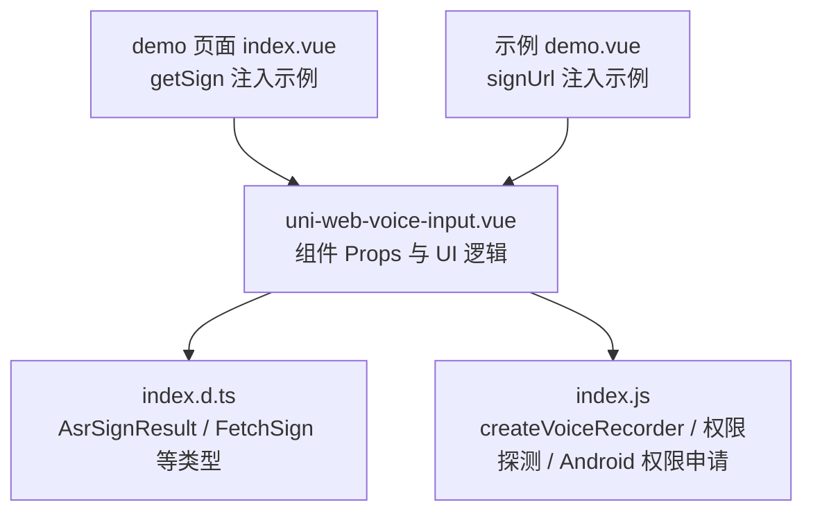
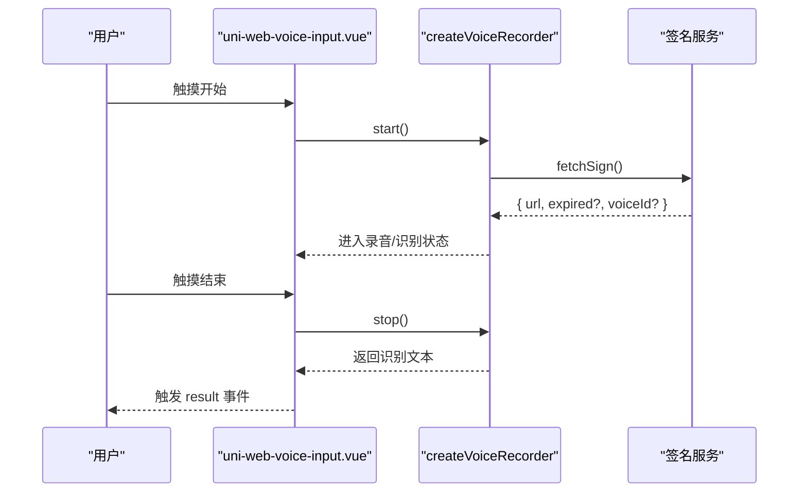
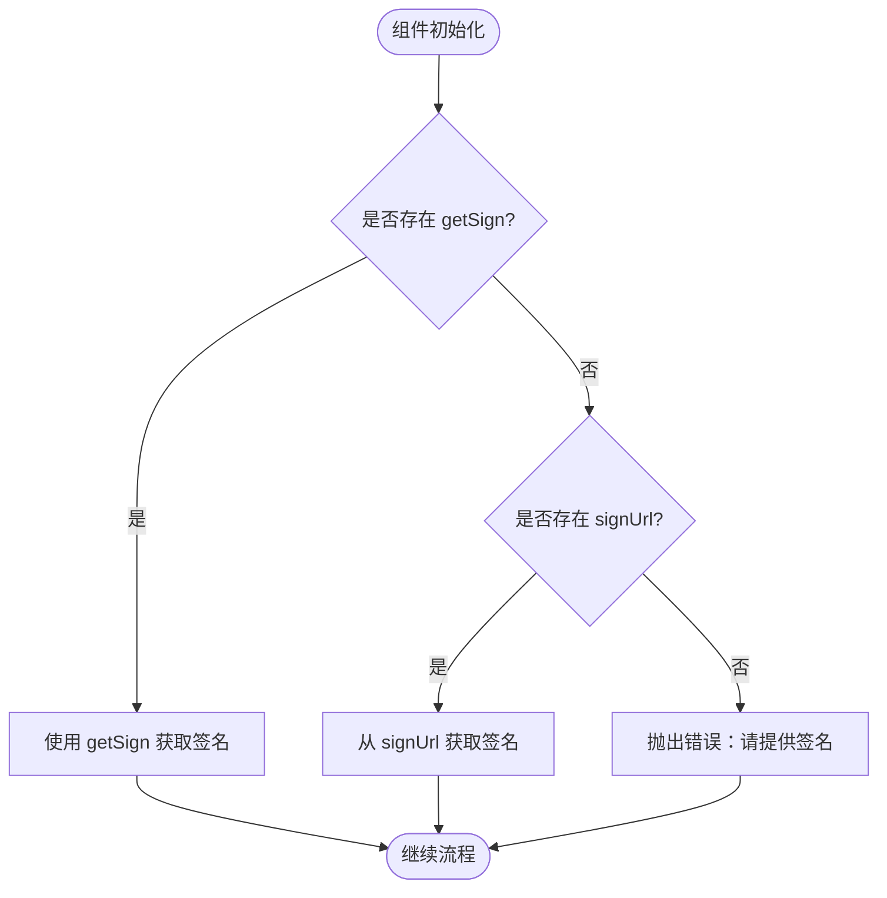

# 组件属性（Props）

<cite>
**本文引用的文件**   
- [uni-web-voice-input.vue](file://uni_modules/uni-web-voice-input/components/uni-web-voice-input/uni-web-voice-input.vue)
- [index.d.ts](file://uni_modules/uni-web-voice-input/js_sdk/uni-web-voice/index.d.ts)
- [index.js](file://uni_modules/uni-web-voice-input/js_sdk/uni-web-voice/index.js)
- [demo 页面 index.vue](file://demo/src/pages/index/index.vue)
- [示例 demo.vue](file://examples/demo/demo.vue)
</cite>

## 目录
1. [简介](#简介)
2. [项目结构](#项目结构)
3. [核心属性总览](#核心属性总览)
4. [架构概览](#架构概览)
5. [属性详细文档](#属性详细文档)
6. [依赖关系与互斥关系](#依赖关系与互斥关系)
7. [性能与行为特征](#性能与行为特征)
8. [常见配置错误与解决方案](#常见配置错误与解决方案)
9. [结论](#结论)

## 简介
本章节面向 uni-web-voice-input 组件的使用者，聚焦其对外暴露的 props 接口，包括类型、默认值、用途、使用场景、最佳实践以及与其他属性的依赖和互斥关系。该组件基于纯 Web 能力实现「按住说话」交互，内部通过 js_sdk/uni-web-voice 提供的 createVoiceRecorder 完成麦克风录音、实时语音识别与结果回调；组件本身主要负责 UI 状态、手势处理以及与 SDK 之间的参数传递。

## 项目结构
与组件属性直接相关的代码主要位于以下位置：
- 组件定义与 props 声明：`uni_modules/uni-web-voice-input/components/uni-web-voice-input/uni-web-voice-input.vue`
- SDK 类型声明与签名相关类型：`uni_modules/uni-web-voice-input/js_sdk/uni-web-voice/index.d.ts`
- SDK 运行时导出与能力探测函数：`uni_modules/uni-web-voice-input/js_sdk/uni-web-voice/index.js`
- 组件使用示例：`demo/src/pages/index/index.vue`、`examples/demo/demo.vue`

**图表来源**
- [uni-web-voice-input.vue:46-57](file://uni_modules/uni-web-voice-input/components/uni-web-voice-input/uni-web-voice-input.vue#L46-L57)
- [index.d.ts:10-19](file://uni_modules/uni-web-voice-input/js_sdk/uni-web-voice/index.d.ts#L10-L19)
- [index.js](file://uni_modules/uni-web-voice-input/js_sdk/uni-web-voice/index.js)
- [demo 页面 index.vue:17-24](file://demo/src/pages/index/index.vue#L17-L24)
- [示例 demo.vue:11-11](file://examples/demo/demo.vue#L11-L11)

**章节来源**
- [uni-web-voice-input.vue:28-57](file://uni_modules/uni-web-voice-input/components/uni-web-voice-input/uni-web-voice-input.vue#L28-L57)
- [index.d.ts:1-108](file://uni_modules/uni-web-voice-input/js_sdk/uni-web-voice/index.d.ts#L1-L108)

## 核心属性总览
| 属性名 | 类型 | 默认值 | 用途简述 | 典型使用场景 |
|---|---|---:|---|---|
| `getSign` | `Function` | `null` | 动态获取 ASR 签名，优先于 `signUrl` | 需要服务端鉴权、携带业务 token 或动态参数的场景 |
| `signUrl` | `String` | `''` | 直接提供返回签名的 GET 地址 | 快速接入，无需自定义签名函数 |
| `voiceFormat` | `Number` | `1` | 指定音频编码格式 | 对接不同 ASR 厂商的 PCM/WAV 等格式要求 |
| `debug` | `Boolean` | `false` | 开启调试日志 | 开发阶段排查握手、权限、网络问题 |
| `cancelThreshold` | `Number` | `80` | 上滑取消阈值（像素） | 调整滑动取消灵敏度 |
| `autoRequestAndroidPermission` | `Boolean` | `true` | App-plus 安卓环境自动申请录音权限 | 在宿主未提前申请权限时自动补弹系统框 |

**章节来源**
- [uni-web-voice-input.vue:46-57](file://uni_modules/uni-web-voice-input/components/uni-web-voice-input/uni-web-voice-input.vue#L46-L57)

## 架构概览
组件在挂载时创建录音器实例，并预取签名以减少首次按下等待；同时异步探测麦克风授权状态，并在 App-plus 安卓环境下根据 `autoRequestAndroidPermission` 决定是否主动申请系统录音权限。用户按住按钮时同步调用录音器启动，松开后停止录音并触发识别；上滑超过阈值则取消录音。

**图表来源**
- [uni-web-voice-input.vue:130-169](file://uni_modules/uni-web-voice-input/components/uni-web-voice-input/uni-web-voice-input.vue#L130-L169)
- [uni-web-voice-input.vue:180-228](file://uni_modules/uni-web-voice-input/components/uni-web-voice-input/uni-web-voice-input.vue#L180-L228)
- [index.d.ts:71-79](file://uni_modules/uni-web-voice-input/js_sdk/uni-web-voice/index.d.ts#L71-L79)

## 属性详细文档

### getSign
- **类型**：`Function`
- **默认值**：`null`
- **用途**：提供一个可返回 Promise 的函数，用于动态获取 ASR 签名。当存在 `getSign` 时，组件优先使用该函数，而忽略 `signUrl`。
- **返回值格式**：Promise 解析为对象，至少包含 `url` 字段；可选字段包括 `expired`（过期时间戳，秒）、`voiceId`（会话标识）。
- **使用场景**：
  - 需要服务端鉴权、携带业务 token、设备指纹等动态参数。
  - 需要根据用户身份或租户动态选择不同 ASR 服务地址。
- **最佳实践**：
  - 在发起请求前检查麦克风是否被阻断，若被阻断应抛出可读错误信息，便于组件统一提示。
  - 对响应体进行容错处理，兼容 `{ url }` 与 `{ data: { url } }` 两种常见结构。
  - 合理设置 `expired`，避免频繁重签导致握手延迟。
- **参考实现路径**：[demo 页面 index.vue:59-75](file://demo/src/pages/index/index.vue#L59-L75)

**章节来源**
- [uni-web-voice-input.vue:47-48](file://uni_modules/uni-web-voice-input/components/uni-web-voice-input/uni-web-voice-input.vue#L47-L48)
- [index.d.ts:10-19](file://uni_modules/uni-web-voice-input/js_sdk/uni-web-voice/index.d.ts#L10-L19)
- [demo 页面 index.vue:59-75](file://demo/src/pages/index/index.vue#L59-L75)

### signUrl
- **类型**：`String`
- **默认值**：`''`
- **用途**：直接提供一个 GET 接口地址，组件会自行发起请求并解析签名。返回体支持 `{ url }` 或 `{ data: { url } }`。
- **使用场景**：
  - 快速接入，无需自定义签名函数。
  - 签名接口稳定且不需要复杂业务参数注入。
- **最佳实践**：
  - 确保接口返回稳定的 JSON 结构，并包含 `url` 字段。
  - 注意跨域与 HTTPS 要求，尤其在鸿蒙 WebView 环境中。
- **参考实现路径**：[示例 demo.vue:11-19](file://examples/demo/demo.vue#L11-L19)

**章节来源**
- [uni-web-voice-input.vue:49-50](file://uni_modules/uni-web-voice-input/components/uni-web-voice-input/uni-web-voice-input.vue#L49-L50)
- [示例 demo.vue:11-19](file://examples/demo/demo.vue#L11-L19)

### voiceFormat
- **类型**：`Number`
- **默认值**：`1`
- **用途**：指定音频编码格式，传递给底层录音器以适配不同 ASR 厂商的期望输入。
- **使用场景**：
  - 腾讯云等 ASR 服务通常期望 16k PCM16，对应默认值 `1`。
  - 其他厂商可能要求 WAV、MP3 或其他编码，需按厂商文档调整。
- **最佳实践**：
  - 与后端 ASR 配置保持一致，避免因编码不匹配导致识别失败。
  - 在切换不同 ASR 供应商时，集中管理 `voiceFormat` 配置项。
- **参考实现路径**：[uni-web-voice-input.vue:51-51](file://uni_modules/uni-web-voice-input/components/uni-web-voice-input/uni-web-voice-input.vue#L51-L51)

**章节来源**
- [uni-web-voice-input.vue:51-51](file://uni_modules/uni-web-voice-input/components/uni-web-voice-input/uni-web-voice-input.vue#L51-L51)
- [index.d.ts:53-69](file://uni_modules/uni-web-voice-input/js_sdk/uni-web-voice/index.d.ts#L53-L69)

### debug
- **类型**：`Boolean`
- **默认值**：`false`
- **用途**：控制是否输出调试日志，例如权限申请结果、握手信息等。
- **使用场景**：
  - 开发阶段排查权限、网络、握手问题。
  - 生产环境建议关闭以降低日志噪音。
- **最佳实践**：
  - 结合环境变量或构建开关控制 `debug`，避免在生产环境泄露敏感信息。
  - 关注控制台中的 `[uni-web-voice] plus RECORD_AUDIO:` 等关键日志。
- **参考实现路径**：[uni-web-voice-input.vue:52-52](file://uni_modules/uni-web-voice-input/components/uni-web-voice-input/uni-web-voice-input.vue#L52-L52)

**章节来源**
- [uni-web-voice-input.vue:52-52](file://uni_modules/uni-web-voice-input/components/uni-web-voice-input/uni-web-voice-input.vue#L52-L52)

### cancelThreshold
- **类型**：`Number`
- **默认值**：`80`
- **用途**：定义上滑取消的阈值（像素），超过该距离即判定为取消录音。
- **使用场景**：
  - 调整滑动取消灵敏度，适应不同设备的触控体验。
  - 在误触较多的场景中适当增大阈值。
- **最佳实践**：
  - 根据实际测试反馈微调，避免过小导致误取消或过大导致无法取消。
  - 可在不同平台或机型下差异化配置。
- **参考实现路径**：[uni-web-voice-input.vue:53-54](file://uni_modules/uni-web-voice-input/components/uni-web-voice-input/uni-web-voice-input.vue#L53-L54)

**章节来源**
- [uni-web-voice-input.vue:53-54](file://uni_modules/uni-web-voice-input/components/uni-web-voice-input/uni-web-voice-input.vue#L53-L54)

### autoRequestAndroidPermission
- **类型**：`Boolean`
- **默认值**：`true`
- **用途**：在 App-plus 安卓 webview 中，组件挂载时主动申请 `RECORD_AUDIO` 运行时权限；非 App-plus 环境无副作用。
- **使用场景**：
  - 宿主未提前申请权限时，由组件自动补弹系统权限框。
  - 宿主已负责权限申请时可关闭此功能以避免重复弹窗。
- **最佳实践**：
  - 若宿主已在应用启动时申请权限，可将此属性设为 `false`。
  - 结合 `debug` 观察权限申请结果，确认是否成功授予。
- **参考实现路径**：[uni-web-voice-input.vue:55-56](file://uni_modules/uni-web-voice-input/components/uni-web-voice-input/uni-web-voice-input.vue#L55-L56)

**章节来源**
- [uni-web-voice-input.vue:55-56](file://uni_modules/uni-web-voice-input/components/uni-web-voice-input/uni-web-voice-input.vue#L55-L56)

## 依赖关系与互斥关系
- `getSign` 与 `signUrl`：
  - 二者均可提供 ASR 签名，但 `getSign` 优先级更高。
  - 若同时设置，组件将忽略 `signUrl`，仅调用 `getSign`。
  - 若两者均未提供，组件会在尝试获取签名时抛出错误。
- `voiceFormat` 与 ASR 后端：
  - `voiceFormat` 必须与后端 ASR 服务的音频格式要求一致，否则可能导致识别失败。
- `autoRequestAndroidPermission` 与宿主权限管理：
  - 若宿主已负责申请权限，建议关闭此属性以避免重复弹窗。
  - 在非 App-plus 环境，该属性不会产生额外行为。
- `debug` 与日志输出：
  - `debug` 影响权限申请、握手等过程的日志输出，便于排查问题。

**图表来源**
- [uni-web-voice-input.vue:95-103](file://uni_modules/uni-web-voice-input/components/uni-web-voice-input/uni-web-voice-input.vue#L95-L103)

**章节来源**
- [uni-web-voice-input.vue:95-103](file://uni_modules/uni-web-voice-input/components/uni-web-voice-input/uni-web-voice-input.vue#L95-L103)

## 性能与行为特征
- 预取签名：组件在挂载时会调用录音器的预取方法，减少首次按下的握手延迟。
- 权限探测：组件异步探测麦克风授权状态，若被拒绝则显示引导文案，提升用户体验。
- 手势时序：在触摸开始时同步调用录音器启动，确保在鸿蒙/安卓环境下能正确触发麦克风授权弹窗。
- 计时器管理：录音状态下启动计时器，结束时清理，避免内存泄漏。

**章节来源**
- [uni-web-voice-input.vue:130-169](file://uni_modules/uni-web-voice-input/components/uni-web-voice-input/uni-web-voice-input.vue#L130-L169)
- [uni-web-voice-input.vue:180-228](file://uni_modules/uni-web-voice-input/components/uni-web-voice-input/uni-web-voice-input.vue#L180-L228)

## 常见配置错误与解决方案
- 未提供签名：
  - 现象：组件在尝试获取签名时抛出错误。
  - 解决：提供 `getSign` 或 `signUrl`，并确保返回体包含 `url`。
- 签名响应缺少 `url`：
  - 现象：提示签名响应无效。
  - 解决：检查后端接口返回结构，确保包含 `url` 字段。
- 麦克风权限被拒绝：
  - 现象：提示麦克风未授权或录音启动失败。
  - 解决：在 App-plus 安卓环境启用 `autoRequestAndroidPermission`，或由宿主提前申请权限。
- 音频格式不匹配：
  - 现象：识别结果为空或异常。
  - 解决：调整 `voiceFormat` 以匹配后端 ASR 服务的要求。
- 滑动取消过于灵敏：
  - 现象：轻微上滑即取消录音。
  - 解决：增大 `cancelThreshold` 以提升稳定性。

**章节来源**
- [uni-web-voice-input.vue:95-103](file://uni_modules/uni-web-voice-input/components/uni-web-voice-input/uni-web-voice-input.vue#L95-L103)
- [uni-web-voice-input.vue:158-168](file://uni_modules/uni-web-voice-input/components/uni-web-voice-input/uni-web-voice-input.vue#L158-L168)
- [uni-web-voice-input.vue:192-206](file://uni_modules/uni-web-voice-input/components/uni-web-voice-input/uni-web-voice-input.vue#L192-L206)

## 结论
uni-web-voice-input 组件通过简洁的 props 接口提供了灵活的签名注入、音频格式配置、调试开关、滑动取消阈值以及安卓权限自动申请等功能。正确使用这些属性可以显著提升语音输入的稳定性与用户体验。建议在集成时结合后端 ASR 服务的具体要求，合理配置 `getSign`/`signUrl`、`voiceFormat`、`debug`、`cancelThreshold` 与 `autoRequestAndroidPermission`，并通过示例页面的用法参考快速验证配置效果。