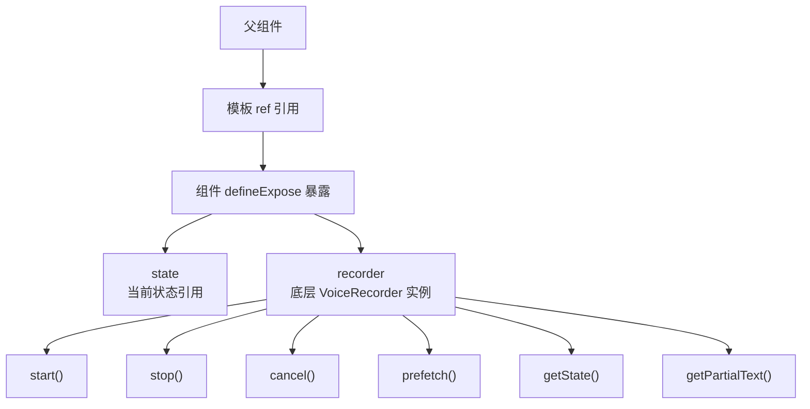
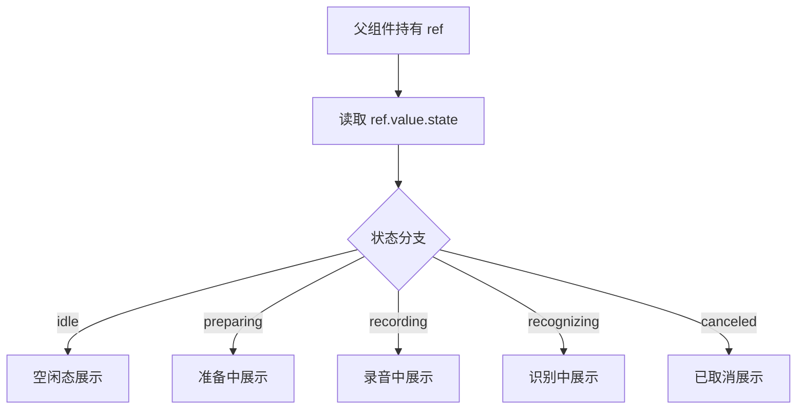
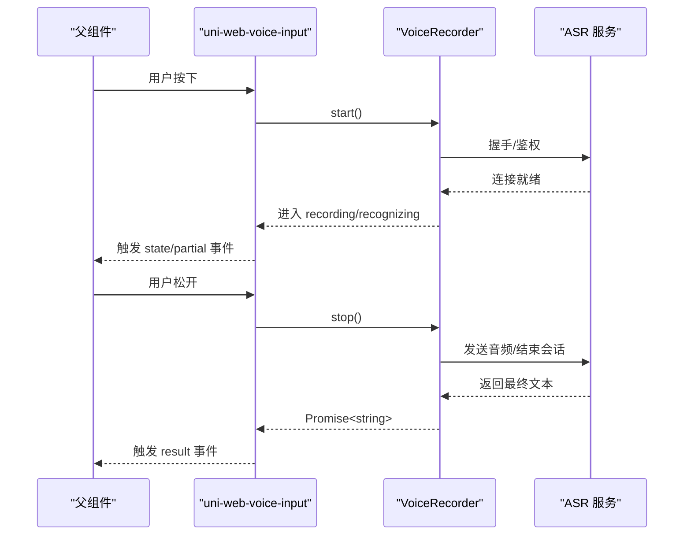
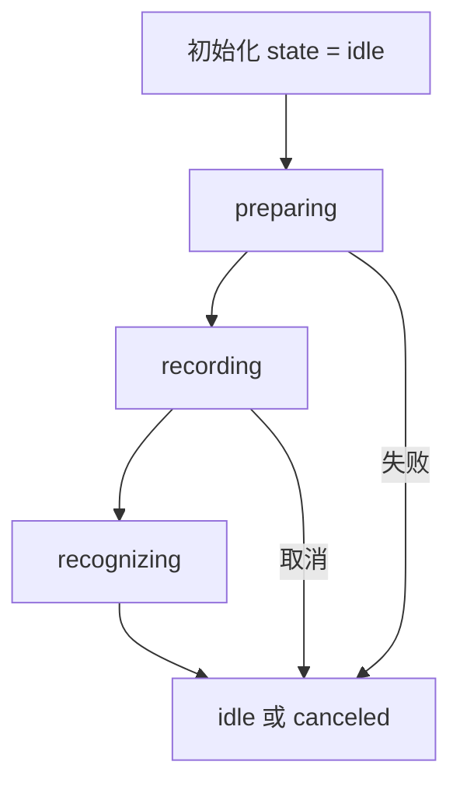

# 组件方法（Methods）

<cite>
**本文引用的文件**   
- [uni-web-voice-input.vue](file://uni_modules/uni-web-voice-input/components/uni-web-voice-input/uni-web-voice-input.vue)
- [index.d.ts](file://uni_modules/uni-web-voice-input/js_sdk/uni-web-voice/index.d.ts)
- [index.js](file://uni_modules/uni-web-voice-input/js_sdk/uni-web-voice/index.js)
- [voiceRecorder.js](file://uni_modules/uni-web-voice-input/js_sdk/uni-web-voice/voiceRecorder.js)
- [realtimeAsr.js](file://uni_modules/uni-web-voice-input/js_sdk/uni-web-voice/realtimeAsr.js)
- [demo 页面 index.vue](file://demo/src/pages/index/index.vue)
- [示例 demo.vue](file://examples/demo/demo.vue)
</cite>

## 目录
1. [简介](#简介)
2. [暴露的 API 总览](#暴露的-api-总览)
3. [state 对象说明](#state-对象说明)
4. [recorder 对象与方法说明](#recorder-对象与方法说明)
5. [异步特性与返回值格式](#异步特性与返回值格式)
6. [在组件外部控制语音输入行为](#在组件外部控制语音输入行为)
7. [监听组件状态变化](#监听组件状态变化)
8. [最佳实践与注意事项](#最佳实践与注意事项)
9. [常见问题排查](#常见问题排查)
10. [结论](#结论)

## 简介
本章节聚焦 uni-web-voice-input 组件对外暴露的方法与可访问对象，重点说明如何通过 `defineExpose` 暴露的 `recorder` 和 `state` 进行高级控制。该组件内部使用 js_sdk 中的 `createVoiceRecorder` 驱动底层录音与实时识别，并在触摸、鼠标等手势中调用录制器的 `start()`、`stop()`、`cancel()`。对外暴露的接口允许父组件：
- 直接读取当前组件状态；
- 获取底层录制器实例以执行预取签名、查询状态、取消等操作；
- 结合事件回调完成更复杂的业务编排。

## 暴露的 API 总览
组件通过 `defineExpose` 暴露两个顶层对象：
- `state`：当前组件状态的可响应式引用。
- `recorder`：底层录制器实例，对应 SDK 类型定义中的 `VoiceRecorder`。



**图示来源**
- [uni-web-voice-input.vue:266-266](file://uni_modules/uni-web-voice-input/components/uni-web-voice-input/uni-web-voice-input.vue#L266-L266)
- [index.d.ts:71-79](file://uni_modules/uni-web-voice-input/js_sdk/uni-web-voice/index.d.ts#L71-L79)

**章节来源**
- [uni-web-voice-input.vue:266-266](file://uni_modules/uni-web-voice-input/components/uni-web-voice-input/uni-web-voice-input.vue#L266-L266)
- [index.d.ts:71-79](file://uni_modules/uni-web-voice-input/js_sdk/uni-web-voice/index.d.ts#L71-L79)

## state 对象说明
`state` 是组件内部维护的状态引用，类型为字符串枚举值之一：
- `idle`：空闲
- `preparing`：准备中
- `recording`：录音中
- `recognizing`：识别中
- `canceled`：已取消

父组件可通过模板 ref 直接读取 `ref.value.state`，用于显示状态标签、禁用按钮或联动其他 UI。



**图示来源**
- [uni-web-voice-input.vue:61-61](file://uni_modules/uni-web-voice-input/components/uni-web-voice-input/uni-web-voice-input.vue#L61-L61)
- [index.d.ts:3-8](file://uni_modules/uni-web-voice-input/js_sdk/uni-web-voice/index.d.ts#L3-L8)

**章节来源**
- [uni-web-voice-input.vue:61-61](file://uni_modules/uni-web-voice-input/components/uni-web-voice-input/uni-web-voice-input.vue#L61-L61)
- [index.d.ts:3-8](file://uni_modules/uni-web-voice-input/js_sdk/uni-web-voice/index.d.ts#L3-L8)

## recorder 对象与方法说明
`recorder` 是底层 `VoiceRecorder` 实例，提供以下方法：

- `start(): Promise<void>`
  - 作用：开始录音并建立 ASR 连接。必须在用户手势同步窗口内调用（例如点击、按下）。
  - 返回：Promise，成功时 resolve，失败时 reject。
  - 注意：组件内部在触摸开始时同步调用该方法，以确保触发麦克风授权弹窗。

- `stop(): Promise<string>`
  - 作用：结束录音并返回最终识别文本。
  - 返回：Promise，成功时解析为识别文本字符串；若未识别到内容可能为空字符串。
  - 注意：组件内部在松手时调用该方法，并将结果通过 `result` 事件抛出。

- `cancel(): void`
  - 作用：取消当前录音流程。
  - 返回：无返回值。
  - 注意：组件在取消手势或异常路径中调用该方法。

- `prefetch(): Promise<void>`
  - 作用：预取签名或预热连接，减少首次按下的等待时间。
  - 返回：Promise，成功时 resolve。
  - 注意：组件在挂载后主动调用一次。

- `getState(): RecorderState`
  - 作用：读取录制器当前状态。
  - 返回：状态枚举值。

- `getPartialText(): string`
  - 作用：读取当前部分识别文本。
  - 返回：字符串。

```mermaid
classDiagram
class VoiceRecorder {
+start() Promise~void~
+stop() Promise~string~
+cancel() void
+prefetch() Promise~void~
+getState() RecorderState
+getPartialText() string
}
class RecorderState {
<<enum>>
"idle"
"preparing"
"recording"
"recognizing"
"canceled"
}
VoiceRecorder --> RecorderState : "getState() 返回"
```

**图示来源**
- [index.d.ts:71-79](file://uni_modules/uni-web-voice-input/js_sdk/uni-web-voice/index.d.ts#L71-L79)
- [index.d.ts:3-8](file://uni_modules/uni-web-voice-input/js_sdk/uni-web-voice/index.d.ts#L3-L8)

**章节来源**
- [index.d.ts:71-79](file://uni_modules/uni-web-voice-input/js_sdk/uni-web-voice/index.d.ts#L71-L79)

## 异步特性与返回值格式
- `start()`：异步启动，可能在握手、权限检查、签名获取阶段耗时。建议在用户交互事件中调用，并处理拒绝情况。
- `stop()`：异步结束，返回 Promise<string>。成功时解析为识别文本；失败时 reject。
- `prefetch()`：异步预热，成功后可减少首次延迟。
- 事件回调：
  - `partial`：部分识别文本，流式更新。
  - `result`：最终识别文本。
  - `error`：错误消息。
  - `state`：状态变更事件，值为状态枚举。



**图示来源**
- [uni-web-voice-input.vue:180-228](file://uni_modules/uni-web-voice-input/components/uni-web-voice-input/uni-web-voice-input.vue#L180-L228)
- [index.d.ts:71-79](file://uni_modules/uni-web-voice-input/js_sdk/uni-web-voice/index.d.ts#L71-L79)

**章节来源**
- [uni-web-voice-input.vue:180-228](file://uni_modules/uni-web-voice-input/components/uni-web-voice-input/uni-web-voice-input.vue#L180-L228)
- [index.d.ts:71-79](file://uni_modules/uni-web-voice-input/js_sdk/uni-web-voice/index.d.ts#L71-L79)

## 在组件外部控制语音输入行为
推荐通过模板 ref 获取组件实例，然后访问 `recorder` 与 `state`：

- 获取状态：
  - 读取 `ref.value.state` 显示当前状态。
- 预取签名：
  - 调用 `ref.value.recorder.prefetch()` 提前预热。
- 查询状态：
  - 调用 `ref.value.recorder.getState()` 获取录制器状态。
- 读取部分文本：
  - 调用 `ref.value.recorder.getPartialText()` 获取实时文本。
- 手动控制：
  - 在特定场景下调用 `ref.value.recorder.start()`、`ref.value.recorder.stop()`、`ref.value.recorder.cancel()`。

参考示例页面的用法模式：
- 通过 `@state` 监听状态变化；
- 通过 `@result` 接收最终文本；
- 通过 `@partial` 接收部分文本；
- 通过 `@error` 处理错误提示。

**章节来源**
- [demo 页面 index.vue:17-24](file://demo/src/pages/index/index.vue#L17-L24)
- [demo 页面 index.vue:77-83](file://demo/src/pages/index/index.vue#L77-L83)
- [示例 demo.vue:10-12](file://examples/demo/demo.vue#L10-L12)
- [示例 demo.vue:24-26](file://examples/demo/demo.vue#L24-L26)

## 监听组件状态变化
组件在内部通过 `emit('state', s)` 广播状态变化。父组件可以：
- 在模板上绑定 `@state="onState"`；
- 在回调中将状态保存到本地变量，用于计算状态标签或控制 UI。

组件内部状态流转逻辑：
- 当状态变为 `recording` 时，启动计时器；
- 当状态离开 `recording` 时，停止计时器；
- 当检测到麦克风被拒绝时，设置引导文案。



**图示来源**
- [uni-web-voice-input.vue:61-61](file://uni_modules/uni-web-voice-input/components/uni-web-voice-input/uni-web-voice-input.vue#L61-L61)
- [uni-web-voice-input.vue:111-114](file://uni_modules/uni-web-voice-input/components/uni-web-voice-input/uni-web-voice-input.vue#L111-L114)
- [uni-web-voice-input.vue:144-152](file://uni_modules/uni-web-voice-input/components/uni-web-voice-input/uni-web-voice-input.vue#L144-L152)

**章节来源**
- [uni-web-voice-input.vue:111-114](file://uni_modules/uni-web-voice-input/components/uni-web-voice-input/uni-web-voice-input.vue#L111-L114)
- [uni-web-voice-input.vue:144-152](file://uni_modules/uni-web-voice-input/components/uni-web-voice-input/uni-web-voice-input.vue#L144-L152)

## 最佳实践与注意事项
- 始终在用户手势同步窗口内调用 `recorder.start()`，避免浏览器拦截麦克风权限。
- 对 `start()` 和 `stop()` 的 Promise 进行 try/catch 或 .catch 处理，捕获网络、权限、签名错误。
- 使用 `prefetch()` 在页面加载或用户即将操作前预热，降低首触延迟。
- 通过 `@state` 监听状态变化，结合 UI 展示“准备中”“录音中”“识别中”等反馈。
- 对于安卓 App-plus 环境，注意系统录音权限问题；组件内部会尝试自动申请，但必要时仍需宿主配合。
- 不要在非交互上下文中重复调用 `start()`，避免并发冲突。
- 使用 `getState()` 与 `getPartialText()` 实现自定义 UI 或日志记录。
- 在组件卸载时，确保不再调用录制器方法；组件内部会在卸载时尝试 cancel，但外部应避免再次操作。

**章节来源**
- [uni-web-voice-input.vue:130-169](file://uni_modules/uni-web-voice-input/components/uni-web-voice-input/uni-web-voice-input.vue#L130-L169)
- [uni-web-voice-input.vue:171-178](file://uni_modules/uni-web-voice-input/components/uni-web-voice-input/uni-web-voice-input.vue#L171-L178)
- [uni-web-voice-input.vue:192-206](file://uni_modules/uni-web-voice-input/components/uni-web-voice-input/uni-web-voice-input.vue#L192-L206)

## 常见问题排查
- 无法弹出麦克风权限：
  - 确认在用户手势同步窗口内调用 `start()`；
  - 检查 HTTPS 与安全上下文；
  - 在安卓 App-plus 环境中，确认宿主已授予 RECORD_AUDIO 权限。
- 识别结果为空：
  - 检查 `signUrl` 或 `getSign` 是否返回有效的 wss url；
  - 查看 `error` 事件消息；
  - 使用 `debug=true` 开启调试日志。
- 状态不更新：
  - 确认绑定了 `@state` 事件；
  - 检查是否有异常导致状态回退到 `idle`。

**章节来源**
- [uni-web-voice-input.vue:105-109](file://uni_modules/uni-web-voice-input/components/uni-web-voice-input/uni-web-voice-input.vue#L105-L109)
- [uni-web-voice-input.vue:192-206](file://uni_modules/uni-web-voice-input/components/uni-web-voice-input/uni-web-voice-input.vue#L192-L206)

## 结论
通过 `defineExpose` 暴露的 `state` 与 `recorder`，父组件可以：
- 直观地读取与展示组件状态；
- 获取底层录制器实例进行高级控制；
- 结合事件回调实现完整的语音输入体验。

建议优先使用组件的事件模型（`result`、`partial`、`error`、`state`），在需要精细控制时再直接调用 `recorder` 的方法，并注意异步特性与权限要求。