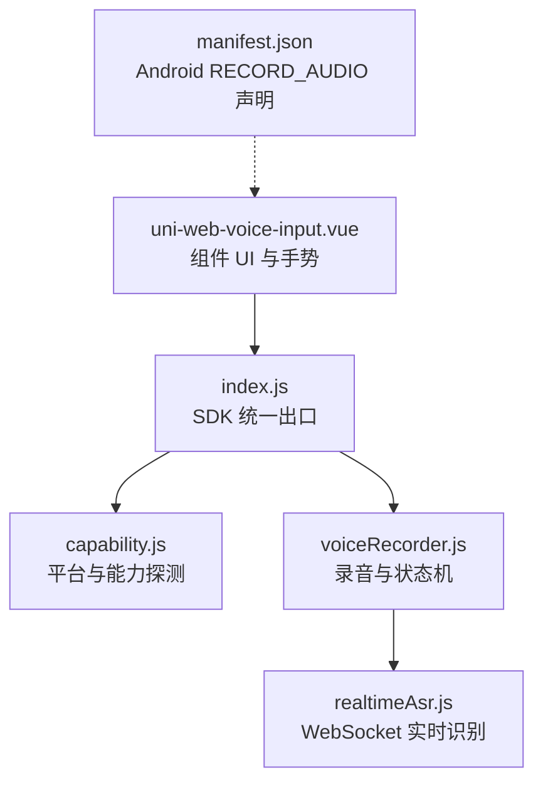
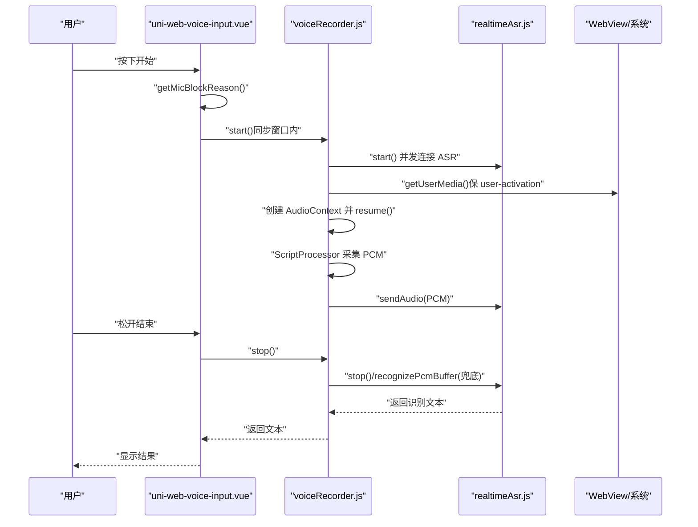
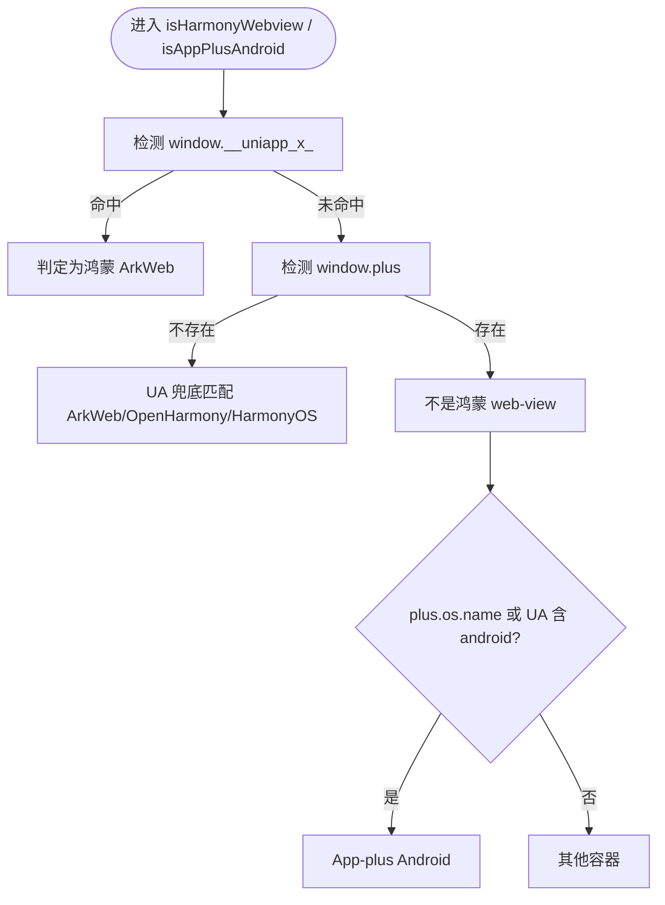
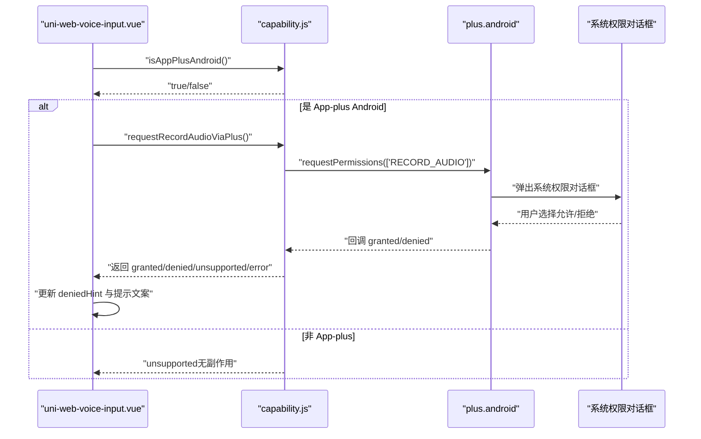
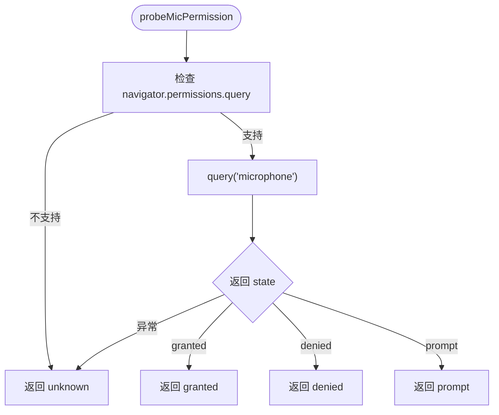
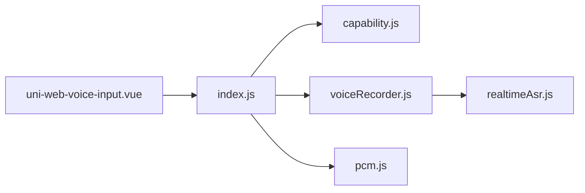

# Android/iOS WebView 兼容性

<cite>
**本文引用的文件**   
- [README.md](file://README.md)
- [demo/src/manifest.json](file://demo/src/manifest.json)
- [uni_modules/uni-web-voice-input/readme.md](file://uni_modules/uni-web-voice-input/readme.md)
- [js_sdk/uni-web-voice/index.js](file://uni_modules/uni-web-voice-input/js_sdk/uni-web-voice/index.js)
- [js_sdk/uni-web-voice/capability.js](file://uni_modules/uni-web-voice-input/js_sdk/uni-web-voice/capability.js)
- [components/uni-web-voice-input/uni-web-voice-input.vue](file://uni_modules/uni-web-voice-input/components/uni-web-voice-input/uni-web-voice-input.vue)
- [js_sdk/uni-web-voice/voiceRecorder.js](file://uni_modules/uni-web-voice-input/js_sdk/uni-web-voice/voiceRecorder.js)
- [js_sdk/uni-web-voice/realtimeAsr.js](file://uni_modules/uni-web-voice-input/js_sdk/uni-web-voice/realtimeAsr.js)
</cite>

## 目录
1. [引言](#引言)
2. [项目结构](#项目结构)
3. [核心组件](#核心组件)
4. [架构总览](#架构总览)
5. [详细组件分析](#详细组件分析)
6. [依赖关系分析](#依赖关系分析)
7. [性能与稳定性考量](#性能与稳定性考量)
8. [常见问题与排障](#常见问题与排障)
9. [结论](#结论)

## 引言
本文件聚焦于 Android 与 iOS WebView 环境下的语音输入兼容性，围绕 uni-app App-plus 容器的识别机制、Android WebView 的麦克风权限管理、iOS WebView 的音频差异与注意事项、以及不同 WebView 环境的权限状态探测方法展开。文档同时给出常见权限问题与解决方案，帮助在 H5、App-vue、鸿蒙 ArkWeb、微信/QQ 浏览器等 WebView 中稳定实现「按住说话」体验。

## 项目结构
该仓库提供一套跨端语音输入能力：以纯 Web API（getUserMedia + Web Audio + WebSocket）为核心，封装为 Vue 组件与 JS SDK，并在 uni_modules 下发布。关键路径如下：
- 组件入口：`uni_modules/uni-web-voice-input/components/uni-web-voice-input/uni-web-voice-input.vue`
- SDK 统一导出：`uni_modules/uni-web-voice-input/js_sdk/uni-web-voice/index.js`
- 能力探测与平台判断：`capability.js`
- 录音编排与手势时序：`voiceRecorder.js`
- 实时 ASR 客户端：`realtimeAsr.js`
- 示例工程清单（含 Android 权限声明）：`demo/src/manifest.json`

图表来源
- [components/uni-web-voice-input/uni-web-voice-input.vue:1-339](file://uni_modules/uni-web-voice-input/components/uni-web-voice-input/uni-web-voice-input.vue#L1-L339)
- [js_sdk/uni-web-voice/index.js:1-18](file://uni_modules/uni-web-voice-input/js_sdk/uni-web-voice/index.js#L1-L18)
- [js_sdk/uni-web-voice/capability.js:1-138](file://uni_modules/uni-web-voice-input/js_sdk/uni-web-voice/capability.js#L1-L138)
- [js_sdk/uni-web-voice/voiceRecorder.js:1-315](file://uni_modules/uni-web-voice-input/js_sdk/uni-web-voice/voiceRecorder.js#L1-L315)
- [js_sdk/uni-web-voice/realtimeAsr.js:1-380](file://uni_modules/uni-web-voice-input/js_sdk/uni-web-voice/realtimeAsr.js#L1-L380)
- [demo/src/manifest.json:1-32](file://demo/src/manifest.json#L1-L32)

章节来源
- [README.md:1-52](file://README.md#L1-L52)
- [uni_modules/uni-web-voice-input/readme.md:1-203](file://uni_modules/uni-web-voice-input/readme.md#L1-L203)

## 核心组件
- 组件层 `uni-web-voice-input.vue`：负责 UI、触摸/鼠标事件、状态展示、错误提示，并调用 SDK 完成录音与识别。
- SDK 层：
  - `index.js`：统一导出能力探测、权限申请、录音器与 PCM 工具。
  - `capability.js`：跨端能力探测（安全上下文、是否可用网页麦克风、鸿蒙 ArkWeb 判定、App-plus Android 判定、plus 权限申请）。
  - `voiceRecorder.js`：录音生命周期编排、AudioContext 处理、ScriptProcessor 采集 PCM、ASR 连接与兜底整段 PCM 识别。
  - `realtimeAsr.js`：基于 WebSocket 的实时 ASR 客户端，支持签名注入、分片发送、超时控制与错误映射。

章节来源
- [components/uni-web-voice-input/uni-web-voice-input.vue:28-169](file://uni_modules/uni-web-voice-input/components/uni-web-voice-input/uni-web-voice-input.vue#L28-L169)
- [js_sdk/uni-web-voice/index.js:1-18](file://uni_modules/uni-web-voice-input/js_sdk/uni-web-voice/index.js#L1-L18)
- [js_sdk/uni-web-voice/capability.js:1-138](file://uni_modules/uni-web-voice-input/js_sdk/uni-web-voice/capability.js#L1-L138)
- [js_sdk/uni-web-voice/voiceRecorder.js:1-315](file://uni_modules/uni-web-voice-input/js_sdk/uni-web-voice/voiceRecorder.js#L1-L315)
- [js_sdk/uni-web-voice/realtimeAsr.js:1-380](file://uni_modules/uni-web-voice-input/js_sdk/uni-web-voice/realtimeAsr.js#L1-L380)

## 架构总览
整体流程：用户按下触发 → 组件同步调用 recorder.start() → SDK 并发发起 ASR 连接与 getUserMedia → 建立 AudioContext 与 ScriptProcessor 采集 PCM → 通过 WebSocket 推送至 ASR → 松手后 stop() 取回文本，若实时无结果则用整段 PCM 兜底识别。

图表来源
- [components/uni-web-voice-input/uni-web-voice-input.vue:180-228](file://uni_modules/uni-web-voice-input/components/uni-web-voice-input/uni-web-voice-input.vue#L180-L228)
- [js_sdk/uni-web-voice/voiceRecorder.js:152-295](file://uni_modules/uni-web-voice-input/js_sdk/uni-web-voice/voiceRecorder.js#L152-L295)
- [js_sdk/uni-web-voice/realtimeAsr.js:214-315](file://uni_modules/uni-web-voice-input/js_sdk/uni-web-voice/realtimeAsr.js#L214-L315)

## 详细组件分析

### uni-app App-plus 容器识别与 window.plus 检测
- 鸿蒙 ArkWeb `<web-view>` 判定：优先检查结构化信号 `window.__uniapp_x_`，再排除存在 `window.plus` 的情况，最后 UA 兜底匹配 ArkWeb/OpenHarmony/HarmonyOS。
- App-plus Android 判定：当 `window.plus` 存在且 `plus.os.name` 或 UA 包含 android 时，视为 App-plus Android。
- plus 权限申请：仅在 App-plus 环境下调用 `plus.android.requestPermissions(['android.permission.RECORD_AUDIO'])`，非 App-plus 直接返回 unsupported，零副作用。

图表来源
- [js_sdk/uni-web-voice/capability.js:14-26](file://uni_modules/uni-web-voice-input/js_sdk/uni-web-voice/capability.js#L14-L26)
- [js_sdk/uni-web-voice/capability.js:85-104](file://uni_modules/uni-web-voice-input/js_sdk/uni-web-voice/capability.js#L85-L104)

章节来源
- [js_sdk/uni-web-voice/capability.js:14-26](file://uni_modules/uni-web-voice-input/js_sdk/uni-web-voice/capability.js#L14-L26)
- [js_sdk/uni-web-voice/capability.js:85-104](file://uni_modules/uni-web-voice-input/js_sdk/uni-web-voice/capability.js#L85-L104)

### Android WebView 麦克风权限管理与 RECORD_AUDIO 申请
- 背景：安卓 App-plus 的 WebView 不会自动弹出系统授权框，需宿主持有 `android.permission.RECORD_AUDIO`；组件挂载时会尝试通过 `plus.android.requestPermissions` 补申请一次。
- 运行时权限申请流程：
  - 调用 `requestRecordAudioViaPlus()`，传入 `['android.permission.RECORD_AUDIO']`。
  - 成功回调解析 granted/denied 列表，返回 granted/denied/unsupported/error 四种状态。
  - 组件根据状态更新提示文案，并在 start() 失败时再次触发申请。

图表来源
- [components/uni-web-voice-input/uni-web-voice-input.vue:130-169](file://uni_modules/uni-web-voice-input/components/uni-web-voice-input/uni-web-voice-input.vue#L130-L169)
- [js_sdk/uni-web-voice/capability.js:106-137](file://uni_modules/uni-web-voice-input/js_sdk/uni-web-voice/capability.js#L106-L137)

章节来源
- [components/uni-web-voice-input/uni-web-voice-input.vue:130-169](file://uni_modules/uni-web-voice-input/components/uni-web-voice-input/uni-web-voice-input.vue#L130-L169)
- [js_sdk/uni-web-voice/capability.js:106-137](file://uni_modules/uni-web-voice-input/js_sdk/uni-web-voice/capability.js#L106-L137)
- [demo/src/manifest.json:9-19](file://demo/src/manifest.json#L9-L19)

### iOS WebView 的音频处理差异与注意事项
- iOS 版本要求：需要 iOS 14.3+，因为此前没有 `navigator.mediaDevices.getUserMedia`。
- WKWebView 权限：需在 Info.plist 声明 `NSMicrophoneUsageDescription`，否则 WKWebView 直接拒绝且不弹框。
- AudioContext 行为：iOS 上 AudioContext 常以 suspended 状态启动，必须显式 resume()，否则 ScriptProcessor.onaudioprocess 不回调，导致“有权限却零 PCM”。
- 组件已处理：在 start() 中创建 AudioContext 后立即 resume()，确保采音链路正常。

章节来源
- [uni_modules/uni-web-voice-input/readme.md:149-158](file://uni_modules/uni-web-voice-input/readme.md#L149-L158)
- [js_sdk/uni-web-voice/voiceRecorder.js:195-201](file://uni_modules/uni-web-voice-input/js_sdk/uni-web-voice/voiceRecorder.js#L195-L201)

### 不同 WebView 环境的权限状态探测方法
- 安全上下文检测：优先使用 `window.isSecureContext`，兜底判断 https 或 localhost。
- 可用性检测：检查 `navigator.mediaDevices.getUserMedia` 是否存在。
- 权限状态探测：使用 `navigator.permissions.query({ name: 'microphone' })`，不支持或异常时返回 unknown，避免阻塞。
- 不可用原因提示：封装 `getMicBlockReason()` 返回可读文案（如非安全环境、缺少 getUserMedia）。

图表来源
- [js_sdk/uni-web-voice/capability.js:28-46](file://uni_modules/uni-web-voice-input/js_sdk/uni-web-voice/capability.js#L28-L46)
- [js_sdk/uni-web-voice/capability.js:65-83](file://uni_modules/uni-web-voice-input/js_sdk/uni-web-voice/capability.js#L65-L83)

章节来源
- [js_sdk/uni-web-voice/capability.js:28-46](file://uni_modules/uni-web-voice-input/js_sdk/uni-web-voice/capability.js#L28-L46)
- [js_sdk/uni-web-voice/capability.js:65-83](file://uni_modules/uni-web-voice-input/js_sdk/uni-web-voice/capability.js#L65-L83)

### 组件与 SDK 的关键交互
- 组件在 mounted 时：
  - 初始化 recorder 并 prefetch 签名。
  - 异步探测权限状态，若 denied 则预显示引导文案。
  - 在 App-plus Android 环境下自动申请 RECORD_AUDIO。
- 用户按下时：
  - 先调用 getMicBlockReason() 快速拦截不可用场景。
  - 同步调用 recorder.start()，保证 user-activation 有效。
  - 若 start() 失败且处于 App-plus Android，提示重新授权并再次申请。
- 用户松开时：
  - 调用 recorder.stop()，优先从实时 ASR 取文本，若无结果则用整段 PCM 兜底识别。

章节来源
- [components/uni-web-voice-input/uni-web-voice-input.vue:130-228](file://uni_modules/uni-web-voice-input/components/uni-web-voice-input/uni-web-voice-input.vue#L130-L228)
- [js_sdk/uni-web-voice/voiceRecorder.js:152-295](file://uni_modules/uni-web-voice-input/js_sdk/uni-web-voice/voiceRecorder.js#L152-L295)

## 依赖关系分析
- 组件依赖 SDK 导出的能力探测与录音器。
- SDK 内部：
  - capability.js 提供平台与环境判断。
  - voiceRecorder.js 编排录音与 ASR 流程。
  - realtimeAsr.js 负责 WebSocket 通信与错误处理。
  - pcm.js 提供 float→PCM16k 与分片拼接（由 index.js 导出）。

图表来源
- [components/uni-web-voice-input/uni-web-voice-input.vue:28-44](file://uni_modules/uni-web-voice-input/components/uni-web-voice-input/uni-web-voice-input.vue#L28-L44)
- [js_sdk/uni-web-voice/index.js:1-18](file://uni_modules/uni-web-voice-input/js_sdk/uni-web-voice/index.js#L1-L18)

章节来源
- [components/uni-web-voice-input/uni-web-voice-input.vue:28-44](file://uni_modules/uni-web-voice-input/components/uni-web-voice-input/uni-web-voice-input.vue#L28-L44)
- [js_sdk/uni-web-voice/index.js:1-18](file://uni_modules/uni-web-voice-input/js_sdk/uni-web-voice/index.js#L1-L18)

## 性能与稳定性考量
- 用户手势窗口：start() 必须在按下事件的同步代码中调用，避免 await 网络请求消耗 user-activation，确保鸿蒙与部分 WebView 能正确触发权限弹窗。
- AudioContext 状态：创建后立即 resume()，防止 suspended 导致无 PCM 数据。
- ASR 连接与超时：设置连接超时、停止等待与识别超时，避免长时间卡死。
- 兜底策略：实时 WS 未连上或无结果时，使用整段 PCM 进行一次性识别，提升成功率。
- 资源释放：每次录音结束后断开 ScriptProcessor、关闭 AudioContext、停止 MediaStream，避免内存泄漏。

章节来源
- [js_sdk/uni-web-voice/voiceRecorder.js:152-295](file://uni_modules/uni-web-voice-input/js_sdk/uni-web-voice/voiceRecorder.js#L152-L295)
- [js_sdk/uni-web-voice/realtimeAsr.js:10-18](file://uni_modules/uni-web-voice-input/js_sdk/uni-web-voice/realtimeAsr.js#L10-L18)
- [js_sdk/uni-web-voice/realtimeAsr.js:214-315](file://uni_modules/uni-web-voice-input/js_sdk/uni-web-voice/realtimeAsr.js#L214-L315)

## 常见问题与排障
- 按下后不弹麦克风权限：
  - 可能原因：页面非 HTTPS、宿主 WebView 未转发 onPermissionRequest、或在 getUserMedia 前 await 了网络请求。
  - 解决：确保 HTTPS；确认宿主转发权限；组件已在同步窗口内发起 getUserMedia。
- 安卓报 couldn't start audio（不弹框）：
  - 原因：安卓 WebView 不自弹系统授权框，需宿主持有 RECORD_AUDIO。
  - 解决：App-plus 下组件会尝试 plus 申请；原生 WebView 需在 WebChromeClient.onPermissionRequest 中申请并 grant。
- iOS 无反应或不支持：
  - 检查 iOS 版本 ≥ 14.3；页面 HTTPS；Info.plist 声明 NSMicrophoneUsageDescription。
- 弹了权限但无识别文本：
  - 检查是否有 PCM 数据；个别环境 ScriptProcessor 不回调时可考虑替换为 AudioWorklet。
- 识别报额度已用尽或鉴权失败：
  - 属后端签名或服务侧问题（腾讯 ASR 错误码 4004/4001~4003），需在 getSign 后端处理。
- 小程序端无效：
  - 小程序无 getUserMedia，请勿在该端使用。

章节来源
- [uni_modules/uni-web-voice-input/readme.md:149-167](file://uni_modules/uni-web-voice-input/readme.md#L149-L167)
- [js_sdk/uni-web-voice/voiceRecorder.js:25-41](file://uni_modules/uni-web-voice-input/js_sdk/uni-web-voice/voiceRecorder.js#L25-L41)
- [js_sdk/uni-web-voice/realtimeAsr.js:43-49](file://uni_modules/uni-web-voice-input/js_sdk/uni-web-voice/realtimeAsr.js#L43-L49)

## 结论
本方案通过纯 Web 能力实现跨端语音输入，重点解决了 Android App-plus WebView 的权限申请与 iOS WKWebView 的音频状态问题，并通过结构化判端与用户手势窗口内的 getUserMedia 调用，确保鸿蒙 ArkWeb 也能正常触发权限弹窗。结合权限状态探测、错误文案映射与 ASR 兜底策略，可在多种 WebView 环境中获得稳定的「按住说话」体验。实际集成时，请确保宿主侧权限声明与转发逻辑完备，并根据平台特性调整 Info.plist 与 manifest 配置。