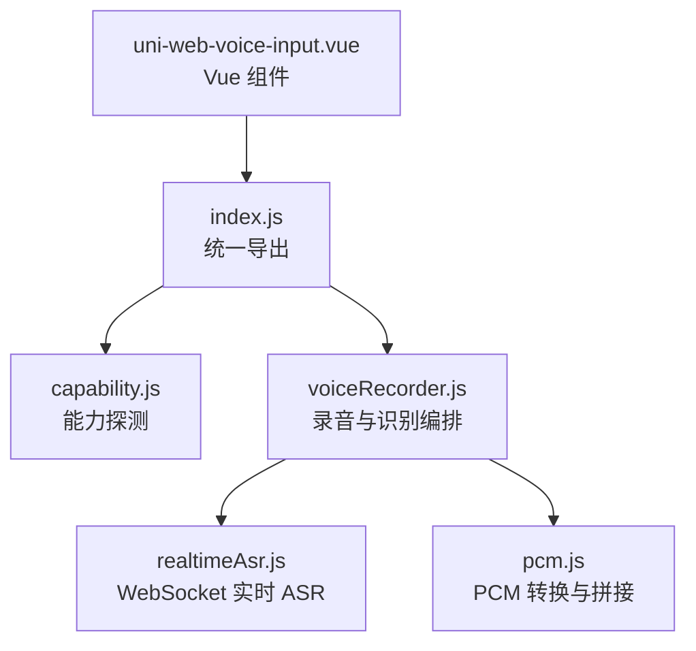
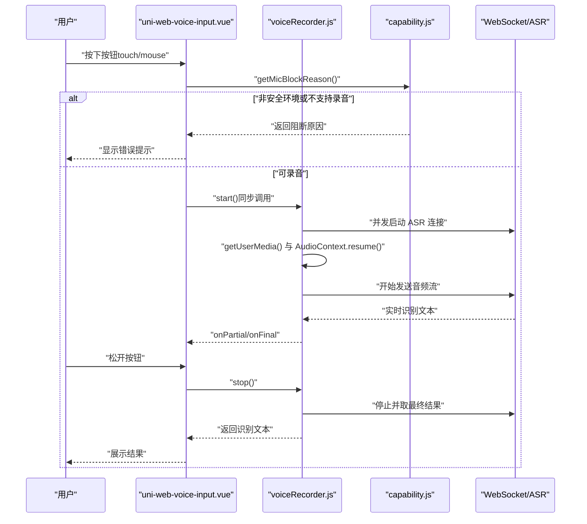
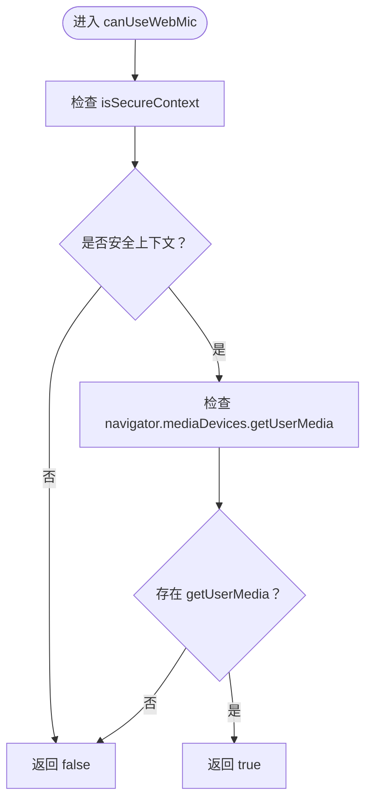
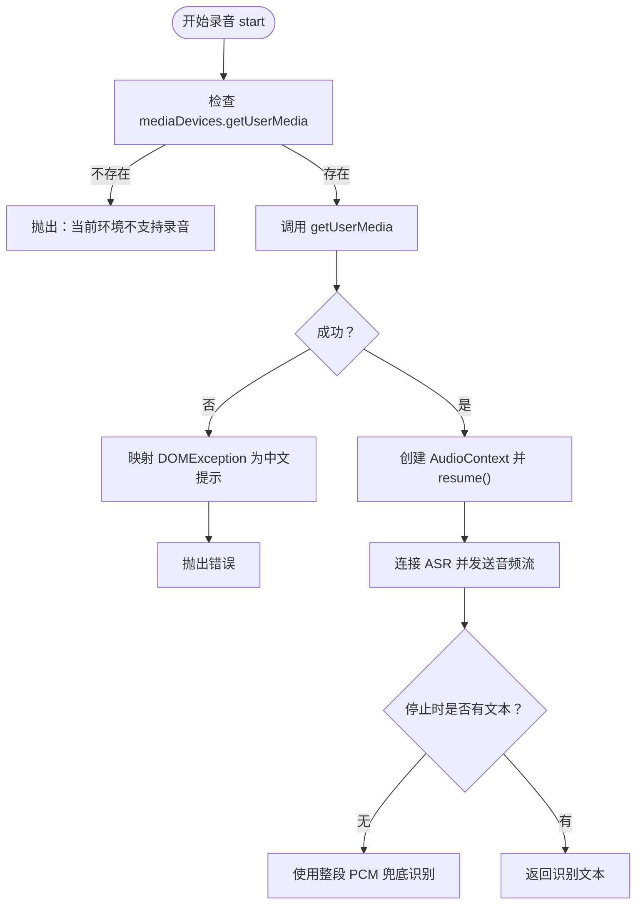
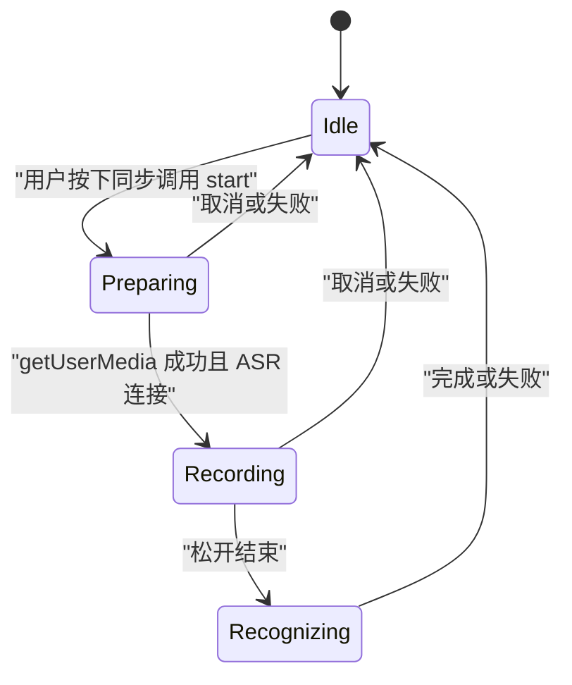
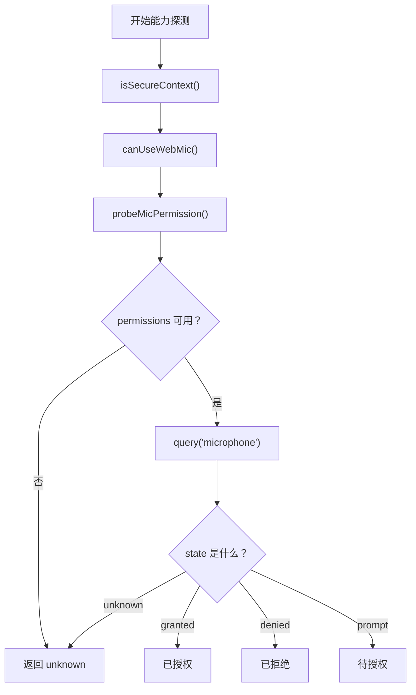
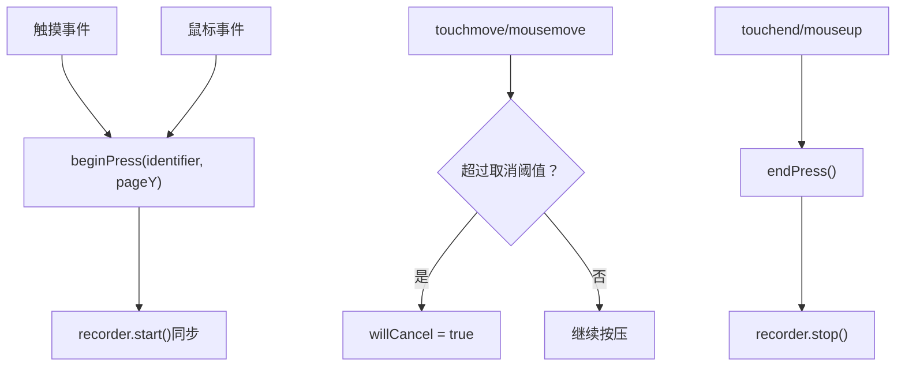
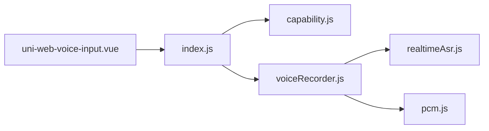

# H5 浏览器兼容性

<cite>
**本文引用的文件**   
- [README.md](file://README.md)
- [capability.js](file://demo/src/uni_modules/uni-web-voice-input/js_sdk/uni-web-voice/capability.js)
- [index.js](file://demo/src/uni_modules/uni-web-voice-input/js_sdk/uni-web-voice/index.js)
- [voiceRecorder.js](file://demo/src/uni_modules/uni-web-voice-input/js_sdk/uni-web-voice/voiceRecorder.js)
- [uni-web-voice-input.vue](file://demo/src/uni_modules/uni-web-voice-input/components/uni-web-voice-input/uni-web-voice-input.vue)
</cite>

## 目录
1. [引言](#引言)
2. [项目结构](#项目结构)
3. [核心组件](#核心组件)
4. [架构总览](#架构总览)
5. [详细组件分析](#详细组件分析)
6. [依赖关系分析](#依赖关系分析)
7. [性能与兼容性考量](#性能与兼容性考量)
8. [故障诊断指南](#故障诊断指南)
9. [结论](#结论)

## 引言
本仓库实现了一个面向 H5、App WebView（含鸿蒙 ArkWeb）的「纯 Web 能力」语音输入方案：基于 `getUserMedia` + Web Audio + WebSocket 实时 ASR，提供「按住说话、松手出字、上滑取消」的交互体验。其关键目标是解决多端 WebView 中原生录音桥不可用时的降级路径，并通过结构化能力探测、安全上下文校验、权限探测与错误映射，提升跨浏览器与跨容器的稳定性。

该方案特别关注以下兼容性问题：
- 安全上下文要求与检测机制（HTTPS / localhost）。
- `getUserMedia` 的浏览器支持与降级策略。
- 不同浏览器的麦克风权限弹窗行为差异与处理。
- 移动端与桌面端的交互差异。
- 常见兼容性问题的诊断与解决方案。

## 项目结构
从兼容性视角，本项目主要涉及三类代码：
- 能力探测与平台判断：`capability.js`
- 录音与识别编排：`voiceRecorder.js`
- 对外统一导出：`index.js`
- Vue 组件封装与手势时序：`uni-web-voice-input.vue`
- 项目说明与亮点：`README.md`

**图表来源**
- [index.js:6-17](file://demo/src/uni_modules/uni-web-voice-input/js_sdk/uni-web-voice/index.js#L6-L17)
- [uni-web-voice-input.vue:38-44](file://demo/src/uni_modules/uni-web-voice-input/components/uni-web-voice-input/uni-web-voice-input.vue#L38-L44)

**章节来源**
- [README.md:1-24](file://README.md#L1-L24)
- [index.js:1-18](file://demo/src/uni_modules/uni-web-voice-input/js_sdk/uni-web-voice/index.js#L1-L18)

## 核心组件
围绕 H5 浏览器兼容性，核心由以下模块构成：

- 能力探测模块（`capability.js`）
  - 安全上下文检测：优先使用 `window.isSecureContext`，兜底协议与主机名判断。
  - Web 麦克风可用性：检查 `navigator.mediaDevices.getUserMedia` 是否存在且处于安全上下文。
  - 权限探测：通过 `navigator.permissions.query({ name: 'microphone' })` 异步探测授权状态；在不支持时静默回退为 `unknown`，避免阻塞。
  - 平台判定：
    - 鸿蒙 ArkWeb `<web-view>`：通过注入对象 `__uniapp_x_` 判定，不依赖易被覆写的 UA。
    - App-plus Android：通过 `window.plus` 及系统信息或 UA 判定，用于触发运行时权限申请。
  - 运行时权限申请：在 App-plus Android 下调用 `plus.android.requestPermissions(['android.permission.RECORD_AUDIO'])`。

- 录音编排模块（`voiceRecorder.js`）
  - 严格保证 `start()` 在用户手势同步窗口内发起，确保鸿蒙等容器能弹出麦克风权限。
  - 创建并显式 `resume()` `AudioContext`，避免“有权限却零 PCM”的问题。
  - 并发启动 ASR 连接与 `getUserMedia`，失败时清理资源并抛出可读中文错误。
  - 实时流式识别失败时，使用整段 PCM 兜底识别一次。
  - 对 `DOMException` 进行语义化映射，输出友好提示。

- 组件层（`uni-web-voice-input.vue`）
  - 将 `recorder.start()` 挂在触摸/鼠标事件的同步分支中，保障 user-activation。
  - 挂载时异步探测权限，若已拒绝则预显示引导文案。
  - 在 App-plus Android 环境自动尝试补申请系统录音权限。
  - 区分移动端触摸与桌面端鼠标事件，提供一致的「按住说话」体验。

**章节来源**
- [capability.js:14-104](file://demo/src/uni_modules/uni-web-voice-input/js_sdk/uni-web-voice/capability.js#L14-L104)
- [capability.js:106-137](file://demo/src/uni_modules/uni-web-voice-input/js_sdk/uni-web-voice/capability.js#L106-L137)
- [voiceRecorder.js:19-41](file://demo/src/uni_modules/uni-web-voice-input/js_sdk/uni-web-voice/voiceRecorder.js#L19-L41)
- [voiceRecorder.js:152-240](file://demo/src/uni_modules/uni-web-voice-input/js_sdk/uni-web-voice/voiceRecorder.js#L152-L240)
- [uni-web-voice-input.vue:130-169](file://demo/src/uni_modules/uni-web-voice-input/components/uni-web-voice-input/uni-web-voice-input.vue#L130-L169)
- [uni-web-voice-input.vue:180-264](file://demo/src/uni_modules/uni-web-voice-input/components/uni-web-voice-input/uni-web-voice-input.vue#L180-L264)

## 架构总览
下图展示 H5 浏览器兼容性相关的关键流程：从组件手势到能力探测、录音、ASR 与结果返回。

**图表来源**
- [uni-web-voice-input.vue:180-264](file://demo/src/uni_modules/uni-web-voice-input/components/uni-web-voice-input/uni-web-voice-input.vue#L180-L264)
- [voiceRecorder.js:152-240](file://demo/src/uni_modules/uni-web-voice-input/js_sdk/uni-web-voice/voiceRecorder.js#L152-L240)
- [capability.js:52-63](file://demo/src/uni_modules/uni-web-voice-input/js_sdk/uni-web-voice/capability.js#L52-L63)

## 详细组件分析

### 安全上下文（HTTPS / localhost）的要求与检测
- 硬性要求：`getUserMedia` 需要安全上下文，即 HTTPS 或 localhost。
- 检测优先级：
  1. 优先读取 `window.isSecureContext`。
  2. 兜底判断 `location.protocol === 'https:'` 或 `location.hostname === 'localhost'`。
- 不可用时给出明确提示：当前为非安全环境（HTTP），无法使用网页麦克风。

**图表来源**
- [capability.js:28-46](file://demo/src/uni_modules/uni-web-voice-input/js_sdk/uni-web-voice/capability.js#L28-L46)

**章节来源**
- [capability.js:28-39](file://demo/src/uni_modules/uni-web-voice-input/js_sdk/uni-web-voice/capability.js#L28-L39)
- [capability.js:41-46](file://demo/src/uni_modules/uni-web-voice-input/js_sdk/uni-web-voice/capability.js#L41-L46)
- [capability.js:52-63](file://demo/src/uni_modules/uni-web-voice-input/js_sdk/uni-web-voice/capability.js#L52-L63)

### getUserMedia API 的浏览器支持与降级策略
- 基础支持：现代浏览器普遍支持 `navigator.mediaDevices.getUserMedia`，但需满足安全上下文。
- 降级策略：
  - 若不存在 `mediaDevices.getUserMedia`，直接返回不支持录音的错误提示。
  - 若存在但权限被拒或设备不可用，捕获 `DOMException` 并映射为中文提示。
  - 若实时 ASR 未连上，先丢弃头段音频，松手后使用整段 PCM 兜底识别一次。
  - 在 App-plus Android 环境下，WebView 不会自动弹系统录音权限框，需通过 `plus.android.requestPermissions` 主动申请。

**图表来源**
- [voiceRecorder.js:152-240](file://demo/src/uni_modules/uni-web-voice-input/js_sdk/uni-web-voice/voiceRecorder.js#L152-L240)
- [voiceRecorder.js:246-295](file://demo/src/uni_modules/uni-web-voice-input/js_sdk/uni-web-voice/voiceRecorder.js#L246-L295)
- [voiceRecorder.js:19-41](file://demo/src/uni_modules/uni-web-voice-input/js_sdk/uni-web-voice/voiceRecorder.js#L19-L41)

**章节来源**
- [voiceRecorder.js:152-240](file://demo/src/uni_modules/uni-web-voice-input/js_sdk/uni-web-voice/voiceRecorder.js#L152-L240)
- [voiceRecorder.js:246-295](file://demo/src/uni_modules/uni-web-voice-input/js_sdk/uni-web-voice/voiceRecorder.js#L246-L295)
- [voiceRecorder.js:19-41](file://demo/src/uni_modules/uni-web-voice-input/js_sdk/uni-web-voice/voiceRecorder.js#L19-L41)

### 不同浏览器的权限弹窗行为差异与处理方式
- 普通浏览器/H5：
  - 首次访问会弹出系统级麦克风权限对话框。
  - 可通过 `navigator.permissions.query({ name: 'microphone' })` 探测状态，若为 `denied`，组件预显示“麦克风未授权，点击重试”。
- 鸿蒙 ArkWeb `<web-view>`：
  - 必须在用户手势同步窗口内发起 `getUserMedia`，否则不会触发权限请求。
  - 组件在 `onTouchStart` 同步调用 `recorder.start()`，确保权限弹窗出现。
- App-plus Android：
  - WebView 不会自动弹系统录音权限框，需宿主先持有 `RECORD_AUDIO`。
  - 组件在挂载时尝试通过 `plus.android.requestPermissions` 申请权限；若失败，提示用户手动允许后再试。

**图表来源**
- [uni-web-voice-input.vue:180-264](file://demo/src/uni_modules/uni-web-voice-input/components/uni-web-voice-input/uni-web-voice-input.vue#L180-L264)
- [voiceRecorder.js:152-240](file://demo/src/uni_modules/uni-web-voice-input/js_sdk/uni-web-voice/voiceRecorder.js#L152-L240)

**章节来源**
- [uni-web-voice-input.vue:130-169](file://demo/src/uni_modules/uni-web-voice-input/components/uni-web-voice-input/uni-web-voice-input.vue#L130-L169)
- [uni-web-voice-input.vue:180-264](file://demo/src/uni_modules/uni-web-voice-input/components/uni-web-voice-input/uni-web-voice-input.vue#L180-L264)
- [capability.js:65-83](file://demo/src/uni_modules/uni-web-voice-input/js_sdk/uni-web-voice/capability.js#L65-L83)
- [capability.js:85-137](file://demo/src/uni_modules/uni-web-voice-input/js_sdk/uni-web-voice/capability.js#L85-L137)

### 浏览器能力探测的最佳实践与兼容性检查方法
- 安全上下文检查：
  - 优先使用 `window.isSecureContext`。
  - 兜底检查 `location.protocol` 与 `location.hostname`。
- Web 麦克风可用性检查：
  - 检查 `navigator.mediaDevices.getUserMedia` 是否存在。
  - 结合安全上下文判断是否可录音。
- 权限状态探测：
  - 使用 `navigator.permissions.query({ name: 'microphone' })`。
  - 不支持时静默回退为 `unknown`，避免阻塞主流程。
- 平台与环境判定：
  - 鸿蒙 ArkWeb：通过 `window.__uniapp_x_` 判定，不依赖 UA。
  - App-plus Android：通过 `window.plus` 与系统信息或 UA 判定。
- 运行时权限申请：
  - 仅在 App-plus Android 环境调用 `plus.android.requestPermissions`。

**图表来源**
- [capability.js:28-83](file://demo/src/uni_modules/uni-web-voice-input/js_sdk/uni-web-voice/capability.js#L28-L83)

**章节来源**
- [capability.js:28-83](file://demo/src/uni_modules/uni-web-voice-input/js_sdk/uni-web-voice/capability.js#L28-L83)

### 移动端与桌面端的差异处理
- 移动端：
  - 使用触摸事件（`touchstart/touchmove/touchend/touchcancel`）驱动「按住说话」。
  - 支持上滑取消逻辑，根据滑动距离阈值判定取消。
- 桌面端：
  - 使用鼠标事件（`mousedown/mouseup`）作为兜底，保持交互一致性。
- 组件层统一封装：
  - 将触摸与鼠标事件统一接入 `beginPress/endPress`，内部再调用 `recorder.start()/stop()`。

**图表来源**
- [uni-web-voice-input.vue:180-264](file://demo/src/uni_modules/uni-web-voice-input/components/uni-web-voice-input/uni-web-voice-input.vue#L180-L264)

**章节来源**
- [uni-web-voice-input.vue:180-264](file://demo/src/uni_modules/uni-web-voice-input/components/uni-web-voice-input/uni-web-voice-input.vue#L180-L264)

## 依赖关系分析
- 组件层依赖 SDK 导出接口：
  - `createVoiceRecorder`：录音与识别编排。
  - `getMicBlockReason`：获取麦克风不可用的原因。
  - `probeMicPermission`：异步探测权限状态。
  - `isAppPlusAndroid` / `requestRecordAudioViaPlus`：App-plus Android 权限处理。
- SDK 内部依赖：
  - `capability.js`：能力探测与平台判断。
  - `voiceRecorder.js`：录音编排与错误映射。
  - `realtimeAsr.js`：WebSocket 实时 ASR。
  - `pcm.js`：PCM 转换与拼接。

**图表来源**
- [index.js:6-17](file://demo/src/uni_modules/uni-web-voice-input/js_sdk/uni-web-voice/index.js#L6-L17)
- [uni-web-voice-input.vue:38-44](file://demo/src/uni_modules/uni-web-voice-input/components/uni-web-voice-input/uni-web-voice-input.vue#L38-L44)

**章节来源**
- [index.js:1-18](file://demo/src/uni_modules/uni-web-voice-input/js_sdk/uni-web-voice/index.js#L1-L18)
- [uni-web-voice-input.vue:38-44](file://demo/src/uni_modules/uni-web-voice-input/components/uni-web-voice-input/uni-web-voice-input.vue#L38-L44)

## 性能与兼容性考量
- 性能优化：
  - 预热签名：组件挂载时调用 `recorder.prefetch()`，减少首次按下等待。
  - 并发启动 ASR 与 `getUserMedia`，避免串行阻塞。
  - ScriptProcessor 缓冲帧大小可调，平衡延迟与内存占用。
- 兼容性要点：
  - 必须保证安全上下文（HTTPS / localhost）。
  - 在鸿蒙 ArkWeb 中，必须在用户手势同步窗口内发起 `getUserMedia`。
  - 在 App-plus Android 中，需主动申请系统录音权限。
  - 对不支持 `permissions.query` 的环境，静默回退为 `unknown`，不影响主流程。

[本节为通用指导，不直接分析具体文件]

## 故障诊断指南
常见问题与定位建议：

- 问题：按了没反应，没有弹出麦克风权限
  - 可能原因：未在用户手势同步窗口内调用 `getUserMedia`。
  - 解决方案：确保 `recorder.start()` 在 `onTouchStart` 同步分支中调用。
  - 参考位置：
    - [uni-web-voice-input.vue:180-207](file://demo/src/uni_modules/uni-web-voice-input/components/uni-web-voice-input/uni-web-voice-input.vue#L180-L207)
    - [voiceRecorder.js:152-178](file://demo/src/uni_modules/uni-web-voice-input/js_sdk/uni-web-voice/voiceRecorder.js#L152-L178)

- 问题：有权限却零 PCM、无识别文本
  - 可能原因：`AudioContext` 以 `suspended` 状态创建，未显式 `resume()`。
  - 解决方案：创建 `AudioContext` 后立即 `resume()`。
  - 参考位置：
    - [voiceRecorder.js:195-201](file://demo/src/uni_modules/uni-web-voice-input/js_sdk/uni-web-voice/voiceRecorder.js#L195-L201)

- 问题：HTTP 页面无法录音
  - 可能原因：非安全上下文。
  - 解决方案：改用 HTTPS 或在 localhost 调试。
  - 参考位置：
    - [capability.js:28-39](file://demo/src/uni_modules/uni-web-voice-input/js_sdk/uni-web-voice/capability.js#L28-L39)
    - [capability.js:52-63](file://demo/src/uni_modules/uni-web-voice-input/js_sdk/uni-web-voice/capability.js#L52-L63)

- 问题：App-plus Android 第一次按住无效
  - 可能原因：WebView 未自动弹系统录音权限框。
  - 解决方案：组件挂载时调用 `requestRecordAudioViaPlus()`；若失败，提示用户手动允许。
  - 参考位置：
    - [uni-web-voice-input.vue:161-168](file://demo/src/uni_modules/uni-web-voice-input/components/uni-web-voice-input/uni-web-voice-input.vue#L161-L168)
    - [capability.js:106-137](file://demo/src/uni_modules/uni-web-voice-input/js_sdk/uni-web-voice/capability.js#L106-L137)

- 问题：权限被拒绝后一直提示
  - 可能原因：`navigator.permissions.query` 返回 `denied`。
  - 解决方案：组件预显示“麦克风未授权，点击重试”，引导用户去系统设置开启。
  - 参考位置：
    - [uni-web-voice-input.vue:157-160](file://demo/src/uni_modules/uni-web-voice-input/components/uni-web-voice-input/uni-web-voice-input.vue#L157-L160)
    - [capability.js:65-83](file://demo/src/uni_modules/uni-web-voice-input/js_sdk/uni-web-voice/capability.js#L65-L83)

**章节来源**
- [uni-web-voice-input.vue:157-168](file://demo/src/uni_modules/uni-web-voice-input/components/uni-web-voice-input/uni-web-voice-input.vue#L157-L168)
- [uni-web-voice-input.vue:180-207](file://demo/src/uni_modules/uni-web-voice-input/components/uni-web-voice-input/uni-web-voice-input.vue#L180-L207)
- [voiceRecorder.js:152-201](file://demo/src/uni_modules/uni-web-voice-input/js_sdk/uni-web-voice/voiceRecorder.js#L152-L201)
- [capability.js:28-83](file://demo/src/uni_modules/uni-web-voice-input/js_sdk/uni-web-voice/capability.js#L28-L83)
- [capability.js:106-137](file://demo/src/uni_modules/uni-web-voice-input/js_sdk/uni-web-voice/capability.js#L106-L137)

## 结论
本方案通过结构化能力探测、严格的安全上下文校验、用户手势同步的 `getUserMedia` 调用、以及针对鸿蒙 ArkWeb 与 App-plus Android 的特殊处理，实现了在多种 H5 与 WebView 环境下的稳定语音输入。最佳实践包括：
- 始终在 HTTPS 或 localhost 下运行。
- 在用户手势同步窗口内发起 `getUserMedia`。
- 显式 `resume()` `AudioContext`。
- 使用 `navigator.permissions.query` 探测权限，并在不支持时静默回退。
- 在 App-plus Android 环境中主动申请系统录音权限。
- 对错误进行语义化映射，提供友好的用户提示。

这些实践共同提升了跨浏览器与跨容器的兼容性，降低了集成成本与维护难度。

[本节为总结性内容，不直接分析具体文件]