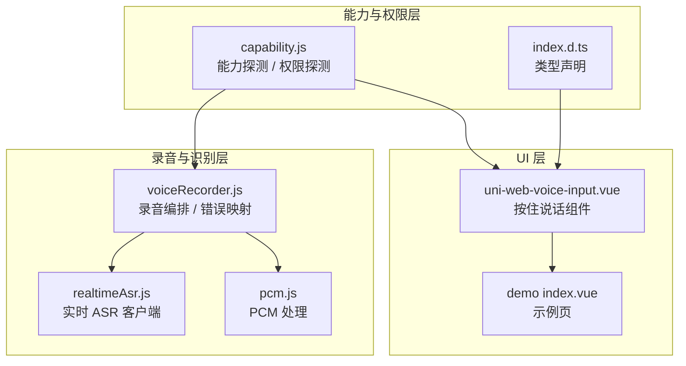
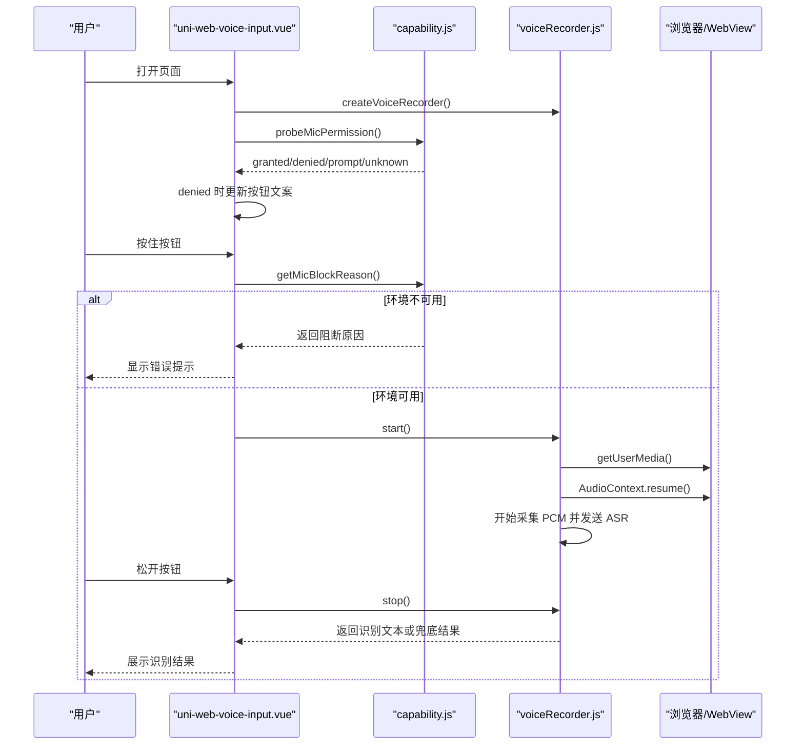
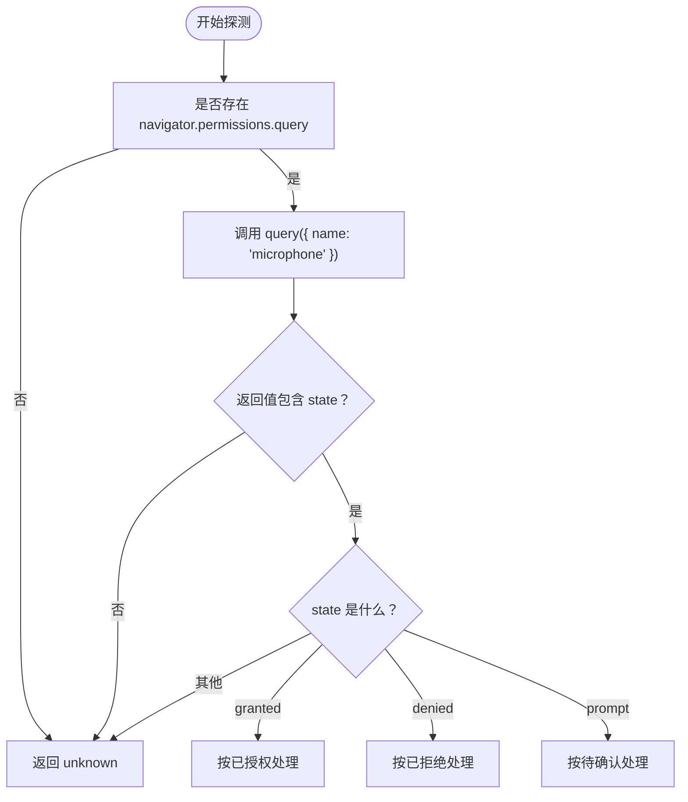
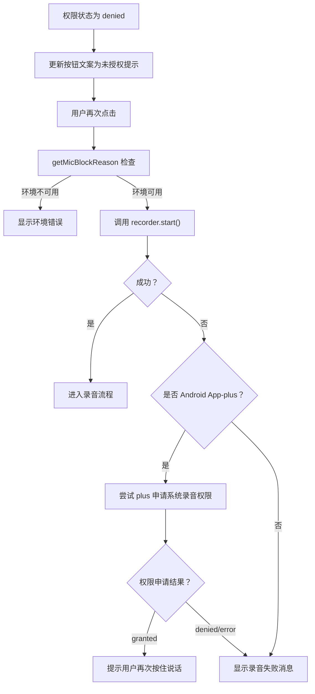

# 权限管理策略

<cite>
**本文引用的文件**   
- [README.md](file://README.md)
- [capability.js](file://uni_modules/uni-web-voice-input/js_sdk/uni-web-voice/capability.js)
- [index.js](file://uni_modules/uni-web-voice-input/js_sdk/uni-web-voice/index.js)
- [index.d.ts](file://uni_modules/uni-web-voice-input/js_sdk/uni-web-voice/index.d.ts)
- [voiceRecorder.js](file://uni_modules/uni-web-voice-input/js_sdk/uni-web-voice/voiceRecorder.js)
- [uni-web-voice-input.vue](file://uni_modules/uni-web-voice-input/components/uni-web-voice-input/uni-web-voice-input.vue)
- [demo index.vue](file://demo/src/pages/index/index.vue)
</cite>

## 目录
1. [引言](#引言)
2. [项目结构与权限相关边界](#项目结构与权限相关边界)
3. [核心权限能力与数据模型](#核心权限能力与数据模型)
4. [架构总览：权限探测、录音编排与组件交互](#架构总览权限探测录音编排与组件交互)
5. [navigator.permissions.query 使用指南](#navigatorpermissionsquery-使用指南)
6. [权限状态枚举值含义与处理逻辑](#权限状态枚举值含义与处理逻辑)
7. [权限探测最佳实践](#权限探测最佳实践)
8. [权限被拒绝时的降级方案](#权限被拒绝时的降级方案)
9. [用户体验优化建议](#用户体验优化建议)
10. [诊断工具与调试方法](#诊断工具与调试方法)
11. [性能与兼容性注意事项](#性能与兼容性注意事项)
12. [结论](#结论)

## 引言
本仓库是一个面向跨端 WebView 的纯 Web 语音输入方案，核心思路是绕过原生录音桥不可用的场景，直接基于 `getUserMedia`、Web Audio 和 WebSocket 实时语音识别。由于不同容器（普通浏览器、H5、App-vue、安卓/iOS WebView、鸿蒙 ArkWeb）对麦克风权限、安全上下文、用户手势激活的处理差异很大，本项目在“能力探测 + 权限探测 + 录音编排 + 组件 UI”四个层面做了系统化封装。

本文聚焦“权限管理策略”，重点说明：
- 如何使用 `navigator.permissions.query` 做非阻塞式麦克风权限探测；
- 如何理解并处理 `granted` / `denied` / `prompt` / `unknown` 四种状态；
- 如何在鸿蒙 ArkWeb、App-plus Android 等容器中给出稳定且友好的权限体验；
- 当权限被拒绝时，如何提供降级路径和用户引导；
- 如何通过现有 SDK 暴露的能力进行问题诊断与调试。

## 项目结构与权限相关边界
从权限视角看，本项目的关键边界如下：
- 能力探测层：判断当前环境是否支持网页麦克风、是否处于安全上下文、是否为鸿蒙 ArkWeb 或 App-plus Android。
- 权限探测层：通过 `navigator.permissions.query` 异步探测麦克风授权状态，不阻塞页面加载。
- 录音编排层：在用户手势同步窗口内发起 `getUserMedia`，保证跨端能弹出系统权限框；同时处理音频链路、ASR 连接、兜底整段 PCM 识别。
- 组件交互层：把权限提示、按钮文案、错误弹窗、Android 运行时权限补申请等统一收敛到 Vue 组件中。

**图表来源**
- [capability.js:1-138](file://uni_modules/uni-web-voice-input/js_sdk/uni-web-voice/capability.js#L1-L138)
- [index.d.ts:87-95](file://uni_modules/uni-web-voice-input/js_sdk/uni-web-voice/index.d.ts#L87-L95)
- [voiceRecorder.js:1-315](file://uni_modules/uni-web-voice-input/js_sdk/uni-web-voice/voiceRecorder.js#L1-L315)
- [uni-web-voice-input.vue:28-169](file://uni_modules/uni-web-voice-input/components/uni-web-voice-input/uni-web-voice-input.vue#L28-L169)
- [demo index.vue:34-84](file://demo/src/pages/index/index.vue#L34-L84)

**章节来源**
- [README.md:1-24](file://README.md#L1-L24)
- [index.js:1-18](file://uni_modules/uni-web-voice-input/js_sdk/uni-web-voice/index.js#L1-L18)

## 核心权限能力与数据模型
### 能力探测函数
- `isHarmonyWebview`：通过结构化信号判定是否运行在鸿蒙 ArkWeb `<web-view>` 内，避免依赖易被覆写的 UA。
- `isSecureContext`：判断是否处于 HTTPS 或 localhost 安全上下文，这是 `getUserMedia` 的前置条件。
- `canUseWebMic`：综合安全上下文与 `navigator.mediaDevices.getUserMedia` 可用性，判断网页麦克风是否可用。
- `getMicBlockReason`：返回无法使用麦克风的中文原因文案，便于直接展示给用户。

### 权限探测函数
- `probeMicPermission`：调用 `navigator.permissions.query({ name: 'microphone' })`，返回 Promise，解析为 `'granted' | 'denied' | 'prompt' | 'unknown'`。若内核不支持 `permissions.query` 或 `microphone` 名称，则静默回退为 `'unknown'`，绝不阻塞。

### 平台扩展权限函数
- `isAppPlusAndroid`：判断是否运行在 uni-app App-plus 的 Android WebView 内。
- `requestRecordAudioViaPlus`：通过 `plus.android.requestPermissions` 申请 Android 运行时录音权限，返回 `'granted' | 'denied' | 'unsupported' | 'error'`。

### 类型定义
类型声明文件中导出了 `getMicBlockReason` 与 `probeMicPermission` 的类型，供上层 TypeScript 或 IDE 使用。

**章节来源**
- [capability.js:14-83](file://uni_modules/uni-web-voice-input/js_sdk/uni-web-voice/capability.js#L14-L83)
- [capability.js:85-138](file://uni_modules/uni-web-voice-input/js_sdk/uni-web-voice/capability.js#L85-L138)
- [index.d.ts:87-95](file://uni_modules/uni-web-voice-input/js_sdk/uni-web-voice/index.d.ts#L87-L95)

## 架构总览：权限探测、录音编排与组件交互
权限相关的主流程可以概括为：
1. 组件挂载时，先创建录音器，再异步探测权限。
2. 如果权限状态为 `denied`，组件将按钮文案改为“麦克风未授权，点击重试”。
3. 用户在 Android App-plus 环境下，组件还会尝试主动申请系统录音权限。
4. 用户按下按钮时，组件先做基础能力检查，再同步调用录音器的 `start()`。
5. 录音器在用户手势同步窗口内并发发起 ASR 连接、`getUserMedia` 和 `AudioContext` 初始化。
6. 松手后，录音器停止实时识别，若无结果则用整段 PCM 兜底识别一次。

**图表来源**
- [uni-web-voice-input.vue:130-169](file://uni_modules/uni-web-voice-input/components/uni-web-voice-input/uni-web-voice-input.vue#L130-L169)
- [uni-web-voice-input.vue:180-228](file://uni_modules/uni-web-voice-input/components/uni-web-voice-input/uni-web-voice-input.vue#L180-L228)
- [capability.js:52-83](file://uni_modules/uni-web-voice-input/js_sdk/uni-web-voice/capability.js#L52-L83)
- [voiceRecorder.js:152-240](file://uni_modules/uni-web-voice-input/js_sdk/uni-web-voice/voiceRecorder.js#L152-L240)

## navigator.permissions.query 使用指南
### 基本用法
项目中封装了 `probeMicPermission`，其内部逻辑可理解为：
- 如果 `navigator.permissions` 不存在，或 `permissions.query` 不是函数，直接返回 `'unknown'`。
- 否则调用 `permissions.query({ name: 'microphone' })`。
- 如果返回值没有 `state`，或调用抛出异常，也返回 `'unknown'`。

这意味着：
- 它不会因内核不支持而抛错；
- 它不会阻塞页面加载；
- 它适合在组件挂载时调用，用于提前准备 UI 文案。

### 返回值语义
| 返回值 | 含义 | 推荐处理方式 |
|---|---|---|
| `granted` | 麦克风权限已授予 | 正常进入录音流程，无需额外提示 |
| `denied` | 麦克风权限已被明确拒绝 | 预显示“麦克风未授权，点击重试”，并在用户再次尝试时引导重新授权 |
| `prompt` | 尚未询问过用户，或需要用户确认 | 正常进入录音流程，等待系统弹窗 |
| `unknown` | 当前环境不支持权限查询，或查询失败 | 当作未知处理，继续走 `getUserMedia` 自然弹窗，不卡住 |

### 为什么不能只依赖 `navigator.permissions.query`
部分内核（包括老版本 ArkWeb）可能：
- 没有 `navigator.permissions`；
- 有 `permissions.query`，但不支持 `microphone` 这个权限名；
- 返回的对象没有 `state`。

因此，SDK 的设计原则是：**探测失败一律视为 unknown，不阻止后续自然授权流程**。这保证了兼容性优先于“提前知道权限状态”。

**章节来源**
- [capability.js:65-83](file://uni_modules/uni-web-voice-input/js_sdk/uni-web-voice/capability.js#L65-L83)
- [index.d.ts:89-95](file://uni_modules/uni-web-voice-input/js_sdk/uni-web-voice/index.d.ts#L89-L95)

## 权限状态枚举值含义与处理逻辑
### granted
表示当前环境已经允许访问麦克风。此时：
- 组件不需要显示“未授权”提示；
- 用户按下按钮可直接进入录音；
- 如果后续 `getUserMedia` 仍然失败，应视为运行时异常，而不是“已知被拒绝”。

### denied
表示用户或系统明确拒绝了麦克风权限。此时：
- 组件应将按钮文案改为“麦克风未授权，点击重试”；
- 在 Android App-plus 下，可尝试通过 `plus.android.requestPermissions` 补申请系统录音权限；
- 如果用户再次尝试仍失败，应给出清晰的用户提示，而不是反复静默失败。

### prompt
表示尚未完成授权决策，通常会在首次 `getUserMedia` 时弹出系统权限框。此时：
- 组件应保持默认“按住说话”文案；
- 确保 `getUserMedia` 在用户手势同步窗口内触发，否则某些容器不会弹权限框。

### unknown
表示当前环境无法确定权限状态。此时：
- 不应阻止用户使用功能；
- 应继续走 `getUserMedia` 自然授权流程；
- 如果失败，再通过错误映射给出可读提示。

**图表来源**
- [capability.js:65-83](file://uni_modules/uni-web-voice-input/js_sdk/uni-web-voice/capability.js#L65-L83)

**章节来源**
- [capability.js:65-83](file://uni_modules/uni-web-voice-input/js_sdk/uni-web-voice/capability.js#L65-L83)

## 权限探测最佳实践
### 非阻塞式探测
- 在组件 `onMounted` 中调用 `probeMicPermission`，并使用 `.then` 处理结果。
- 不要 await 权限探测后再渲染页面；权限探测应与页面初始化并行。
- 如果结果为 `denied`，仅改变 UI 文案，不中断业务主流程。

### 前置能力检查
在用户真正按下按钮前，先用 `getMicBlockReason` 做一次快速检查：
- 如果不是安全上下文，直接提示改用 HTTPS；
- 如果缺少 `mediaDevices.getUserMedia`，提示当前环境不支持录音；
- 如果两者都满足，再进入录音流程。

### 用户手势同步窗口
`getUserMedia` 必须在用户手势（如 `touchstart`、`mousedown`）的同步代码中触发。项目中录音器明确要求：
- `start()` 必须在按下手势的同步 tick 内调用；
- 不要在 `start()` 之前插入 `await`；
- 在鸿蒙 ArkWeb 中，只有保持 user-activation，才会触发系统麦克风授权弹窗。

### 多端差异化处理
- 鸿蒙 ArkWeb：强调结构化判端、HTTPS、用户手势同步窗口。
- App-plus Android：WebView 不会自动弹系统录音权限框，需宿主持有 `RECORD_AUDIO`，组件可在挂载时尝试补申请。
- 普通 H5：主要关注 HTTPS 和浏览器权限弹窗。

**章节来源**
- [uni-web-voice-input.vue:130-169](file://uni_modules/uni-web-voice-input/components/uni-web-voice-input/uni-web-voice-input.vue#L130-L169)
- [uni-web-voice-input.vue:180-208](file://uni_modules/uni-web-voice-input/components/uni-web-voice-input/uni-web-voice-input.vue#L180-L208)
- [voiceRecorder.js:152-187](file://uni_modules/uni-web-voice-input/js_sdk/uni-web-voice/voiceRecorder.js#L152-L187)
- [capability.js:14-26](file://uni_modules/uni-web-voice-input/js_sdk/uni-web-voice/capability.js#L14-L26)
- [capability.js:85-138](file://uni_modules/uni-web-voice-input/js_sdk/uni-web-voice/capability.js#L85-L138)

## 权限被拒绝时的降级方案
### 组件级降级
当 `probeMicPermission` 返回 `denied` 时：
- 按钮文案变为“麦克风未授权，点击重试”；
- 用户再次点击时，组件会先执行 `getMicBlockReason` 检查；
- 如果是 Android App-plus，组件会尝试调用 `requestRecordAudioViaPlus` 补申请系统权限；
- 如果仍失败，向父组件抛出错误事件，由上层决定如何展示。

### 录音器级降级
录音器在启动失败时会：
- 关闭已并发的 ASR 连接；
- 清理音频节点和媒体流；
- 将 DOMException 映射为中文可读错误；
- 根据错误类型区分“权限被拒”“设备缺失”“设备占用”“参数不满足”等场景。

### 识别结果兜底
即使实时 ASR 未连上，录音器也会缓存 PCM 片段；松手后若实时识别无结果，则尝试用整段 PCM 再识别一次。这降低了网络或服务不稳定导致的“零结果”概率。

**图表来源**
- [uni-web-voice-input.vue:157-168](file://uni_modules/uni-web-voice-input/components/uni-web-voice-input/uni-web-voice-input.vue#L157-L168)
- [uni-web-voice-input.vue:180-208](file://uni_modules/uni-web-voice-input/components/uni-web-voice-input/uni-web-voice-input.vue#L180-L208)
- [voiceRecorder.js:152-187](file://uni_modules/uni-web-voice-input/js_sdk/uni-web-voice/voiceRecorder.js#L152-L187)
- [voiceRecorder.js:242-295](file://uni_modules/uni-web-voice-input/js_sdk/uni-web-voice/voiceRecorder.js#L242-L295)

**章节来源**
- [uni-web-voice-input.vue:157-208](file://uni_modules/uni-web-voice-input/components/uni-web-voice-input/uni-web-voice-input.vue#L157-L208)
- [voiceRecorder.js:19-41](file://uni_modules/uni-web-voice-input/js_sdk/uni-web-voice/voiceRecorder.js#L19-L41)
- [voiceRecorder.js:242-295](file://uni_modules/uni-web-voice-input/js_sdk/uni-web-voice/voiceRecorder.js#L242-L295)

## 用户体验优化建议
### 按钮文案分层
- 空闲态：显示“按住说话”。
- 已拒绝态：显示“麦克风未授权，点击重试”。
- 录音中：显示“抬起发送”。
- 识别中：显示“正在识别…”。
- 取消态：显示“松开取消”。

### 错误提示分层
- 环境级错误：HTTP 非安全上下文、缺少 `getUserMedia`、缺少 `AudioContext`。
- 权限级错误：权限被拒绝、设备被占用、设备缺失。
- 业务级错误：录音太短、未识别到内容、签名请求失败。

### 渐进式引导
- 第一次进入页面时，不主动打断用户；
- 用户首次尝试录音失败时，给出明确原因；
- 在 Android App-plus 中，若系统权限未授予，引导用户去系统设置开启；
- 在鸿蒙 ArkWeb 中，强调 HTTPS 和宿主转发权限请求。

### 可观测性
- 组件暴露 `state` 事件，方便上层统计“空闲/准备中/录音中/识别中/已取消”分布；
- 组件暴露 `partial` 事件，展示实时识别文本；
- 组件暴露 `error` 事件，集中处理错误提示；
- 示例页通过 `debug` 开关控制日志输出。

**章节来源**
- [uni-web-voice-input.vue:61-93](file://uni_modules/uni-web-voice-input/components/uni-web-voice-input/uni-web-voice-input.vue#L61-L93)
- [uni-web-voice-input.vue:130-169](file://uni_modules/uni-web-voice-input/components/uni-web-voice-input/uni-web-voice-input.vue#L130-L169)
- [demo index.vue:44-84](file://demo/src/pages/index/index.vue#L44-L84)

## 诊断工具与调试方法
### 使用 `getMicBlockReason`
在业务侧或示例页中，可以在获取 ASR 签名前调用 `getMicBlockReason`：
- 如果返回字符串，说明当前环境存在硬性限制；
- 如果返回 null，说明环境层面可以使用网页麦克风；
- 示例页在 `getSign` 中直接使用该函数，失败时抛出错误。

### 使用 `probeMicPermission`
在组件挂载时调用，用于：
- 提前判断是否需要显示“未授权”提示；
- 记录权限状态日志；
- 在 A/B 测试或埋点中统计各端权限分布。

### 使用 `describeMicError`
录音器内部会将底层错误映射为中文文案，常见映射包括：
- `NotAllowedError` / `PermissionDenied` / `SecurityError` → 权限被拒绝；
- `NotFoundError` / `DevicesNotFound` → 未检测到麦克风；
- `NotReadableError` / `AbortError` / `InUse` → 麦克风被占用；
- `OverconstrainedError` → 设备不支持所需录音参数。

### 使用 debug 模式
- 组件支持 `debug` 属性；
- 在 Android App-plus 权限申请成功后，可通过控制台观察权限结果；
- 示例页通过 `@error` 事件展示 toast，便于快速定位问题。

### 常见问题排查清单
| 现象 | 可能原因 | 排查方向 |
|---|---|---|
| 按住没反应 | 未在用户手势同步窗口内调用 `getUserMedia` | 检查是否在 `touchstart` 同步代码中调用 `recorder.start()` |
| 鸿蒙不弹权限框 | 非 HTTPS 或 user-activation 失效 | 检查协议、检查是否插入 await 导致手势失效 |
| 有权限却零 PCM | `AudioContext` 处于 suspended | 检查是否显式 `resume()` |
| Android 一直报权限错误 | WebView 未持有系统录音权限 | 检查宿主是否申请 `RECORD_AUDIO`，组件是否调用 `requestRecordAudioViaPlus` |
| 识别结果为空 | 实时 ASR 未连上且 PCM 不足 | 检查网络、签名接口、最小时长和 PCM 缓存 |

**章节来源**
- [demo index.vue:59-75](file://demo/src/pages/index/index.vue#L59-L75)
- [voiceRecorder.js:19-41](file://uni_modules/uni-web-voice-input/js_sdk/uni-web-voice/voiceRecorder.js#L19-L41)
- [uni-web-voice-input.vue:157-168](file://uni_modules/uni-web-voice-input/components/uni-web-voice-input/uni-web-voice-input.vue#L157-L168)

## 性能与兼容性注意事项
### 性能
- 权限探测是异步且不阻塞渲染的；
- 录音器在 `start()` 中并发发起 ASR 连接、`getUserMedia` 和 `AudioContext` 初始化，减少首帧等待；
- 实时 ASR 未连上时丢弃头几百毫秒音频，避免阻塞；
- 松手后若实时无结果，再用整段 PCM 兜底识别一次，提升成功率。

### 兼容性
- 鸿蒙 ArkWeb：强调结构化判端、HTTPS、用户手势同步窗口；
- App-plus Android：WebView 不自动弹系统权限框，需宿主配合；
- 普通 H5：以 HTTPS 和安全上下文为前提；
- 权限探测失败时一律回退为 `unknown`，不阻止自然授权流程。

**章节来源**
- [voiceRecorder.js:152-240](file://uni_modules/uni-web-voice-input/js_sdk/uni-web-voice/voiceRecorder.js#L152-L240)
- [voiceRecorder.js:242-295](file://uni_modules/uni-web-voice-input/js_sdk/uni-web-voice/voiceRecorder.js#L242-L295)
- [capability.js:14-26](file://uni_modules/uni-web-voice-input/js_sdk/uni-web-voice/capability.js#L14-L26)
- [capability.js:65-83](file://uni_modules/uni-web-voice-input/js_sdk/uni-web-voice/capability.js#L65-L83)

## 结论
本项目的权限管理策略以“兼容优先、体验优先、可观测优先”为核心：
- 使用 `navigator.permissions.query` 做非阻塞式权限探测，但不过度依赖其结果；
- 将 `granted` / `denied` / `prompt` / `unknown` 四类状态纳入统一的 UI 与业务流程；
- 在鸿蒙 ArkWeb 和 App-plus Android 等特殊容器中，补充结构化判端、用户手势修复和系统权限补申请；
- 通过 `getMicBlockReason`、`describeMicError`、组件事件和 debug 模式，形成完整的权限诊断闭环；
- 最终目标是让用户在尽可能少的感知下完成授权，并在权限被拒绝时获得清晰、可操作的降级路径。