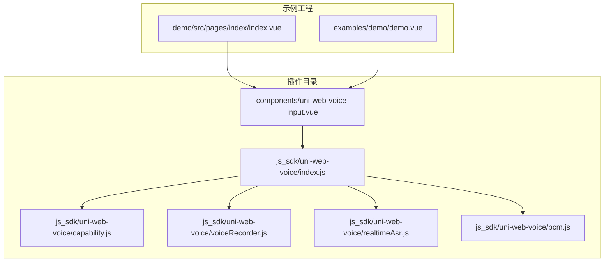
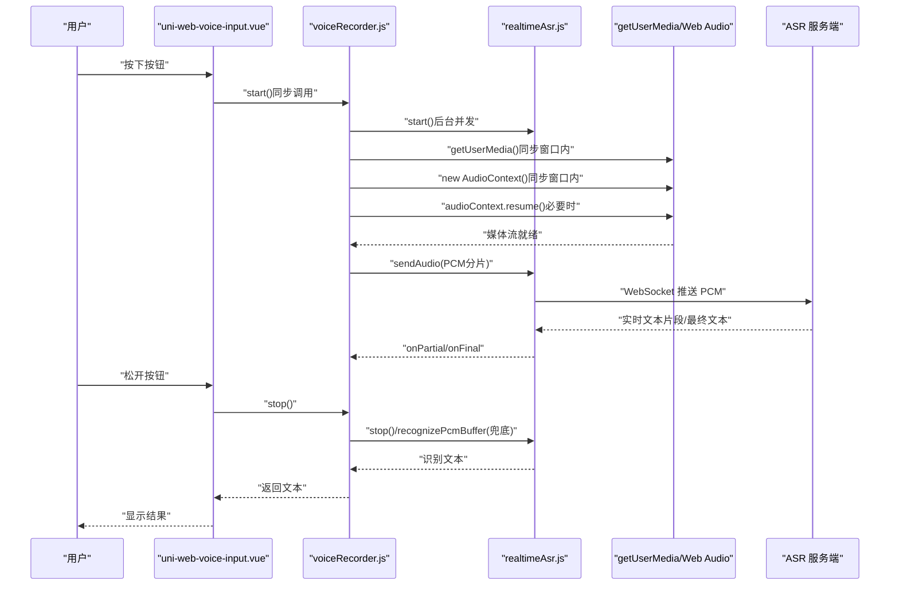
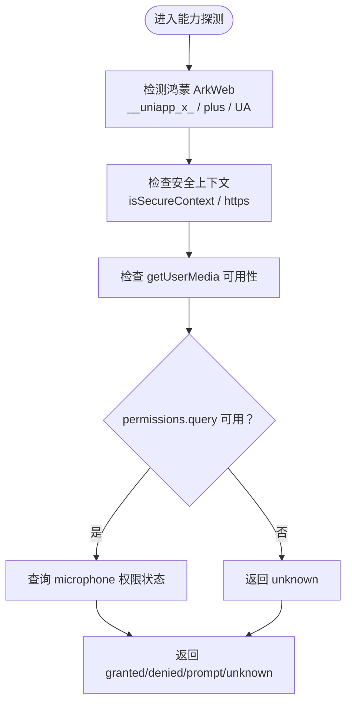
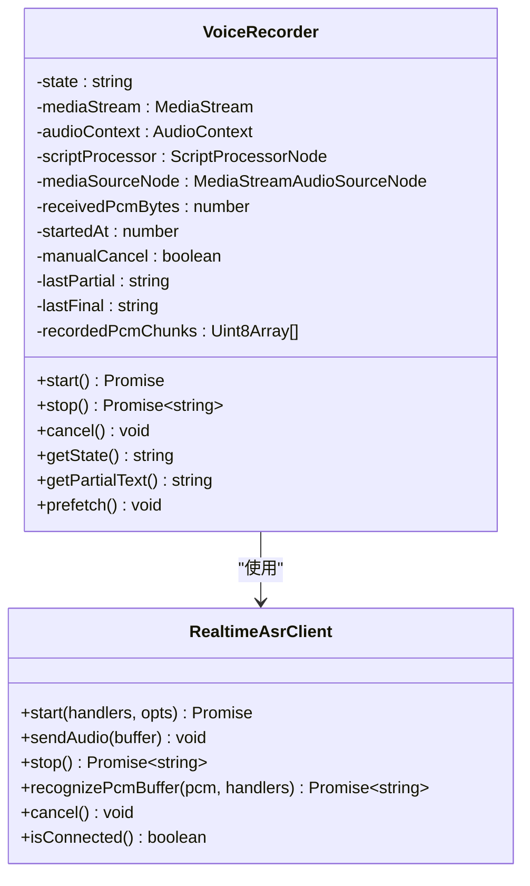
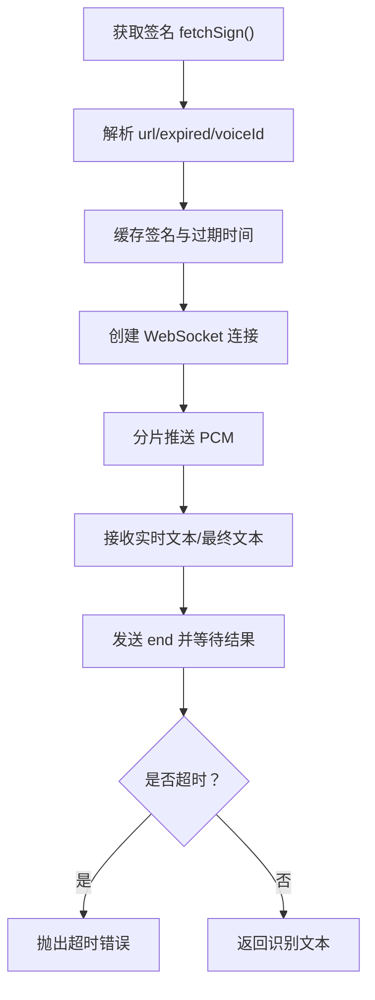
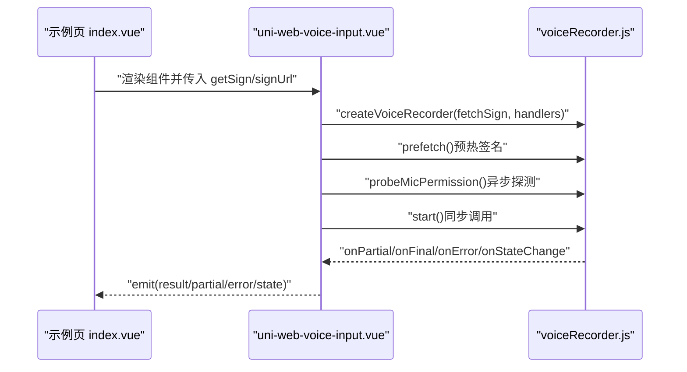
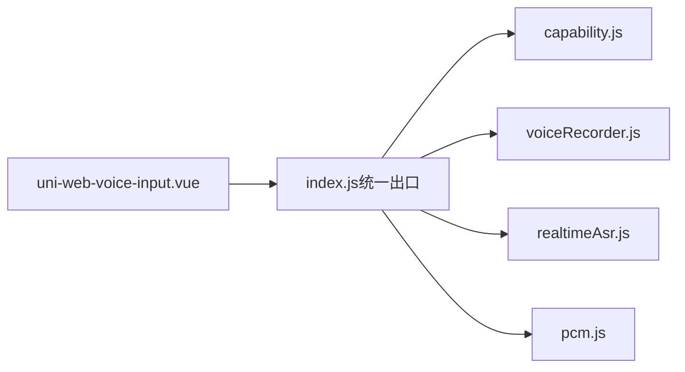

# 跨端兼容性指南

<cite>
**本文引用的文件**   
- [README.md](file://README.md)
- [index.js（SDK 统一出口）](file://uni_modules/uni-web-voice-input/js_sdk/uni-web-voice/index.js)
- [capability.js（跨端能力探测）](file://uni_modules/uni-web-voice-input/js_sdk/uni-web-voice/capability.js)
- [voiceRecorder.js（录音编排器）](file://uni_modules/uni-web-voice-input/js_sdk/uni-web-voice/voiceRecorder.js)
- [realtimeAsr.js（实时 ASR 客户端）](file://uni_modules/uni-web-voice-input/js_sdk/uni-web-voice/realtimeAsr.js)
- [pcm.js（PCM 处理）](file://uni_modules/uni-web-voice-input/js_sdk/uni-web-voice/pcm.js)
- [uni-web-voice-input.vue（语音输入组件）](file://uni_modules/uni-web-voice-input/components/uni-web-voice-input/uni-web-voice-input.vue)
- [demo 示例页 index.vue](file://demo/src/pages/index/index.vue)
- [examples demo.vue](file://examples/demo/demo.vue)
</cite>

## 目录
1. [引言](#引言)
2. [项目结构](#项目结构)
3. [核心组件](#核心组件)
4. [架构总览](#架构总览)
5. [详细组件分析](#详细组件分析)
6. [依赖关系分析](#依赖关系分析)
7. [平台差异与兼容性策略](#平台差异与兼容性策略)
8. [测试验证与调试技巧](#测试验证与调试技巧)
9. [常见问题诊断与解决方案](#常见问题诊断与解决方案)
10. [UA 检测的局限性与替代方案](#ua-检测的局限性与替代方案)
11. [性能优化建议](#性能优化建议)
12. [结论](#结论)

## 引言
本指南面向需要在多端 WebView 中实现「按住说话、松手出字」的开发者，重点覆盖鸿蒙 ArkWeb、Android WebView、iOS WebView 以及 H5 浏览器的兼容性问题。该仓库通过纯 Web 能力（`getUserMedia` + Web Audio + WebSocket 实时 ASR）提供一套可复用的语音输入 SDK 与 uni-app 组件，并在关键时序上做了针对 ArkWeb 和 iOS 的修复：在用户手势同步窗口内发起 `getUserMedia`、在手势内创建并 `resume()` `AudioContext`，同时提供结构化能力探测与 Android 运行时权限补申请逻辑。

## 项目结构
仓库采用「插件市场目录 + Demo 工程」组织方式：
- `uni_modules/uni-web-voice-input`：DCloud 插件市场使用的组件与 JS SDK。
- `demo/src`：基于 uni-app 的示例工程，演示组件用法与签名注入。
- `examples/demo`：更轻量的示例页面。

**图表来源**
- [index.js（SDK 统一出口）:1-18](file://uni_modules/uni-web-voice-input/js_sdk/uni-web-voice/index.js#L1-L18)
- [uni-web-voice-input.vue:28-44](file://uni_modules/uni-web-voice-input/components/uni-web-voice-input/uni-web-voice-input.vue#L28-L44)

**章节来源**
- [README.md:1-33](file://README.md#L1-L33)
- [index.js（SDK 统一出口）:1-18](file://uni_modules/uni-web-voice-input/js_sdk/uni-web-voice/index.js#L1-L18)

## 核心组件
本项目的核心由以下模块组成：
- 能力探测模块：负责判断是否运行在鸿蒙 ArkWeb、是否安全上下文、是否可用网页麦克风、Android App-plus 环境及权限请求。
- 录音编排器：封装 `getUserMedia` + Web Audio 采集 PCM + 实时 ASR 的完整生命周期，保证在用户手势同步窗口内完成关键初始化。
- 实时 ASR 客户端：基于 WebSocket 的实时识别客户端，支持签名预热、分片推送、错误码映射与超时控制。
- PCM 工具：Float32 到 PCM16 的重采样与拼接。
- uni-app 组件：将录音编排器与 UI 交互绑定，暴露结果、部分文本、状态与错误事件。

**章节来源**
- [capability.js:1-138](file://uni_modules/uni-web-voice-input/js_sdk/uni-web-voice/capability.js#L1-L138)
- [voiceRecorder.js:1-315](file://uni_modules/uni-web-voice-input/js_sdk/uni-web-voice/voiceRecorder.js#L1-L315)
- [realtimeAsr.js:1-380](file://uni_modules/uni-web-voice-input/js_sdk/uni-web-voice/realtimeAsr.js#L1-L380)
- [pcm.js:1-37](file://uni_modules/uni-web-voice-input/js_sdk/uni-web-voice/pcm.js#L1-L37)
- [uni-web-voice-input.vue:28-169](file://uni_modules/uni-web-voice-input/components/uni-web-voice-input/uni-web-voice-input.vue#L28-L169)

## 架构总览
整体流程从用户触摸开始，组件在同步代码中调用录音编排器；编排器并发启动 ASR 连接、获取麦克风流、创建并恢复音频上下文，随后将 PCM 数据分片推送到 WebSocket 服务端，最终返回识别文本或兜底整段 PCM 识别。

**图表来源**
- [uni-web-voice-input.vue:180-264](file://uni_modules/uni-web-voice-input/components/uni-web-voice-input/uni-web-voice-input.vue#L180-L264)
- [voiceRecorder.js:152-295](file://uni_modules/uni-web-voice-input/js_sdk/uni-web-voice/voiceRecorder.js#L152-L295)
- [realtimeAsr.js:214-378](file://uni_modules/uni-web-voice-input/js_sdk/uni-web-voice/realtimeAsr.js#L214-L378)

## 详细组件分析

### 能力探测模块（capability.js）
该模块提供跨端能力探测与权限相关工具函数：
- `isHarmonyWebview`：优先通过 `window.__uniapp_x_` 判定鸿蒙 ArkWeb，其次排除 `window.plus`，最后用 UA 兜底。
- `isSecureContext`：检查 `isSecureContext` 或协议是否为 https/localhost。
- `canUseWebMic`：综合安全上下文与 `mediaDevices.getUserMedia` 可用性。
- `getMicBlockReason`：返回不可用原因文案，便于直接提示用户。
- `probeMicPermission`：异步探测麦克风授权状态，兼容不支持 `microphone` 的环境。
- `isAppPlusAndroid` / `requestRecordAudioViaPlus`：用于 uni-app App-plus 安卓环境的运行时权限补申请。

**图表来源**
- [capability.js:14-83](file://uni_modules/uni-web-voice-input/js_sdk/uni-web-voice/capability.js#L14-L83)

**章节来源**
- [capability.js:14-138](file://uni_modules/uni-web-voice-input/js_sdk/uni-web-voice/capability.js#L14-L138)

### 录音编排器（voiceRecorder.js）
录音编排器是本 SDK 的核心，负责：
- 在用户手势同步窗口内发起 `getUserMedia`、创建 `AudioContext` 并 `resume()`，确保鸿蒙 ArkWeb 能触发系统权限弹窗。
- 建立 Web Audio 链路：`MediaStreamSource -> ScriptProcessor -> Gain -> Destination`，避免声音外放。
- 将 Float32 音频重采样为 PCM16 并通过 ASR 客户端发送。
- 维护整段 PCM 缓存，当实时 WS 未连上时，松手后使用整段 PCM 进行兜底识别。
- 管理状态机：idle → preparing → recording → recognizing → canceled。

**图表来源**
- [voiceRecorder.js:59-313](file://uni_modules/uni-web-voice-input/js_sdk/uni-web-voice/voiceRecorder.js#L59-L313)
- [realtimeAsr.js:84-378](file://uni_modules/uni-web-voice-input/js_sdk/uni-web-voice/realtimeAsr.js#L84-L378)

**章节来源**
- [voiceRecorder.js:1-315](file://uni_modules/uni-web-voice-input/js_sdk/uni-web-voice/voiceRecorder.js#L1-L315)

### 实时 ASR 客户端（realtimeAsr.js）
该模块实现与后端解耦的实时语音识别客户端：
- 通过 `fetchSign` 注入签名 URL，解析响应体中的 `url`、`expired`、`voiceId`。
- 自动刷新即将过期的签名，提前 60s 刷新以避免连接中断。
- 分片推送 PCM 数据，每片 3200 字节，间隔 40ms。
- 错误码映射：对 4001/4002/4003/4004 等常见错误给出可读中文提示。
- 超时控制：连接超时、识别超时、停止等待超时。

**图表来源**
- [realtimeAsr.js:151-223](file://uni_modules/uni-web-voice-input/js_sdk/uni-web-voice/realtimeAsr.js#L151-L223)
- [realtimeAsr.js:274-378](file://uni_modules/uni-web-voice-input/js_sdk/uni-web-voice/realtimeAsr.js#L274-L378)

**章节来源**
- [realtimeAsr.js:1-380](file://uni_modules/uni-web-voice-input/js_sdk/uni-web-voice/realtimeAsr.js#L1-L380)

### PCM 处理（pcm.js）
提供两个关键工具：
- `floatToPcm16k`：将 Float32 音频线性重采样为目标采样率（默认 16kHz），并转换为 Int16 PCM。
- `concatPcmChunks`：将多个 PCM 分片拼接为一个 ArrayBuffer，用于整段兜底识别。

**章节来源**
- [pcm.js:1-37](file://uni_modules/uni-web-voice-input/js_sdk/uni-web-voice/pcm.js#L1-L37)

### uni-app 组件（uni-web-voice-input.vue）
组件负责：
- 绑定触摸/鼠标事件，在 `touchstart` 同步调用 `recorder.start()`。
- 根据 `probeMicPermission` 预提示“麦克风未授权”。
- 在 App-plus 安卓环境下自动申请 `RECORD_AUDIO` 运行时权限。
- 暴露 `result`、`partial`、`error`、`state` 事件给上层业务。

**图表来源**
- [uni-web-voice-input.vue:130-169](file://uni_modules/uni-web-voice-input/components/uni-web-voice-input/uni-web-voice-input.vue#L130-L169)
- [demo/src/pages/index/index.vue:16-83](file://demo/src/pages/index/index.vue#L16-L83)

**章节来源**
- [uni-web-voice-input.vue:1-339](file://uni_modules/uni-web-voice-input/components/uni-web-voice-input/uni-web-voice-input.vue#L1-L339)
- [demo/src/pages/index/index.vue:1-138](file://demo/src/pages/index/index.vue#L1-L138)

## 依赖关系分析
SDK 统一出口导出能力探测、PCM 工具、实时 ASR 客户端与录音编排器，组件仅依赖 SDK 接口，不直接耦合底层实现。

**图表来源**
- [index.js（SDK 统一出口）:6-17](file://uni_modules/uni-web-voice-input/js_sdk/uni-web-voice/index.js#L6-L17)
- [uni-web-voice-input.vue:38-44](file://uni_modules/uni-web-voice-input/components/uni-web-voice-input/uni-web-voice-input.vue#L38-L44)

**章节来源**
- [index.js（SDK 统一出口）:1-18](file://uni_modules/uni-web-voice-input/js_sdk/uni-web-voice/index.js#L1-L18)

## 平台差异与兼容性策略

### 鸿蒙 ArkWeb
- **问题**：`getUserMedia` 若不在用户手势同步窗口内发起，ArkWeb 不会触发系统麦克风权限弹窗；`AudioContext` 可能以 `suspended` 状态创建，导致无 PCM 输出。
- **修复**：
  - 在 `touchstart` 同步代码中调用 `recorder.start()`，内部立即发起 `getUserMedia` 与 `AudioContext` 创建。
  - 创建 `AudioContext` 后立即尝试 `resume()`。
  - 使用结构化信号 `window.__uniapp_x_` 判定 ArkWeb，而非仅依赖 UA。
- **参考实现路径**：
  - [uni-web-voice-input.vue:192-207](file://uni_modules/uni-web-voice-input/components/uni-web-voice-input/uni-web-voice-input.vue#L192-L207)
  - [voiceRecorder.js:168-201](file://uni_modules/uni-web-voice-input/js_sdk/uni-web-voice/voiceRecorder.js#L168-L201)
  - [capability.js:14-26](file://uni_modules/uni-web-voice-input/js_sdk/uni-web-voice/capability.js#L14-L26)

### Android WebView
- **权限机制**：在 uni-app App-plus 的安卓 WebView 中，`getUserMedia` 不会自动弹出系统授权框，需宿主先持有 `RECORD_AUDIO` 权限。
- **策略**：
  - 组件挂载时检测 `isAppPlusAndroid()`，若为真则调用 `requestRecordAudioViaPlus()` 主动申请运行时权限。
  - 若首次按住失败，捕获错误后再次引导用户授予权限。
- **参考实现路径**：
  - [capability.js:85-138](file://uni_modules/uni-web-voice-input/js_sdk/uni-web-voice/capability.js#L85-L138)
  - [uni-web-voice-input.vue:161-168](file://uni_modules/uni-web-voice-input/components/uni-web-voice-input/uni-web-voice-input.vue#L161-L168)
  - [uni-web-voice-input.vue:196-203](file://uni_modules/uni-web-voice-input/components/uni-web-voice-input/uni-web-voice-input.vue#L196-L203)

### iOS WebView
- **音频处理差异**：iOS 下 `AudioContext` 常以 `suspended` 状态创建，必须显式 `resume()` 才能触发 `onaudioprocess`。
- **策略**：
  - 在 `start()` 中创建 `AudioContext` 后立即尝试 `resume()`。
  - 若 `resume()` 失败，忽略异常并继续后续流程，避免阻塞。
- **参考实现路径**：
  - [voiceRecorder.js:176-201](file://uni_modules/uni-web-voice-input/js_sdk/uni-web-voice/voiceRecorder.js#L176-L201)

### H5 浏览器
- **兼容性要求**：需要 HTTPS 或 localhost 安全上下文，且支持 `navigator.mediaDevices.getUserMedia`。
- **降级策略**：
  - 若环境不安全或缺少 `getUserMedia`，`getMicBlockReason()` 返回可读原因，组件直接提示用户。
  - 若实时 WS 未连上，松手后使用整段 PCM 兜底识别一次。
- **参考实现路径**：
  - [capability.js:28-63](file://uni_modules/uni-web-voice-input/js_sdk/uni-web-voice/capability.js#L28-L63)
  - [voiceRecorder.js:276-278](file://uni_modules/uni-web-voice-input/js_sdk/uni-web-voice/voiceRecorder.js#L276-L278)

**章节来源**
- [README.md:7-23](file://README.md#L7-L23)
- [capability.js:14-138](file://uni_modules/uni-web-voice-input/js_sdk/uni-web-voice/capability.js#L14-L138)
- [voiceRecorder.js:168-201](file://uni_modules/uni-web-voice-input/js_sdk/uni-web-voice/voiceRecorder.js#L168-L201)
- [uni-web-voice-input.vue:161-203](file://uni_modules/uni-web-voice-input/components/uni-web-voice-input/uni-web-voice-input.vue#L161-L203)

## 测试验证与调试技巧

### 各平台测试方法
- **鸿蒙 ArkWeb**：
  - 确认宿主 WebView 已声明麦克风权限并转发 `onPermissionRequest`。
  - 页面必须为 HTTPS。
  - 观察首次按住是否弹出系统权限框；若无弹出，检查是否在手势同步窗口内调用 `start()`。
- **Android WebView**：
  - 检查宿主是否持有 `RECORD_AUDIO` 权限。
  - 若首次按住失败，查看是否触发 `requestRecordAudioViaPlus()` 并成功授予权限。
- **iOS WebView**：
  - 确认 `AudioContext.resume()` 被调用且未抛错。
  - 检查 `ScriptProcessor.onaudioprocess` 是否回调。
- **H5 浏览器**：
  - 使用 HTTPS 或 localhost 访问。
  - 检查 `navigator.mediaDevices.getUserMedia` 是否存在。

### 调试技巧
- 启用组件 `debug=true`，查看控制台日志。
- 监听组件事件：`result`、`partial`、`error`、`state`。
- 使用 `probeMicPermission()` 预探测权限状态，若为 `denied`，预提示用户前往设置开启。
- 在 `realtimeAsr.js` 中检查 WebSocket 连接状态与错误码。

**章节来源**
- [uni-web-voice-input.vue:130-169](file://uni_modules/uni-web-voice-input/components/uni-web-voice-input/uni-web-voice-input.vue#L130-L169)
- [demo/src/pages/index/index.vue:16-83](file://demo/src/pages/index/index.vue#L16-L83)
- [realtimeAsr.js:95-103](file://uni_modules/uni-web-voice-input/js_sdk/uni-web-voice/realtimeAsr.js#L95-L103)

## 常见问题诊断与解决方案

| 现象 | 可能原因 | 解决方案 |
|------|----------|----------|
| 鸿蒙 ArkWeb 按住不弹麦克风权限 | `getUserMedia` 未在用户手势同步窗口内发起 | 确保在 `touchstart` 同步代码中调用 `recorder.start()` |
| 有权限却零 PCM、无识别文本 | `AudioContext` 处于 `suspended` 状态 | 在创建 `AudioContext` 后立即调用 `resume()` |
| Android WebView 首次按住失败 | 缺少 `RECORD_AUDIO` 运行时权限 | 组件挂载时调用 `requestRecordAudioViaPlus()`，或在失败后引导用户授予权限 |
| H5 无法录音 | 非安全环境或缺少 `getUserMedia` | 改用 HTTPS 或 localhost，检查浏览器兼容性 |
| 实时识别无结果 | WebSocket 未连上或网络异常 | 检查签名 URL、网络连通性；使用整段 PCM 兜底识别 |
| 识别文本为空 | 录音时间太短或静音 | 调整 `minDurationMs`，靠近麦克风重试 |

**章节来源**
- [voiceRecorder.js:152-295](file://uni_modules/uni-web-voice-input/js_sdk/uni-web-voice/voiceRecorder.js#L152-L295)
- [capability.js:52-83](file://uni_modules/uni-web-voice-input/js_sdk/uni-web-voice/capability.js#L52-L83)
- [realtimeAsr.js:178-212](file://uni_modules/uni-web-voice-input/js_sdk/uni-web-voice/realtimeAsr.js#L178-L212)

## UA 检测的局限性与替代方案
- **局限性**：ArkWeb 的 `<web-view>` 可能被宿主覆写 UA，使其不包含 `ArkWeb` 或 `OpenHarmony` 关键字，导致 UA 检测失效。
- **替代方案**：
  - 优先使用结构化信号 `window.__uniapp_x_` 判定 ArkWeb。
  - 排除 `window.plus` 以区分 App-plus 容器。
  - UA 仅作为兜底，不单独作为判端依据。

**章节来源**
- [capability.js:14-26](file://uni_modules/uni-web-voice-input/js_sdk/uni-web-voice/capability.js#L14-L26)

## 性能优化建议
- **签名预热**：组件挂载时调用 `recorder.prefetch()`，减少首次按下的等待时间。
- **分片推送**：ASR 客户端将 PCM 分为 3200 字节分片，每片间隔 40ms，平衡实时性与网络压力。
- **音频链路静音**：通过 `Gain` 节点将音量设为 0，避免声音外放。
- **PCM 缓存限制**：最多缓存 400 个 PCM 分片，防止内存溢出。
- **超时控制**：连接超时、识别超时、停止等待超时，避免长时间阻塞。

**章节来源**
- [uni-web-voice-input.vue:155-156](file://uni_modules/uni-web-voice-input/components/uni-web-voice-input/uni-web-voice-input.vue#L155-L156)
- [realtimeAsr.js:16-17](file://uni_modules/uni-web-voice-input/js_sdk/uni-web-voice/realtimeAsr.js#L16-L17)
- [voiceRecorder.js:203-228](file://uni_modules/uni-web-voice-input/js_sdk/uni-web-voice/voiceRecorder.js#L203-L228)
- [voiceRecorder.js:218-222](file://uni_modules/uni-web-voice-input/js_sdk/uni-web-voice/voiceRecorder.js#L218-L222)

## 结论
本指南基于仓库源码，系统梳理了跨端语音输入的兼容性策略与实现细节。通过结构化能力探测、用户手势同步窗口内的关键初始化、Android 运行时权限补申请、iOS `AudioContext` 恢复、H5 安全上下文校验与 WebSocket 实时 ASR 客户端，项目在鸿蒙 ArkWeb、Android WebView、iOS WebView 与 H5 浏览器之间实现了稳定一致的语音输入体验。开发者可依据本文档进行平台适配、测试验证与性能调优，快速集成并落地生产环境。