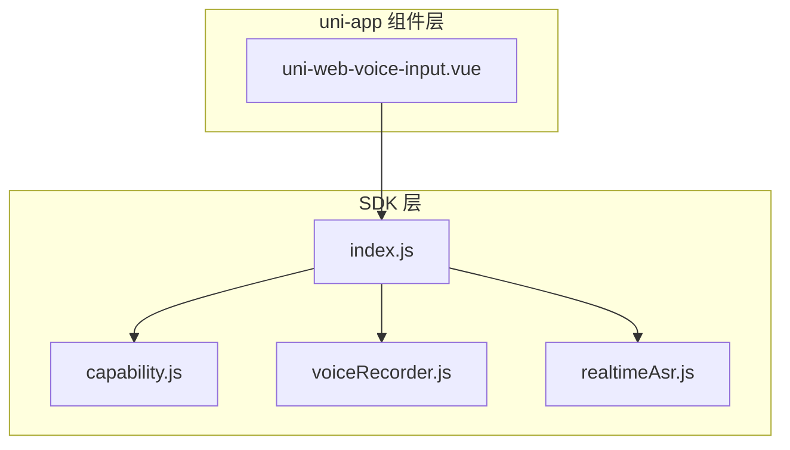
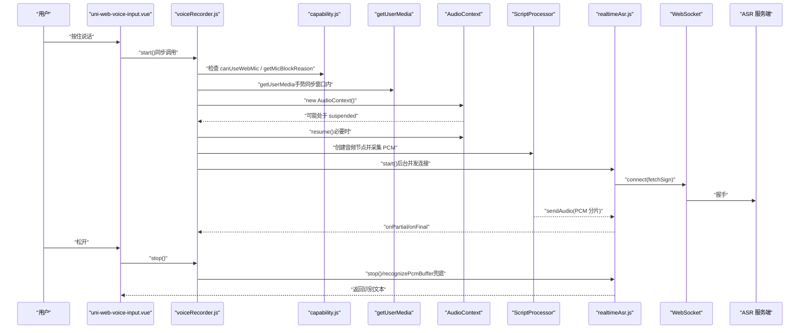
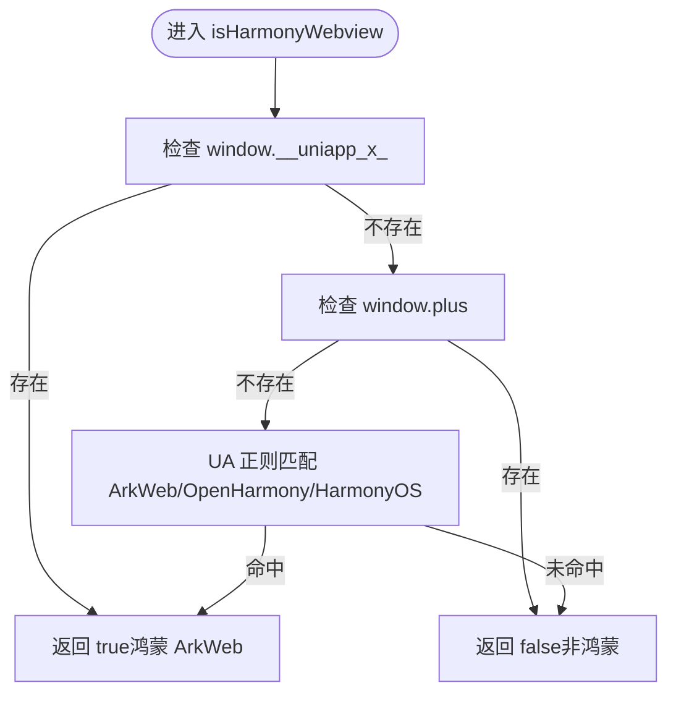
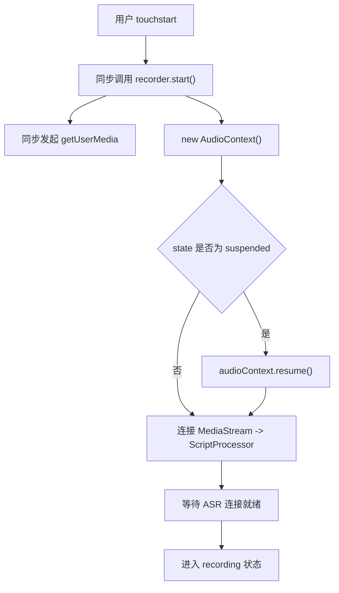
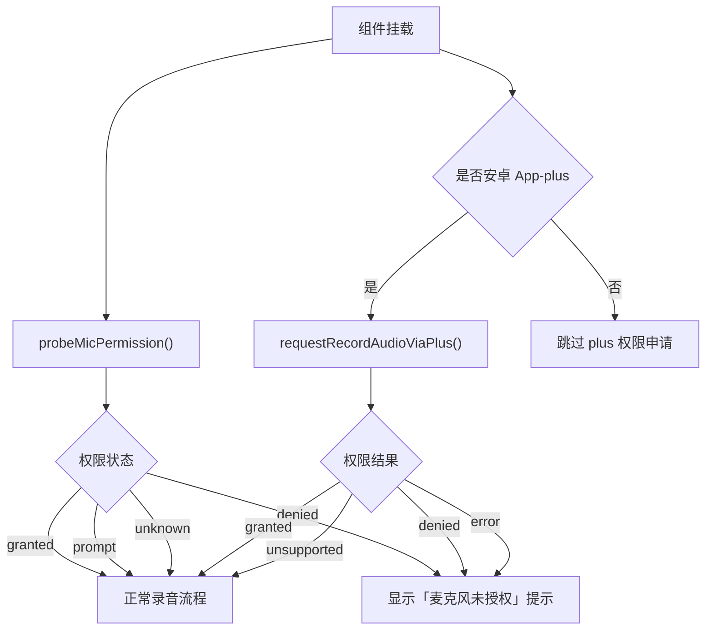
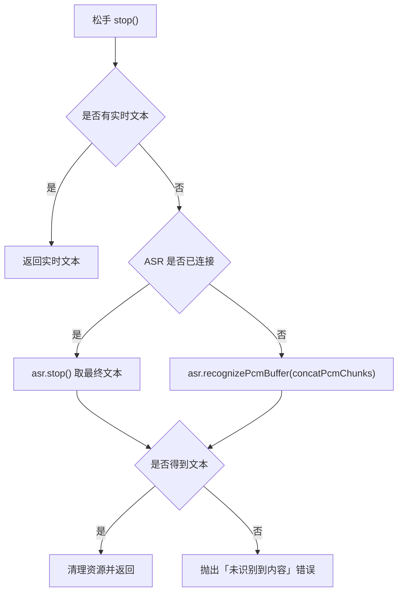
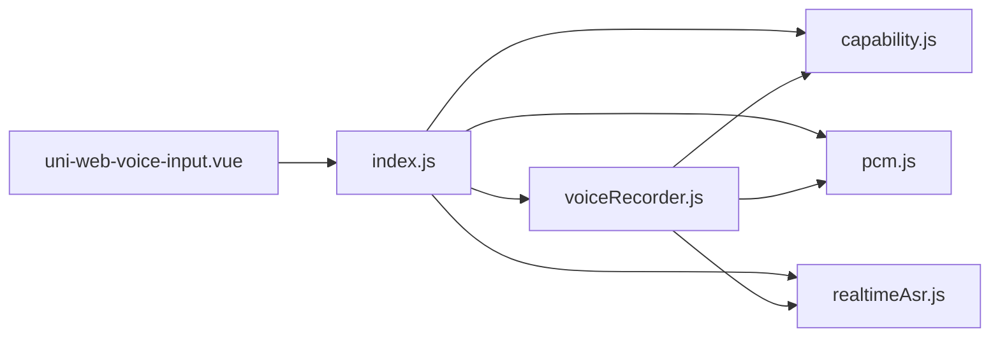

# 鸿蒙 ArkWeb 兼容性处理

<cite>
**本文引用的文件**   
- [README.md](file://README.md)
- [capability.js](file://uni_modules/uni-web-voice-input/js_sdk/uni-web-voice/capability.js)
- [index.js](file://uni_modules/uni-web-voice-input/js_sdk/uni-web-voice/index.js)
- [voiceRecorder.js](file://uni_modules/uni-web-voice-input/js_sdk/uni-web-voice/voiceRecorder.js)
- [realtimeAsr.js](file://uni_modules/uni-web-voice-input/js_sdk/uni-web-voice/realtimeAsr.js)
- [uni-web-voice-input.vue](file://uni_modules/uni-web-voice-input/components/uni-web-voice-input/uni-web-voice-input.vue)
</cite>

## 目录
1. [引言](#引言)
2. [项目结构](#项目结构)
3. [核心组件](#核心组件)
4. [架构总览](#架构总览)
5. [详细组件分析](#详细组件分析)
6. [依赖关系分析](#依赖关系分析)
7. [性能与稳定性考量](#性能与稳定性考量)
8. [测试与调试方法](#测试与调试方法)
9. [常见问题诊断与解决方案](#常见问题诊断与解决方案)
10. [结论](#结论)

## 引言
本仓库实现了一个面向跨端 WebView 的「纯 Web 语音输入」方案，重点解决鸿蒙 ArkWeb `<web-view>` 中常见的权限弹窗不触发、有权限却无 PCM、以及 UA 被宿主覆写导致判端失败等问题。其核心思路是：
- 使用结构化信号检测 ArkWeb，而不是仅依赖 UA。
- 在用户手势同步窗口内发起 `getUserMedia`，并创建和恢复 `AudioContext`。
- 通过 navigator.permissions 做权限探测，同时提供降级策略。
- 将 ASR 签名获取与 WebSocket 连接封装为可注入的后端解耦模块。

这些能力由 SDK 层（capability、voiceRecorder、realtimeAsr）与 uni-app 组件层（uni-web-voice-input.vue）共同协作完成。

**章节来源**
- [README.md:1-24](file://README.md#L1-L24)

## 项目结构
该仓库主要包含以下关键路径：
- `uni_modules/uni-web-voice-input/js_sdk/uni-web-voice/`：纯 Web 能力 SDK，负责环境探测、录音编排、实时识别。
- `uni_modules/uni-web-voice-input/components/uni-web-voice-input/`：uni-app 组件，负责 UI、手势、状态展示与错误提示。
- `demo/`：基于 uni-app + Vite 的示例工程，用于本地验证。

**图表来源**
- [index.js:6-17](file://uni_modules/uni-web-voice-input/js_sdk/uni-web-voice/index.js#L6-L17)
- [uni-web-voice-input.vue:38-44](file://uni_modules/uni-web-voice-input/components/uni-web-voice-input/uni-web-voice-input.vue#L38-L44)

**章节来源**
- [index.js:1-18](file://uni_modules/uni-web-voice-input/js_sdk/uni-web-voice/index.js#L1-L18)
- [uni-web-voice-input.vue:1-44](file://uni_modules/uni-web-voice-input/components/uni-web-voice-input/uni-web-voice-input.vue#L1-L44)

## 核心组件
- **ArkWeb 与环境探测**
  - `isHarmonyWebview`：优先检测 `window.__uniapp_x_`，再排除 `plus`，最后用 UA 兜底。
  - `isSecureContext` / `canUseWebMic` / `getMicBlockReason`：判断安全上下文与麦克风可用性。
  - `probeMicPermission`：异步探测 `navigator.permissions`，不支持时返回 `unknown` 降级。
  - `isAppPlusAndroid` / `requestRecordAudioViaPlus`：针对安卓 App-plus 的运行时权限补申请。

- **录音编排器**
  - `createVoiceRecorder`：统一封装 `getUserMedia`、`AudioContext`、ScriptProcessor、PCM 缓存、ASR 实时流与整段 PCM 兜底。
  - 关键时序修复：在用户手势同步代码块内发起 `getUserMedia`、创建 `AudioContext`，并在必要时调用 `resume()`。

- **实时 ASR 客户端**
  - `createRealtimeAsrClient`：通过注入的 `fetchSign` 获取 WSS URL，建立 WebSocket，推送 PCM 分片，解析最终/部分文本，并提供超时、错误码映射与 PCM 兜底识别。

- **uni-app 组件**
  - `uni-web-voice-input.vue`：绑定触摸事件，保证 `recorder.start()` 在 touchstart 同步执行；根据权限探测结果预显示引导文案；对安卓 App-plus 自动补申请录音权限。

**章节来源**
- [capability.js:14-138](file://uni_modules/uni-web-voice-input/js_sdk/uni-web-voice/capability.js#L14-L138)
- [voiceRecorder.js:15-315](file://uni_modules/uni-web-voice-input/js_sdk/uni-web-voice/voiceRecorder.js#L15-L315)
- [realtimeAsr.js:78-379](file://uni_modules/uni-web-voice-input/js_sdk/uni-web-voice/realtimeAsr.js#L78-L379)
- [uni-web-voice-input.vue:28-169](file://uni_modules/uni-web-voice-input/components/uni-web-voice-input/uni-web-voice-input.vue#L28-L169)

## 架构总览
下图展示了从用户按下到识别结果的完整链路，包括 ArkWeb 特殊处理点。

**图表来源**
- [uni-web-voice-input.vue:180-228](file://uni_modules/uni-web-voice-input/components/uni-web-voice-input/uni-web-voice-input.vue#L180-L228)
- [voiceRecorder.js:152-295](file://uni_modules/uni-web-voice-input/js_sdk/uni-web-voice/voiceRecorder.js#L152-L295)
- [realtimeAsr.js:214-379](file://uni_modules/uni-web-voice-input/js_sdk/uni-web-voice/realtimeAsr.js#L214-L379)

## 详细组件分析

### ArkWeb 检测与结构化信号
ArkWeb 的 `<web-view>` 会向页面注入 JavaScriptProxy 对象 `window.__uniapp_x_`，而安卓/iOS 的 Html5Plus 容器不会注入该对象。因此，最可靠的判端方式是：
1. 优先检测 `window.__uniapp_x_` 是否存在。
2. 若存在 `window.plus`，则判定为非鸿蒙。
3. 最后用 UA 正则兜底匹配 ArkWeb/OpenHarmony/HarmonyOS。

这种“结构化信号优先 + UA 兜底”的策略，避免了 UA 被宿主覆写后误判的问题。

**图表来源**
- [capability.js:14-26](file://uni_modules/uni-web-voice-input/js_sdk/uni-web-voice/capability.js#L14-L26)

**章节来源**
- [capability.js:1-26](file://uni_modules/uni-web-voice-input/js_sdk/uni-web-voice/capability.js#L1-L26)

### getUserMedia 与 AudioContext 的手势修复
在鸿蒙 ArkWeb 中，如果 `getUserMedia` 不在用户手势的同步代码块内发起，系统不会触发麦克风授权弹窗，表现为“按住没反应”。此外，`AudioContext` 可能以 `suspended` 状态启动，导致 `ScriptProcessor.onaudioprocess` 不回调，出现“有权限却零 PCM、无识别文本”。

SDK 的处理方式：
- 在 `start()` 内部，先同步发起 `getUserMedia`、创建 `AudioContext`，再 await 媒体流。
- 若 `audioContext.state === 'suspended'`，显式调用 `resume()`。
- 组件侧确保 `recorder.start()` 在 `touchstart` 同步执行，不在其前插入 `await`。

**图表来源**
- [voiceRecorder.js:152-240](file://uni_modules/uni-web-voice-input/js_sdk/uni-web-voice/voiceRecorder.js#L152-L240)
- [uni-web-voice-input.vue:192-207](file://uni_modules/uni-web-voice-input/components/uni-web-voice-input/uni-web-voice-input.vue#L192-L207)

**章节来源**
- [voiceRecorder.js:1-13](file://uni_modules/uni-web-voice-input/js_sdk/uni-web-voice/voiceRecorder.js#L1-L13)
- [voiceRecorder.js:152-240](file://uni_modules/uni-web-voice-input/js_sdk/uni-web-voice/voiceRecorder.js#L152-L240)
- [uni-web-voice-input.vue:28-36](file://uni_modules/uni-web-voice-input/components/uni-web-voice-input/uni-web-voice-input.vue#L28-L36)
- [uni-web-voice-input.vue:192-207](file://uni_modules/uni-web-voice-input/components/uni-web-voice-input/uni-web-voice-input.vue#L192-L207)

### 权限探测与降级策略
权限探测采用 `navigator.permissions.query({ name: 'microphone' })`，但部分内核（含老 ArkWeb）可能不支持 `'microphone'` 或没有 `permissions` API。此时 SDK 会静默降级为 `unknown`，由调用方继续走 `getUserMedia` 自然弹窗，绝不阻塞用户体验。

对于安卓 App-plus，WebView 的 `getUserMedia` 不会自动弹系统授权框，需要宿主先持有 `RECORD_AUDIO`。组件在挂载时主动调用 `requestRecordAudioViaPlus`，并在首次按住失败时再次尝试补申请。

**图表来源**
- [capability.js:65-138](file://uni_modules/uni-web-voice-input/js_sdk/uni-web-voice/capability.js#L65-L138)
- [uni-web-voice-input.vue:130-169](file://uni_modules/uni-web-voice-input/components/uni-web-voice-input/uni-web-voice-input.vue#L130-L169)

**章节来源**
- [capability.js:65-138](file://uni_modules/uni-web-voice-input/js_sdk/uni-web-voice/capability.js#L65-L138)
- [uni-web-voice-input.vue:130-169](file://uni_modules/uni-web-voice-input/components/uni-web-voice-input/uni-web-voice-input.vue#L130-L169)

### 实时 ASR 与 PCM 兜底
实时 ASR 通过注入的 `fetchSign` 获取 WSS URL，建立 WebSocket 并推送 PCM 分片。若实时连接未成功或无识别结果，SDK 会使用整段 PCM 缓冲进行兜底识别，确保即使网络异常也能出字。

**图表来源**
- [voiceRecorder.js:242-295](file://uni_modules/uni-web-voice-input/js_sdk/uni-web-voice/voiceRecorder.js#L242-L295)
- [realtimeAsr.js:317-379](file://uni_modules/uni-web-voice-input/js_sdk/uni-web-voice/realtimeAsr.js#L317-L379)

**章节来源**
- [voiceRecorder.js:242-295](file://uni_modules/uni-web-voice-input/js_sdk/uni-web-voice/voiceRecorder.js#L242-L295)
- [realtimeAsr.js:286-379](file://uni_modules/uni-web-voice-input/js_sdk/uni-web-voice/realtimeAsr.js#L286-L379)

## 依赖关系分析
SDK 层与组件层的依赖关系如下：
- 组件层依赖 SDK 出口 `index.js`。
- SDK 出口聚合 capability、pcm、realtimeAsr、voiceRecorder。
- voiceRecorder 依赖 realtimeAsr 与 pcm，并通过 capability 做环境探测。
- realtimeAsr 依赖注入的 `fetchSign` 与可选的自定义 `WebSocketImpl`。

**图表来源**
- [index.js:6-17](file://uni_modules/uni-web-voice-input/js_sdk/uni-web-voice/index.js#L6-L17)
- [voiceRecorder.js:15-17](file://uni_modules/uni-web-voice-input/js_sdk/uni-web-voice/voiceRecorder.js#L15-L17)

**章节来源**
- [index.js:1-18](file://uni_modules/uni-web-voice-input/js_sdk/uni-web-voice/index.js#L1-L18)
- [voiceRecorder.js:15-17](file://uni_modules/uni-web-voice-input/js_sdk/uni-web-voice/voiceRecorder.js#L15-L17)

## 性能与稳定性考量
- **握手与连接超时**：ASR 连接设置超时时间，避免长时间阻塞。
- **分片推送节奏**：按固定字节大小与间隔推送 PCM，降低丢包与拥塞风险。
- **签名缓存与刷新**：提前缓存签名并设置过期偏移，减少重复请求。
- **音频链路清理**：每次录音结束都断开节点、关闭 AudioContext、停止媒体流，防止内存泄漏。
- **兜底识别**：实时未连上或无结果时使用整段 PCM 兜底，提升成功率。

[本节为通用性能建议，不直接分析具体文件]

## 测试与调试方法
- **启用调试日志**
  - 组件层传入 `debug: true`，SDK 层开启 ASR 调试输出。
  - 观察控制台中的 ASR 握手、消息、错误信息。

- **ArkWeb 环境验证**
  - 确认 `window.__uniapp_x_` 存在。
  - 确认 `window.plus` 不存在。
  - 在 ArkWeb 中按住说话，应能弹出系统麦克风权限。

- **权限探测验证**
  - 在支持 `navigator.permissions` 的环境，验证 `probeMicPermission()` 返回 `granted/denied/prompt/unknown`。
  - 在不支持的环境，确认不会阻塞，仍走 `getUserMedia` 自然弹窗。

- **AudioContext 状态验证**
  - 在 iOS 与 ArkWeb 中，确认 `AudioContext` 创建后必要时调用 `resume()`。
  - 验证 `ScriptProcessor.onaudioprocess` 能回调并产生 PCM。

- **ASR 签名与 WebSocket**
  - 验证 `fetchSign` 返回的 `url` 字段正确。
  - 观察 WebSocket 连接是否成功，是否收到 `result.voice_text_str`。

- **安卓 App-plus 权限验证**
  - 在安卓 App-plus 中，确认 `isAppPlusAndroid()` 返回 true。
  - 验证 `requestRecordAudioViaPlus()` 能补申请 `RECORD_AUDIO`。

**章节来源**
- [uni-web-voice-input.vue:46-57](file://uni_modules/uni-web-voice-input/components/uni-web-voice-input/uni-web-voice-input.vue#L46-L57)
- [capability.js:65-138](file://uni_modules/uni-web-voice-input/js_sdk/uni-web-voice/capability.js#L65-L138)
- [voiceRecorder.js:152-240](file://uni_modules/uni-web-voice-input/js_sdk/uni-web-voice/voiceRecorder.js#L152-L240)
- [realtimeAsr.js:151-176](file://uni_modules/uni-web-voice-input/js_sdk/uni-web-voice/realtimeAsr.js#L151-L176)

## 常见问题诊断与解决方案

| 问题现象 | 可能原因 | 诊断要点 | 解决方案 |
|---|---|---|---|
| 鸿蒙 ArkWeb 按住不弹麦克风权限 | `getUserMedia` 未在用户手势同步窗口内发起 | 检查组件是否在 `touchstart` 同步调用 `recorder.start()` | 保持同步调用，不在其前插入 `await` |
| 有权限却零 PCM、无识别文本 | `AudioContext` 处于 `suspended` 状态 | 检查 `audioContext.state` 与是否调用 `resume()` | 创建后立即检查并 `resume()` |
| UA 被宿主覆写导致判端失败 | 仅依赖 UA 判断 ArkWeb | 检查 UA 是否包含 ArkWeb/OpenHarmony/HarmonyOS | 使用 `window.__uniapp_x_` 作为结构化信号 |
| 权限探测报错或卡住 | 不支持 `navigator.permissions` 或 `'microphone'` | 检查 `probeMicPermission()` 返回值 | 降级为 `unknown`，继续走 `getUserMedia` |
| 安卓 App-plus 无法弹出系统权限 | WebView 不自动弹系统授权框 | 检查 `isAppPlusAndroid()` 与 `requestRecordAudioViaPlus()` | 组件挂载时补申请，失败时再次尝试 |
| 实时识别无结果 | WebSocket 未连上或服务器返回错误 | 查看 ASR 调试日志与错误码 | 使用整段 PCM 兜底识别；检查签名与网络 |
| 签名获取失败 | `fetchSign` 返回缺少 `url` 或鉴权失败 | 查看 `resolveAsrSign()` 抛错信息 | 修正后端签名接口，确保返回 `url` |

**章节来源**
- [uni-web-voice-input.vue:192-207](file://uni_modules/uni-web-voice-input/components/uni-web-voice-input/uni-web-voice-input.vue#L192-L207)
- [voiceRecorder.js:152-240](file://uni_modules/uni-web-voice-input/js_sdk/uni-web-voice/voiceRecorder.js#L152-L240)
- [capability.js:14-26](file://uni_modules/uni-web-voice-input/js_sdk/uni-web-voice/capability.js#L14-L26)
- [capability.js:65-138](file://uni_modules/uni-web-voice-input/js_sdk/uni-web-voice/capability.js#L65-L138)
- [realtimeAsr.js:151-176](file://uni_modules/uni-web-voice-input/js_sdk/uni-web-voice/realtimeAsr.js#L151-L176)
- [realtimeAsr.js:178-212](file://uni_modules/uni-web-voice-input/js_sdk/uni-web-voice/realtimeAsr.js#L178-L212)

## 结论
本方案通过结构化信号检测 ArkWeb、在手势同步窗口内发起 `getUserMedia`、显式恢复 `AudioContext`、异步探测权限并提供降级策略，有效解决了鸿蒙 ArkWeb 与多端 WebView 的兼容性问题。配合实时 ASR 与 PCM 兜底机制，能够在网络不稳定或实时连接失败的情况下仍尽量产出识别结果。对于安卓 App-plus，组件层还主动补申请系统录音权限，进一步提升了首次使用的成功率。

[本节为总结性内容，不直接分析具体文件]