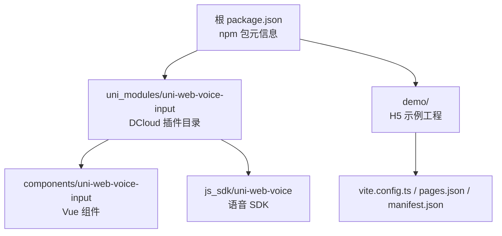
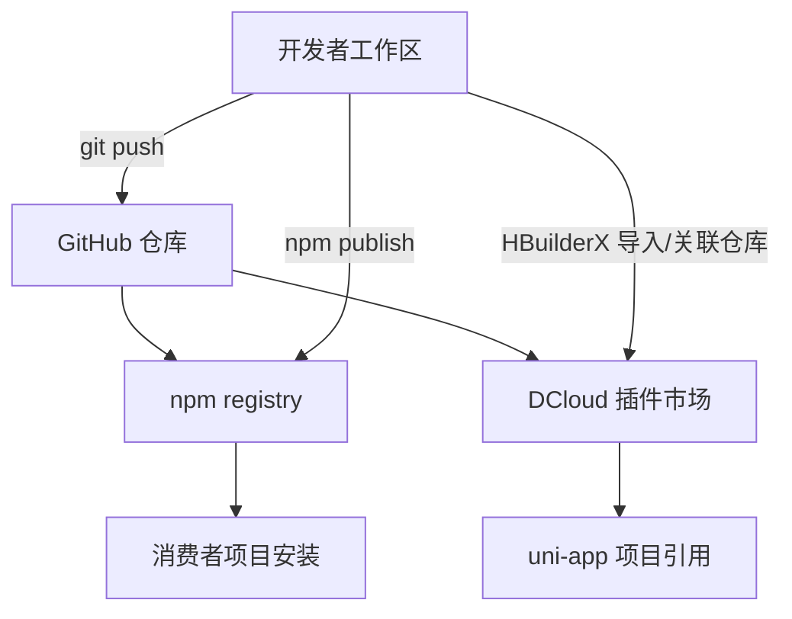
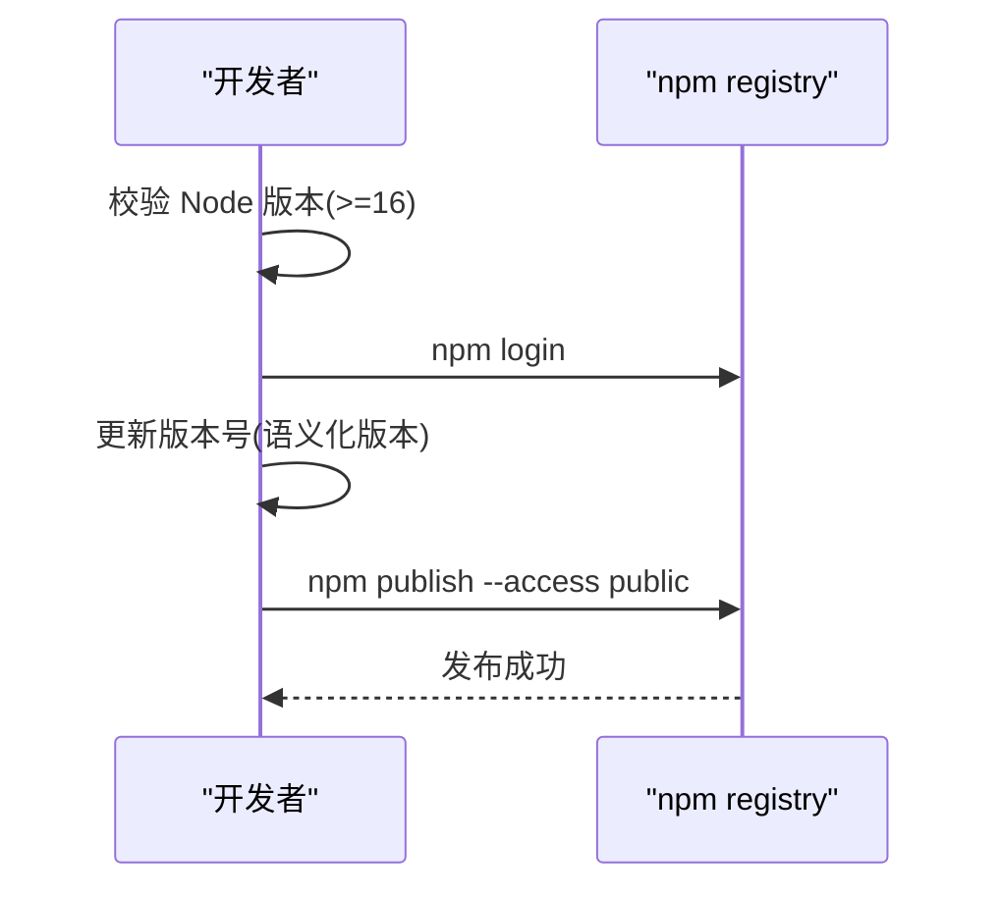
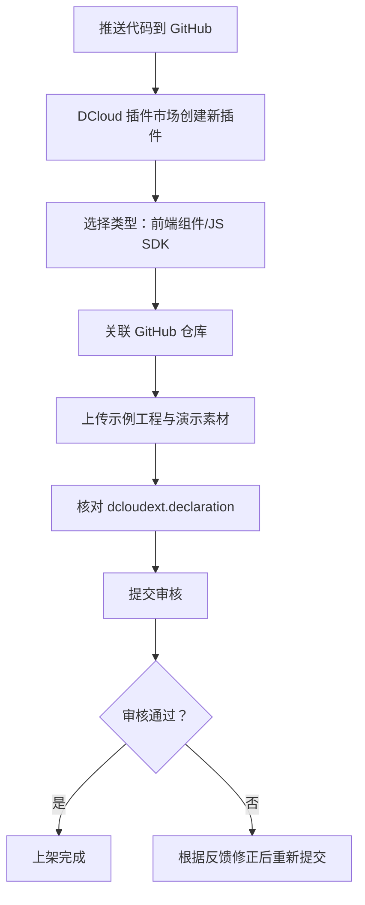
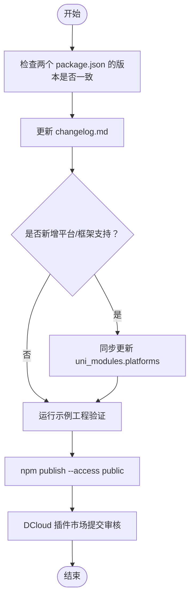
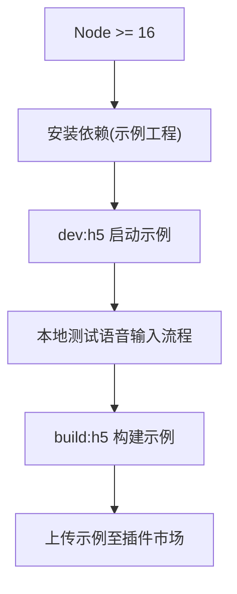
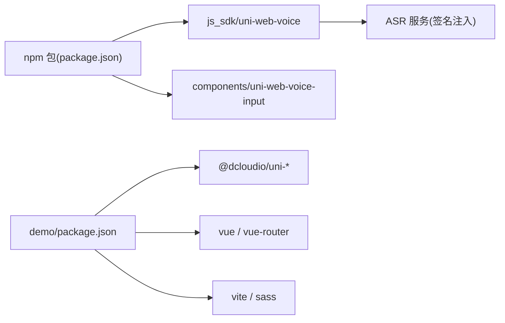

# 部署和发布

<cite>
**本文引用的文件**   
- [package.json](file://package.json)
- [README.md](file://README.md)
- [uni_modules/uni-web-voice-input/package.json](file://uni_modules/uni-web-voice-input/package.json)
- [uni_modules/uni-web-voice-input/readme.md](file://uni_modules/uni-web-voice-input/readme.md)
- [demo/package.json](file://demo/package.json)
</cite>

## 目录
1. [简介](#简介)
2. [项目结构](#项目结构)
3. [核心组件](#核心组件)
4. [架构总览](#架构总览)
5. [详细组件分析](#详细组件分析)
6. [依赖分析](#依赖分析)
7. [性能与构建注意事项](#性能与构建注意事项)
8. [故障排查指南](#故障排查指南)
9. [结论](#结论)
10. [附录：发布检查清单](#附录发布检查清单)

## 简介
本指南面向 uni-web-voice-input 的维护者与发布者，覆盖 npm 包发布、DCloud 插件市场发布、版本管理策略、构建与环境准备、发布前检查清单、依赖更新与安全修复流程，以及回滚与紧急修复操作。文档内容严格基于仓库现有配置与说明，避免臆测。

## 项目结构
仓库采用“npm 包 + DCloud 插件”双形态发布：
- 根 package.json 定义 npm 包的元信息、入口与导出；
- uni_modules/uni-web-voice-input 是 DCloud 插件市场所需的 uni_modules 包，包含组件与 SDK，并声明 dcloudext 元数据；
- demo 为 H5 示例工程，用于本地验证与插件市场示例上传。

**图表来源**
- [package.json:1-56](file://package.json#L1-L56)
- [uni_modules/uni-web-voice-input/package.json:1-76](file://uni_modules/uni-web-voice-input/package.json#L1-L76)
- [demo/package.json:1-24](file://demo/package.json#L1-L24)

**章节来源**
- [package.json:1-56](file://package.json#L1-L56)
- [uni_modules/uni-web-voice-input/package.json:1-76](file://uni_modules/uni-web-voice-input/package.json#L1-L76)
- [demo/package.json:1-24](file://demo/package.json#L1-L24)

## 核心组件
- npm 包入口与导出
  - main/module/types 指向 js_sdk 统一入口；exports 同时暴露组件路径，便于按需引入。
  - files 仅打包 uni_modules 下的必要目录，控制发布体积。
- DCloud 插件元信息
  - id、displayName、version、repository 与 dcloudext.declaration 等字段描述插件能力与权限。
  - uni_modules.platforms 声明支持平台（H5/App/webview）与 Vue 版本约束。
- 示例工程
  - demo 使用 uni-app CLI 脚本 dev:h5/build:h5，依赖 @dcloudio/* 与 vite/vue 生态。

**章节来源**
- [package.json:23-36](file://package.json#L23-L36)
- [uni_modules/uni-web-voice-input/package.json:1-31](file://uni_modules/uni-web-voice-input/package.json#L1-L31)
- [uni_modules/uni-web-voice-input/package.json:32-74](file://uni_modules/uni-web-voice-input/package.json#L32-L74)
- [demo/package.json:6-22](file://demo/package.json#L6-L22)

## 架构总览
下图展示 npm 包与 DCloud 插件在发布时的关系与产物流向。

**图表来源**
- [README.md:35-47](file://README.md#L35-L47)
- [uni_modules/uni-web-voice-input/readme.md:185-192](file://uni_modules/uni-web-voice-input/readme.md#L185-L192)

## 详细组件分析

### npm 包发布流程
- 环境要求
  - Node.js >= 16（由 engines 字段约束）。
- 登录与发布
  - 先执行 npm login；再执行 npm publish --access public。
- 关键配置项
  - name/version/license/author/repository/type/main/module/types/exports/files/uni-app/scripts/engines。
  - exports 同时暴露 SDK 与组件路径，方便不同引入方式。
  - files 限定发布范围，避免多余文件进入 npm 包。
- 版本管理建议
  - 遵循语义化版本（SemVer），修改功能用 minor，修复用 patch，破坏性变更用 major。
  - 同步更新根 package.json 与 uni_modules/.../package.json 中的 version。
  - 建议在 README 或 changelog 中记录变更摘要（仓库已预留 changelog.md 位置）。

**图表来源**
- [package.json:52-54](file://package.json#L52-L54)
- [package.json:23-36](file://package.json#L23-L36)
- [README.md:37-41](file://README.md#L37-L41)

**章节来源**
- [package.json:1-56](file://package.json#L1-L56)
- [README.md:35-41](file://README.md#L35-L41)

### DCloud 插件市场发布流程
- 前置条件
  - 将代码推送到 GitHub 仓库；确保根目录可定位到 uni_modules/uni-web-voice-input。
- 创建插件
  - 在 DCloud 插件市场「创建新插件」，类型选择“前端组件（uni_modules）/ JS SDK”。
- 关联仓库与示例
  - 关联 GitHub 仓库；上传示例工程（examples/ 或 demo 工程）与演示视频/GIF。
- 审核要点
  - 确认 dcloudext.declaration 如实声明：无广告、不收集数据、麦克风权限。
  - 示例需能跑通并按压出字（审核会验证交互）。
- 提交与上架
  - 填写分类、标签、价格（免费/收费）后提交审核，通过后获得市场链接。

**图表来源**
- [README.md:43-47](file://README.md#L35-L47)
- [uni_modules/uni-web-voice-input/readme.md:185-192](file://uni_modules/uni-web-voice-input/readme.md#L185-L192)
- [uni_modules/uni-web-voice-input/package.json:17-31](file://uni_modules/uni-web-voice-input/package.json#L17-L31)

**章节来源**
- [README.md:43-47](file://README.md#L43-L47)
- [uni_modules/uni-web-voice-input/readme.md:185-192](file://uni_modules/uni-web-voice-input/readme.md#L185-L192)
- [uni_modules/uni-web-voice-input/package.json:17-31](file://uni_modules/uni-web-voice-input/package.json#L17-L31)

### 版本管理与更新机制
- 双版本一致性
  - 根 package.json 与 uni_modules/uni-web-voice-input/package.json 的 version 应保持一致，避免 npm 与插件市场版本错位。
- 变更追踪
  - 建议在 uni_modules/.../changelog.md 记录每次发布的变更摘要（仓库已预留该文件位置）。
- 平台与兼容性
  - uni_modules.package.json 的 uni_modules.platforms 明确支持 H5/App/webview 与 Vue3；若新增平台或框架支持，需同步更新。
- 依赖与运行时
  - 根 package.json 的 engines.node 约束 Node >= 16；示例工程依赖 @dcloudio/* 与 vite/vue 生态，升级时需关注兼容矩阵。

**图表来源**
- [package.json:52-54](file://package.json#L52-L54)
- [uni_modules/uni-web-voice-input/package.json:32-74](file://uni_modules/uni-web-voice-input/package.json#L32-L74)
- [uni_modules/uni-web-voice-input/readme.md:168-183](file://uni_modules/uni-web-voice-input/readme.md#L168-L183)

**章节来源**
- [package.json:1-56](file://package.json#L1-L56)
- [uni_modules/uni-web-voice-input/package.json:1-76](file://uni_modules/uni-web-voice-input/package.json#L1-L76)
- [uni_modules/uni-web-voice-input/readme.md:168-183](file://uni_modules/uni-web-voice-input/readme.md#L168-L183)

### 构建配置与环境准备
- 开发环境
  - Node.js >= 16；建议使用 LTS。
  - 示例工程使用 uni-app CLI 与 Vite 生态，依赖 @dcloudio/uni-* 与 vue/vite。
- 本地验证
  - 在 demo 目录下执行 dev:h5 启动 H5 示例，build:h5 构建产物用于静态托管或预览。
- 构建产物
  - 示例工程构建产物可用于插件市场演示；组件与 SDK 以 uni_modules 形式被 uni-app 项目直接引用。

**图表来源**
- [demo/package.json:6-22](file://demo/package.json#L6-L22)
- [package.json:52-54](file://package.json#L52-L54)

**章节来源**
- [demo/package.json:1-24](file://demo/package.json#L1-L24)
- [package.json:52-54](file://package.json#L52-L54)

## 依赖分析
- npm 包依赖
  - 根 package.json 未声明运行时依赖，仅声明 engines 与 scripts；SDK 与组件位于 uni_modules 下，作为独立资源被 uni-app 项目消费。
- 示例工程依赖
  - demo 依赖 @dcloudio/uni-app、@dcloudio/uni-components、@dcloudio/uni-h5、vue、vue-router 及 vite/sass 等开发依赖。
- 外部集成点
  - ASR 签名注入通过 getSign/signUrl/fetchSign 解耦后端，组件不绑定具体厂商密钥；WebSocket 直连实时 ASR（默认兼容腾讯云协议）。

**图表来源**
- [package.json:23-36](file://package.json#L23-L36)
- [demo/package.json:10-22](file://demo/package.json#L10-L22)
- [uni_modules/uni-web-voice-input/readme.md:1-11](file://uni_modules/uni-web-voice-input/readme.md#L1-L11)

**章节来源**
- [package.json:1-56](file://package.json#L1-L56)
- [demo/package.json:1-24](file://demo/package.json#L1-L24)
- [uni_modules/uni-web-voice-input/readme.md:1-11](file://uni_modules/uni-web-voice-input/readme.md#L1-L11)

## 性能与构建注意事项
- 采音与识别链路
  - getUserMedia + Web Audio 采集 PCM16k，WebSocket 直连实时 ASR；松手出字、上滑取消。
- 平台差异
  - iOS 需要 HTTPS 且系统版本 ≥ 14.3；鸿蒙 ArkWeb 需在宿主转发 onPermissionRequest 并在手势窗口内发起 getUserMedia。
- 调试建议
  - 开启 debug 模式打印 ASR/签名日志；必要时替换采音层实现（如 AudioWorklet）以适配个别环境。

[本节为通用指导，不直接分析具体文件]

## 故障排查指南
- 常见问题
  - 按下后不弹麦克风权限：检查宿主 WebView 是否转发 onPermissionRequest、页面是否为 HTTPS、是否在用户手势同步窗口内调用 getUserMedia。
  - 安卓报 couldn't start audio：宿主需持有 RECORD_AUDIO 权限；App-plus 下组件会自动申请，原生 WebView 需在 WebChromeClient.onPermissionRequest 中处理。
  - iOS 无反应：确认系统版本、HTTPS、Info.plist 已声明 NSMicrophoneUsageDescription。
  - 识别报额度/鉴权失败：属签名/服务侧问题，需在 getSign 后端处理错误码。
- 小程序端无效
  - 小程序无 getUserMedia，请勿在该端使用。

**章节来源**
- [uni_modules/uni-web-voice-input/readme.md:159-167](file://uni_modules/uni-web-voice-input/readme.md#L159-L167)

## 结论
- 本项目提供 npm 包与 DCloud 插件两种发布形态，分别服务于 uni-app 生态与更广泛的 Web 场景。
- 发布流程清晰：npm 包通过 npm publish 发布；DCloud 插件通过插件市场创建、关联仓库、上传示例并提交审核。
- 版本管理需保持双 package.json 一致，结合 changelog 与平台声明进行可控演进。
- 构建与示例工程便于本地验证与审核演示；依赖解耦设计使 ASR 后端可灵活替换。

[本节为总结性内容，不直接分析具体文件]

## 附录：发布检查清单
- 环境与依赖
  - Node 版本满足 engines 要求（>=16）。
  - 示例工程依赖安装成功，dev:h5 可运行。
- 版本与元信息
  - 根 package.json 与 uni_modules/.../package.json 的 version 一致。
  - dcloudext.declaration 准确声明无广告、不收集数据、麦克风权限。
  - uni_modules.platforms 与实际支持平台一致。
- 构建与验证
  - 示例工程 build:h5 构建成功。
  - 本地验证语音输入流程（按住说话、松手出字、上滑取消）。
- 发布
  - npm login 成功后执行 npm publish --access public。
  - DCloud 插件市场创建插件、关联仓库、上传示例与演示素材，提交审核。
- 安全与合规
  - 扫描依赖漏洞并及时修复；如有重大修复，优先走紧急修复流程（见下文）。
- 回滚与紧急修复
  - npm 包：如需回滚，可在 npm registry 撤销或下架对应版本；后续以补丁版本修复并发布。
  - DCloud 插件：若审核未通过或上线后发现问题，按市场反馈修正后重新提交；必要时暂停新版本，回退到上一个稳定版本。

[本节为通用指导，不直接分析具体文件]