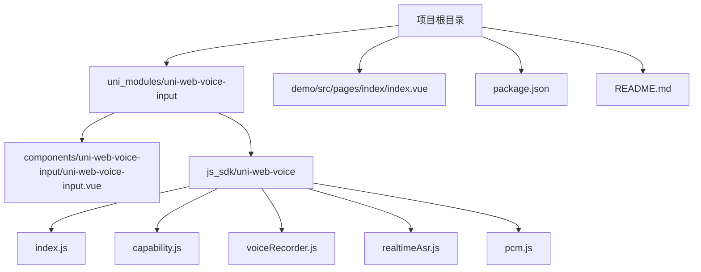
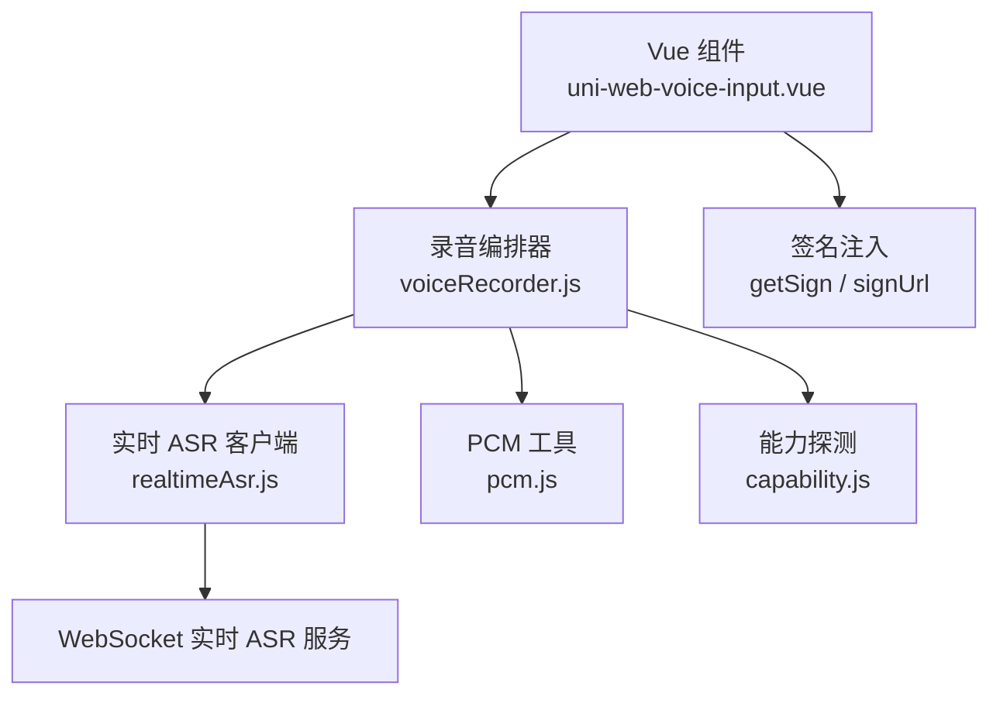
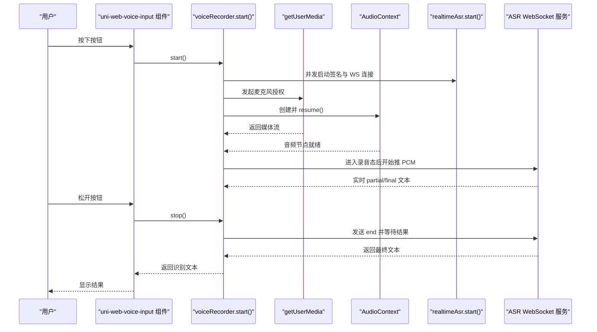
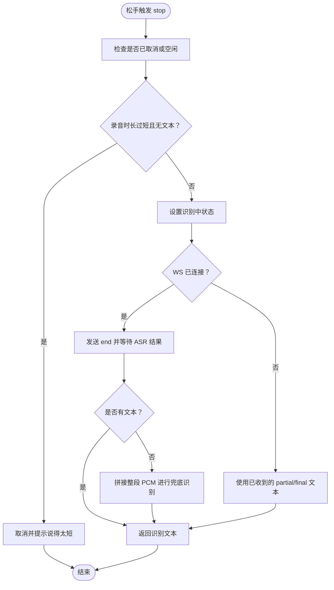
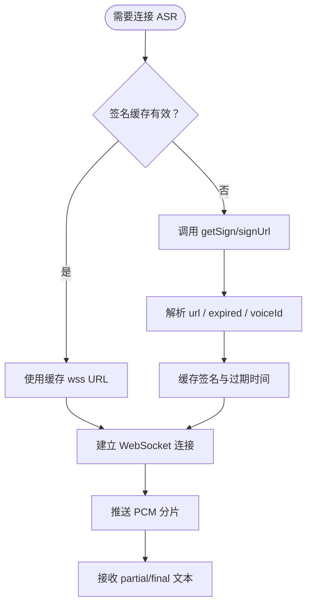
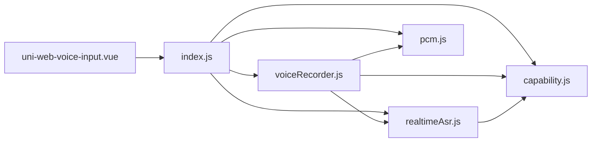

# 项目概述

<cite>
**本文引用的文件**   
- [README.md](file://README.md)
- [package.json](file://package.json)
- [uni_modules/uni-web-voice-input/package.json](file://uni_modules/uni-web-voice-input/package.json)
- [uni_modules/uni-web-voice-input/components/uni-web-voice-input/uni-web-voice-input.vue](file://uni_modules/uni-web-voice-input/components/uni-web-voice-input/uni-web-voice-input.vue)
- [uni_modules/uni-web-voice-input/js_sdk/uni-web-voice/index.js](file://uni_modules/uni-web-voice-input/js_sdk/uni-web-voice/index.js)
- [uni_modules/uni-web-voice-input/js_sdk/uni-web-voice/capability.js](file://uni_modules/uni-web-voice-input/js_sdk/uni-web-voice/capability.js)
- [uni_modules/uni-web-voice-input/js_sdk/uni-web-voice/voiceRecorder.js](file://uni_modules/uni-web-voice-input/js_sdk/uni-web-voice/voiceRecorder.js)
- [uni_modules/uni-web-voice-input/js_sdk/uni-web-voice/realtimeAsr.js](file://uni_modules/uni-web-voice-input/js_sdk/uni-web-voice/realtimeAsr.js)
- [uni_modules/uni-web-voice-input/js_sdk/uni-web-voice/pcm.js](file://uni_modules/uni-web-voice-input/js_sdk/uni-web-voice/pcm.js)
- [demo/src/pages/index/index.vue](file://demo/src/pages/index/index.vue)
</cite>

## 目录
1. [引言](#引言)
2. [项目结构](#项目结构)
3. [核心组件与 SDK](#核心组件与-sdk)
4. [架构总览](#架构总览)
5. [关键流程与数据流](#关键流程与数据流)
6. [跨端能力与鸿蒙修复](#跨端能力与鸿蒙修复)
7. [后端解耦与签名注入](#后端解耦与签名注入)
8. [适用场景与集成方式](#适用场景与集成方式)
9. [依赖关系分析](#依赖关系分析)
10. [性能与稳定性要点](#性能与稳定性要点)
11. [常见问题排查](#常见问题排查)
12. [结论](#结论)

## 引言
uni-web-voice-input 是一个专为 WebView 环境设计的跨端语音输入解决方案，核心价值在于：当原生录音桥不可用时，通过纯 Web 能力实现「按住说话、松手出字、上滑取消」的语音输入体验。它面向鸿蒙 ArkWeb、H5、App-vue 等容器，解决鸿蒙 ArkWeb 中常见的麦克风权限不弹窗、有权限却零 PCM、无识别文本等问题，并通过 WebSocket 实时 ASR 与整段 PCM 兜底策略保障识别成功率。

该方案同时提供两种用法：
- Vue 3 组件用法：开箱即用的 UI 与手势编排；
- JavaScript SDK 用法：更灵活的脚本式集成，便于在任意前端框架或页面中使用。

项目的目标不是绑定特定后端，而是把 ASR 签名获取与连接细节解耦，默认兼容腾讯云 ASR 协议，开发者只需注入自己的签名接口即可接入任意语音识别服务。

**章节来源**
- [README.md:1-23](file://README.md#L1-L23)
- [package.json:2-29](file://package.json#L2-L29)

## 项目结构
仓库采用“插件 + SDK + 示例”的分层组织方式：
- `uni_modules/uni-web-voice-input`：DCloud 插件市场使用的 uni_modules 包，包含 Vue 组件与 JS SDK；
- `js_sdk/uni-web-voice`：框架无关的 JavaScript SDK，导出能力探测、PCM 处理、实时 ASR 客户端和录音编排器；
- `components/uni-web-voice-input`：Vue 3 组件，封装「按住说话」交互、状态展示、错误提示与权限引导；
- `demo/src/pages/index/index.vue`：uni-app 示例页，演示组件用法与签名注入；
- 根级 `package.json`：npm 包元信息，暴露 SDK 入口与组件入口；
- 根级 `README.md`：项目说明、亮点与发布指引。

**图表来源**
- [package.json:23-35](file://package.json#L23-L35)
- [uni_modules/uni-web-voice-input/package.json:1-31](file://uni_modules/uni-web-voice-input/package.json#L1-L31)
- [uni_modules/uni-web-voice-input/components/uni-web-voice-input/uni-web-voice-input.vue:1-44](file://uni_modules/uni-web-voice-input/components/uni-web-voice-input/uni-web-voice-input.vue#L1-L44)
- [uni_modules/uni-web-voice-input/js_sdk/uni-web-voice/index.js:1-18](file://uni_modules/uni-web-voice-input/js_sdk/uni-web-voice/index.js#L1-L18)

**章节来源**
- [package.json:2-35](file://package.json#L2-L35)
- [uni_modules/uni-web-voice-input/package.json:1-31](file://uni_modules/uni-web-voice-input/package.json#L1-L31)
- [README.md:25-33](file://README.md#L25-L33)

## 核心组件与 SDK
### Vue 组件：uni-web-voice-input
组件负责：
- 渲染「按住说话」按钮与录音浮层；
- 处理触摸与鼠标事件，实现「按住说话、松手出字、上滑取消」；
- 驱动 SDK 的 `createVoiceRecorder`，在正确时机调用 `start()` 与 `stop()`；
- 管理状态（空闲、准备中、录音中、识别中、已取消）；
- 显示时长、部分识别结果、错误提示与权限引导文案；
- 支持通过 `getSign` 或 `signUrl` 注入 ASR 签名；
- 在挂载时预热签名并异步探测麦克风权限。

组件对外暴露 `recorder` 与 `state`，并提供 `result`、`partial`、`error`、`state` 事件，方便上层业务消费。

**章节来源**
- [uni_modules/uni-web-voice-input/components/uni-web-voice-input/uni-web-voice-input.vue:28-59](file://uni_modules/uni-web-voice-input/components/uni-web-voice-input/uni-web-voice-input.vue#L28-L59)
- [uni_modules/uni-web-voice-input/components/uni-web-voice-input/uni-web-voice-input.vue:95-169](file://uni_modules/uni-web-voice-input/components/uni-web-voice-input/uni-web-voice-input.vue#L95-L169)
- [uni_modules/uni-web-voice-input/components/uni-web-voice-input/uni-web-voice-input.vue:180-266](file://uni_modules/uni-web-voice-input/components/uni-web-voice-input/uni-web-voice-input.vue#L180-L266)

### JavaScript SDK：uni-web-voice
SDK 统一出口位于 `index.js`，导出以下能力：
- 能力探测：`isHarmonyWebview`、`isSecureContext`、`canUseWebMic`、`getMicBlockReason`、`probeMicPermission`、`isAppPlusAndroid`、`requestRecordAudioViaPlus`；
- PCM 工具：`floatToPcm16k`、`concatPcmChunks`；
- 实时 ASR 客户端：`createRealtimeAsrClient`；
- 录音编排器：`createVoiceRecorder`、`describeMicError`。

这种设计让 SDK 既可作为 uni-app 组件的内部依赖，也可被任意 H5 页面直接引入使用。

**章节来源**
- [uni_modules/uni-web-voice-input/js_sdk/uni-web-voice/index.js:1-18](file://uni_modules/uni-web-voice-input/js_sdk/uni-web-voice/index.js#L1-L18)

## 架构总览
整体架构分为三层：
- 交互层：Vue 组件负责 UI 与手势编排；
- 录制编排层：`voiceRecorder.js` 协调 `getUserMedia`、`AudioContext`、ScriptProcessor、PCM 转换与 ASR 生命周期；
- 识别层：`realtimeAsr.js` 负责签名获取、WebSocket 连接、音频分片推送、实时结果回调与兜底整段识别。

**图表来源**
- [uni_modules/uni-web-voice-input/components/uni-web-voice-input/uni-web-voice-input.vue:38-44](file://uni_modules/uni-web-voice-input/components/uni-web-voice-input/uni-web-voice-input.vue#L38-L44)
- [uni_modules/uni-web-voice-input/js_sdk/uni-web-voice/voiceRecorder.js:15-17](file://uni_modules/uni-web-voice-input/js_sdk/uni-web-voice/voiceRecorder.js#L15-L17)
- [uni_modules/uni-web-voice-input/js_sdk/uni-web-voice/realtimeAsr.js:1-8](file://uni_modules/uni-web-voice-input/js_sdk/uni-web-voice/realtimeAsr.js#L1-L8)

## 关键流程与数据流
### 「按住说话」主流程

**图表来源**
- [uni_modules/uni-web-voice-input/components/uni-web-voice-input/uni-web-voice-input.vue:180-228](file://uni_modules/uni-web-voice-input/components/uni-web-voice-input/uni-web-voice-input.vue#L180-L228)
- [uni_modules/uni-web-voice-input/js_sdk/uni-web-voice/voiceRecorder.js:152-240](file://uni_modules/uni-web-voice-input/js_sdk/uni-web-voice/voiceRecorder.js#L152-L240)
- [uni_modules/uni-web-voice-input/js_sdk/uni-web-voice/realtimeAsr.js:317-330](file://uni_modules/uni-web-voice-input/js_sdk/uni-web-voice/realtimeAsr.js#L317-L330)

### 松手结束与兜底识别

**图表来源**
- [uni_modules/uni-web-voice-input/js_sdk/uni-web-voice/voiceRecorder.js:242-295](file://uni_modules/uni-web-voice-input/js_sdk/uni-web-voice/voiceRecorder.js#L242-L295)
- [uni_modules/uni-web-voice-input/js_sdk/uni-web-voice/realtimeAsr.js:298-315](file://uni_modules/uni-web-voice-input/js_sdk/uni-web-voice/realtimeAsr.js#L298-L315)

## 跨端能力与鸿蒙修复
### 结构化判端而非 UA
项目强调不能只靠 UA 判断鸿蒙 ArkWeb，因为宿主可能覆写 UA。SDK 使用结构化信号判定：
- 优先检测 `window.__uniapp_x_`，这是鸿蒙 ArkWeb `<web-view>` 注入的信号；
- 若存在 `window.plus`，则判定为 Html5Plus 容器，非鸿蒙；
- 最后才用 UA 兜底匹配 ArkWeb/OpenHarmony/HarmonyOS。

这避免了因 UA 被篡改导致的误判。

### 安全上下文与麦克风可用性
- `isSecureContext` 确保当前环境满足 HTTPS 或 localhost；
- `canUseWebMic` 检查 `mediaDevices.getUserMedia` 是否存在；
- `getMicBlockReason` 返回可读原因，便于 UI 提示；
- `probeMicPermission` 异步探测权限状态，不阻塞手势。

### 鸿蒙与 App-plus 的特殊处理
- 鸿蒙 ArkWeb：必须在用户手势同步窗口内发起 `getUserMedia`，否则不会弹出麦克风权限；
- iOS 与鸿蒙：`AudioContext` 可能以 suspended 状态创建，需显式 `resume()`；
- 安卓 App-plus：webview 的 `getUserMedia` 不会自动弹系统授权框，需通过 `plus.android.requestPermissions` 申请 `RECORD_AUDIO`。

**章节来源**
- [uni_modules/uni-web-voice-input/js_sdk/uni-web-voice/capability.js:14-26](file://uni_modules/uni-web-voice-input/js_sdk/uni-web-voice/capability.js#L14-L26)
- [uni_modules/uni-web-voice-input/js_sdk/uni-web-voice/capability.js:28-46](file://uni_modules/uni-web-voice-input/js_sdk/uni-web-voice/capability.js#L28-L46)
- [uni_modules/uni-web-voice-input/js_sdk/uni-web-voice/capability.js:48-83](file://uni_modules/uni-web-voice-input/js_sdk/uni-web-voice/capability.js#L48-L83)
- [uni_modules/uni-web-voice-input/js_sdk/uni-web-voice/capability.js:85-137](file://uni_modules/uni-web-voice-input/js_sdk/uni-web-voice/capability.js#L85-L137)
- [uni_modules/uni-web-voice-input/components/uni-web-voice-input/uni-web-voice-input.vue:130-169](file://uni_modules/uni-web-voice-input/components/uni-web-voice-input/uni-web-voice-input.vue#L130-L169)
- [uni_modules/uni-web-voice-input/js_sdk/uni-web-voice/voiceRecorder.js:152-201](file://uni_modules/uni-web-voice-input/js_sdk/uni-web-voice/voiceRecorder.js#L152-L201)

## 后端解耦与签名注入
SDK 不绑定任何具体后端或厂商密钥，ASR 签名通过以下方式注入：
- `getSign`：函数形式，返回 Promise，应包含 `url`、可选 `expired`、可选 `voiceId`；
- `signUrl`：字符串形式，SDK 会 fetch 该地址并解析响应体；
- `fetchSign`：SDK 内部实际调用的签名获取函数，由组件或上层业务注入。

实时 ASR 客户端会在连接前刷新签名，并在签名过期前提前续期；若服务器返回鉴权失败码，会清空缓存并提示重试。

**图表来源**
- [uni_modules/uni-web-voice-input/js_sdk/uni-web-voice/realtimeAsr.js:151-176](file://uni_modules/uni-web-voice-input/js_sdk/uni-web-voice/realtimeAsr.js#L151-L176)
- [uni_modules/uni-web-voice-input/js_sdk/uni-web-voice/realtimeAsr.js:214-272](file://uni_modules/uni-web-voice-input/js_sdk/uni-web-voice/realtimeAsr.js#L214-L272)
- [uni_modules/uni-web-voice-input/components/uni-web-voice-input/uni-web-voice-input.vue:95-103](file://uni_modules/uni-web-voice-input/components/uni-web-voice-input/uni-web-voice-input.vue#L95-L103)

**章节来源**
- [uni_modules/uni-web-voice-input/js_sdk/uni-web-voice/realtimeAsr.js:1-8](file://uni_modules/uni-web-voice-input/js_sdk/uni-web-voice/realtimeAsr.js#L1-L8)
- [uni_modules/uni-web-voice-input/js_sdk/uni-web-voice/realtimeAsr.js:151-176](file://uni_modules/uni-web-voice-input/js_sdk/uni-web-voice/realtimeAsr.js#L151-L176)
- [uni_modules/uni-web-voice-input/components/uni-web-voice-input/uni-web-voice-input.vue:95-103](file://uni_modules/uni-web-voice-input/components/uni-web-voice-input/uni-web-voice-input.vue#L95-L103)

## 适用场景与集成方式
### 适用场景
- 原生录音桥不可用：例如鸿蒙 ArkWeb `<web-view>` 内嵌 H5 页面；
- 多端 WebView：H5、App-vue、安卓/iOS WebView；
- 需要「按住说话、松手出字、上滑取消」的交互体验；
- 希望后端解耦，仅通过签名接口接入任意 ASR 服务。

### 集成方式
- 组件用法：在 uni-app 项目中直接使用 `<uni-web-voice-input>`，传入 `getSign` 或 `signUrl`；
- SDK 用法：直接引入 `uni-web-voice-input` 的 JS SDK，自行编排录音与识别逻辑；
- 示例参考：`demo/src/pages/index/index.vue` 展示了组件用法、签名注入与事件监听。

**章节来源**
- [README.md:5-11](file://README.md#L5-L11)
- [demo/src/pages/index/index.vue:16-24](file://demo/src/pages/index/index.vue#L16-L24)
- [demo/src/pages/index/index.vue:59-75](file://demo/src/pages/index/index.vue#L59-L75)

## 依赖关系分析
### 模块依赖图

**图表来源**
- [uni_modules/uni-web-voice-input/components/uni-web-voice-input/uni-web-voice-input.vue:38-44](file://uni_modules/uni-web-voice-input/components/uni-web-voice-input/uni-web-voice-input.vue#L38-L44)
- [uni_modules/uni-web-voice-input/js_sdk/uni-web-voice/index.js:6-17](file://uni_modules/uni-web-voice-input/js_sdk/uni-web-voice/index.js#L6-L17)
- [uni_modules/uni-web-voice-input/js_sdk/uni-web-voice/voiceRecorder.js:15-17](file://uni_modules/uni-web-voice-input/js_sdk/uni-web-voice/voiceRecorder.js#L15-L17)
- [uni_modules/uni-web-voice-input/js_sdk/uni-web-voice/realtimeAsr.js:1-8](file://uni_modules/uni-web-voice-input/js_sdk/uni-web-voice/realtimeAsr.js#L1-L8)

### npm 与 uni_modules 暴露点
- npm 包名：`uni-web-voice-input`；
- SDK 入口：`uni_modules/uni-web-voice-input/js_sdk/uni-web-voice/index.js`；
- 组件入口：`uni_modules/uni-web-voice-input/components/uni-web-voice-input/uni-web-voice-input.vue`；
- uni_modules 平台支持：H5、APP、webview，Vue3。

**章节来源**
- [package.json:23-47](file://package.json#L23-L47)
- [uni_modules/uni-web-voice-input/package.json:32-73](file://uni_modules/uni-web-voice-input/package.json#L32-L73)

## 性能与稳定性要点
- 并发启动 ASR 与麦克风：在 `start()` 中并发发起 ASR 连接与 `getUserMedia`，避免 user-activation 失效；
- AudioContext 显式 resume：防止因 suspended 导致零 PCM；
- ScriptProcessor 缓冲帧可配：默认 4096，平衡延迟与内存；
- PCM 分片推送：按固定字节大小与间隔推送，降低网络压力；
- 整段 PCM 兜底：WS 未连上或无实时结果时，使用缓存 PCM 再次识别；
- 签名缓存与提前刷新：减少首次按下等待与鉴权失败概率；
- 超时保护：连接超时、识别超时均有明确错误提示。

这些设计共同保障了在弱网、权限异常、容器差异下的稳定体验。

[本节为通用性能讨论，不直接分析具体代码行]

## 常见问题排查
### 麦克风权限不弹窗
- 现象：按住按钮无反应，未弹出系统麦克风授权；
- 原因：未在用户手势同步窗口内发起 `getUserMedia`；
- 解决：确保 `recorder.start()` 在 touchstart/mousedown 同步调用；鸿蒙 ArkWeb 必须如此。

**章节来源**
- [uni_modules/uni-web-voice-input/components/uni-web-voice-input/uni-web-voice-input.vue:192-207](file://uni_modules/uni-web-voice-input/components/uni-web-voice-input/uni-web-voice-input.vue#L192-L207)
- [uni_modules/uni-web-voice-input/js_sdk/uni-web-voice/voiceRecorder.js:152-173](file://uni_modules/uni-web-voice-input/js_sdk/uni-web-voice/voiceRecorder.js#L152-L173)

### 有权限却零 PCM、无识别文本
- 现象：权限已允许，但无音频采集或无文字输出；
- 原因：`AudioContext` 处于 suspended 状态；
- 解决：创建后显式 `resume()`，组件与 SDK 均已处理。

**章节来源**
- [uni_modules/uni-web-voice-input/js_sdk/uni-web-voice/voiceRecorder.js:195-201](file://uni_modules/uni-web-voice-input/js_sdk/uni-web-voice/voiceRecorder.js#L195-L201)

### 安卓 App-plus 录音失败
- 现象：报错包含 audio/permission/notreadable/notallowed/denied/start；
- 原因：webview 未持有 RECORD_AUDIO 运行时权限；
- 解决：组件挂载时主动调用 `requestRecordAudioViaPlus()`，或在宿主侧先申请权限。

**章节来源**
- [uni_modules/uni-web-voice-input/components/uni-web-voice-input/uni-web-voice-input.vue:161-168](file://uni_modules/uni-web-voice-input/components/uni-web-voice-input/uni-web-voice-input.vue#L161-L168)
- [uni_modules/uni-web-voice-input/components/uni-web-voice-input/uni-web-voice-input.vue:196-203](file://uni_modules/uni-web-voice-input/components/uni-web-voice-input/uni-web-voice-input.vue#L196-L203)
- [uni_modules/uni-web-voice-input/js_sdk/uni-web-voice/capability.js:106-137](file://uni_modules/uni-web-voice-input/js_sdk/uni-web-voice/capability.js#L106-L137)

### 签名无效或鉴权失败
- 现象：WS 连接成功但立即断开，提示鉴权失败；
- 原因：签名过期或字段缺失；
- 解决：确保 `getSign` 返回含 `url` 的对象，必要时返回 `expired`；检查服务端返回格式。

**章节来源**
- [uni_modules/uni-web-voice-input/js_sdk/uni-web-voice/realtimeAsr.js:151-167](file://uni_modules/uni-web-voice-input/js_sdk/uni-web-voice/realtimeAsr.js#L151-L167)
- [uni_modules/uni-web-voice-input/js_sdk/uni-web-voice/realtimeAsr.js:178-190](file://uni_modules/uni-web-voice-input/js_sdk/uni-web-voice/realtimeAsr.js#L178-L190)

## 结论
uni-web-voice-input 通过纯 Web 能力实现了跨端 WebView 环境的语音输入能力，重点解决了鸿蒙 ArkWeb 的权限与音频时序问题，并以「组件 + SDK」双模式满足不同集成需求。其核心优势包括：
- 基于 `getUserMedia` + `Web Audio` + `WebSocket` 的纯 Web 路径；
- 「按住说话、松手出字、上滑取消」的自然交互；
- 结构化跨端探测与鸿蒙修复；
- 后端解耦与签名注入；
- 实时识别与整段 PCM 兜底的双重保障。

对于需要在鸿蒙 ArkWeb、H5、App-vue 等 WebView 环境中提供语音输入能力的开发者，该项目提供了开箱即用且可扩展的解决方案。

[本节为总结性内容，不直接分析具体代码行]