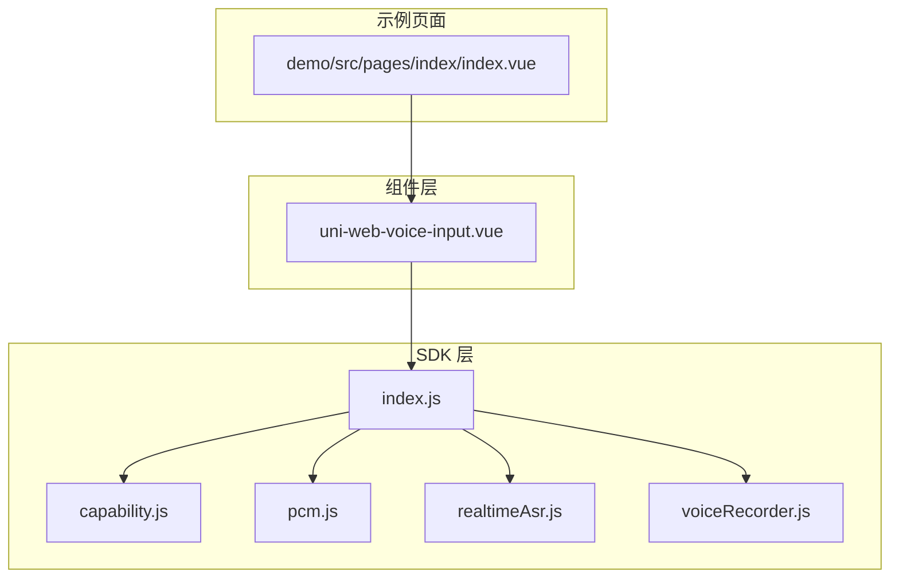
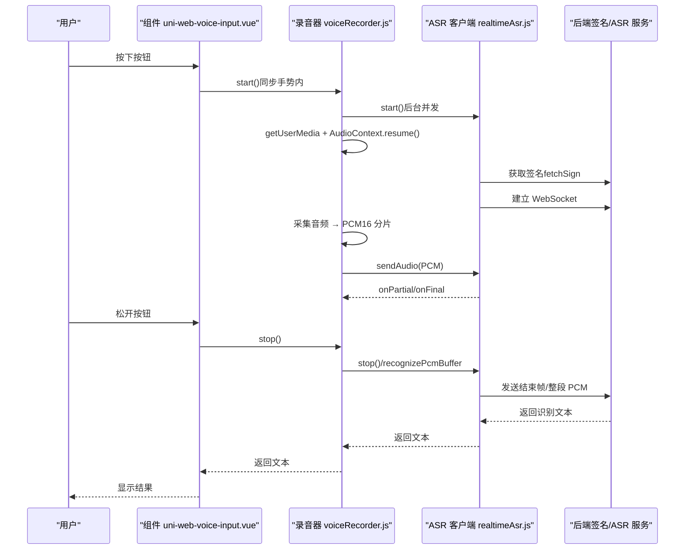
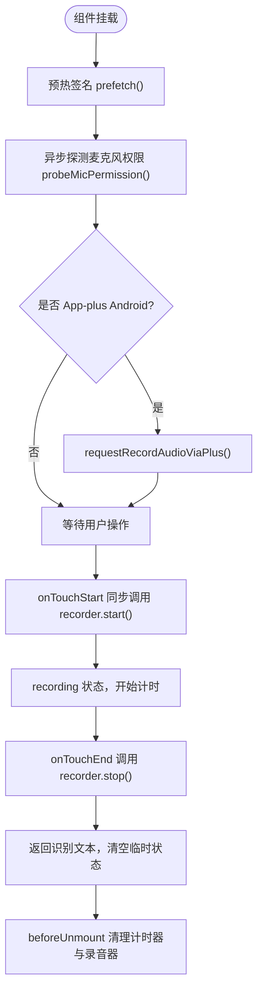
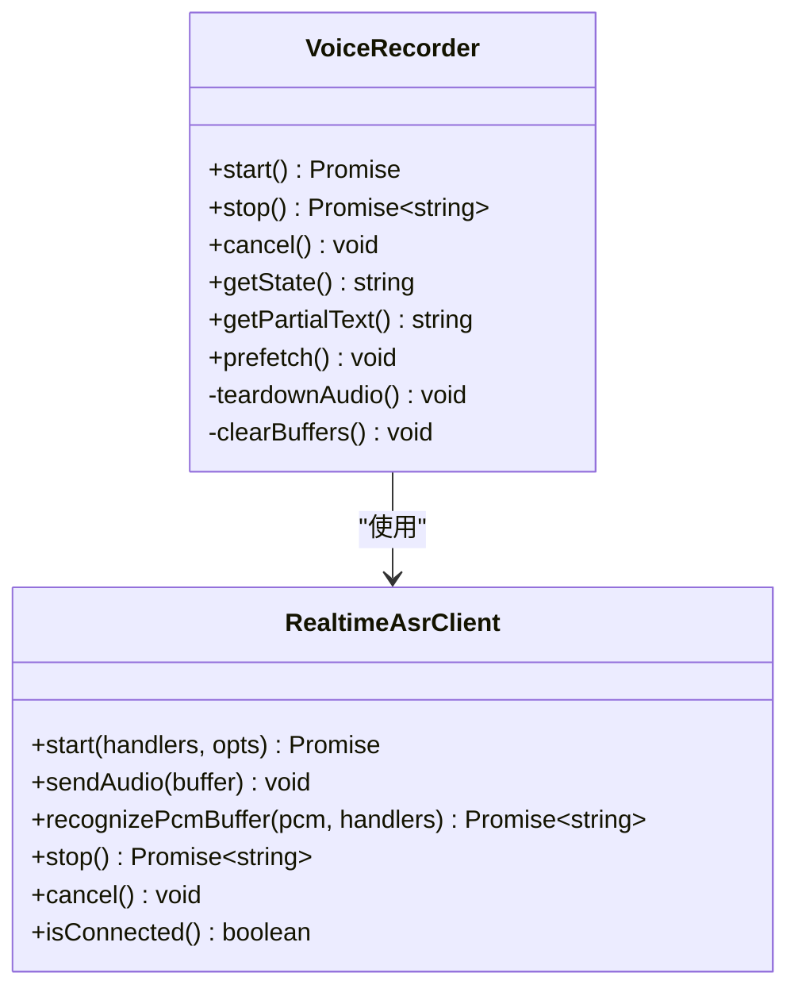
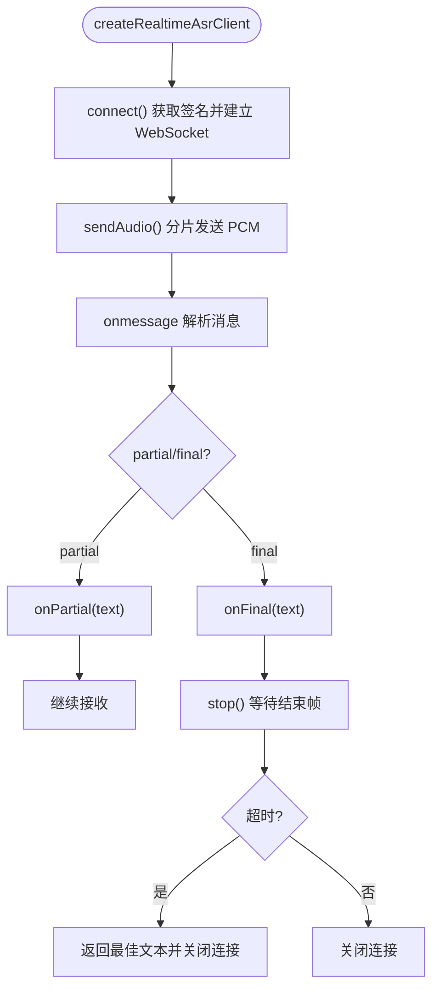
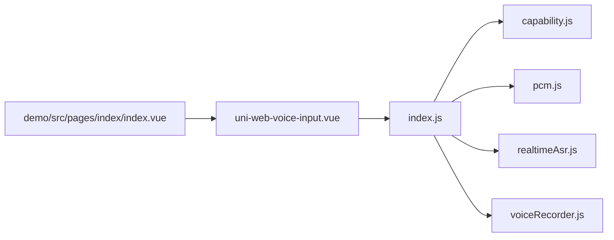

# 安全和隐私保护

<cite>
**本文引用的文件**   
- [README.md](file://README.md)
- [package.json](file://package.json)
- [demo/src/pages/index/index.vue](file://demo/src/pages/index/index.vue)
- [uni_modules/uni-web-voice-input/js_sdk/uni-web-voice/index.js](file://uni_modules/uni-web-voice-input/js_sdk/uni-web-voice/index.js)
- [uni_modules/uni-web-voice-input/js_sdk/uni-web-voice/capability.js](file://uni_modules/uni-web-voice-input/js_sdk/uni-web-voice/capability.js)
- [uni_modules/uni-web-voice-input/js_sdk/uni-web-voice/pcm.js](file://uni_modules/uni-web-voice-input/js_sdk/uni-web-voice/pcm.js)
- [uni_modules/uni-web-voice-input/js_sdk/uni-web-voice/realtimeAsr.js](file://uni_modules/uni-web-voice-input/js_sdk/uni-web-voice/realtimeAsr.js)
- [uni_modules/uni-web-voice-input/js_sdk/uni-web-voice/voiceRecorder.js](file://uni_modules/uni-web-voice-input/js_sdk/uni-web-voice/voiceRecorder.js)
- [uni_modules/uni-web-voice-input/components/uni-web-voice-input/uni-web-voice-input.vue](file://uni_modules/uni-web-voice-input/components/uni-web-voice-input/uni-web-voice-input.vue)
- [demo/src/manifest.json](file://demo/src/manifest.json)
- [demo/vite.config.ts](file://demo/vite.config.ts)
</cite>

## 目录
1. [引言](#引言)
2. [项目结构](#项目结构)
3. [核心组件](#核心组件)
4. [架构总览](#架构总览)
5. [详细组件分析](#详细组件分析)
6. [依赖关系分析](#依赖关系分析)
7. [性能与资源清理](#性能与资源清理)
8. [网络安全措施](#网络安全措施)
9. [权限最小化与移动端安全](#权限最小化与移动端安全)
10. [敏感数据处理与内存清理](#敏感数据处理与内存清理)
11. [隐私合规要求](#隐私合规要求)
12. [安全审计与漏洞防护](#安全审计与漏洞防护)
13. [故障排查指南](#故障排查指南)
14. [结论](#结论)

## 引言
本仓库提供跨端语音输入能力，基于 Web 原生能力（getUserMedia、Web Audio、WebSocket）实现“按住说话、松手出字”，并兼容 H5、App-vue 与各端 WebView（含鸿蒙 ArkWeb）。从安全与隐私视角，本项目涉及麦克风权限、音频流采集、实时语音识别 WebSocket 通信、签名获取、PCM 处理与缓冲、以及错误提示与状态管理。本文围绕以下目标给出可落地的安全与隐私指导：
- 明确敏感数据（音频、识别文本、签名 URL）在传输、本地缓存与内存中的生命周期与清理策略。
- 遵循权限最小化原则，仅在必要时机请求权限，并在完成后释放。
- 强化网络安全：HTTPS 强制、CORS 配置、XSS 防护。
- 满足隐私合规：用户同意机制、数据使用说明与隐私政策。
- 补充移动端特有安全考虑：剪贴板访问、文件存储安全等。
- 提供安全审计与漏洞防护措施建议。

## 项目结构
项目采用 uni_modules 插件结构，包含组件与 JS SDK 两部分：
- 组件层：uni-web-voice-input.vue 负责 UI 交互、手势时序与状态展示。
- SDK 层：capability.js、pcm.js、realtimeAsr.js、voiceRecorder.js 提供能力探测、PCM 转换、实时 ASR 客户端与录音编排。
- 示例工程：demo 目录演示如何注入签名、监听结果与状态。

图表来源
- [demo/src/pages/index/index.vue:17-83](file://demo/src/pages/index/index.vue#L17-L83)
- [uni_modules/uni-web-voice-input/components/uni-web-voice-input/uni-web-voice-input.vue:28-169](file://uni_modules/uni-web-voice-input/components/uni-web-voice-input/uni-web-voice-input.vue#L28-L169)
- [uni_modules/uni-web-voice-input/js_sdk/uni-web-voice/index.js:1-18](file://uni_modules/uni-web-voice-input/js_sdk/uni-web-voice/index.js#L1-L18)

章节来源
- [README.md:1-24](file://README.md#L1-L24)
- [package.json:1-30](file://package.json#L1-L30)

## 核心组件
- 组件 uni-web-voice-input.vue：封装“按住说话”交互，调用 SDK 的 createVoiceRecorder，处理触摸/鼠标事件、计时器、状态与错误提示，并在卸载时清理资源。
- SDK index.js：统一导出能力探测、PCM 工具、实时 ASR 客户端与录音器。
- capability.js：检测是否处于安全上下文、是否支持 getUserMedia、鸿蒙 ArkWeb 判定、Android App-plus 运行时权限申请。
- realtimeAsr.js：实现 WebSocket 实时 ASR 客户端，负责签名刷新、连接、分片发送 PCM、解析服务端消息、超时与错误处理。
- voiceRecorder.js：编排录音流程，保证 getUserMedia 与 AudioContext 在用户手势同步窗口内启动，维护音频链路、PCM 缓冲与兜底整段识别。
- pcm.js：Float32 到 PCM16 的重采样与拼接工具。

章节来源
- [uni_modules/uni-web-voice-input/components/uni-web-voice-input/uni-web-voice-input.vue:28-169](file://uni_modules/uni-web-voice-input/components/uni-web-voice-input/uni-web-voice-input.vue#L28-L169)
- [uni_modules/uni-web-voice-input/js_sdk/uni-web-voice/index.js:1-18](file://uni_modules/uni-web-voice-input/js_sdk/uni-web-voice/index.js#L1-L18)
- [uni_modules/uni-web-voice-input/js_sdk/uni-web-voice/capability.js:14-63](file://uni_modules/uni-web-voice-input/js_sdk/uni-web-voice/capability.js#L14-L63)
- [uni_modules/uni-web-voice-input/js_sdk/uni-web-voice/realtimeAsr.js:78-176](file://uni_modules/uni-web-voice-input/js_sdk/uni-web-voice/realtimeAsr.js#L78-L176)
- [uni_modules/uni-web-voice-input/js_sdk/uni-web-voice/voiceRecorder.js:15-150](file://uni_modules/uni-web-voice-input/js_sdk/uni-web-voice/voiceRecorder.js#L15-L150)
- [uni_modules/uni-web-voice-input/js_sdk/uni-web-voice/pcm.js:6-36](file://uni_modules/uni-web-voice-input/js_sdk/uni-web-voice/pcm.js#L6-L36)

## 架构总览
整体流程如下：
- 用户在组件上触发“按住说话”，组件在同步手势中调用 recorder.start()。
- recorder.start() 并发发起 ASR 签名与连接、getUserMedia 与 AudioContext 创建，确保 user-activation 有效。
- 音频通过 ScriptProcessor 转 PCM16，按固定大小分片发送到 WebSocket。
- 实时 ASR 返回部分或最终文本；若未连上则使用整段 PCM 兜底识别。
- 松手后停止识别、关闭连接、清理音频链路与缓冲区。

图表来源
- [uni_modules/uni-web-voice-input/components/uni-web-voice-input/uni-web-voice-input.vue:180-266](file://uni_modules/uni-web-voice-input/components/uni-web-voice-input/uni-web-voice-input.vue#L180-L266)
- [uni_modules/uni-web-voice-input/js_sdk/uni-web-voice/voiceRecorder.js:156-295](file://uni_modules/uni-web-voice-input/js_sdk/uni-web-voice/voiceRecorder.js#L156-L295)
- [uni_modules/uni-web-voice-input/js_sdk/uni-web-voice/realtimeAsr.js:214-377](file://uni_modules/uni-web-voice-input/js_sdk/uni-web-voice/realtimeAsr.js#L214-L377)

## 详细组件分析

### 组件 uni-web-voice-input.vue
职责与关键点：
- 暴露 getSign/signUrl 两种签名注入方式，优先函数注入。
- 在 mounted 时预热签名、异步探测麦克风权限、必要时自动申请 Android RECORD_AUDIO。
- 在 onTouchStart 同步调用 recorder.start()，避免 user-activation 失效导致无法弹出系统授权。
- 在 touchend/mouseup 调用 recorder.stop()，将识别结果向上抛出。
- 在 beforeUnmount 中取消录音、停止计时器，防止内存泄漏。

图表来源
- [uni_modules/uni-web-voice-input/components/uni-web-voice-input/uni-web-voice-input.vue:130-178](file://uni_modules/uni-web-voice-input/components/uni-web-voice-input/uni-web-voice-input.vue#L130-L178)
- [uni_modules/uni-web-voice-input/components/uni-web-voice-input/uni-web-voice-input.vue:180-266](file://uni_modules/uni-web-voice-input/components/uni-web-voice-input/uni-web-voice-input.vue#L180-L266)

章节来源
- [uni_modules/uni-web-voice-input/components/uni-web-voice-input/uni-web-voice-input.vue:46-169](file://uni_modules/uni-web-voice-input/components/uni-web-voice-input/uni-web-voice-input.vue#L46-L169)
- [uni_modules/uni-web-voice-input/components/uni-web-voice-input/uni-web-voice-input.vue:180-266](file://uni_modules/uni-web-voice-input/components/uni-web-voice-input/uni-web-voice-input.vue#L180-L266)

### 录音器 voiceRecorder.js
职责与关键点：
- 保证 start() 在用户手势同步代码中直接调用，不先 await 网络。
- 并发发起 ASR 连接与 getUserMedia，立即创建 AudioContext 并 resume()。
- 维护 mediaStream、audioContext、scriptProcessor、mediaSourceNode 的生命周期，stop/cancel 时断开与关闭。
- 记录 recordedPcmChunks 用于整段兜底识别，stop 时清理缓冲区。
- 对短录音和无内容进行校验，抛出可读错误信息。

图表来源
- [uni_modules/uni-web-voice-input/js_sdk/uni-web-voice/voiceRecorder.js:60-314](file://uni_modules/uni-web-voice-input/js_sdk/uni-web-voice/voiceRecorder.js#L60-L314)
- [uni_modules/uni-web-voice-input/js_sdk/uni-web-voice/realtimeAsr.js:84-377](file://uni_modules/uni-web-voice-input/js_sdk/uni-web-voice/realtimeAsr.js#L84-L377)

章节来源
- [uni_modules/uni-web-voice-input/js_sdk/uni-web-voice/voiceRecorder.js:15-150](file://uni_modules/uni-web-voice-input/js_sdk/uni-web-voice/voiceRecorder.js#L15-L150)
- [uni_modules/uni-web-voice-input/js_sdk/uni-web-voice/voiceRecorder.js:156-295](file://uni_modules/uni-web-voice-input/js_sdk/uni-web-voice/voiceRecorder.js#L156-L295)

### 实时 ASR 客户端 realtimeAsr.js
职责与关键点：
- 通过 fetchSign 获取已签名的 wss URL，支持多种字段名。
- 连接超时、识别超时、服务端错误码映射为可读文案。
- 分片发送 PCM，间隔控制，避免拥塞。
- 缓存签名与过期时间，提前刷新减少首次延迟。
- stop 后等待服务端 final 消息，超时则返回最佳文本。

图表来源
- [uni_modules/uni-web-voice-input/js_sdk/uni-web-voice/realtimeAsr.js:151-212](file://uni_modules/uni-web-voice-input/js_sdk/uni-web-voice/realtimeAsr.js#L151-L212)
- [uni_modules/uni-web-voice-input/js_sdk/uni-web-voice/realtimeAsr.js:214-315](file://uni_modules/uni-web-voice-input/js_sdk/uni-web-voice/realtimeAsr.js#L214-L315)
- [uni_modules/uni-web-voice-input/js_sdk/uni-web-voice/realtimeAsr.js:317-377](file://uni_modules/uni-web-voice-input/js_sdk/uni-web-voice/realtimeAsr.js#L317-L377)

章节来源
- [uni_modules/uni-web-voice-input/js_sdk/uni-web-voice/realtimeAsr.js:78-176](file://uni_modules/uni-web-voice-input/js_sdk/uni-web-voice/realtimeAsr.js#L78-L176)
- [uni_modules/uni-web-voice-input/js_sdk/uni-web-voice/realtimeAsr.js:214-377](file://uni_modules/uni-web-voice-input/js_sdk/uni-web-voice/realtimeAsr.js#L214-L377)

### 能力探测 capability.js
职责与关键点：
- isSecureContext：判断是否为 HTTPS 或 localhost。
- canUseWebMic：综合安全上下文与 getUserMedia 可用性。
- getMicBlockReason：返回不可用原因文案，便于前端提示。
- probeMicPermission：异步探测 microphone 权限状态，兼容不支持的环境。
- isAppPlusAndroid/requestRecordAudioViaPlus：针对 Android App-plus 运行时权限申请。

章节来源
- [uni_modules/uni-web-voice-input/js_sdk/uni-web-voice/capability.js:14-63](file://uni_modules/uni-web-voice-input/js_sdk/uni-web-voice/capability.js#L14-L63)
- [uni_modules/uni-web-voice-input/js_sdk/uni-web-voice/capability.js:65-137](file://uni_modules/uni-web-voice-input/js_sdk/uni-web-voice/capability.js#L65-L137)

### PCM 工具 pcm.js
职责与关键点：
- floatToPcm16k：线性重采样 Float32 到 Int16，默认 16kHz 单声道。
- concatPcmChunks：拼接多个 Uint8Array 片段为 ArrayBuffer，用于整段兜底识别。

章节来源
- [uni_modules/uni-web-voice-input/js_sdk/uni-web-voice/pcm.js:6-36](file://uni_modules/uni-web-voice-input/js_sdk/uni-web-voice/pcm.js#L6-L36)

## 依赖关系分析
- 组件依赖 SDK 的统一入口 index.js。
- index.js 再分别依赖 capability.js、pcm.js、realtimeAsr.js、voiceRecorder.js。
- demo 示例页通过 uni_modules 路径引入组件与 SDK，演示签名注入与事件监听。

图表来源
- [demo/src/pages/index/index.vue:34-83](file://demo/src/pages/index/index.vue#L34-L83)
- [uni_modules/uni-web-voice-input/js_sdk/uni-web-voice/index.js:1-18](file://uni_modules/uni-web-voice-input/js_sdk/uni-web-voice/index.js#L1-L18)

章节来源
- [demo/src/pages/index/index.vue:34-83](file://demo/src/pages/index/index.vue#L34-L83)
- [uni_modules/uni-web-voice-input/js_sdk/uni-web-voice/index.js:1-18](file://uni_modules/uni-web-voice-input/js_sdk/uni-web-voice/index.js#L1-L18)

## 性能与资源清理
- 音频链路清理：voiceRecorder.js 在 teardownAudio 中断开 scriptProcessor、mediaSourceNode，关闭 audioContext，停止 mediaStream tracks。
- 缓冲区清理：clearBuffers 重置 receivedPcmBytes、recordedPcmChunks、lastPartial/lastFinal、startedAt、manualCancel。
- 计时器清理：组件在 beforeUnmount 中 clearInterval，避免重复计时。
- WebSocket 清理：realtimeAsr.js 在 closeSocket 中清除定时器并关闭 socket。

章节来源
- [uni_modules/uni-web-voice-input/js_sdk/uni-web-voice/voiceRecorder.js:116-150](file://uni_modules/uni-web-voice-input/js_sdk/uni-web-voice/voiceRecorder.js#L116-L150)
- [uni_modules/uni-web-voice-input/components/uni-web-voice-input/uni-web-voice-input.vue:171-178](file://uni_modules/uni-web-voice-input/components/uni-web-voice-input/uni-web-voice-input.vue#L171-L178)
- [uni_modules/uni-web-voice-input/js_sdk/uni-web-voice/realtimeAsr.js:116-131](file://uni_modules/uni-web-voice-input/js_sdk/uni-web-voice/realtimeAsr.js#L116-L131)

## 网络安全措施
- HTTPS 强制：
  - capability.js 的 isSecureContext 检查 isSecureContext 或 location.protocol === 'https:'，否则 getMicBlockReason 返回非安全环境提示。
  - 示例页注释强调鸿蒙内嵌需页面为 HTTPS。
- CORS 配置：
  - 签名接口与 ASR WebSocket 由后端提供，需在服务器端正确配置 CORS，允许前端域名访问。
  - 示例中使用 uni.request 与 fetch 获取签名，需确保响应头允许跨域。
- XSS 防护：
  - 组件输出识别文本时使用模板绑定，避免 innerHTML 直接渲染。
  - 建议在业务层对识别文本做二次过滤与转义，避免注入脚本。

章节来源
- [uni_modules/uni-web-voice-input/js_sdk/uni-web-voice/capability.js:28-63](file://uni_modules/uni-web-voice-input/js_sdk/uni-web-voice/capability.js#L28-L63)
- [demo/src/pages/index/index.vue:26-30](file://demo/src/pages/index/index.vue#L26-L30)
- [uni_modules/uni-web-voice-input/components/uni-web-voice-input/uni-web-voice-input.vue:1-26](file://uni_modules/uni-web-voice-input/components/uni-web-voice-input/uni-web-voice-input.vue#L1-L26)

## 权限最小化与移动端安全
- 权限最小化：
  - 仅在使用麦克风时请求权限，通过 probeMicPermission 异步探测，避免阻塞。
  - Android App-plus 环境下，组件在 mounted 时尝试 requestRecordAudioViaPlus，失败时在录音启动失败时再次引导用户授权。
- 移动端特有安全：
  - 剪贴板访问：若业务需要读取剪贴板，应仅在用户主动触发时请求，并明确告知用途。
  - 文件存储安全：避免将原始 PCM 或识别文本写入外部可访问目录；如需持久化，应加密存储并限制访问范围。
  - 权限声明：示例 manifest.json 中声明了 android.permission.RECORD_AUDIO，符合最小权限原则。

章节来源
- [uni_modules/uni-web-voice-input/components/uni-web-voice-input/uni-web-voice-input.vue:157-168](file://uni_modules/uni-web-voice-input/components/uni-web-voice-input/uni-web-voice-input.vue#L157-L168)
- [uni_modules/uni-web-voice-input/components/uni-web-voice-input/uni-web-voice-input.vue:192-206](file://uni_modules/uni-web-voice-input/components/uni-web-voice-input/uni-web-voice-input.vue#L192-L206)
- [demo/src/manifest.json:9-19](file://demo/src/manifest.json#L9-L19)

## 敏感数据处理与内存清理
- 音频数据：
  - 通过 ScriptProcessor 获取 Float32 数据，转换为 PCM16 后分片发送，不在浏览器侧持久化。
  - recordedPcmChunks 仅用于短时兜底识别，stop 后清理。
- 识别文本：
  - 实时文本通过 onPartial/onFinal 回调给上层，组件内部仅保留 lastPartial/lastFinal，stop 后清理。
- 签名与 URL：
  - realtimeAsr.js 缓存 cachedWsUrl 与 cachedExpire，在过期前刷新，避免频繁请求。
  - 签名 URL 由业务后端提供，不应硬编码在前端。
- 内存清理：
  - teardownAudio 断开节点、关闭 AudioContext、停止媒体轨道。
  - clearBuffers 清空缓冲与状态变量。
  - beforeUnmount 清理计时器与录音器。

章节来源
- [uni_modules/uni-web-voice-input/js_sdk/uni-web-voice/voiceRecorder.js:208-224](file://uni_modules/uni-web-voice-input/js_sdk/uni-web-voice/voiceRecorder.js#L208-L224)
- [uni_modules/uni-web-voice-input/js_sdk/uni-web-voice/voiceRecorder.js:276-295](file://uni_modules/uni-web-voice-input/js_sdk/uni-web-voice/voiceRecorder.js#L276-L295)
- [uni_modules/uni-web-voice-input/js_sdk/uni-web-voice/realtimeAsr.js:105-114](file://uni_modules/uni-web-voice-input/js_sdk/uni-web-voice/realtimeAsr.js#L105-L114)
- [uni_modules/uni-web-voice-input/js_sdk/uni-web-voice/realtimeAsr.js:170-176](file://uni_modules/uni-web-voice-input/js_sdk/uni-web-voice/realtimeAsr.js#L170-L176)

## 隐私合规要求
- 用户同意机制：
  - 在用户主动触发录音时请求麦克风权限，避免静默收集。
  - 若权限被拒绝，显示友好提示并引导用户前往系统设置开启。
- 数据使用说明：
  - 在界面或帮助文档中说明录音用途、识别结果去向、是否上传至第三方服务。
- 隐私政策：
  - 明确数据存储期限、删除机制、用户撤回同意的途径。
  - 对于云端识别，应提供数据脱敏与最小化传输策略。

[本节为通用合规指导，不直接分析具体文件]

## 安全审计与漏洞防护措施
- 代码审计要点：
  - 检查是否存在明文日志打印敏感信息（如签名 URL、识别文本）。
  - 确认所有网络请求均走 HTTPS，WebSocket 使用 wss。
  - 验证权限请求仅在必要场景触发，且用户可随时撤销。
- 漏洞防护建议：
  - 对识别文本进行输入过滤与输出转义，防止 XSS。
  - 限制 WebSocket 连接频率与时长，防止资源耗尽。
  - 对签名接口实施鉴权与限流，防止滥用。
- 监控与告警：
  - 记录识别失败率、连接超时率、权限拒绝率，设置阈值告警。
  - 对异常错误码（如 4001/4002/4003/4004）进行专项监控。

[本节为通用安全建议，不直接分析具体文件]

## 故障排查指南
- 常见错误与处理：
  - 麦克风权限被拒绝：提示用户前往系统设置授权。
  - 无设备或设备被占用：提示更换设备或关闭占用应用。
  - 非安全环境（HTTP）：改用 HTTPS 或在 App 内重试。
  - 签名请求失败：检查 SIGN_URL 与网络连通性。
  - 识别超时：检查网络与服务端状态，重试或缩短录音时长。
- 调试建议：
  - 启用 debug 模式打印关键日志，但生产环境关闭以避免泄露。
  - 在开发环境使用 localhost，注意浏览器对本地文件的限制。

章节来源
- [uni_modules/uni-web-voice-input/js_sdk/uni-web-voice/voiceRecorder.js:25-41](file://uni_modules/uni-web-voice-input/js_sdk/uni-web-voice/voiceRecorder.js#L25-L41)
- [uni_modules/uni-web-voice-input/js_sdk/uni-web-voice/capability.js:52-63](file://uni_modules/uni-web-voice-input/js_sdk/uni-web-voice/capability.js#L52-L63)
- [demo/src/pages/index/index.vue:59-75](file://demo/src/pages/index/index.vue#L59-L75)

## 结论
本项目通过纯 Web 能力实现跨端语音输入，具备较好的兼容性与时序修复。从安全与隐私角度，应重点关注：
- 严格 HTTPS 与 wss 通信，避免明文传输。
- 权限最小化与及时释放，避免长期持有敏感资源。
- 敏感数据（音频、识别文本、签名）在内存中的短期存在与及时清理。
- 用户同意机制与透明数据使用说明，满足隐私合规。
- 持续的安全审计与漏洞防护，结合监控与告警提升系统韧性。

[本节为总结性内容，不直接分析具体文件]