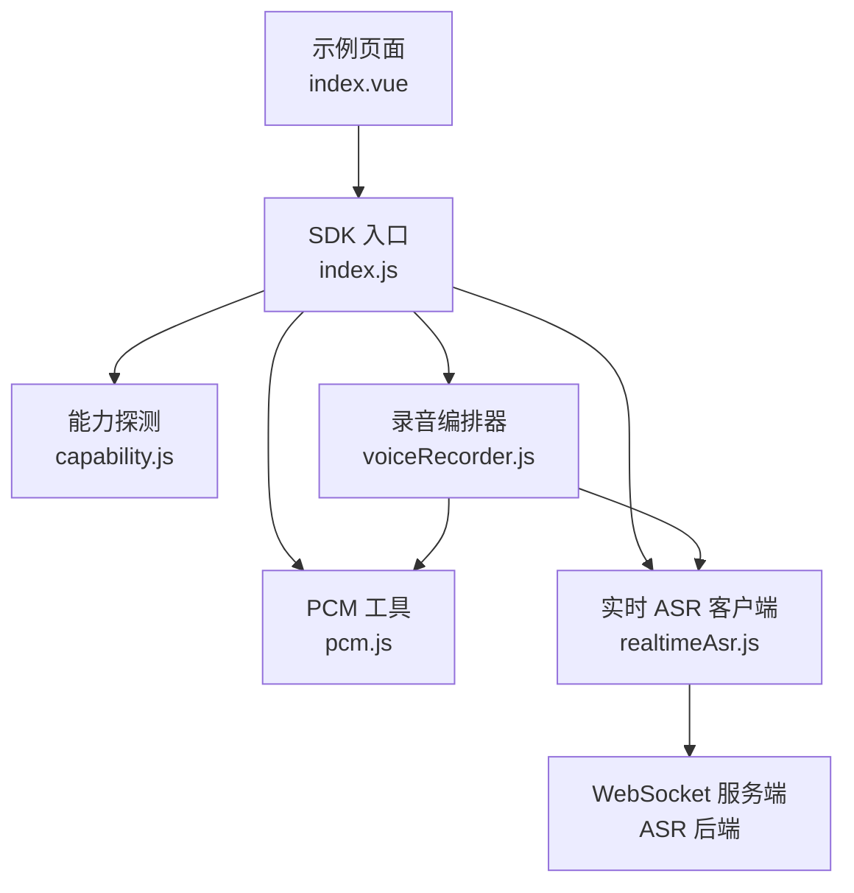
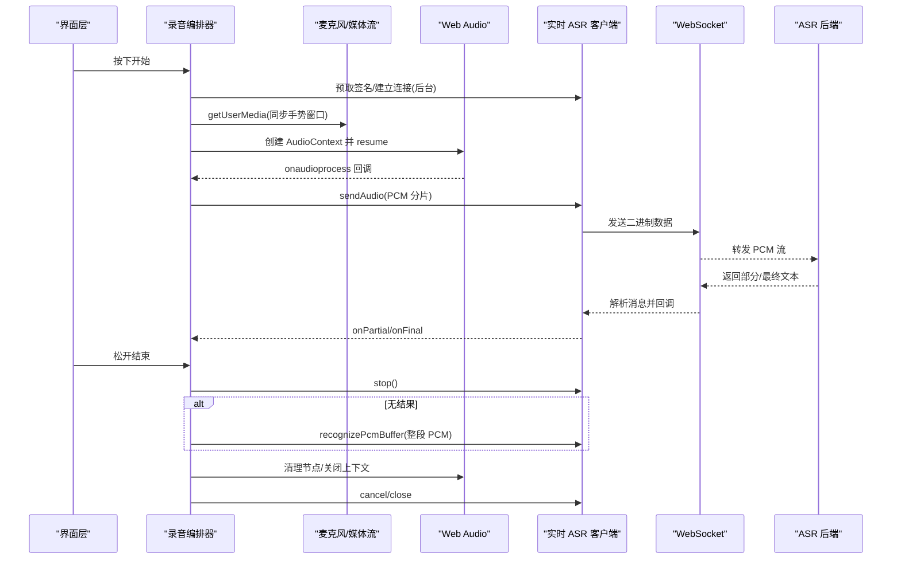
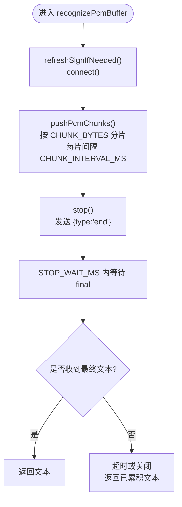
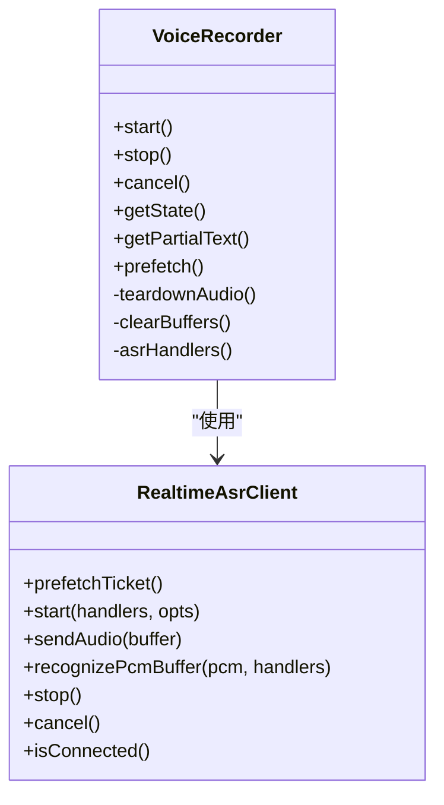
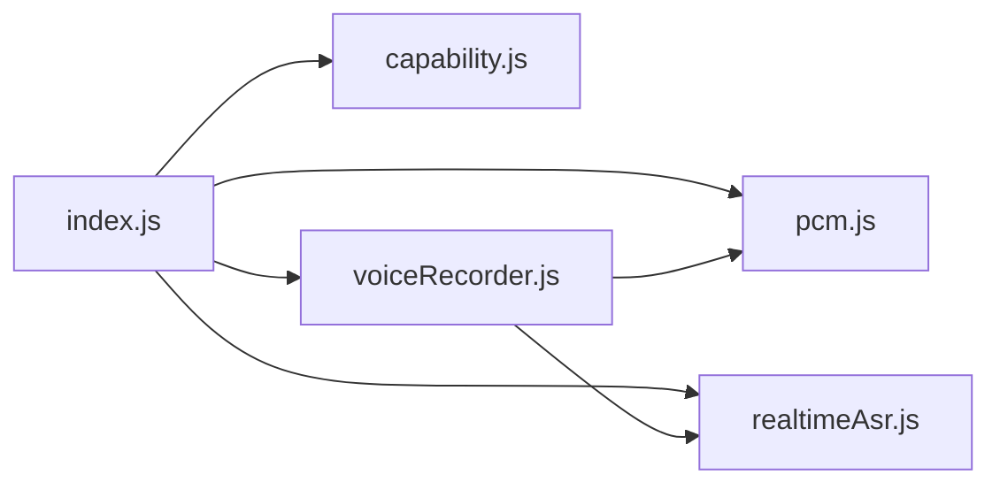

# 性能优化技巧

<cite>
**本文引用的文件**   
- [README.md](file://README.md)
- [index.js](file://uni_modules/uni-web-voice-input/js_sdk/uni-web-voice/index.js)
- [capability.js](file://uni_modules/uni-web-voice-input/js_sdk/uni-web-voice/capability.js)
- [pcm.js](file://uni_modules/uni-web-voice-input/js_sdk/uni-web-voice/pcm.js)
- [realtimeAsr.js](file://uni_modules/uni-web-voice-input/js_sdk/uni-web-voice/realtimeAsr.js)
- [voiceRecorder.js](file://uni_modules/uni-web-voice-input/js_sdk/uni-web-voice/voiceRecorder.js)
- [index.vue](file://demo/src/pages/index/index.vue)
</cite>

## 目录
1. [引言](#引言)
2. [项目结构](#项目结构)
3. [核心组件](#核心组件)
4. [架构总览](#架构总览)
5. [详细组件分析](#详细组件分析)
6. [依赖关系分析](#依赖关系分析)
7. [性能优化策略](#性能优化策略)
8. [监控与诊断](#监控与诊断)
9. [设备与网络适配建议](#设备与网络适配建议)
10. [故障排查指南](#故障排查指南)
11. [结论](#结论)

## 引言
本仓库提供一套面向 H5、App-vue 与各端 WebView（含鸿蒙 ArkWeb）的纯 Web 语音输入方案，核心链路为：麦克风采集 → Web Audio 转 PCM → WebSocket 实时 ASR；同时提供整段 PCM 兜底识别。围绕该链路，本文从音频缓冲策略、WebSocket 连接管理、内存使用优化、监控与诊断、以及多设备与网络环境适配等维度，给出可落地的性能优化指导。

## 项目结构
- SDK 入口统一导出能力探测、PCM 工具、实时 ASR 客户端与录音编排器。
- 实时 ASR 客户端负责签名获取、WebSocket 连接、分片发送与结果回调。
- 录音编排器封装 getUserMedia + Web Audio 采音、PCM 转换、ASR 流式推送与兜底整段识别。
- 示例页面演示如何通过 getSign 注入签名并绑定识别结果、实时文本与状态变化。

**图表来源**
- [index.js:6-17](file://uni_modules/uni-web-voice-input/js_sdk/uni-web-voice/index.js#L6-L17)
- [index.vue:17-24](file://demo/src/pages/index/index.vue#L17-L24)

**章节来源**
- [README.md:1-24](file://README.md#L1-L24)
- [index.js:1-18](file://uni_modules/uni-web-voice-input/js_sdk/uni-web-voice/index.js#L1-L18)

## 核心组件
- 能力探测：安全上下文、跨端检测、权限探测与提示文案。
- PCM 工具：Float32 到 PCM16 的重采样与拼接。
- 实时 ASR 客户端：签名缓存、WebSocket 连接、分片推流、超时与错误处理。
- 录音编排器：用户手势同步启动、AudioContext 恢复、ScriptProcessor 采音、ASR 流式与整段兜底。

**章节来源**
- [capability.js:14-63](file://uni_modules/uni-web-voice-input/js_sdk/uni-web-voice/capability.js#L14-L63)
- [pcm.js:6-24](file://uni_modules/uni-web-voice-input/js_sdk/uni-web-voice/pcm.js#L6-L24)
- [realtimeAsr.js:78-115](file://uni_modules/uni-web-voice-input/js_sdk/uni-web-voice/realtimeAsr.js#L78-L115)
- [voiceRecorder.js:47-94](file://uni_modules/uni-web-voice-input/js_sdk/uni-web-voice/voiceRecorder.js#L47-L94)

## 架构总览
整体流程如下：
- 用户按下按钮触发 start，在同步手势窗口内并发发起 ASR 签名与 WebSocket 连接、getUserMedia 与 AudioContext 创建。
- ScriptProcessor 回调中把 Float32 转为 PCM16，按固定大小分片通过 WebSocket 推送。
- 松手后先尝试结束流式识别；若未得到文本，则用缓存的整段 PCM 进行兜底识别。
- 所有资源在结束时清理，避免泄漏。

**图表来源**
- [voiceRecorder.js:156-240](file://uni_modules/uni-web-voice-input/js_sdk/uni-web-voice/voiceRecorder.js#L156-L240)
- [voiceRecorder.js:246-295](file://uni_modules/uni-web-voice-input/js_sdk/uni-web-voice/voiceRecorder.js#L246-L295)
- [realtimeAsr.js:214-272](file://uni_modules/uni-web-voice-input/js_sdk/uni-web-voice/realtimeAsr.js#L214-L272)
- [realtimeAsr.js:286-315](file://uni_modules/uni-web-voice-input/js_sdk/uni-web-voice/realtimeAsr.js#L286-L315)

## 详细组件分析

### 实时 ASR 客户端
职责：
- 获取并缓存签名 URL，支持过期前刷新。
- 建立 WebSocket 连接，设置二进制类型，处理连接超时、失败与关闭。
- 将 PCM 数据按固定字节数切分并以固定间隔发送，降低瞬时吞吐压力。
- 解析服务端消息，区分部分结果与最终结果，并在 final 时结束会话。
- 提供取消、停止、连接状态查询等方法。

关键参数与行为：
- 连接超时、识别超时、停止等待时间、签名提前刷新偏移、分片大小与间隔。
- 错误码映射与鉴权失败时的签名缓存清理。

**图表来源**
- [realtimeAsr.js:151-176](file://uni_modules/uni-web-voice-input/js_sdk/uni-web-voice/realtimeAsr.js#L151-L176)
- [realtimeAsr.js:214-272](file://uni_modules/uni-web-voice-input/js_sdk/uni-web-voice/realtimeAsr.js#L214-L272)
- [realtimeAsr.js:286-315](file://uni_modules/uni-web-voice-input/js_sdk/uni-web-voice/realtimeAsr.js#L286-L315)
- [realtimeAsr.js:332-364](file://uni_modules/uni-web-voice-input/js_sdk/uni-web-voice/realtimeAsr.js#L332-L364)

**章节来源**
- [realtimeAsr.js:10-17](file://uni_modules/uni-web-voice-input/js_sdk/uni-web-voice/realtimeAsr.js#L10-L17)
- [realtimeAsr.js:178-212](file://uni_modules/uni-web-voice-input/js_sdk/uni-web-voice/realtimeAsr.js#L178-L212)
- [realtimeAsr.js:317-378](file://uni_modules/uni-web-voice-input/js_sdk/uni-web-voice/realtimeAsr.js#L317-L378)

### 录音编排器
职责：
- 在用户手势同步窗口内并发发起 ASR 连接与麦克风请求，确保权限弹窗正常触发。
- 创建并恢复 AudioContext，避免 suspended 导致无声。
- 通过 ScriptProcessor 获取 Float32 数据，转换为 PCM16 并分片发送到 ASR。
- 维护整段 PCM 缓存用于兜底识别，限制缓存数量防止内存暴涨。
- 根据时长与内容判断短语音，必要时直接拒绝并提示。

**图表来源**
- [voiceRecorder.js:60-94](file://uni_modules/uni-web-voice-input/js_sdk/uni-web-voice/voiceRecorder.js#L60-L94)
- [voiceRecorder.js:156-240](file://uni_modules/uni-web-voice-input/js_sdk/uni-web-voice/voiceRecorder.js#L156-L240)
- [voiceRecorder.js:246-295](file://uni_modules/uni-web-voice-input/js_sdk/uni-web-voice/voiceRecorder.js#L246-L295)
- [realtimeAsr.js:317-378](file://uni_modules/uni-web-voice-input/js_sdk/uni-web-voice/realtimeAsr.js#L317-L378)

**章节来源**
- [voiceRecorder.js:1-13](file://uni_modules/uni-web-voice-input/js_sdk/uni-web-voice/voiceRecorder.js#L1-L13)
- [voiceRecorder.js:116-150](file://uni_modules/uni-web-voice-input/js_sdk/uni-web-voice/voiceRecorder.js#L116-L150)
- [voiceRecorder.js:208-229](file://uni_modules/uni-web-voice-input/js_sdk/uni-web-voice/voiceRecorder.js#L208-L229)

### PCM 工具
职责：
- 将 Float32 线性重采样为目标采样率的 PCM16 小端字节数组。
- 将多个 PCM 片段拼接为完整 ArrayBuffer，供整段兜底识别使用。

复杂度与注意事项：
- floatToPcm16k 为 O(n)，n 为输出样本数；concatPcmChunks 为 O(m)，m 为总字节数。
- 注意目标采样率与 ASR 后端要求一致，避免失真或识别失败。

**章节来源**
- [pcm.js:6-24](file://uni_modules/uni-web-voice-input/js_sdk/uni-web-voice/pcm.js#L6-L24)
- [pcm.js:26-36](file://uni_modules/uni-web-voice-input/js_sdk/uni-web-voice/pcm.js#L26-L36)

### 能力探测
职责：
- 判定是否运行在鸿蒙 ArkWeb、是否安全上下文、是否可用网页麦克风。
- 提供权限探测与平台特定权限申请辅助函数。

**章节来源**
- [capability.js:14-26](file://uni_modules/uni-web-voice-input/js_sdk/uni-web-voice/capability.js#L14-L26)
- [capability.js:28-46](file://uni_modules/uni-web-voice-input/js_sdk/uni-web-voice/capability.js#L28-L46)
- [capability.js:65-83](file://uni_modules/uni-web-voice-input/js_sdk/uni-web-voice/capability.js#L65-L83)
- [capability.js:85-137](file://uni_modules/uni-web-voice-input/js_sdk/uni-web-voice/capability.js#L85-L137)

## 依赖关系分析
- index.js 作为统一出口，聚合 capability、pcm、realtimeAsr、voiceRecorder。
- voiceRecorder 依赖 realtimeAsr 与 pcm，并通过 capability 获取错误描述与环境信息。
- realtimeAsr 不依赖业务 API，仅依赖注入的 fetchSign 与 WebSocket 实现。

**图表来源**
- [index.js:6-17](file://uni_modules/uni-web-voice-input/js_sdk/uni-web-voice/index.js#L6-L17)
- [voiceRecorder.js:15-17](file://uni_modules/uni-web-voice-input/js_sdk/uni-web-voice/voiceRecorder.js#L15-L17)

**章节来源**
- [index.js:1-18](file://uni_modules/uni-web-voice-input/js_sdk/uni-web-voice/index.js#L1-L18)
- [voiceRecorder.js:15-17](file://uni_modules/uni-web-voice-input/js_sdk/uni-web-voice/voiceRecorder.js#L15-L17)

## 性能优化策略

### 音频缓冲策略
- 缓冲区大小调优
  - ScriptProcessor 的 bufferSize 默认 4096，可在不同设备上调整以平衡延迟与稳定性。较小值可降低延迟但可能增加回调频率；较大值更稳定但延迟略高。
  - 参考位置：[voiceRecorder.js:60-71](file://uni_modules/uni-web-voice-input/js_sdk/uni-web-voice/voiceRecorder.js#L60-L71)
- 数据分片传输
  - PCM 分片大小 CHUNK_BYTES=3200，间隔 CHUNK_INTERVAL_MS=40，有助于在网络抖动下平滑吞吐，避免突发拥塞。
  - 参考位置：[realtimeAsr.js:10-17](file://uni_modules/uni-web-voice-input/js_sdk/uni-web-voice/realtimeAsr.js#L10-L17)、[realtimeAsr.js:286-296](file://uni_modules/uni-web-voice-input/js_sdk/uni-web-voice/realtimeAsr.js#L286-L296)
- 流式处理优化
  - 仅在 ASR 连接就绪后才开始采音并发送，减少无效数据与首包丢失影响。
  - 参考位置：[voiceRecorder.js:208-224](file://uni_modules/uni-web-voice-input/js_sdk/uni-web-voice/voiceRecorder.js#L208-L224)

### WebSocket 连接池管理与可靠性
- 连接复用与签名缓存
  - 对签名 URL 与过期时间进行缓存，并在过期前 SIGN_SKEW_SEC 秒主动刷新，减少重复鉴权开销。
  - 参考位置：[realtimeAsr.js:151-176](file://uni_modules/uni-web-voice-input/js_sdk/uni-web-voice/realtimeAsr.js#L151-L176)
- 负载均衡
  - 当前实现为单连接直连；如需多路负载，可在上层对多个 wssUrl 做轮询或权重选择，并结合心跳与连通性探测。
- 断线重连策略
  - 连接超时 CONNECT_TIMEOUT_MS、识别超时 RECOGNIZE_TIMEOUT_MS、停止等待 STOP_WAIT_MS 提供基础保护；可在上层对鉴权失败（如 4001/4002/4003/4004）清空缓存并重试。
  - 参考位置：[realtimeAsr.js:10-17](file://uni_modules/uni-web-voice-input/js_sdk/uni-web-voice/realtimeAsr.js#L10-L17)、[realtimeAsr.js:178-212](file://uni_modules/uni-web-voice-input/js_sdk/uni-web-voice/realtimeAsr.js#L178-L212)

### 内存使用优化
- 音频数据清理
  - teardownAudio 断开节点、关闭 AudioContext、停止媒体轨道，避免资源泄漏。
  - clearBuffers 重置计数与缓存，释放 lastPartial/lastFinal 引用。
  - 参考位置：[voiceRecorder.js:116-150](file://uni_modules/uni-web-voice-input/js_sdk/uni-web-voice/voiceRecorder.js#L116-L150)
- 对象池化与缓存控制
  - recordedPcmChunks 限制最大长度（例如小于 400），避免长语音占用过多内存；整段拼接仅在兜底识别时执行。
  - 参考位置：[voiceRecorder.js:217-223](file://uni_modules/uni-web-voice-input/js_sdk/uni-web-voice/voiceRecorder.js#L217-L223)、[voiceRecorder.js:276-278](file://uni_modules/uni-web-voice-input/js_sdk/uni-web-voice/voiceRecorder.js#L276-L278)
- 垃圾回收优化
  - 及时置空引用（如 scriptProcessor、mediaSourceNode、audioContext、mediaStream），帮助 GC 回收。
  - 参考位置：[voiceRecorder.js:116-141](file://uni_modules/uni-web-voice-input/js_sdk/uni-web-voice/voiceRecorder.js#L116-L141)

### 性能指标收集与瓶颈定位
- 指标建议
  - 连接耗时：connect 成功耗时、首次 onopen 时间。
  - 分片吞吐：每秒发送分片数、平均分片大小、丢包/重传（由后端统计）。
  - 识别延迟：onPartial 到 onFinal 的时间差、端到端延迟（start 到 onFinal）。
  - 资源占用：AudioContext 存活时间、recordedPcmChunks 峰值长度、内存峰值。
- 定位方法
  - 开启 debug 模式打印日志，观察握手、消息与错误路径。
  - 结合浏览器/WebView 开发者工具的性能面板，观察脚本 CPU 与主线程阻塞情况。
  - 参考位置：[realtimeAsr.js:95-103](file://uni_modules/uni-web-voice-input/js_sdk/uni-web-voice/realtimeAsr.js#L95-L103)、[voiceRecorder.js:60-71](file://uni_modules/uni-web-voice-input/js_sdk/uni-web-voice/voiceRecorder.js#L60-L71)

## 监控与诊断
- 调试开关
  - realtimeAsr 与 voiceRecorder 均支持 debug 选项，便于在生产环境按需开启。
  - 参考位置：[realtimeAsr.js:84-103](file://uni_modules/uni-web-voice-input/js_sdk/uni-web-voice/realtimeAsr.js#L84-L103)、[voiceRecorder.js:60-71](file://uni_modules/uni-web-voice-input/js_sdk/uni-web-voice/voiceRecorder.js#L60-L71)
- 错误分类与提示
  - describeMicError 将 DOMException/Error 映射为可读中文文案，覆盖权限拒绝、设备缺失、占用、约束不满足等场景。
  - formatAsrServerError 对常见错误码进行友好提示，并在鉴权失败时清理签名缓存。
  - 参考位置：[voiceRecorder.js:25-41](file://uni_modules/uni-web-voice-input/js_sdk/uni-web-voice/voiceRecorder.js#L25-L41)、[realtimeAsr.js:43-49](file://uni_modules/uni-web-voice-input/js_sdk/uni-web-voice/realtimeAsr.js#L43-L49)

**章节来源**
- [voiceRecorder.js:25-41](file://uni_modules/uni-web-voice-input/js_sdk/uni-web-voice/voiceRecorder.js#L25-L41)
- [realtimeAsr.js:43-49](file://uni_modules/uni-web-voice-input/js_sdk/uni-web-voice/realtimeAsr.js#L43-L49)

## 设备与网络适配建议
- 鸿蒙 ArkWeb
  - 必须在用户手势同步窗口内调用 getUserMedia 与创建 AudioContext，否则不会弹出权限框或无声。
  - 参考位置：[voiceRecorder.js:1-13](file://uni_modules/uni-web-voice-input/js_sdk/uni-web-voice/voiceRecorder.js#L1-L13)、[voiceRecorder.js:168-178](file://uni_modules/uni-web-voice-input/js_sdk/uni-web-voice/voiceRecorder.js#L168-L178)
- 安全上下文
  - 必须 HTTPS 或 localhost；否则无法使用网页麦克风。
  - 参考位置：[capability.js:28-39](file://uni_modules/uni-web-voice-input/js_sdk/uni-web-voice/capability.js#L28-L39)
- App-plus Android
  - 可通过 requestRecordAudioViaPlus 申请系统录音权限，再走 getUserMedia。
  - 参考位置：[capability.js:85-137](file://uni_modules/uni-web-voice-input/js_sdk/uni-web-voice/capability.js#L85-L137)
- 弱网环境
  - 适当增大 CHUNK_INTERVAL_MS 以降低瞬时压力；缩短 STOP_WAIT_MS 以减少等待；启用兜底整段识别提升成功率。
  - 参考位置：[realtimeAsr.js:10-17](file://uni_modules/uni-web-voice-input/js_sdk/uni-web-voice/realtimeAsr.js#L10-L17)、[voiceRecorder.js:276-278](file://uni_modules/uni-web-voice-input/js_sdk/uni-web-voice/voiceRecorder.js#L276-L278)

**章节来源**
- [capability.js:28-39](file://uni_modules/uni-web-voice-input/js_sdk/uni-web-voice/capability.js#L28-L39)
- [capability.js:85-137](file://uni_modules/uni-web-voice-input/js_sdk/uni-web-voice/capability.js#L85-L137)
- [voiceRecorder.js:168-178](file://uni_modules/uni-web-voice-input/js_sdk/uni-web-voice/voiceRecorder.js#L168-L178)

## 故障排查指南
- 常见问题
  - 按住无反应：检查是否在用户手势同步窗口内调用 start，并确保 AudioContext 已 resume。
  - 有权限却零 PCM：确认 AudioContext 非 suspended，且 onaudioprocess 回调正常。
  - 无识别文本：查看 ASR 连接是否成功、是否收到 partial/final；若未连上，兜底整段 PCM 是否被触发。
  - 鉴权失败：检查签名接口返回是否包含 url，错误码是否为 4001/4002/4003/4004。
- 快速定位
  - 打开 debug 模式，观察日志中的 sign、wss message、pcm chunks sent 等信息。
  - 使用 describeMicError 获取可读错误原因，优先解决权限与设备问题。
  - 参考位置：[voiceRecorder.js:156-240](file://uni_modules/uni-web-voice-input/js_sdk/uni-web-voice/voiceRecorder.js#L156-L240)、[voiceRecorder.js:246-295](file://uni_modules/uni-web-voice-input/js_sdk/uni-web-voice/voiceRecorder.js#L246-L295)、[realtimeAsr.js:178-212](file://uni_modules/uni-web-voice-input/js_sdk/uni-web-voice/realtimeAsr.js#L178-L212)

**章节来源**
- [voiceRecorder.js:156-240](file://uni_modules/uni-web-voice-input/js_sdk/uni-web-voice/voiceRecorder.js#L156-L240)
- [voiceRecorder.js:246-295](file://uni_modules/uni-web-voice-input/js_sdk/uni-web-voice/voiceRecorder.js#L246-L295)
- [realtimeAsr.js:178-212](file://uni_modules/uni-web-voice-input/js_sdk/uni-web-voice/realtimeAsr.js#L178-L212)

## 结论
本方案通过“流式 ASR + 整段 PCM 兜底”的双通道设计，在保证低延迟的同时提升了弱网与异常场景下的可用性。配合合理的音频缓冲策略、WebSocket 连接管理与内存清理机制，可在多端 WebView 环境下获得稳定、流畅的语音输入体验。建议在真实业务中结合监控指标持续优化分片大小、连接超时与缓存上限，并根据设备与网络特征动态调整参数，以获得最佳性能与用户体验。