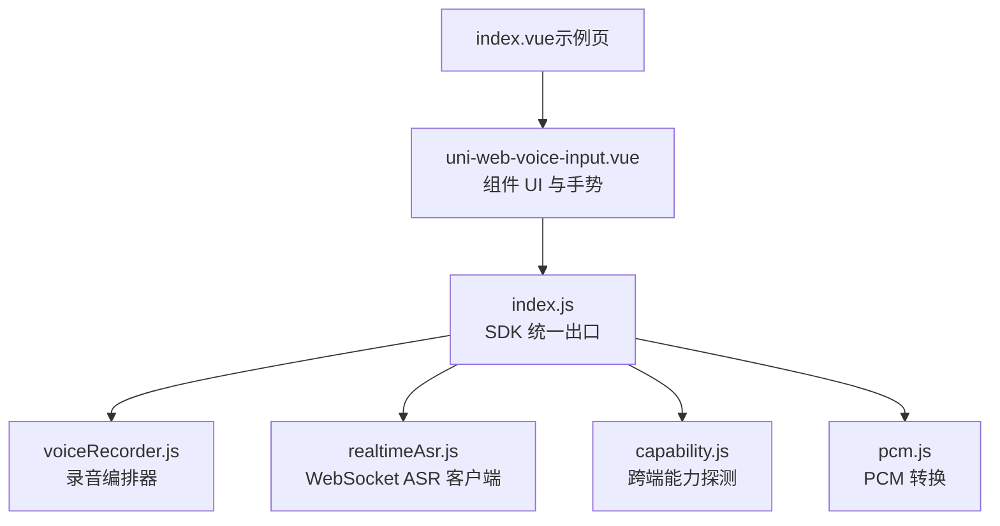
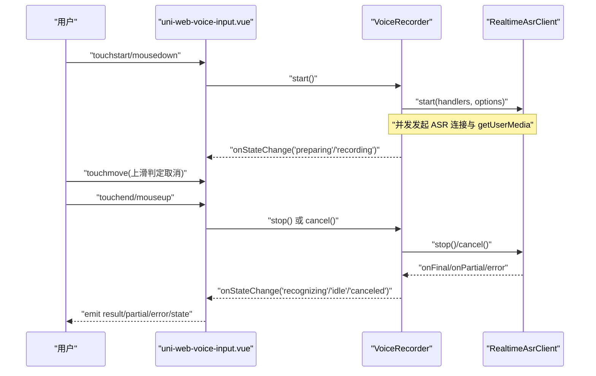
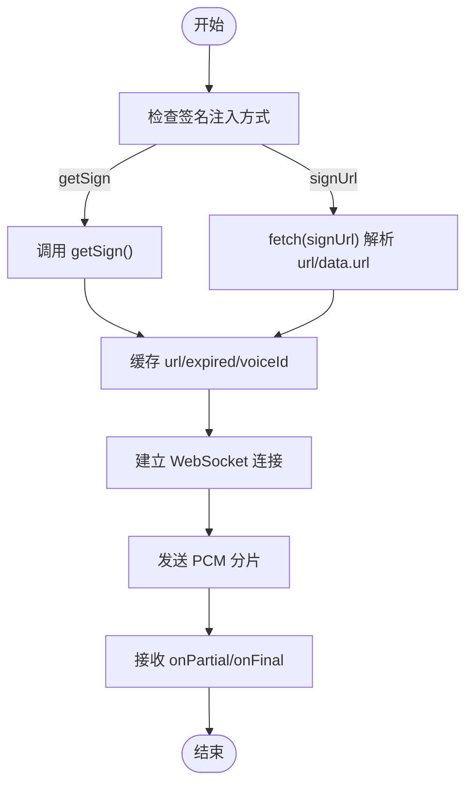
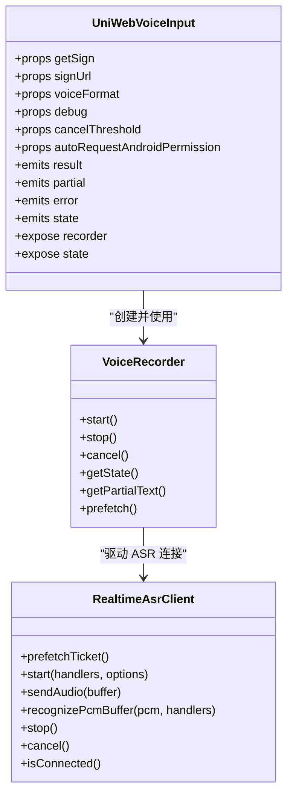
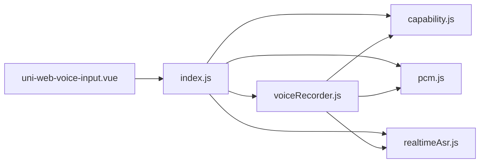

# 扩展和定制

<cite>
**本文引用的文件**   
- [uni-web-voice-input.vue](file://uni_modules/uni-web-voice-input/components/uni-web-voice-input/uni-web-voice-input.vue)
- [index.js](file://uni_modules/uni-web-voice-input/js_sdk/uni-web-voice/index.js)
- [index.d.ts](file://uni_modules/uni-web-voice-input/js_sdk/uni-web-voice/index.d.ts)
- [voiceRecorder.js](file://uni_modules/uni-web-voice-input/js_sdk/uni-web-voice/voiceRecorder.js)
- [realtimeAsr.js](file://uni_modules/uni-web-voice-input/js_sdk/uni-web-voice/realtimeAsr.js)
- [capability.js](file://uni_modules/uni-web-voice-input/js_sdk/uni-web-voice/capability.js)
- [pcm.js](file://uni_modules/uni-web-voice-input/js_sdk/uni-web-voice/pcm.js)
- [index.vue（示例页）](file://demo/src/pages/index/index.vue)
</cite>

## 目录
1. [简介](#简介)
2. [项目结构](#项目结构)
3. [核心组件与 SDK 职责划分](#核心组件与-sdk-职责划分)
4. [生命周期与事件扩展](#生命周期与事件扩展)
5. [样式与主题定制](#样式与主题定制)
6. [插件架构与第三方集成](#插件架构与第三方集成)
7. [UI 二次开发指南](#ui-二次开发指南)
8. [TypeScript 类型扩展方法](#typescript-类型扩展方法)
9. [依赖关系分析](#依赖关系分析)
10. [性能与稳定性建议](#性能与稳定性建议)
11. [常见问题排查](#常见问题排查)
12. [总结](#总结)

## 简介
本仓库提供 uni-web-voice-input，一个面向 H5、App-vue 以及鸿蒙 ArkWeb WebView 的「纯 Web 能力」语音输入方案。它通过 `getUserMedia` + Web Audio 采集 PCM，再经 WebSocket 实时接入 ASR；同时保留整段 PCM 兜底识别，保证在实时连接异常时仍可出字。

组件层负责 UI 与手势编排，SDK 层负责录音、音频处理、ASR 客户端与跨端能力探测。签名获取通过 `getSign` / `signUrl` / `fetchSign` 注入，不绑定具体后端或厂商密钥。

## 项目结构
- 组件入口：`uni_modules/uni-web-voice-input/components/uni-web-voice-input/uni-web-voice-input.vue`
- SDK 统一出口：`uni_modules/uni-web-voice-input/js_sdk/uni-web-voice/index.js`
- 类型声明：`uni_modules/uni-web-voice-input/js_sdk/uni-web-voice/index.d.ts`
- 录音编排器：`voiceRecorder.js`
- 实时 ASR 客户端：`realtimeAsr.js`
- 能力探测与权限工具：`capability.js`
- PCM 转换工具：`pcm.js`
- 示例页面：`demo/src/pages/index/index.vue`



**图表来源**
- [uni-web-voice-input.vue:1-339](file://uni_modules/uni-web-voice-input/components/uni-web-voice-input/uni-web-voice-input.vue#L1-L339)
- [index.js:1-18](file://uni_modules/uni-web-voice-input/js_sdk/uni-web-voice/index.js#L1-L18)
- [voiceRecorder.js:1-315](file://uni_modules/uni-web-voice-input/js_sdk/uni-web-voice/voiceRecorder.js#L1-L315)
- [realtimeAsr.js:1-380](file://uni_modules/uni-web-voice-input/js_sdk/uni-web-voice/realtimeAsr.js#L1-L380)
- [capability.js:1-138](file://uni_modules/uni-web-voice-input/js_sdk/uni-web-voice/capability.js#L1-L138)
- [pcm.js:1-37](file://uni_modules/uni-web-voice-input/js_sdk/uni-web-voice/pcm.js#L1-L37)
- [index.vue（示例页）:1-138](file://demo/src/pages/index/index.vue#L1-L138)

**章节来源**
- [README.md:1-52](file://README.md#L1-L52)
- [index.js:1-18](file://uni_modules/uni-web-voice-input/js_sdk/uni-web-voice/index.js#L1-L18)

## 核心组件与 SDK 职责划分
- 组件层
  - 负责 UI 展示、按住说话手势、上滑取消、计时、状态文案、遮罩面板。
  - 通过 `defineExpose` 暴露内部 `recorder` 实例与当前 `state`，便于外部控制与调试。
  - 通过 props 注入 ASR 签名、格式、调试开关、取消阈值、安卓运行时权限策略等。
  - 通过 emits 向外抛出 `result`、`partial`、`error`、`state` 事件。

- SDK 层
  - `createVoiceRecorder`：封装 getUserMedia、AudioContext、ScriptProcessor、PCM 缓存、ASR 连接与兜底识别。
  - `createRealtimeAsrClient`：管理 WebSocket 连接、签名刷新、分片发送、结果回调、超时与错误处理。
  - `capability.js`：检测安全上下文、是否 ArkWeb、是否 App-plus 安卓、麦克风权限探测与提示。
  - `pcm.js`：Float32 → PCM16、重采样、拼接 PCM 分片。

**章节来源**
- [uni-web-voice-input.vue:28-267](file://uni_modules/uni-web-voice-input/components/uni-web-voice-input/uni-web-voice-input.vue#L28-L267)
- [voiceRecorder.js:15-315](file://uni_modules/uni-web-voice-input/js_sdk/uni-web-voice/voiceRecorder.js#L15-L315)
- [realtimeAsr.js:84-379](file://uni_modules/uni-web-voice-input/js_sdk/uni-web-voice/realtimeAsr.js#L84-L379)
- [capability.js:14-138](file://uni_modules/uni-web-voice-input/js_sdk/uni-web-voice/capability.js#L14-L138)
- [pcm.js:6-37](file://uni_modules/uni-web-voice-input/js_sdk/uni-web-voice/pcm.js#L6-L37)

## 生命周期与事件扩展
### 组件生命周期钩子
- 初始化阶段
  - 组件挂载后创建 `createVoiceRecorder`，并传入 `fetchSign`、`voiceFormat`、`debug`、`handlers`。
  - 调用 `prefetch()` 预热签名，减少首次按下等待。
  - 异步探测麦克风授权状态，若已拒绝则预显示引导文案。
  - 在安卓 App-plus 环境下可自动申请 RECORD_AUDIO 运行时权限。

- 录制开始阶段
  - 触摸或鼠标按下时同步调用 `recorder.start()`，确保用户手势窗口内触发系统麦克风授权弹窗。
  - 若检测到麦克风被阻断，直接抛出可读错误并通过 `error` 事件通知上层。

- 录制结束阶段
  - 松手时调用 `recorder.stop()`，优先走实时 ASR 结果；若无结果且存在 PCM 缓存，则回退到整段 PCM 识别。
  - 成功返回文本后触发 `result` 事件，清空部分文本。
  - 失败时通过 `error` 事件抛出可读错误。

- 取消阶段
  - 上滑超过阈值标记为取消，松手时调用 `recorder.cancel()`，状态变为 `canceled`。

- 销毁阶段
  - 组件卸载前停止计时器并尝试取消录音，避免资源泄漏。



**图表来源**
- [uni-web-voice-input.vue:130-178](file://uni_modules/uni-web-voice-input/components/uni-web-voice-input/uni-web-voice-input.vue#L130-L178)
- [uni-web-voice-input.vue:180-267](file://uni_modules/uni-web-voice-input/components/uni-web-voice-input/uni-web-voice-input.vue#L180-L267)
- [voiceRecorder.js:156-313](file://uni_modules/uni-web-voice-input/js_sdk/uni-web-voice/voiceRecorder.js#L156-L313)
- [realtimeAsr.js:317-379](file://uni_modules/uni-web-voice-input/js_sdk/uni-web-voice/realtimeAsr.js#L317-L379)

**章节来源**
- [uni-web-voice-input.vue:46-114](file://uni_modules/uni-web-voice-input/components/uni-web-voice-input/uni-web-voice-input.vue#L46-L114)
- [uni-web-voice-input.vue:130-178](file://uni_modules/uni-web-voice-input/components/uni-web-voice-input/uni-web-voice-input.vue#L130-L178)
- [uni-web-voice-input.vue:180-267](file://uni_modules/uni-web-voice-input/components/uni-web-voice-input/uni-web-voice-input.vue#L180-L267)
- [voiceRecorder.js:156-313](file://uni_modules/uni-web-voice-input/js_sdk/uni-web-voice/voiceRecorder.js#L156-L313)

## 样式与主题定制
组件使用 scoped SCSS 定义基础样式，可通过覆盖类名实现主题化与响应式适配：
- 外层容器：`.uni-web-voice`
- 按住说话条：`.uni-web-voice__bar`，激活态 `.is-active`
- 遮罩层：`.uni-web-voice__mask`
- 面板：`.uni-web-voice__panel`
- 时长文本：`.uni-web-voice__duration`
- 提示文案：`.uni-web-voice__hint`，取消态 `.is-cancel`
- 部分识别文本：`.uni-web-voice__partial`

推荐定制方式：
- 主题配置：通过 CSS 变量或全局样式覆盖上述类名的颜色、字号、圆角、背景色。
- 动画效果：可在 `.uni-web-voice__mask` 与 `.uni-web-voice__panel` 上添加过渡与缩放动画。
- 响应式设计：根据屏幕宽度调整面板宽度、字号与间距，或使用 rpx 单位适配多端。

注意：
- 组件样式为 scoped，建议在应用级样式文件中覆盖，或通过自定义类名包裹组件根节点进行作用域隔离。
- 遮罩层 z-index 较高，需确保业务弹窗层级合理，避免遮挡。

**章节来源**
- [uni-web-voice-input.vue:269-338](file://uni_modules/uni-web-voice-input/components/uni-web-voice-input/uni-web-voice-input.vue#L269-L338)

## 插件架构与第三方集成
### 签名注入与后端解耦
- 支持两种签名注入方式：
  - `getSign`：函数形式，返回包含 `url`、可选 `expired`、可选 `voiceId` 的对象。
  - `signUrl`：字符串地址，组件会 fetch 该地址并解析响应体中的 `url` 或 `data.url`。
- SDK 内部通过 `fetchSign` 统一获取签名，并缓存过期时间，提前刷新以避免鉴权失败。

### 第三方功能模块集成
- 自定义 WebSocket 实现：通过 `WebSocketImpl` 注入，适用于 App 端需要替换原生 WebSocket 的场景。
- 自定义媒体约束：通过 `mediaConstraints` 配置 `getUserMedia` 的音频参数，如声道数、回声消除、降噪等。
- 调试日志：开启 `debug` 后可打印关键流程，便于定位问题。



**图表来源**
- [uni-web-voice-input.vue:95-103](file://uni_modules/uni-web-voice-input/components/uni-web-voice-input/uni-web-voice-input.vue#L95-L103)
- [realtimeAsr.js:151-176](file://uni_modules/uni-web-voice-input/js_sdk/uni-web-voice/realtimeAsr.js#L151-L176)
- [realtimeAsr.js:214-272](file://uni_modules/uni-web-voice-input/js_sdk/uni-web-voice/realtimeAsr.js#L214-L272)

**章节来源**
- [uni-web-voice-input.vue:46-57](file://uni_modules/uni-web-voice-input/components/uni-web-voice-input/uni-web-voice-input.vue#L46-L57)
- [realtimeAsr.js:151-176](file://uni_modules/uni-web-voice-input/js_sdk/uni-web-voice/realtimeAsr.js#L151-L176)
- [voiceRecorder.js:60-81](file://uni_modules/uni-web-voice-input/js_sdk/uni-web-voice/voiceRecorder.js#L60-L81)

## UI 二次开发指南
### 手势交互定制
- 按住说话：组件监听 `touchstart`、`mousedown`，并在同步窗口内调用 `recorder.start()`。
- 上滑取消：监听 `touchmove`，计算起始 Y 坐标与当前 Y 差值，超过 `cancelThreshold` 即标记取消。
- 松开发送：监听 `touchend`、`mouseup`，调用 `recorder.stop()` 或 `recorder.cancel()`。
- 桌面兜底：提供 `mousedown`/`mouseup` 事件以兼容 H5 桌面环境。

### 状态显示定制
- 组件内部维护 `state`，包括 `idle`、`preparing`、`recording`、`recognizing`、`canceled`。
- 通过 `state` 计算按钮文案、提示文案、遮罩显示与计时器启停。
- 外部可通过监听 `state` 事件更新业务 UI，如状态标签、进度条、日志面板等。

### 暴露 API 与外部控制
- 通过 `defineExpose({ recorder, state })` 暴露内部录音器实例与状态。
- 外部可调用 `recorder.start()`、`recorder.stop()`、`recorder.cancel()`、`recorder.prefetch()` 等方法。
- 外部可读取 `recorder.getState()` 与 `recorder.getPartialText()` 获取当前状态与部分文本。



**图表来源**
- [uni-web-voice-input.vue:266-267](file://uni_modules/uni-web-voice-input/components/uni-web-voice-input/uni-web-voice-input.vue#L266-L267)
- [voiceRecorder.js:305-313](file://uni_modules/uni-web-voice-input/js_sdk/uni-web-voice/voiceRecorder.js#L305-L313)
- [realtimeAsr.js:317-379](file://uni_modules/uni-web-voice-input/js_sdk/uni-web-voice/realtimeAsr.js#L317-L379)

**章节来源**
- [uni-web-voice-input.vue:180-267](file://uni_modules/uni-web-voice-input/components/uni-web-voice-input/uni-web-voice-input.vue#L180-L267)
- [voiceRecorder.js:305-313](file://uni_modules/uni-web-voice-input/js_sdk/uni-web-voice/voiceRecorder.js#L305-L313)

## TypeScript 类型扩展方法
SDK 提供了完整的类型声明，便于在 TypeScript 项目中获得完整智能提示与类型校验：
- 录音状态：`RecorderState`
- ASR 签名结果：`AsrSignResult`
- 签名函数：`FetchSign`
- 实时 ASR 处理器：`RealtimeAsrHandlers`
- 实时 ASR 客户端选项：`RealtimeAsrClientOptions`
- 实时 ASR 客户端接口：`RealtimeAsrClient`
- 录音器处理器：`VoiceRecorderHandlers`
- 录音器选项：`VoiceRecorderOptions`
- 录音器接口：`VoiceRecorder`
- 工具函数：`describeMicError`、`probeMicPermission`、`isAppPlusAndroid`、`requestRecordAudioViaPlus`
- PCM 工具：`floatToPcm16k`、`concatPcmChunks`

扩展建议：
- 在业务项目中定义自己的 `FetchSign` 实现，返回符合 `AsrSignResult` 的结构。
- 如需扩展 ASR 协议字段，可在 `RealtimeAsrHandlers` 中追加自定义回调。
- 如需自定义 WebSocket 行为，可实现 `WebSocketImpl` 并传入 `RealtimeAsrClientOptions`。

```mermaid
erDiagram
RECORDER_STATE {
string idle
string preparing
string recording
string recognizing
string canceled
}
ASR_SIGN_RESULT {
string url
number expired
string voiceId
}
FETCH_SIGN {
function Promise~AsrSignResult~
}
REALTIME_ASR_HANDLERS {
function onPartial
function onFinal
function onError
}
REALTIME_ASR_CLIENT_OPTIONS {
FetchSign fetchSign
boolean debug
typeof WebSocket WebSocketImpl
}
REALTIME_ASR_CLIENT {
function prefetchTicket
function start
function sendAudio
function recognizePcmBuffer
function stop
function cancel
function isConnected
}
VOICE_RECORDER_HANDLERS {
function onPartial
function onFinal
function onError
function onStateChange
}
VOICE_RECORDER_OPTIONS {
FetchSign fetchSign
VoiceRecorderHandlers handlers
number voiceFormat
number targetSampleRate
number bufferSize
number minDurationMs
object mediaConstraints
boolean debug
typeof WebSocket WebSocketImpl
Window _win
Navigator _nav
}
VOICE_RECORDER {
function start
function stop
function cancel
function getState
function getPartialText
function prefetch
}
REALTIME_ASR_CLIENT ||--o{ REALTIME_ASR_HANDLERS : "使用"
VOICE_RECORDER ||--o{ REALTIME_ASR_CLIENT : "驱动"
VOICE_RECORDER_OPTIONS ||--o{ ASR_SIGN_RESULT : "生成"
```

**图表来源**
- [index.d.ts:3-108](file://uni_modules/uni-web-voice-input/js_sdk/uni-web-voice/index.d.ts#L3-L108)

**章节来源**
- [index.d.ts:3-108](file://uni_modules/uni-web-voice-input/js_sdk/uni-web-voice/index.d.ts#L3-L108)

## 依赖关系分析
组件与 SDK 之间的依赖关系清晰：
- 组件依赖 SDK 的统一出口 `index.js`。
- SDK 导出能力探测、PCM 工具、实时 ASR 客户端与录音编排器。
- 录音编排器依赖实时 ASR 客户端与 PCM 工具。
- 实时 ASR 客户端依赖 WebSocket 与签名注入。
- 能力探测工具用于判断环境、权限与平台差异。



**图表来源**
- [index.js:6-17](file://uni_modules/uni-web-voice-input/js_sdk/uni-web-voice/index.js#L6-L17)
- [voiceRecorder.js:15-17](file://uni_modules/uni-web-voice-input/js_sdk/uni-web-voice/voiceRecorder.js#L15-L17)

**章节来源**
- [index.js:6-17](file://uni_modules/uni-web-voice-input/js_sdk/uni-web-voice/index.js#L6-L17)
- [voiceRecorder.js:15-17](file://uni_modules/uni-web-voice-input/js_sdk/uni-web-voice/voiceRecorder.js#L15-L17)

## 性能与稳定性建议
- 预热签名：组件挂载后调用 `prefetch()`，减少首次按下等待。
- 最小录音时长：通过 `minDurationMs` 过滤过短录音，避免无效请求。
- PCM 分片大小与间隔：默认 3200 字节、40ms 间隔，平衡网络负载与实时性。
- 连接超时与识别超时：设置合理的超时时间，避免长时间阻塞。
- 错误映射：使用 `describeMicError` 将底层错误转化为用户可读文案。
- 资源清理：在组件卸载或取消时及时关闭 AudioContext、MediaStream 与 WebSocket。

[本节为通用性能建议，不直接分析具体文件]

## 常见问题排查
- 麦克风权限未弹出
  - 确认在用户手势同步窗口内调用 `start()`。
  - 在鸿蒙 ArkWeb 中确保宿主 WebView 正确转发权限请求。
  - 在安卓 App-plus 中通过 `requestRecordAudioViaPlus` 补申请运行时权限。

- 有权限但无 PCM 或无识别文本
  - 确保 `AudioContext` 创建后显式 `resume()`。
  - 检查 `mediaConstraints` 是否满足设备能力。
  - 查看 `canUseWebMic` 与 `getMicBlockReason` 的输出。

- 实时连接失败
  - 检查 `fetchSign` 返回的 `url` 是否正确。
  - 检查网络与证书，确保 WSS 可达。
  - 查看 `realtimeAsr.js` 的错误码与消息，必要时刷新签名。

- 识别结果为空
  - 检查录音时长是否小于 `minDurationMs`。
  - 检查是否采集到 PCM 数据。
  - 查看兜底识别逻辑是否执行。

**章节来源**
- [capability.js:52-83](file://uni_modules/uni-web-voice-input/js_sdk/uni-web-voice/capability.js#L52-L83)
- [voiceRecorder.js:156-240](file://uni_modules/uni-web-voice-input/js_sdk/uni-web-voice/voiceRecorder.js#L156-L240)
- [realtimeAsr.js:178-212](file://uni_modules/uni-web-voice-input/js_sdk/uni-web-voice/realtimeAsr.js#L178-L212)

## 总结
uni-web-voice-input 通过组件与 SDK 分层设计，实现了跨端语音输入的标准化扩展点：
- 生命周期钩子：初始化、录制开始、结束、取消、销毁均可定制。
- 样式定制：通过类名覆盖实现主题与响应式适配。
- 事件扩展：`result`、`partial`、`error`、`state` 事件覆盖主要业务流程。
- 插件架构：签名注入、WebSocket 实现、媒体约束、调试开关均支持扩展。
- UI 二次开发：手势交互、状态显示、API 暴露便于深度定制。
- TypeScript 支持：完整类型声明，便于类型安全与智能提示。

在实际项目中，建议结合业务需求定制签名获取、错误提示、UI 主题与状态展示，并利用 SDK 提供的工具函数提升健壮性与可维护性。