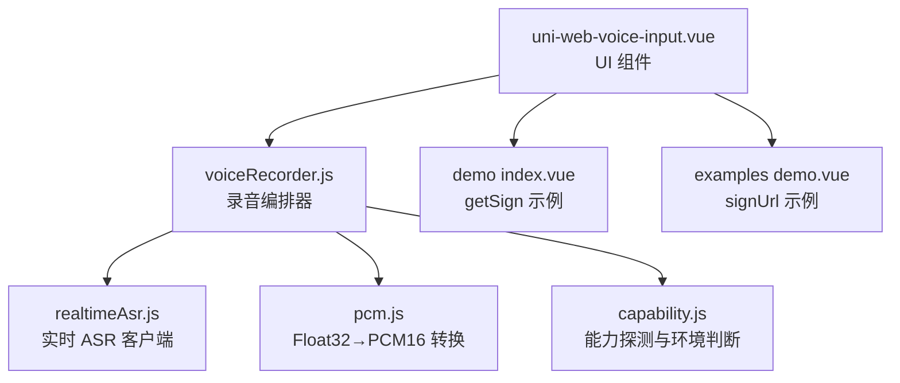
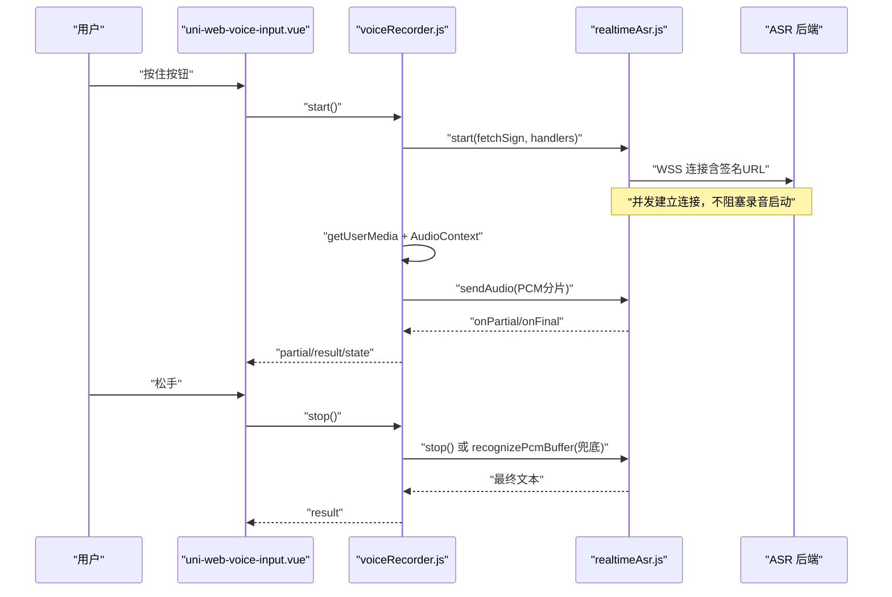
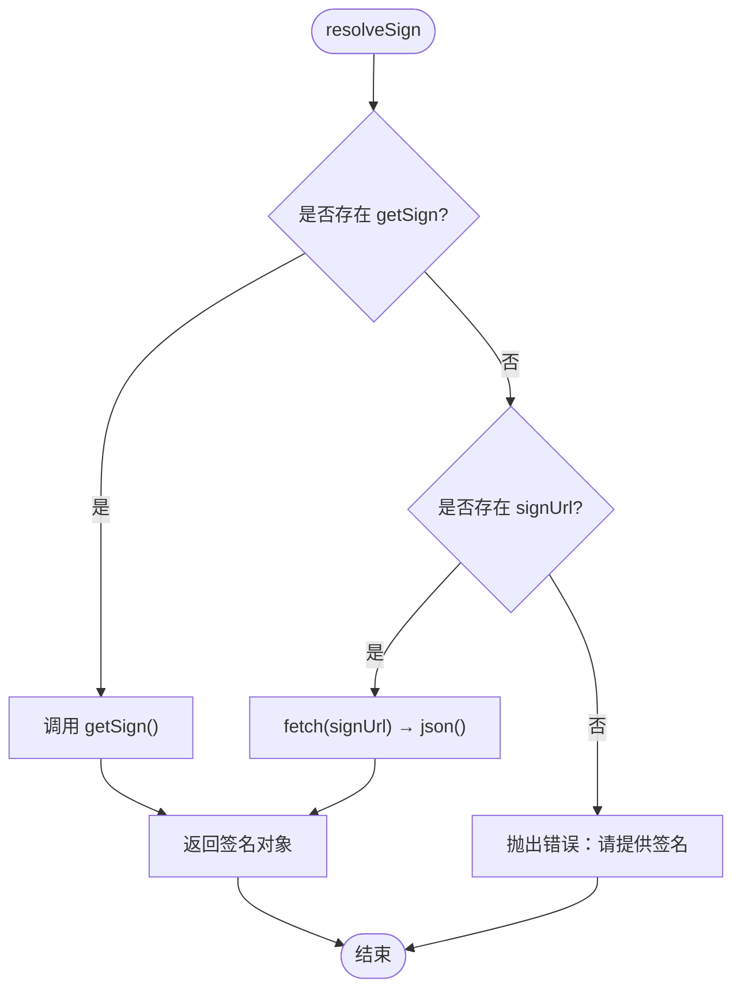
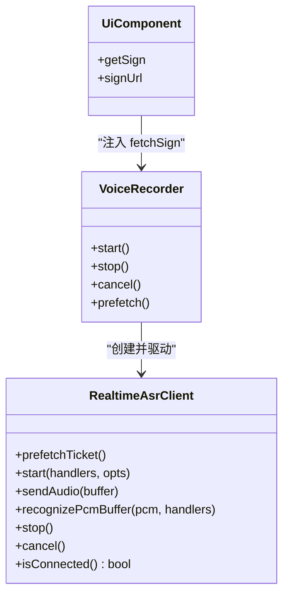
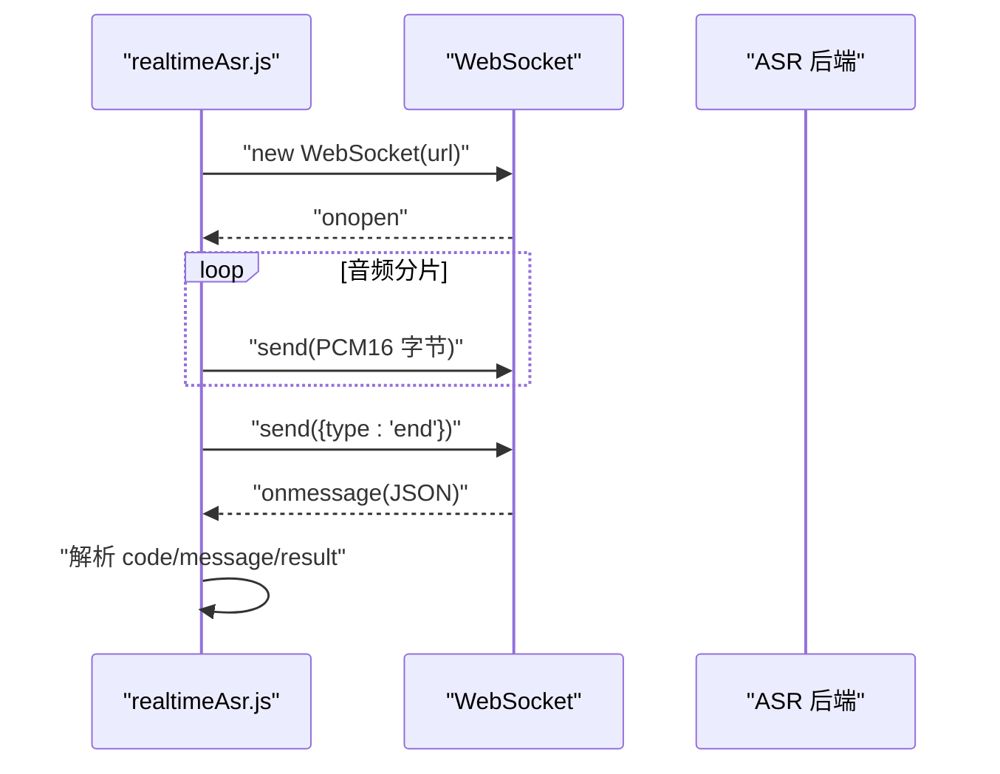
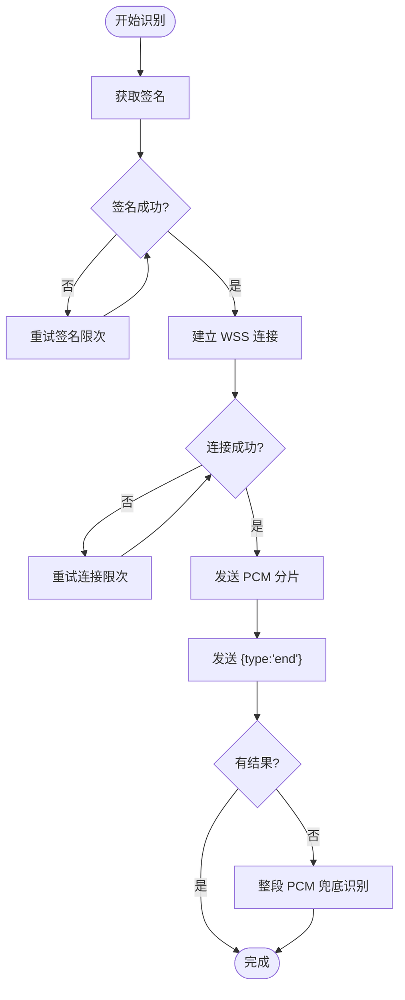

# 自定义 ASR 服务集成

<cite>
**本文引用的文件**   
- [README.md](file://README.md)
- [index.js](file://uni_modules/uni-web-voice-input/js_sdk/uni-web-voice/index.js)
- [realtimeAsr.js](file://uni_modules/uni-web-voice-input/js_sdk/uni-web-voice/realtimeAsr.js)
- [voiceRecorder.js](file://uni_modules/uni-web-voice-input/js_sdk/uni-web-voice/voiceRecorder.js)
- [capability.js](file://uni_modules/uni-web-voice-input/js_sdk/uni-web-voice/capability.js)
- [pcm.js](file://uni_modules/uni-web-voice-input/js_sdk/uni-web-voice/pcm.js)
- [uni-web-voice-input.vue](file://uni_modules/uni-web-voice-input/components/uni-web-voice-input/uni-web-voice-input.vue)
- [demo index.vue](file://demo/src/pages/index/index.vue)
- [examples demo.vue](file://examples/demo/demo.vue)
</cite>

## 目录
1. [引言](#引言)
2. [项目结构](#项目结构)
3. [核心组件与职责](#核心组件与职责)
4. [架构总览](#架构总览)
5. [签名注入机制详解：getSign / signUrl / fetchSign](#签名注入机制详解-getsign--signurl--fetchsign)
6. [WebSocket 连接、认证与数据传输格式](#websocket-连接认证与数据传输格式)
7. [替换默认 ASR 后端的完整流程](#替换默认-asr-后端的完整流程)
8. [常见 ASR 服务商集成要点](#常见-asr-服务商集成要点)
9. [错误处理与重试策略](#错误处理与重试策略)
10. [性能与稳定性建议](#性能与稳定性建议)
11. [故障排查清单](#故障排查清单)
12. [结论](#结论)

## 引言
本仓库提供一套基于纯 Web 能力的跨端语音输入方案，核心目标是让 H5、App-vue 以及鸿蒙 ArkWeb 等 WebView 场景都能「按住说话、松手出字」，并通过可插拔的 ASR 后端解耦厂商密钥。SDK 通过 `getSign` / `signUrl` / `fetchSign` 注入签名获取逻辑，不绑定具体厂商；默认协议兼容腾讯云实时 ASR，但你可以用任意后端替换它。

## 项目结构
- `uni_modules/uni-web-voice-input/`：插件主目录，包含 Vue 组件与 JS SDK。
- `uni_modules/uni-web-voice-input/components/uni-web-voice-input/uni-web-voice-input.vue`：UI 组件，封装「按住说话」手势、状态展示与结果回调。
- `uni_modules/uni-web-voice-input/js_sdk/uni-web-voice/`：JS SDK，负责能力探测、录音编排、PCM 转换、实时 ASR 客户端。
- `demo/src/pages/index/index.vue`：示例页面，演示通过 `getSign` 注入签名接口。
- `examples/demo/demo.vue`：示例页面，演示通过 `signUrl` 直接传入签名地址。

**图表来源**
- [uni-web-voice-input.vue:28-169](file://uni_modules/uni-web-voice-input/components/uni-web-voice-input/uni-web-voice-input.vue#L28-L169)
- [voiceRecorder.js:15-81](file://uni_modules/uni-web-voice-input/js_sdk/uni-web-voice/voiceRecorder.js#L15-L81)
- [realtimeAsr.js:1-18](file://uni_modules/uni-web-voice-input/js_sdk/uni-web-voice/realtimeAsr.js#L1-L18)
- [pcm.js:1-37](file://uni_modules/uni-web-voice-input/js_sdk/uni-web-voice/pcm.js#L1-L37)
- [capability.js:1-46](file://uni_modules/uni-web-voice-input/js_sdk/uni-web-voice/capability.js#L1-L46)
- [demo index.vue:16-84](file://demo/src/pages/index/index.vue#L16-L84)
- [examples demo.vue:10-27](file://examples/demo/demo.vue#L10-L27)

**章节来源**
- [README.md:1-24](file://README.md#L1-L24)
- [index.js:1-18](file://uni_modules/uni-web-voice-input/js_sdk/uni-web-voice/index.js#L1-L18)

## 核心组件与职责
- **UI 组件 uni-web-voice-input.vue**
  - 暴露属性：`getSign`（函数）、`signUrl`（字符串）、`voiceFormat`、`debug`、`cancelThreshold`、`autoRequestAndroidPermission`。
  - 内部通过 `createVoiceRecorder` 驱动录音与识别，并转发 `result`、`partial`、`error`、`state` 事件。
  - 在挂载时调用 `recorder.prefetch()` 预热签名，减少首次按下等待。
- **录音编排器 voiceRecorder.js**
  - 统一调度 `getUserMedia`、`AudioContext`、ScriptProcessor 音频流、ASR 客户端。
  - 保证关键时序：用户手势同步窗口内发起 `getUserMedia` 与创建 `AudioContext`，避免鸿蒙权限弹窗丢失。
  - 支持实时 WS 推送 PCM，并在 WS 未连上或无结果时回退到整段 PCM 兜底识别。
- **实时 ASR 客户端 realtimeAsr.js**
  - 通过 `options.fetchSign` 获取签名对象，解析出 WSS URL，建立 WebSocket 连接。
  - 按固定分片大小与间隔发送 PCM 数据，发送 `{type:'end'}` 结束识别。
  - 对服务端错误码进行友好提示，并对鉴权失败类错误清理缓存签名。
- **能力探测 capability.js**
  - 检测是否运行在鸿蒙 ArkWeb、安全上下文、是否可用麦克风、权限状态、App-plus 安卓环境等。
- **PCM 工具 pcm.js**
  - 将 Float32 采样转换为 16kHz 单声道 PCM16，适配腾讯云实时 ASR 的 `voice_format=1`。

**章节来源**
- [uni-web-voice-input.vue:46-169](file://uni_modules/uni-web-voice-input/components/uni-web-voice-input/uni-web-voice-input.vue#L46-L169)
- [voiceRecorder.js:43-81](file://uni_modules/uni-web-voice-input/js_sdk/uni-web-voice/voiceRecorder.js#L43-L81)
- [realtimeAsr.js:71-94](file://uni_modules/uni-web-voice-input/js_sdk/uni-web-voice/realtimeAsr.js#L71-L94)
- [capability.js:14-46](file://uni_modules/uni-web-voice-input/js_sdk/uni-web-voice/capability.js#L14-L46)
- [pcm.js:1-24](file://uni_modules/uni-web-voice-input/js_sdk/uni-web-voice/pcm.js#L1-L24)

## 架构总览
整体流程如下：
1. 用户在 UI 组件上按住按钮，触发 `start()`。
2. 组件调用 `createVoiceRecorder().start()`，同时后台并发请求 ASR 签名并建立 WebSocket。
3. 录音开始后，音频流经 ScriptProcessor 转为 PCM16，按分片发送到 ASR。
4. ASR 返回部分文本与最终文本，组件透传 `partial` 与 `result`。
5. 松手后若实时识别无结果，则使用整段 PCM 兜底识别一次。

**图表来源**
- [uni-web-voice-input.vue:130-169](file://uni_modules/uni-web-voice-input/components/uni-web-voice-input/uni-web-voice-input.vue#L130-L169)
- [voiceRecorder.js:152-240](file://uni_modules/uni-web-voice-input/js_sdk/uni-web-voice/voiceRecorder.js#L152-L240)
- [realtimeAsr.js:214-315](file://uni_modules/uni-web-voice-input/js_sdk/uni-web-voice/realtimeAsr.js#L214-L315)

## 签名注入机制详解：getSign / signUrl / fetchSign
SDK 支持两种签名注入方式：
- **函数注入 getSign**：推荐，灵活可控，可在调用前做权限检查、埋点、日志等。
- **地址注入 signUrl**：简单直接，SDK 内部会 `fetch(signUrl)` 并解析响应体。

### 组件层 resolveSign 逻辑
- 如果存在 `props.getSign`，优先调用该函数。
- 否则如果存在 `props.signUrl`，则 `fetch(signUrl)` 并取 `data` 或直接取根对象。
- 两者都不存在则抛出错误，要求提供签名。

**图表来源**
- [uni-web-voice-input.vue:95-103](file://uni_modules/uni-web-voice-input/components/uni-web-voice-input/uni-web-voice-input.vue#L95-L103)

### SDK 层 fetchSign 契约
- `realtimeAsr.js` 要求 `options.fetchSign` 为异步函数，返回一个包含 WSS URL 的对象。
- SDK 内部会尝试从响应中读取多种字段名：`url`、`wsUrl`、`wssUrl`、`ws_url`、`wss_url`。
- 同时支持 `expired` 字段控制签名有效期，默认 TTL 为 600 秒，提前 60 秒刷新。
- 可选 `voiceId` 用于业务关联。

**图表来源**
- [realtimeAsr.js:78-94](file://uni_modules/uni-web-voice-input/js_sdk/uni-web-voice/realtimeAsr.js#L78-L94)
- [voiceRecorder.js:77-81](file://uni_modules/uni-web-voice-input/js_sdk/uni-web-voice/voiceRecorder.js#L77-L81)
- [uni-web-voice-input.vue:46-57](file://uni_modules/uni-web-voice-input/components/uni-web-voice-input/uni-web-voice-input.vue#L46-L57)

**章节来源**
- [uni-web-voice-input.vue:95-103](file://uni_modules/uni-web-voice-input/components/uni-web-voice-input/uni-web-voice-input.vue#L95-L103)
- [realtimeAsr.js:29-41](file://uni_modules/uni-web-voice-input/js_sdk/uni-web-voice/realtimeAsr.js#L29-L41)
- [realtimeAsr.js:151-176](file://uni_modules/uni-web-voice-input/js_sdk/uni-web-voice/realtimeAsr.js#L151-L176)

## WebSocket 连接、认证与数据传输格式
### 连接建立
- SDK 通过 `new WebSocket(url)` 建立连接，支持通过 `options.WebSocketImpl` 注入自定义实现（例如 App 端 uni 的 WebSocket）。
- 连接超时时间默认 8 秒，连接成功后设置 `binaryType='arraybuffer'`。

### 认证机制
- 认证由你的后端完成：前端只负责拿到已签名的 WSS URL。
- 若后端返回鉴权失败（如 4001/4002/4003），SDK 会清空缓存签名并提示重试。
- 若返回额度不足（如 4004），SDK 给出明确提示。

### 数据传输格式
- 音频数据以 PCM16 字节数组分片发送，默认分片大小 3200 字节，间隔 40ms。
- 结束时发送 JSON：`{type:'end'}`。
- 服务端返回消息需包含 `code`、`message`、`result.voice_text_str`、`result.slice_type` 等字段，SDK 会区分部分文本与最终文本。

**图表来源**
- [realtimeAsr.js:214-272](file://uni_modules/uni-web-voice-input/js_sdk/uni-web-voice/realtimeAsr.js#L214-L272)
- [realtimeAsr.js:274-315](file://uni_modules/uni-web-voice-input/js_sdk/uni-web-voice/realtimeAsr.js#L274-L315)
- [realtimeAsr.js:178-212](file://uni_modules/uni-web-voice-input/js_sdk/uni-web-voice/realtimeAsr.js#L178-L212)

**章节来源**
- [realtimeAsr.js:214-315](file://uni_modules/uni-web-voice-input/js_sdk/uni-web-voice/realtimeAsr.js#L214-L315)

## 替换默认 ASR 后端的完整流程
### 步骤一：准备你的签名接口
- 提供一个 HTTP 接口，返回包含 WSS URL 的对象。
- 响应体至少包含 `url`，可选 `expired`、`voiceId`。
- 示例参考：
  - 组件示例中使用 `uni.request` 调用 `SIGN_URL`，并校验 `data.url`。
  - 示例页也展示了直接传入 `signUrl` 的方式。

### 步骤二：选择注入方式
- **方式 A：使用 `getSign`**
  - 在页面中定义 `getSign` 函数，返回 Promise，解析你的签名接口响应。
  - 将 `getSign` 传给 `<uni-web-voice-input>`。
- **方式 B：使用 `signUrl`**
  - 直接将签名地址传给 `<uni-web-voice-input :sign-url="signUrl">`。

### 步骤三：配置 WebSocket 与 PCM
- 确保你的后端支持腾讯云实时 ASR 协议（或你自行适配 SDK 的消息解析）。
- 音频格式默认 `voice_format=1`（16kHz PCM16 单声道），如需调整可在组件属性 `voiceFormat` 中设置。
- 如需自定义 WebSocket 实现，可通过 `options.WebSocketImpl` 注入（适用于 App 端）。

### 步骤四：测试与调试
- 开启 `debug=true`，观察控制台日志。
- 关注 `state` 变化：idle → preparing → recording → recognizing → idle。
- 若鉴权失败或额度不足，根据错误提示调整后端配置。

**章节来源**
- [demo index.vue:41-84](file://demo/src/pages/index/index.vue#L41-L84)
- [examples demo.vue:15-27](file://examples/demo/demo.vue#L15-L27)
- [uni-web-voice-input.vue:46-57](file://uni_modules/uni-web-voice-input/components/uni-web-voice-input/uni-web-voice-input.vue#L46-L57)
- [realtimeAsr.js:10-17](file://uni_modules/uni-web-voice-input/js_sdk/uni-web-voice/realtimeAsr.js#L10-L17)

## 常见 ASR 服务商集成要点
### 通用原则
- 所有服务商都需要一个签名接口，返回 WSS URL。
- SDK 默认兼容腾讯云实时 ASR 协议，其他厂商可按相同协议对接，或在后端做协议适配。
- 重点保证：
  - 签名接口返回 `url`。
  - WSS 连接能接收 PCM16 分片。
  - 返回消息包含 `code`、`message`、`result.voice_text_str`、`result.slice_type`。

### 百度 ASR
- 通常需要在后端生成临时 Token 与 WSS URL。
- 注意百度实时转写协议的字段命名可能与腾讯云不同，建议在网关层做字段映射。

### 阿里云 ASR
- 阿里云实时语音识别需要 AccessKey 与 Endpoint。
- 后端生成 STS 临时凭证与 WSS URL，前端仅消费 `url`。

### 腾讯云 ASR
- 原生兼容腾讯云实时 ASR 协议。
- 可直接复用腾讯云官方 SDK 的后端签名逻辑，返回 `url`、`expired`、`voiceId`。

[本节为概念性说明，不直接分析具体代码文件]

## 错误处理与重试策略
### 常见错误分类
- **签名失败**：网络错误或响应缺少 `url`。
- **鉴权失败**：后端返回 4001/4002/4003。
- **额度不足**：后端返回 4004。
- **连接失败**：WebSocket 无法建立或超时。
- **权限问题**：麦克风被拒绝、设备不可用或被占用。

### SDK 内置处理
- 鉴权失败类错误会清空缓存签名，强制下次重新获取。
- 连接超时、连接失败、连接关闭均有明确错误提示。
- 录音太短或未采集到音频会抛出可读文案。

### 推荐重试策略
- **签名重试**：遇到鉴权失败自动刷新签名；网络失败可指数退避重试。
- **连接重试**：WebSocket 连接失败时，最多重试 2-3 次，每次间隔递增。
- **识别超时**：SDK 默认 20 秒识别超时，可结合业务调整。
- **兜底识别**：实时 WS 无结果时使用整段 PCM 再识别一次。

**图表来源**
- [realtimeAsr.js:151-176](file://uni_modules/uni-web-voice-input/js_sdk/uni-web-voice/realtimeAsr.js#L151-L176)
- [realtimeAsr.js:214-272](file://uni_modules/uni-web-voice-input/js_sdk/uni-web-voice/realtimeAsr.js#L214-L272)
- [voiceRecorder.js:246-295](file://uni_modules/uni-web-voice-input/js_sdk/uni-web-voice/voiceRecorder.js#L246-L295)

**章节来源**
- [realtimeAsr.js:43-49](file://uni_modules/uni-web-voice-input/js_sdk/uni-web-voice/realtimeAsr.js#L43-L49)
- [realtimeAsr.js:178-212](file://uni_modules/uni-web-voice-input/js_sdk/uni-web-voice/realtimeAsr.js#L178-L212)
- [voiceRecorder.js:246-295](file://uni_modules/uni-web-voice-input/js_sdk/uni-web-voice/voiceRecorder.js#L246-L295)

## 性能与稳定性建议
- **预热签名**：组件挂载时调用 `recorder.prefetch()`，减少首次按下等待。
- **分片大小与间隔**：默认 3200 字节、40ms 间隔，平衡延迟与带宽。
- **最小录音时长**：默认 600ms，避免误触。
- **Debug 模式**：开发阶段开启 `debug=true`，生产环境关闭。
- **权限预检**：在组件挂载时探测麦克风权限，提前提示用户授权。

**章节来源**
- [uni-web-voice-input.vue:130-169](file://uni_modules/uni-web-voice-input/components/uni-web-voice-input/uni-web-voice-input.vue#L130-L169)
- [realtimeAsr.js:10-17](file://uni_modules/uni-web-voice-input/js_sdk/uni-web-voice/realtimeAsr.js#L10-L17)
- [voiceRecorder.js:52-58](file://uni_modules/uni-web-voice-input/js_sdk/uni-web-voice/voiceRecorder.js#L52-L58)

## 故障排查清单
- **鸿蒙 ArkWeb 不弹麦克风权限**
  - 确认 `start()` 在用户手势同步窗口内调用。
  - 确认页面为 HTTPS。
  - 宿主需声明麦克风权限并转发 `onPermissionRequest`。
- **有权限却零 PCM**
  - 确认 `AudioContext` 已 `resume()`。
  - 检查 `scriptProcessor.onaudioprocess` 是否回调。
- **鉴权失败**
  - 检查签名接口返回的 `url` 是否正确。
  - 检查后端鉴权逻辑与密钥配置。
- **额度不足**
  - 联系管理员开通资源包或后付费。
- **连接超时**
  - 检查网络与防火墙策略。
  - 适当增加连接超时时间。

**章节来源**
- [README.md:17-24](file://README.md#L17-L24)
- [capability.js:48-63](file://uni_modules/uni-web-voice-input/js_sdk/uni-web-voice/capability.js#L48-L63)
- [voiceRecorder.js:195-201](file://uni_modules/uni-web-voice-input/js_sdk/uni-web-voice/voiceRecorder.js#L195-L201)

## 结论
通过 `getSign` / `signUrl` / `fetchSign` 注入机制，本 SDK 实现了 ASR 后端的完全解耦。你只需提供一个返回 WSS URL 的签名接口，即可替换默认后端。SDK 内置了完善的错误处理、重试策略与兜底识别逻辑，并针对鸿蒙 ArkWeb、App-plus 等环境做了兼容性优化。按照本文流程接入，即可快速集成百度、阿里云、腾讯云等任意 ASR 服务商。