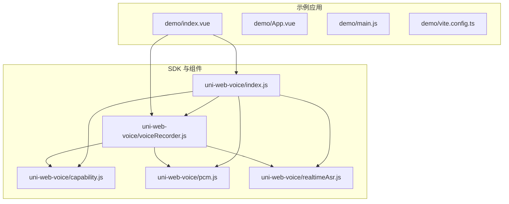
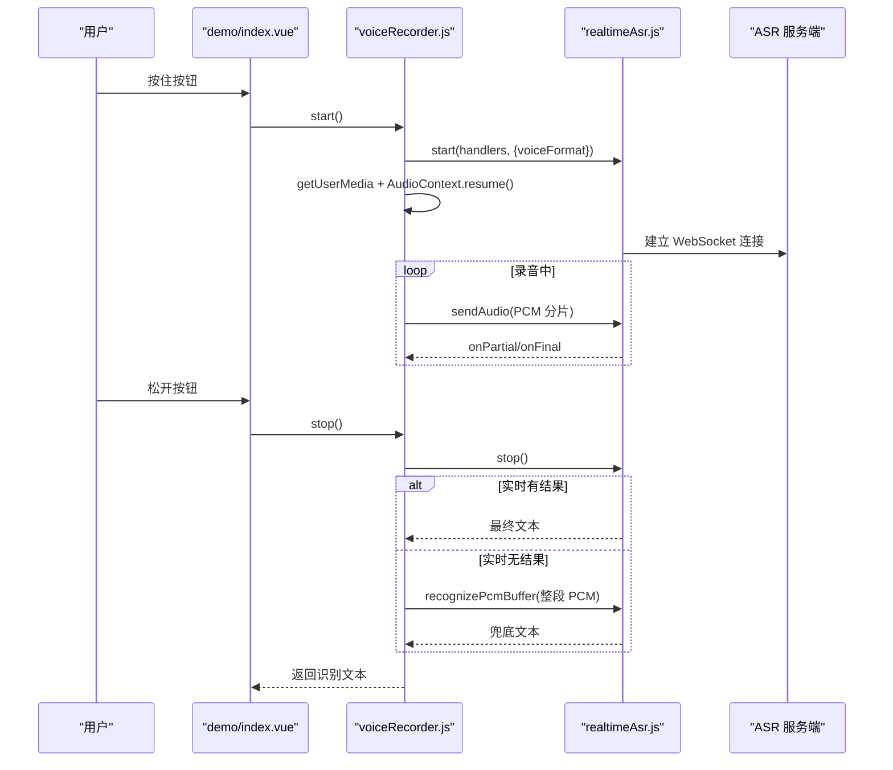
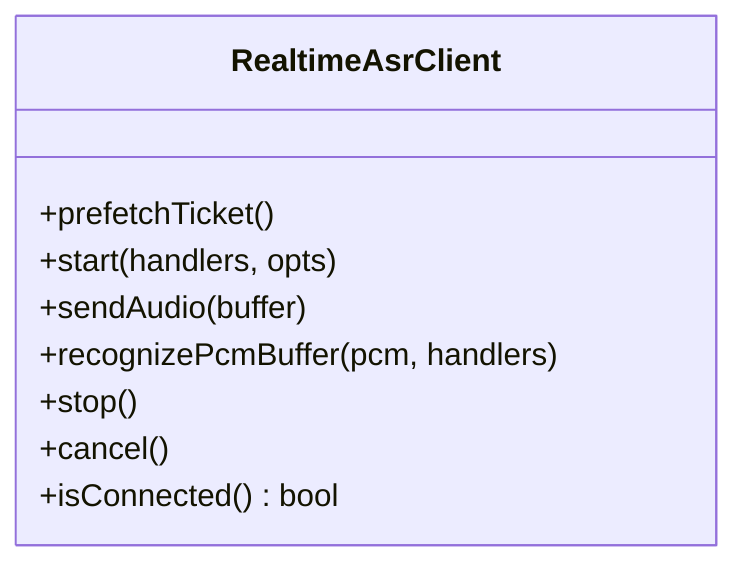
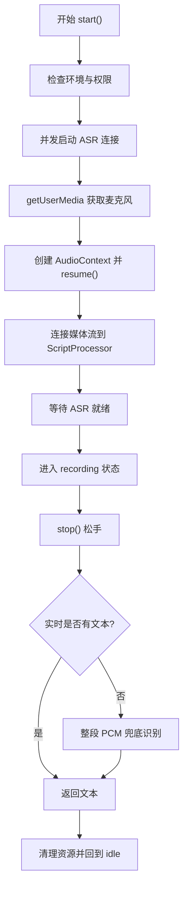
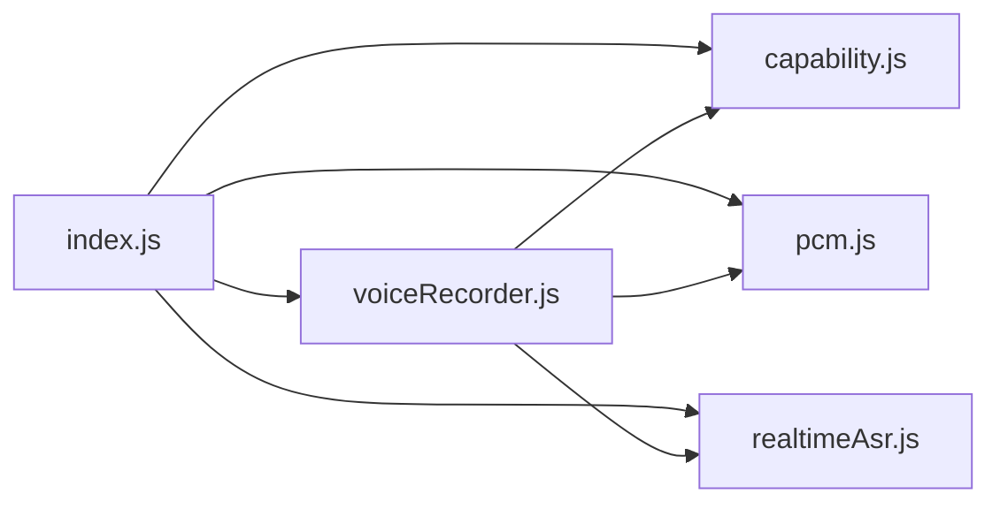

# 调试和监控

<cite>
**本文引用的文件**   
- [README.md](file://README.md)
- [package.json](file://package.json)
- [demo/index.vue](file://demo/src/pages/index/index.vue)
- [uni-web-voice/index.js](file://uni_modules/uni-web-voice-input/js_sdk/uni-web-voice/index.js)
- [uni-web-voice/capability.js](file://uni_modules/uni-web-voice-input/js_sdk/uni-web-voice/capability.js)
- [uni-web-voice/pcm.js](file://uni_modules/uni-web-voice-input/js_sdk/uni-web-voice/pcm.js)
- [uni-web-voice/realtimeAsr.js](file://uni_modules/uni-web-voice-input/js_sdk/uni-web-voice/realtimeAsr.js)
- [uni-web-voice/voiceRecorder.js](file://uni_modules/uni-web-voice-input/js_sdk/uni-web-voice/voiceRecorder.js)
- [demo/vite.config.ts](file://demo/vite.config.ts)
- [demo/App.vue](file://demo/src/App.vue)
- [demo/main.js](file://demo/src/main.js)
</cite>

## 目录
1. [引言](#引言)
2. [项目结构](#项目结构)
3. [核心组件](#核心组件)
4. [架构总览](#架构总览)
5. [详细组件分析](#详细组件分析)
6. [依赖关系分析](#依赖关系分析)
7. [性能与指标](#性能与指标)
8. [日志与结构化输出](#日志与结构化输出)
9. [问题诊断工具与方法](#问题诊断工具与方法)
10. [监控告警机制](#监控告警机制)
11. [常见问题排查](#常见问题排查)
12. [生产环境最佳实践](#生产环境最佳实践)
13. [结论](#结论)

## 引言
本文件面向开发者，提供针对 uni-web-voice-input 的完整调试与监控方案。内容覆盖：
- 日志输出配置：不同级别、结构化格式与过滤策略
- 性能指标收集：音频延迟统计、网络传输监控、资源使用追踪
- 问题诊断工具：浏览器开发者工具、移动端调试技巧、远程调试
- 监控告警：关键指标阈值与异常通知
- 常见问题排查步骤与解决方案
- 生产环境的监控最佳实践

该 SDK 基于纯 Web 能力（getUserMedia + Web Audio + WebSocket 实时 ASR），适配 H5 / App-vue / 安卓·iOS WebView，并针对鸿蒙 ArkWeb <web-view> 做了时序与权限修复。

**章节来源**
- [README.md:1-24](file://README.md#L1-L24)

## 项目结构
仓库包含示例工程与可复用插件两部分：
- demo：基于 uni-app + Vite 的演示页面，展示组件用法与事件回调
- uni_modules/uni-web-voice-input：SDK 与 Vue 组件，支持 npm 包与 DCloud 插件市场双分发

**图表来源**
- [demo/index.vue:16-24](file://demo/src/pages/index/index.vue#L16-L24)
- [uni-web-voice/index.js:6-17](file://uni_modules/uni-web-voice-input/js_sdk/uni-web-voice/index.js#L6-L17)
- [uni-web-voice/voiceRecorder.js:15-17](file://uni_modules/uni-web-voice-input/js_sdk/uni-web-voice/voiceRecorder.js#L15-L17)

**章节来源**
- [package.json:1-35](file://package.json#L1-L35)
- [demo/vite.config.ts:1-7](file://demo/vite.config.ts#L1-L7)

## 核心组件
- 入口导出：统一暴露能力探测、PCM 处理、实时 ASR 客户端与录音编排器
- 能力探测：跨端安全上下文、麦克风可用性、权限探测与平台判断
- PCM 处理：Float32 → PCM16 重采样与分片拼接
- 实时 ASR：WebSocket 连接、签名刷新、分片发送、超时与错误处理
- 语音录制：getUserMedia + Web Audio 采集 PCM，串联实时 ASR，并提供兜底整段识别

**章节来源**
- [uni-web-voice/index.js:6-17](file://uni_modules/uni-web-voice-input/js_sdk/uni-web-voice/index.js#L6-L17)
- [uni-web-voice/capability.js:14-63](file://uni_modules/uni-web-voice-input/js_sdk/uni-web-voice/capability.js#L14-L63)
- [uni-web-voice/pcm.js:6-24](file://uni_modules/uni-web-voice-input/js_sdk/uni-web-voice/pcm.js#L6-L24)
- [uni-web-voice/realtimeAsr.js:78-103](file://uni_modules/uni-web-voice-input/js_sdk/uni-web-voice/realtimeAsr.js#L78-L103)
- [uni-web-voice/voiceRecorder.js:47-81](file://uni_modules/uni-web-voice-input/js_sdk/uni-web-voice/voiceRecorder.js#L47-L81)

## 架构总览
整体流程：用户按下按钮触发 start()，SDK 在同步手势窗口内并发发起 ASR 连接与麦克风授权；AudioContext 创建后 resume；ScriptProcessor 将 PCM 分片推送到 WebSocket；松手后 stop()，若实时无结果则用整段 PCM 兜底识别。

**图表来源**
- [demo/index.vue:16-24](file://demo/src/pages/index/index.vue#L16-L24)
- [uni-web-voice/voiceRecorder.js:156-240](file://uni_modules/uni-web-voice-input/js_sdk/uni-web-voice/voiceRecorder.js#L156-L240)
- [uni-web-voice/voiceRecorder.js:246-295](file://uni_modules/uni-web-voice-input/js_sdk/uni-web-voice/voiceRecorder.js#L246-L295)
- [uni-web-voice/realtimeAsr.js:214-272](file://uni_modules/uni-web-voice-input/js_sdk/uni-web-voice/realtimeAsr.js#L214-L272)
- [uni-web-voice/realtimeAsr.js:286-315](file://uni_modules/uni-web-voice-input/js_sdk/uni-web-voice/realtimeAsr.js#L286-L315)

## 详细组件分析

### 实时 ASR 客户端（realtimeAsr.js）
职责：
- 通过 fetchSign 获取带 wss URL 的签名对象，缓存并提前刷新
- 管理 WebSocket 生命周期：连接、消息解析、错误格式化、超时控制
- 分片发送 PCM，支持 stop 等待结束或取消
- 提供 isConnected、prefetchTicket、recognizePcmBuffer 等能力

关键点：
- 连接超时 CONNECT_TIMEOUT_MS、识别超时 RECOGNIZE_TIMEOUT_MS、停止等待 STOP_WAIT_MS
- 分片大小 CHUNK_BYTES 与间隔 CHUNK_INTERVAL_MS
- 错误码映射（如 4001/4002/4003/4004）
- debug 开关控制 console.log/warn/error

**图表来源**
- [uni-web-voice/realtimeAsr.js:84-103](file://uni_modules/uni-web-voice-input/js_sdk/uni-web-voice/realtimeAsr.js#L84-L103)
- [uni-web-voice/realtimeAsr.js:317-378](file://uni_modules/uni-web-voice-input/js_sdk/uni-web-voice/realtimeAsr.js#L317-L378)

**章节来源**
- [uni-web-voice/realtimeAsr.js:19-53](file://uni_modules/uni-web-voice-input/js_sdk/uni-web-voice/realtimeAsr.js#L19-L53)
- [uni-web-voice/realtimeAsr.js:151-176](file://uni_modules/uni-web-voice-input/js_sdk/uni-web-voice/realtimeAsr.js#L151-L176)
- [uni-web-voice/realtimeAsr.js:178-212](file://uni_modules/uni-web-voice-input/js_sdk/uni-web-voice/realtimeAsr.js#L178-L212)
- [uni-web-voice/realtimeAsr.js:214-272](file://uni_modules/uni-web-voice-input/js_sdk/uni-web-voice/realtimeAsr.js#L214-L272)
- [uni-web-voice/realtimeAsr.js:274-315](file://uni_modules/uni-web-voice-input/js_sdk/uni-web-voice/realtimeAsr.js#L274-L315)
- [uni-web-voice/realtimeAsr.js:317-378](file://uni_modules/uni-web-voice-input/js_sdk/uni-web-voice/realtimeAsr.js#L317-L378)

### 语音录制编排器（voiceRecorder.js）
职责：
- 封装「按住说话」全生命周期：start/stop/cancel
- 在用户手势同步窗口内并发发起 ASR 连接与麦克风授权
- 管理 AudioContext、ScriptProcessor、静音链路
- 记录 PCM 分片用于兜底整段识别
- 状态机：idle → preparing → recording → recognizing → idle/canceled

关键行为：
- describeMicError 将底层错误映射为可读中文文案
- minDurationMs 与 receivedPcmBytes 判定“说得太短”
- 实时无结果时回退到整段 PCM 识别

**图表来源**
- [uni-web-voice/voiceRecorder.js:156-240](file://uni_modules/uni-web-voice-input/js_sdk/uni-web-voice/voiceRecorder.js#L156-L240)
- [uni-web-voice/voiceRecorder.js:246-295](file://uni_modules/uni-web-voice-input/js_sdk/uni-web-voice/voiceRecorder.js#L246-L295)

**章节来源**
- [uni-web-voice/voiceRecorder.js:19-41](file://uni_modules/uni-web-voice-input/js_sdk/uni-web-voice/voiceRecorder.js#L19-L41)
- [uni-web-voice/voiceRecorder.js:47-81](file://uni_modules/uni-web-voice-input/js_sdk/uni-web-voice/voiceRecorder.js#L47-L81)
- [uni-web-voice/voiceRecorder.js:116-150](file://uni_modules/uni-web-voice-input/js_sdk/uni-web-voice/voiceRecorder.js#L116-L150)
- [uni-web-voice/voiceRecorder.js:156-240](file://uni_modules/uni-web-voice-input/js_sdk/uni-web-voice/voiceRecorder.js#L156-L240)
- [uni-web-voice/voiceRecorder.js:246-295](file://uni_modules/uni-web-voice-input/js_sdk/uni-web-voice/voiceRecorder.js#L246-L295)

### 能力探测（capability.js）
职责：
- isHarmonyWebview：结构化信号优先（__uniapp_x_），UA 兜底
- isSecureContext：https 或 localhost
- canUseWebMic：安全上下文 + mediaDevices.getUserMedia
- getMicBlockReason：给出不可用原因文案
- probeMicPermission：异步探测权限状态
- isAppPlusAndroid / requestRecordAudioViaPlus：App-plus Android 运行时权限

**章节来源**
- [uni-web-voice/capability.js:14-63](file://uni_modules/uni-web-voice-input/js_sdk/uni-web-voice/capability.js#L14-L63)
- [uni-web-voice/capability.js:65-83](file://uni_modules/uni-web-voice-input/js_sdk/uni-web-voice/capability.js#L65-L83)
- [uni-web-voice/capability.js:85-137](file://uni_modules/uni-web-voice-input/js_sdk/uni-web-voice/capability.js#L85-L137)

### PCM 处理（pcm.js）
职责：
- floatToPcm16k：线性重采样 Float32 → Int16，默认目标 16kHz
- concatPcmChunks：拼接分片为 ArrayBuffer，供兜底识别使用

**章节来源**
- [uni-web-voice/pcm.js:6-24](file://uni_modules/uni-web-voice-input/js_sdk/uni-web-voice/pcm.js#L6-L24)
- [uni-web-voice/pcm.js:26-36](file://uni_modules/uni-web-voice-input/js_sdk/uni-web-voice/pcm.js#L26-L36)

### 示例页面（demo/index.vue）
职责：
- 引入组件与 SDK 能力探测函数
- 注入 getSign 签名接口
- 监听 result/partial/state/error 事件
- 提示注意事项（HTTPS、鸿蒙权限转发）

**章节来源**
- [demo/index.vue:16-84](file://demo/src/pages/index/index.vue#L16-L84)

## 依赖关系分析
SDK 内部模块耦合清晰：
- index.js 作为统一出口，聚合 capability、pcm、realtimeAsr、voiceRecorder
- voiceRecorder 依赖 realtimeAsr、pcm、capability
- realtimeAsr 不依赖业务 API，仅通过 options.fetchSign 解耦

**图表来源**
- [uni-web-voice/index.js:6-17](file://uni_modules/uni-web-voice-input/js_sdk/uni-web-voice/index.js#L6-L17)
- [uni-web-voice/voiceRecorder.js:15-17](file://uni_modules/uni-web-voice-input/js_sdk/uni-web-voice/voiceRecorder.js#L15-L17)

**章节来源**
- [uni-web-voice/index.js:6-17](file://uni_modules/uni-web-voice-input/js_sdk/uni-web-voice/index.js#L6-L17)

## 性能与指标
建议采集以下指标以评估体验与稳定性：
- 音频延迟
  - 首帧延迟：从 start() 到首次 onPartial 的时间
  - 端到端延迟：从 start() 到 onFinal 的时间
  - 分片往返：每 CHUNK_INTERVAL_MS 推送一次，观察服务器响应时间
- 网络传输
  - WebSocket 连接耗时、重连次数、断线率
  - 分片发送成功率、丢包率（可通过心跳或 ACK 扩展）
- 资源使用
  - AudioContext 状态变化（suspended/resumed）
  - MediaStream 轨道数量与占用时长
  - 内存增长（recordedPcmChunks 上限保护）
- 识别质量
  - 兜底识别触发率
  - 短语音误判率（minDurationMs 与 receivedPcmBytes 阈值）

实现建议：
- 在 voiceRecorder.start/stop 与 realtimeAsr.connect/message 处埋点
- 使用 PerformanceObserver 或自定义计时器记录关键阶段耗时
- 对异常路径（鉴权失败、连接超时、设备占用）计数并上报

[本节为通用指导，不直接分析具体文件]

## 日志与结构化输出
SDK 内置 debug 模式：
- realtimeAsr.js 提供 log/warn/errLog，仅在 debug=true 时输出
- voiceRecorder.js 通过 options.debug 透传到 ASR 客户端
- 建议在开发环境开启 debug，生产环境关闭或降级为上报

结构化日志字段建议：
- event：如 "asr_connect", "asr_message", "mic_error", "rec_start", "rec_stop"
- level：debug/info/warn/error
- ts：时间戳
- phase：preparing/recording/recognizing/idle/canceled
- metrics：latency_ms、bytes_sent、ws_state、error_code
- context：platform、browser、device、voice_format

过滤机制：
- 按 level 过滤（开发只保留 debug+info，生产仅 error）
- 按 event 白名单过滤（聚焦关键路径）
- 按 platform/browser 维度分流（便于定位容器差异）

**章节来源**
- [uni-web-voice/realtimeAsr.js:84-103](file://uni_modules/uni-web-voice-input/js_sdk/uni-web-voice/realtimeAsr.js#L84-L103)
- [uni-web-voice/voiceRecorder.js:47-81](file://uni_modules/uni-web-voice-input/js_sdk/uni-web-voice/voiceRecorder.js#L47-L81)

## 问题诊断工具与方法
- 浏览器开发者工具
  - Console：查看 SDK 的 console.log/warn/error（需开启 debug）
  - Network：观察 WebSocket 握手与消息收发，确认签名接口与 wss URL
  - Performance：录制性能面板，定位卡顿与长任务
  - Application：检查 Storage、Cookies、Service Worker 等
- 移动端调试
  - Chrome DevTools Remote Debugging：USB/Wi-Fi 连接真机调试
  - Safari Web Inspector：iOS 设备启用 Web 检查器
  - 控制台日志抓取：结合 uni.showToast 与本地日志文件
- 远程调试
  - 使用 vConsole、Sentry、Bugsnag 等前端监控 SDK 上报日志与异常
  - 在 demo 中接入日志上报，区分 dev/prod 环境

**章节来源**
- [demo/index.vue:77-84](file://demo/src/pages/index/index.vue#L77-L84)
- [demo/App.vue:1-10](file://demo/src/App.vue#L1-L10)

## 监控告警机制
建议设置以下阈值与告警：
- 连接类
  - WebSocket 连接失败率 > 5%（近 5 分钟）
  - 连接超时比例 > 10%
- 识别类
  - 识别超时比例 > 5%
  - 兜底识别触发率 > 20%
- 音频类
  - 未采集到音频占比 > 2%
  - 短语音误判率 > 10%
- 资源类
  - AudioContext 长时间处于 suspended
  - recordedPcmChunks 接近上限（内存风险）

告警渠道：
- 即时通知：企业微信/钉钉/Slack
- 工单系统：Jira/飞书
- 邮件/短信：严重故障升级

[本节为通用指导，不直接分析具体文件]

## 常见问题排查
- 无法弹出麦克风权限
  - 检查是否在用户手势同步窗口内调用 start()
  - 确认 isSecureContext 为 true（HTTPS 或 localhost）
  - 鸿蒙 ArkWeb 需要宿主转发 onPermissionRequest
- 有权限但零 PCM/无识别文本
  - 确保 AudioContext 创建后立即 resume()
  - 检查 ScriptProcessor.onaudioprocess 是否回调
- 签名接口返回缺少 url
  - 校验 getSign 返回值结构，确保包含 url 字段
- 鉴权失败或额度耗尽
  - 关注错误码 4001/4002/4003/4004，及时刷新签名或联系管理员
- 连接超时或频繁断线
  - 检查网络状况与防火墙策略，必要时调整 CONNECT_TIMEOUT_MS
- 录音太短被拒绝
  - 调整 minDurationMs 或引导用户更长的语音输入

**章节来源**
- [uni-web-voice/capability.js:28-63](file://uni_modules/uni-web-voice-input/js_sdk/uni-web-voice/capability.js#L28-L63)
- [uni-web-voice/voiceRecorder.js:156-240](file://uni_modules/uni-web-voice-input/js_sdk/uni-web-voice/voiceRecorder.js#L156-L240)
- [uni-web-voice/voiceRecorder.js:246-295](file://uni_modules/uni-web-voice-input/js_sdk/uni-web-voice/voiceRecorder.js#L246-L295)
- [uni-web-voice/realtimeAsr.js:43-49](file://uni_modules/uni-web-voice-input/js_sdk/uni-web-voice/realtimeAsr.js#L43-L49)
- [uni-web-voice/realtimeAsr.js:214-272](file://uni_modules/uni-web-voice-input/js_sdk/uni-web-voice/realtimeAsr.js#L214-L272)

## 生产环境最佳实践
- 关闭 debug，仅保留必要 warn/error 日志
- 接入前端监控 SDK，集中采集指标与异常
- 对签名接口做限流与熔断，避免雪崩
- 对 WebSocket 连接做重试与退避策略
- 限制 recordedPcmChunks 上限，防止内存泄漏
- 定期巡检错误码分布与超时比例，优化阈值
- 灰度发布与 A/B 测试，逐步放量新策略

[本节为通用指导，不直接分析具体文件]

## 结论
通过合理的日志配置、指标采集、诊断工具与告警机制，可以快速定位并解决 uni-web-voice-input 在跨端 WebView 中的音频与识别问题。结合本指南的实践，可在保证用户体验的同时提升系统的可观测性与稳定性。

[本节为总结性内容，不直接分析具体文件]