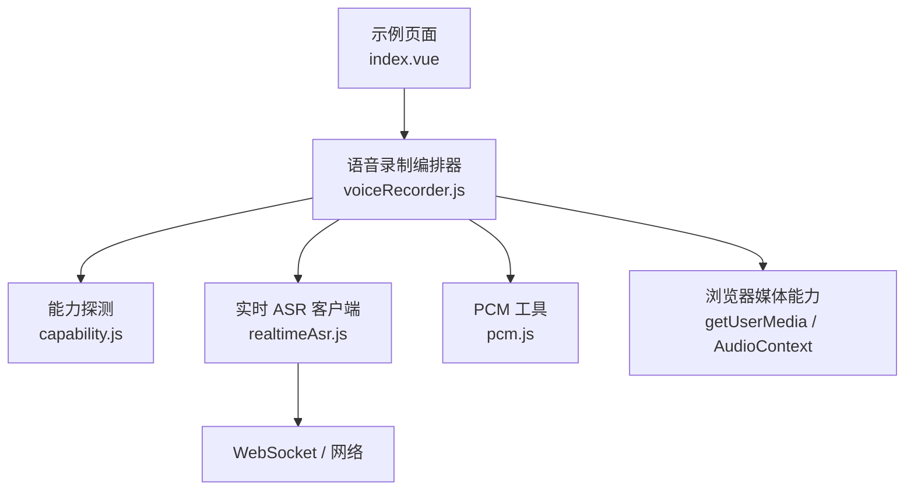
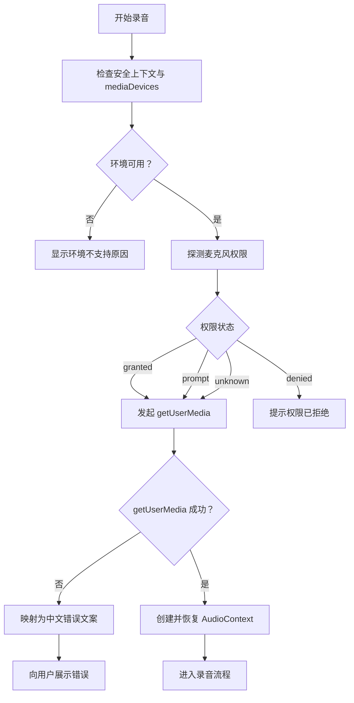
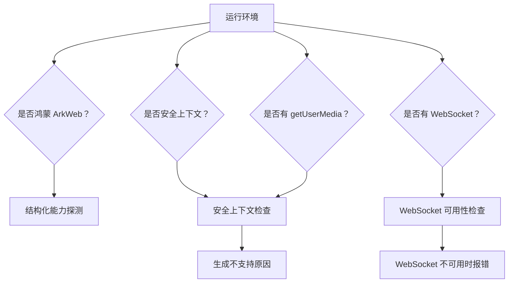
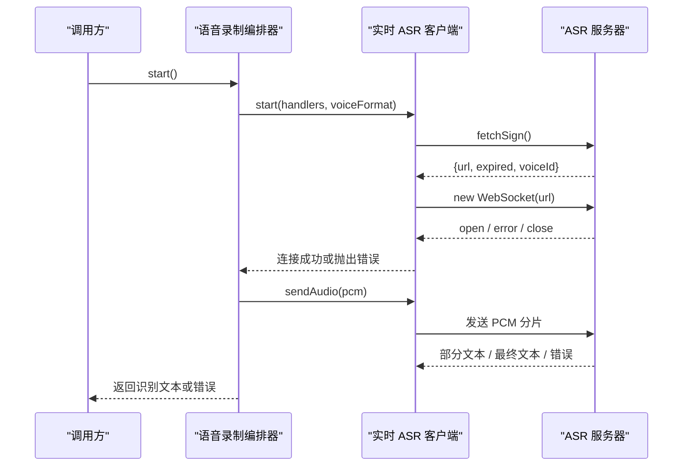
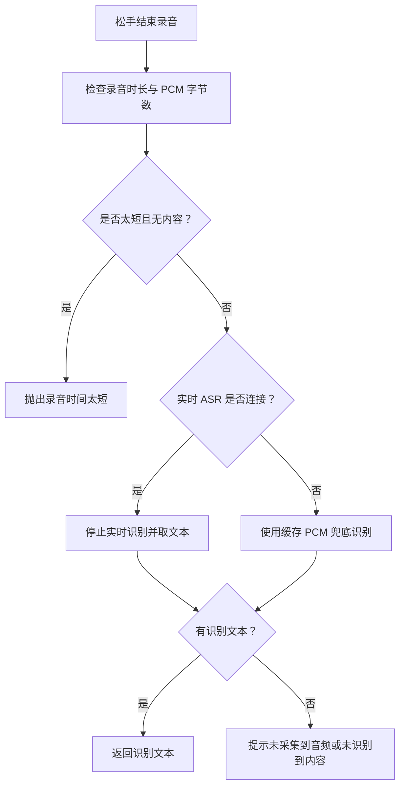
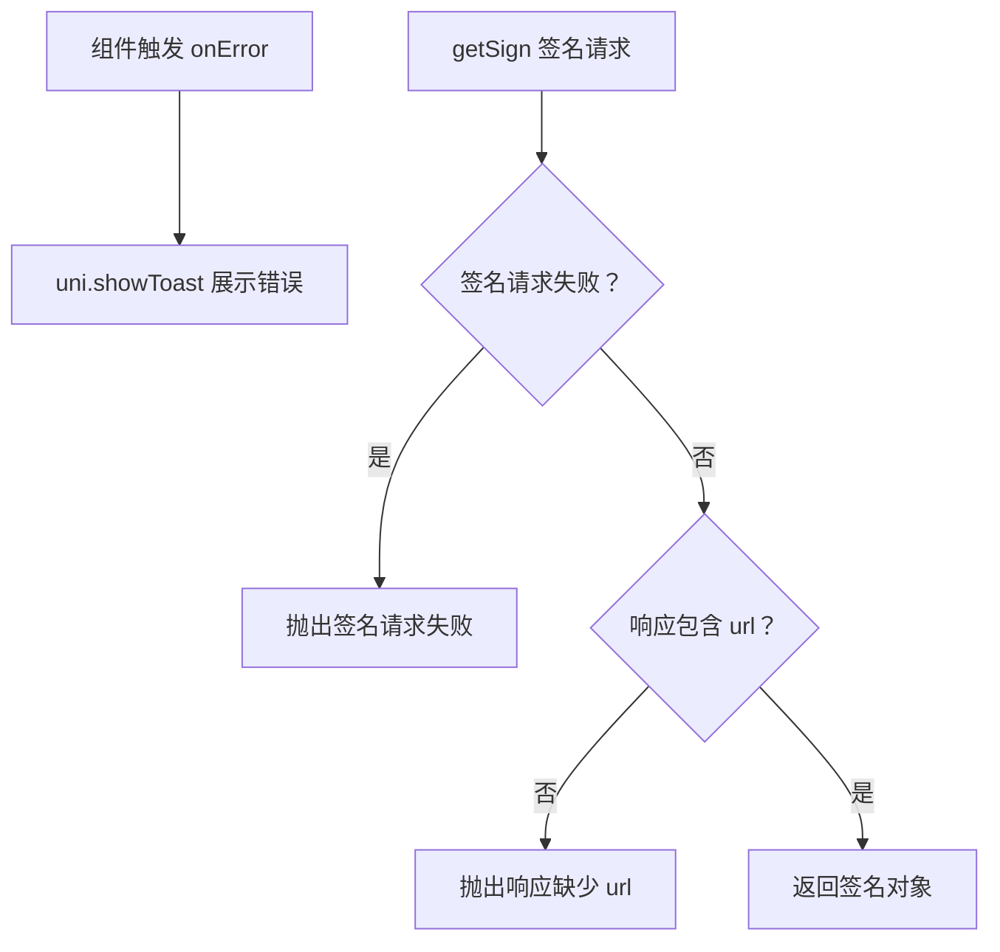
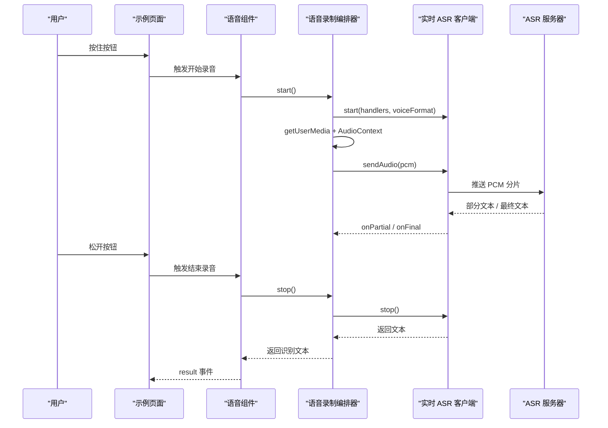
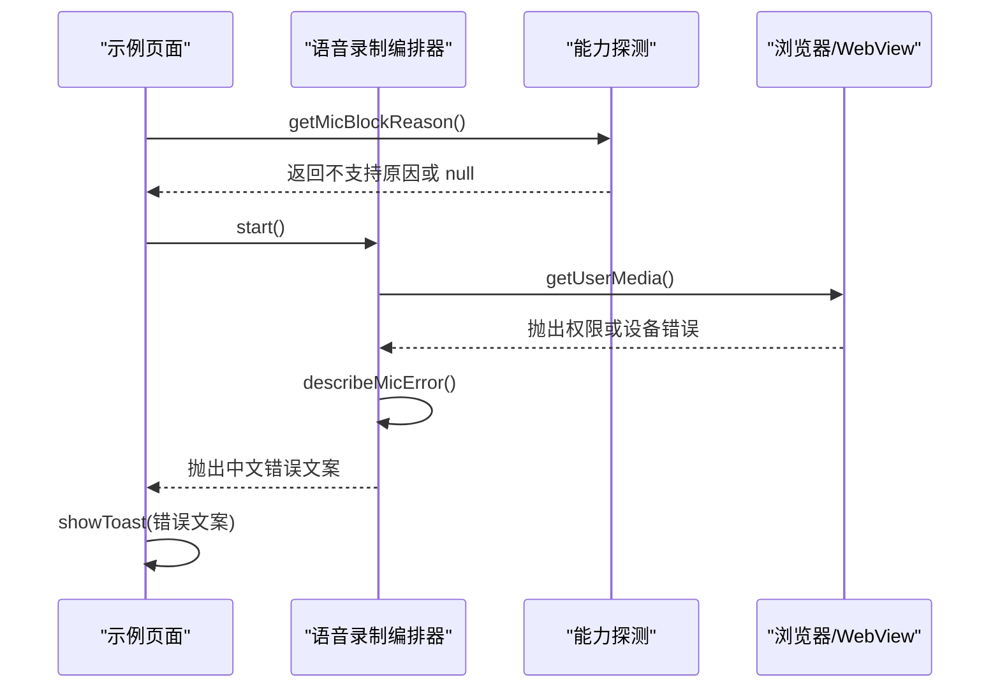
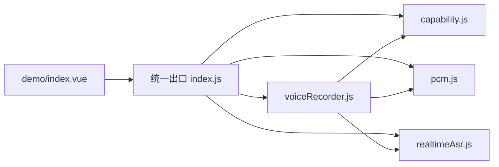

# 错误处理策略

<cite>
**本文引用的文件**   
- [README.md](file://README.md)
- [index.js](file://uni_modules/uni-web-voice-input/js_sdk/uni-web-voice/index.js)
- [capability.js](file://uni_modules/uni-web-voice-input/js_sdk/uni-web-voice/capability.js)
- [realtimeAsr.js](file://uni_modules/uni-web-voice-input/js_sdk/uni-web-voice/realtimeAsr.js)
- [voiceRecorder.js](file://uni_modules/uni-web-voice-input/js_sdk/uni-web-voice/voiceRecorder.js)
- [pcm.js](file://uni_modules/uni-web-voice-input/js_sdk/uni-web-voice/pcm.js)
- [index.vue](file://demo/src/pages/index/index.vue)
</cite>

## 目录
1. [引言](#引言)
2. [项目结构与错误处理定位](#项目结构与错误处理定位)
3. [核心错误分类与处理总览](#核心错误分类与处理总览)
4. [权限拒绝处理方案](#权限拒绝处理方案)
5. [设备与兼容性不支持处理](#设备与兼容性不支持处理)
6. [网络异常与 WebSocket 识别异常处理](#网络异常与-websocket-识别异常处理)
7. [音频采集异常与降级策略](#音频采集异常与降级策略)
8. [用户友好的错误提示设计](#用户友好的错误提示设计)
9. [错误日志记录与上报机制建议](#错误日志记录与上报机制建议)
10. [关键流程时序图](#关键流程时序图)
11. [依赖关系分析](#依赖关系分析)
12. [性能与稳定性注意事项](#性能与稳定性注意事项)
13. [故障排查清单](#故障排查清单)
14. [结论](#结论)

## 引言
本文件围绕「uni-web-voice-input」语音输入 SDK 的错误处理体系进行系统化说明，目标是帮助开发者在 H5、App WebView、鸿蒙 ArkWeb 等复杂环境中，稳定实现「按住说话、松手出字」，并在麦克风权限被拒、设备不支持、网络异常、音频采集失败等场景下给出清晰的用户提示和降级方案。

该 SDK 的核心思路是：
- 使用纯 Web 能力 `getUserMedia` + Web Audio + WebSocket 实时 ASR。
- 通过能力探测模块判断环境是否支持录音、是否安全上下文、是否为鸿蒙 ArkWeb 或 App-plus Android。
- 通过录制编排器统一封装录音生命周期，并对接实时 ASR 客户端。
- 通过示例页面展示如何注入签名接口、展示状态、捕获错误并提示用户。

**章节来源**
- [README.md:1-24](file://README.md#L1-L24)

## 项目结构与错误处理定位
SDK 的错误处理主要分布在以下三个层次：

| 层次 | 主要职责 | 对应文件 |
|---|---|---|
| 能力探测层 | 判断安全上下文、麦克风可用性、鸿蒙/plus 环境、权限探测与原生权限申请 | [capability.js](file://uni_modules/uni-web-voice-input/js_sdk/uni-web-voice/capability.js) |
| 音频录制编排层 | 封装 `getUserMedia`、AudioContext、ScriptProcessor、PCM 缓存、ASR 连接、录音时长校验、兜底整段 PCM 识别 | [voiceRecorder.js](file://uni_modules/uni-web-voice-input/js_sdk/uni-web-voice/voiceRecorder.js) |
| 实时 ASR 客户端层 | 负责签名获取、WebSocket 连接、分片推流、超时控制、服务端错误码映射、取消与停止 | [realtimeAsr.js](file://uni_modules/uni-web-voice-input/js_sdk/uni-web-voice/realtimeAsr.js) |
| 示例应用层 | 演示错误提示、状态展示、签名注入、组件用法 | [index.vue](file://demo/src/pages/index/index.vue) |

**图表来源**
- [index.vue:17-24](file://demo/src/pages/index/index.vue#L17-L24)
- [voiceRecorder.js:15-17](file://uni_modules/uni-web-voice-input/js_sdk/uni-web-voice/voiceRecorder.js#L15-L17)
- [realtimeAsr.js:84-93](file://uni_modules/uni-web-voice-input/js_sdk/uni-web-voice/realtimeAsr.js#L84-L93)
- [capability.js:42-63](file://uni_modules/uni-web-voice-input/js_sdk/uni-web-voice/capability.js#L42-L63)

**章节来源**
- [index.js:6-17](file://uni_modules/uni-web-voice-input/js_sdk/uni-web-voice/index.js#L6-L17)
- [index.vue:17-24](file://demo/src/pages/index/index.vue#L17-L24)

## 核心错误分类与处理总览
从 SDK 实现出发，可将错误分为五类：

| 错误类别 | 典型场景 | 主要处理位置 | 处理策略 |
|---|---|---|---|
| 权限拒绝 | 麦克风权限被拒、系统权限限制、用户主动拒绝 | [capability.js](file://uni_modules/uni-web-voice-input/js_sdk/uni-web-voice/capability.js)、[voiceRecorder.js](file://uni_modules/uni-web-voice-input/js_sdk/uni-web-voice/voiceRecorder.js) | 提前探测、明确文案、引导用户授权、必要时走原生权限申请 |
| 设备与兼容不支持 | Web Audio API 不可用、WebSocket 不可用、非安全上下文、无 `mediaDevices` | [capability.js](file://uni_modules/uni-web-voice-input/js_sdk/uni-web-voice/capability.js)、[realtimeAsr.js](file://uni_modules/uni-web-voice-input/js_sdk/uni-web-voice/realtimeAsr.js) | 早期拦截、返回可读原因、提示降级路径 |
| 网络异常 | WebSocket 连接失败、连接超时、服务端关闭、签名请求失败 | [realtimeAsr.js](file://uni_modules/uni-web-voice-input/js_sdk/uni-web-voice/realtimeAsr.js) | 超时保护、错误码映射、清理状态、提示重试 |
| 音频采集异常 | 设备忙、采样率不匹配、设备不存在、权限问题 | [voiceRecorder.js](file://uni_modules/uni-web-voice-input/js_sdk/uni-web-voice/voiceRecorder.js) | 错误映射为中文文案、释放资源、回退到空闲态 |
| 业务逻辑异常 | 录音太短、未采集到音频、未识别到内容 | [voiceRecorder.js](file://uni_modules/uni-web-voice-input/js_sdk/uni-web-voice/voiceRecorder.js) | 根据录音时长、PCM 字节数、识别结果给出差异化提示 |

**章节来源**
- [capability.js:48-83](file://uni_modules/uni-web-voice-input/js_sdk/uni-web-voice/capability.js#L48-L83)
- [voiceRecorder.js:25-41](file://uni_modules/uni-web-voice-input/js_sdk/uni-web-voice/voiceRecorder.js#L25-L41)
- [realtimeAsr.js:43-49](file://uni_modules/uni-web-voice-input/js_sdk/uni-web-voice/realtimeAsr.js#L43-L49)

## 权限拒绝处理方案
### 权限拒绝的常见形态
SDK 对权限拒绝做了分层处理：

1. **环境级权限前置检查**  
   - 通过 `isSecureContext` 判断是否为 HTTPS 或 localhost。
   - 通过 `canUseWebMic` 判断是否存在 `navigator.mediaDevices.getUserMedia`。
   - 通过 `getMicBlockReason` 直接返回一段面向用户的中文原因文案。

2. **运行时权限探测**  
   - `probeMicPermission` 尝试调用 `navigator.permissions.query('microphone')`。
   - 如果容器不支持 `permissions` 或 `microphone` 名称，则静默返回 `unknown`，避免阻塞用户手势。

3. **原生平台权限补充**  
   - 在 uni-app App-plus Android 环境下，`isAppPlusAndroid` 判定是否需要走 `plus.android.requestPermissions`。
   - `requestRecordAudioViaPlus` 申请 `android.permission.RECORD_AUDIO`，并返回 `granted`、`denied`、`unsupported`、`error`。

4. **getUserMedia 运行时错误映射**  
   - `describeMicError` 将 `NotAllowedError`、`PermissionDenied`、`SecurityError` 映射为“麦克风权限被拒绝”。
   - 将 `NotFoundError`、`DevicesNotFound` 映射为“未检测到麦克风设备”。
   - 将 `NotReadableError`、`AbortError`、`InUse` 映射为“麦克风被其它应用占用”。
   - 将 `OverconstrainedError` 映射为“当前设备不支持所需录音参数”。

**图表来源**
- [capability.js:28-63](file://uni_modules/uni-web-voice-input/js_sdk/uni-web-voice/capability.js#L28-L63)
- [capability.js:72-83](file://uni_modules/uni-web-voice-input/js_sdk/uni-web-voice/capability.js#L72-L83)
- [capability.js:90-137](file://uni_modules/uni-web-voice-input/js_sdk/uni-web-voice/capability.js#L90-L137)
- [voiceRecorder.js:25-41](file://uni_modules/uni-web-voice-input/js_sdk/uni-web-voice/voiceRecorder.js#L25-L41)

### 权限拒绝处理最佳实践
- 在组件挂载时调用 `probeMicPermission`，提前感知权限状态，但不阻塞页面加载。
- 在用户按下按钮的同步代码中再发起 `getUserMedia`，保证 user-activation 有效，尤其修复鸿蒙 ArkWeb 不弹权限的问题。
- 对 `NotAllowedError`、`PermissionDenied`、`SecurityError` 统一提示“请允许麦克风权限后重试”。
- 对 `NotFoundError` 提示“未检测到麦克风设备”，引导用户检查硬件或系统设置。
- 对 `NotReadableError`、`AbortError`、`InUse` 提示“麦克风被其它应用占用”，引导用户关闭其他录音应用。
- 对 `OverconstrainedError` 提示“当前设备不支持所需录音参数”，可考虑放宽约束或切换默认配置。

**章节来源**
- [capability.js:48-83](file://uni_modules/uni-web-voice-input/js_sdk/uni-web-voice/capability.js#L48-L83)
- [capability.js:90-137](file://uni_modules/uni-web-voice-input/js_sdk/uni-web-voice/capability.js#L90-L137)
- [voiceRecorder.js:25-41](file://uni_modules/uni-web-voice-input/js_sdk/uni-web-voice/voiceRecorder.js#L25-L41)

## 设备与兼容性不支持处理
### 不支持场景分类
SDK 对设备与兼容性不支持的处理集中在两个层面：

1. **能力探测层**  
   - `isHarmonyWebview` 通过结构化信号 `__uniapp_x_`、`window.plus`、UA 综合判断是否为鸿蒙 ArkWeb。
   - `isSecureContext` 判断是否为 HTTPS 或 localhost。
   - `canUseWebMic` 判断是否具备 `navigator.mediaDevices.getUserMedia`。
   - `getMicBlockReason` 返回无法使用麦克风的中文原因。

2. **ASR 客户端层**  
   - 若 `WebSocket` 不可用，直接抛出“当前环境没有可用的 WebSocket 实现”。
   - 若未提供 `fetchSign`，直接抛出“必须提供 options.fetchSign”。

**图表来源**
- [capability.js:14-46](file://uni_modules/uni-web-voice-input/js_sdk/uni-web-voice/capability.js#L14-L46)
- [realtimeAsr.js:84-93](file://uni_modules/uni-web-voice-input/js_sdk/uni-web-voice/realtimeAsr.js#L84-L93)

### 兼容性处理建议
- 对于非 HTTPS 环境，优先提示改用 HTTPS 或在 App 内重试。
- 对于缺少 `mediaDevices` 的环境，提示当前环境不支持网页录音。
- 对于缺少 `WebSocket` 的环境，提示当前环境不支持实时语音识别，需要升级容器或替换 WebSocket 实现。
- 对于鸿蒙 ArkWeb，确保宿主 WebView 正确转发 `onPermissionRequest`，并保持页面为 HTTPS。

**章节来源**
- [capability.js:14-63](file://uni_modules/uni-web-voice-input/js_sdk/uni-web-voice/capability.js#L14-L63)
- [realtimeAsr.js:84-93](file://uni_modules/uni-web-voice-input/js_sdk/uni-web-voice/realtimeAsr.js#L84-L93)

## 网络异常与 WebSocket 识别异常处理
### 连接与超时策略
实时 ASR 客户端实现了较完整的网络异常处理：

| 异常类型 | 触发位置 | 处理方式 |
|---|---|---|
| 签名获取失败 | `resolveAsrSign` | 包装为“语音识别签名失败”错误，并记录调试日志 |
| 响应缺少 url | `resolveAsrSign` | 抛出“响应缺少 url”错误 |
| WebSocket 创建失败 | `connect` | 抛出“无法创建语音识别连接” |
| 连接超时 | `connect` 定时器 | 抛出“语音识别连接超时” |
| WebSocket onerror | `connect` | 抛出“语音识别连接失败，请检查网络后重试” |
| WebSocket onclose（未完成） | `connect` | 抛出“语音识别连接已关闭” |
| 识别过程整体超时 | `recognizePcmBuffer` | 抛出“语音识别超时，请重试” |
| 服务端错误码 | `handleMessage` | 根据 `code` 映射为用户友好文案 |

**图表来源**
- [voiceRecorder.js:156-240](file://uni_modules/uni-web-voice-input/js_sdk/uni-web-voice/voiceRecorder.js#L156-L240)
- [realtimeAsr.js:151-272](file://uni_modules/uni-web-voice-input/js_sdk/uni-web-voice/realtimeAsr.js#L151-L272)

### 服务端错误码映射
SDK 对常见 ASR 服务端错误码做了专门映射：

| 错误码 | 用户提示语义 |
|---|---|
| 4004 | 语音识别额度已用尽，请联系管理员开通后付费或购买资源包 |
| 4001 / 4002 / 4003 | 语音识别鉴权失败，请重试 |
| 其他错误码 | 返回“语音识别失败”及原始 message 或错误码 |

当出现鉴权相关错误码时，SDK 会清空缓存的 ws URL 和过期时间，强制下次重新获取签名，避免持续使用失效票据。

**章节来源**
- [realtimeAsr.js:43-49](file://uni_modules/uni-web-voice-input/js_sdk/uni-web-voice/realtimeAsr.js#L43-L49)
- [realtimeAsr.js:151-176](file://uni_modules/uni-web-voice-input/js_sdk/uni-web-voice/realtimeAsr.js#L151-L176)
- [realtimeAsr.js:178-212](file://uni_modules/uni-web-voice-input/js_sdk/uni-web-voice/realtimeAsr.js#L178-L212)
- [realtimeAsr.js:214-272](file://uni_modules/uni-web-voice-input/js_sdk/uni-web-voice/realtimeAsr.js#L214-L272)
- [realtimeAsr.js:332-363](file://uni_modules/uni-web-voice-input/js_sdk/uni-web-voice/realtimeAsr.js#L332-L363)

## 音频采集异常与降级策略
### 音频采集异常分类
`voiceRecorder.js` 对音频采集异常做了明确分类：

| 异常原因 | 错误名称匹配 | 用户提示 |
|---|---|---|
| 权限被拒 | `NotAllowedError`、`PermissionDenied`、`SecurityError` | 麦克风权限被拒绝，请在浏览器/系统设置中允许后重试 |
| 设备不存在 | `NotFoundError`、`DevicesNotFound` | 未检测到麦克风设备 |
| 设备被占用 | `NotReadableError`、`AbortError`、`InUse` | 麦克风被其它应用占用，暂时无法录音 |
| 参数不满足 | `OverconstrainedError` | 当前设备不支持所需录音参数 |
| 未知错误 | 其他情况 | 使用原始 message 或“麦克风启动失败” |

### 降级策略
SDK 的降级策略主要体现在“实时识别失败时使用整段 PCM 兜底识别”：

1. 录音过程中，如果实时 WebSocket 未连接，音频数据会被丢弃或缓存。
2. 松手后，如果实时识别没有返回文本，SDK 会将缓存的 PCM 片段拼接成完整 PCM。
3. 调用 `asr.recognizePcmBuffer` 进行一次整段 PCM 识别。
4. 如果仍然没有文本，则根据 `receivedPcmBytes` 区分“未采集到音频”和“未识别到内容”。

**图表来源**
- [voiceRecorder.js:246-294](file://uni_modules/uni-web-voice-input/js_sdk/uni-web-voice/voiceRecorder.js#L246-L294)

### 音频链路健壮性
- 创建 `AudioContext` 后立即尝试 `resume()`，避免 suspended 状态下 `onaudioprocess` 不回调。
- 使用 `createScriptProcessor` 将音频流转换为 PCM，并按目标采样率转换。
- 缓存最多 400 段 PCM 片段，用于兜底整段识别。
- 结束时统一释放 `scriptProcessor`、`mediaSourceNode`、`audioContext`、`mediaStream`。

**章节来源**
- [voiceRecorder.js:25-41](file://uni_modules/uni-web-voice-input/js_sdk/uni-web-voice/voiceRecorder.js#L25-L41)
- [voiceRecorder.js:116-150](file://uni_modules/uni-web-voice-input/js_sdk/uni-web-voice/voiceRecorder.js#L116-L150)
- [voiceRecorder.js:195-229](file://uni_modules/uni-web-voice-input/js_sdk/uni-web-voice/voiceRecorder.js#L195-L229)
- [voiceRecorder.js:246-294](file://uni_modules/uni-web-voice-input/js_sdk/uni-web-voice/voiceRecorder.js#L246-L294)

## 用户友好的错误提示设计
### 提示原则
- 错误信息应面向用户，而不是暴露内部技术细节。
- 不同错误应给出不同操作指引：权限问题引导授权，设备问题引导检查硬件，网络问题引导重试。
- 对“太短录音”“未采集到音频”“未识别到内容”等业务异常，给出可操作的下一步建议。

### 示例页面的错误提示方式
示例页面通过 `@error` 事件接收错误消息，并使用 `uni.showToast` 展示给用户。同时，`getSign` 中也对签名请求失败、响应缺少 url 等情况做了错误抛出，便于上层统一处理。

**图表来源**
- [index.vue:60-75](file://demo/src/pages/index/index.vue#L60-L75)
- [index.vue:83-83](file://demo/src/pages/index/index.vue#L83-L83)

### 推荐的前端错误处理模式
- 组件层只负责展示错误，不关心具体错误来源。
- SDK 层负责把底层异常映射为可读中文文案。
- 业务层可根据错误文案决定是否引导跳转设置页、是否提示重试、是否降级到传统上传录音方式。

**章节来源**
- [index.vue:60-83](file://demo/src/pages/index/index.vue#L60-L83)
- [voiceRecorder.js:25-41](file://uni_modules/uni-web-voice-input/js_sdk/uni-web-voice/voiceRecorder.js#L25-L41)

## 错误日志记录与上报机制建议
### 现有日志能力
SDK 本身提供了基础调试日志能力：

- `realtimeAsr.js` 中的 `log`、`warn`、`errLog` 在 `debug=true` 时输出控制台日志。
- `voiceRecorder.js` 通过 `handlers.onError` 向上抛出错误消息。
- 示例页面通过 `@error` 事件接收错误并 toast 提示。

### 建议的上报结构
建议在业务层对错误进行分类上报，结构可参考：

| 字段 | 含义 | 示例值 |
|---|---|---|
| `type` | 错误大类 | `mic_permission`、`device_unavailable`、`network_error`、`asr_server_error`、`audio_capture_error` |
| `message` | 用户可见错误文案 | “麦克风权限被拒绝，请在浏览器/系统设置中允许后重试” |
| `rawError` | 原始错误信息 | `NotAllowedError`、`WebSocket connection failed` |
| `environment` | 运行环境 | `h5`、`app-plus-android`、`harmony-arkweb` |
| `step` | 出错阶段 | `start`、`stop`、`connect`、`sendAudio`、`recognizePcmBuffer` |
| `durationMs` | 录音时长 | `1200` |
| `pcmBytes` | 采集到的 PCM 字节数 | `64000` |
| `hasPartialText` | 是否有部分识别文本 | `true` |
| `hasFinalText` | 是否有最终识别文本 | `false` |
| `timestamp` | 发生时间 | ISO 时间戳 |

### 上报时机建议
- 权限拒绝时立即上报。
- WebSocket 连接失败或超时时上报。
- 服务端返回鉴权失败或额度耗尽时上报。
- 录音太短、未采集到音频、未识别到内容时上报。
- 示例页面可在 `onError` 中统一收集并上报。

**章节来源**
- [realtimeAsr.js:95-103](file://uni_modules/uni-web-voice-input/js_sdk/uni-web-voice/realtimeAsr.js#L95-L103)
- [voiceRecorder.js:100-114](file://uni_modules/uni-web-voice-input/js_sdk/uni-web-voice/voiceRecorder.js#L100-L114)
- [index.vue:83-83](file://demo/src/pages/index/index.vue#L83-L83)

## 关键流程时序图
### 正常录音识别流程

**图表来源**
- [index.vue:17-24](file://demo/src/pages/index/index.vue#L17-L24)
- [voiceRecorder.js:156-240](file://uni_modules/uni-web-voice-input/js_sdk/uni-web-voice/voiceRecorder.js#L156-L240)
- [voiceRecorder.js:246-294](file://uni_modules/uni-web-voice-input/js_sdk/uni-web-voice/voiceRecorder.js#L246-L294)
- [realtimeAsr.js:317-378](file://uni_modules/uni-web-voice-input/js_sdk/uni-web-voice/realtimeAsr.js#L317-L378)

### 权限拒绝处理流程

**图表来源**
- [index.vue:60-75](file://demo/src/pages/index/index.vue#L60-L75)
- [capability.js:48-63](file://uni_modules/uni-web-voice-input/js_sdk/uni-web-voice/capability.js#L48-L63)
- [voiceRecorder.js:25-41](file://uni_modules/uni-web-voice-input/js_sdk/uni-web-voice/voiceRecorder.js#L25-L41)

## 依赖关系分析
### 模块依赖图

**图表来源**
- [index.js:6-17](file://uni_modules/uni-web-voice-input/js_sdk/uni-web-voice/index.js#L6-L17)
- [voiceRecorder.js:15-17](file://uni_modules/uni-web-voice-input/js_sdk/uni-web-voice/voiceRecorder.js#L15-L17)
- [index.vue:37-39](file://demo/src/pages/index/index.vue#L37-L39)

### 耦合与内聚分析
- `index.js` 作为统一导出入口，降低外部依赖复杂度。
- `voiceRecorder.js` 是编排核心，耦合 `realtimeAsr.js`、`pcm.js`、`capability.js`，但职责清晰：负责录音生命周期、音频链路、ASR 协作。
- `realtimeAsr.js` 专注网络与 ASR 协议，不依赖业务后端，通过 `fetchSign` 解耦。
- `capability.js` 是纯函数集合，内聚度高，适合复用和测试。

**章节来源**
- [index.js:6-17](file://uni_modules/uni-web-voice-input/js_sdk/uni-web-voice/index.js#L6-L17)
- [voiceRecorder.js:15-17](file://uni_modules/uni-web-voice-input/js_sdk/uni-web-voice/voiceRecorder.js#L15-L17)
- [realtimeAsr.js:6-8](file://uni_modules/uni-web-voice-input/js_sdk/uni-web-voice/realtimeAsr.js#L6-L8)

## 性能与稳定性注意事项
- **用户手势窗口**：`start()` 必须在用户按下按钮的同步代码中调用，避免异步导致 user-activation 失效。
- **并发初始化**：ASR 连接、`getUserMedia`、`AudioContext` 在同一 tick 内发起，减少时序问题。
- **AudioContext resume**：显式 `resume()` 避免 suspended 导致无 PCM。
- **PCM 分片发送**：按固定字节数和间隔发送，避免一次性发送过大缓冲造成卡顿。
- **兜底识别**：实时 WS 未连上时缓存 PCM，松手后尝试整段识别，提升成功率。
- **超时保护**：连接超时、识别超时、停止等待超时均有限制，避免长时间挂起。
- **资源释放**：录音结束后统一断开节点、关闭 `AudioContext`、停止媒体轨道，防止内存泄漏。

**章节来源**
- [voiceRecorder.js:152-178](file://uni_modules/uni-web-voice-input/js_sdk/uni-web-voice/voiceRecorder.js#L152-L178)
- [voiceRecorder.js:195-229](file://uni_modules/uni-web-voice-input/js_sdk/uni-web-voice/voiceRecorder.js#L195-L229)
- [voiceRecorder.js:246-294](file://uni_modules/uni-web-voice-input/js_sdk/uni-web-voice/voiceRecorder.js#L246-L294)
- [realtimeAsr.js:10-17](file://uni_modules/uni-web-voice-input/js_sdk/uni-web-voice/realtimeAsr.js#L10-L17)
- [realtimeAsr.js:286-296](file://uni_modules/uni-web-voice-input/js_sdk/uni-web-voice/realtimeAsr.js#L286-L296)

## 故障排查清单
| 现象 | 可能原因 | 排查步骤 | 处理建议 |
|---|---|---|---|
| 按住没反应 | 非用户手势内调用、user-activation 失效 | 检查是否在按下按钮同步代码中调用 `start()` | 调整调用时机，避免先 await 再调用 |
| 鸿蒙不弹麦克风权限 | 未在用户手势内发起 `getUserMedia` | 检查 `start()` 调用位置 | 保持同步发起，确保权限弹窗触发 |
| 有权限却零识别文本 | `AudioContext` 为 suspended | 检查是否显式 `resume()` | 确保创建后 resume |
| 麦克风权限被拒绝 | 用户拒绝或系统限制 | 查看 `describeMicError` 映射 | 提示用户去系统设置开启麦克风 |
| 未检测到麦克风 | 设备不存在 | 查看 `NotFoundError` 分支 | 提示检查硬件或系统设备 |
| 麦克风被占用 | 其他应用正在录音 | 查看 `NotReadableError`、`AbortError`、`InUse` | 提示关闭其他录音应用 |
| 签名请求失败 | 网络错误或接口异常 | 检查 `SIGN_URL` 和网络 | 提示检查网络和签名接口 |
| 响应缺少 url | 后端签名响应格式不正确 | 检查签名响应结构 | 要求后端返回含 `url` 的对象 |
| WebSocket 连接失败 | 网络不通、证书问题、WSS 不可用 | 检查网络、域名、证书 | 提示检查网络并重试 |
| 连接超时 | 服务器未响应 | 检查 `CONNECT_TIMEOUT_MS` | 提示网络异常并重试 |
| 鉴权失败 | 签名过期或密钥错误 | 检查 `expired`、`voiceId` | 清空缓存并重新获取签名 |
| 额度耗尽 | 服务侧配额不足 | 查看错误码 4004 | 提示联系管理员开通或购买资源包 |
| 录音太短 | 按住时间过短 | 查看 `minDurationMs` | 提示按住说话 |
| 未采集到音频 | 权限问题或设备问题 | 查看 `receivedPcmBytes === 0` | 提示确认麦克风权限 |
| 未识别到内容 | 声音太小或环境嘈杂 | 查看 `receivedPcmBytes > 0` 但无文本 | 提示靠近麦克风再说一次 |

**章节来源**
- [voiceRecorder.js:25-41](file://uni_modules/uni-web-voice-input/js_sdk/uni-web-voice/voiceRecorder.js#L25-L41)
- [voiceRecorder.js:156-240](file://uni_modules/uni-web-voice-input/js_sdk/uni-web-voice/voiceRecorder.js#L156-L240)
- [voiceRecorder.js:246-294](file://uni_modules/uni-web-voice-input/js_sdk/uni-web-voice/voiceRecorder.js#L246-L294)
- [realtimeAsr.js:43-49](file://uni_modules/uni-web-voice-input/js_sdk/uni-web-voice/realtimeAsr.js#L43-L49)
- [realtimeAsr.js:214-272](file://uni_modules/uni-web-voice-input/js_sdk/uni-web-voice/realtimeAsr.js#L214-L272)
- [index.vue:60-83](file://demo/src/pages/index/index.vue#L60-L83)

## 结论
本错误处理体系以“能力探测 + 录制编排 + 实时 ASR 客户端”三层结构为基础，覆盖了权限拒绝、设备不支持、网络异常、音频采集异常和业务逻辑异常等主要场景。其核心优势在于：

- 错误信息面向用户，避免暴露底层技术细节。
- 权限和设备检测前置，减少无效录音尝试。
- 实时识别与整段 PCM 兜底结合，提升弱网和弱设备下的成功率。
- 通过 `fetchSign` 解耦后端，便于适配多种 ASR 服务。
- 示例页面展示了统一的错误提示和状态展示方式。

在实际项目中，建议在此基础上补充业务层的错误日志上报、埋点统计和用户引导跳转，从而形成更完整的错误治理闭环。