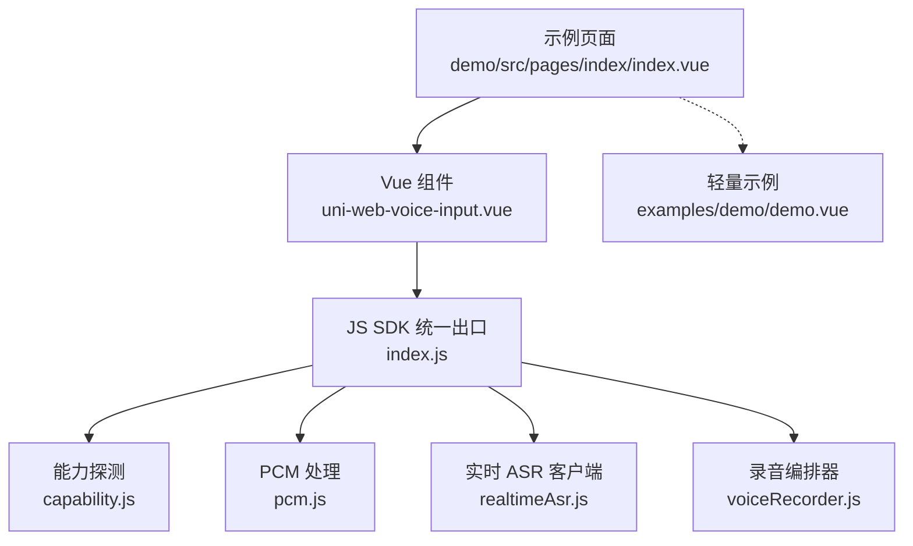
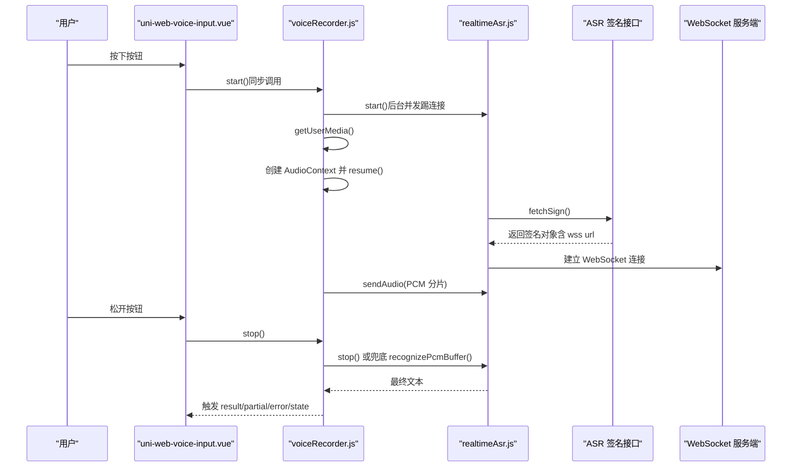
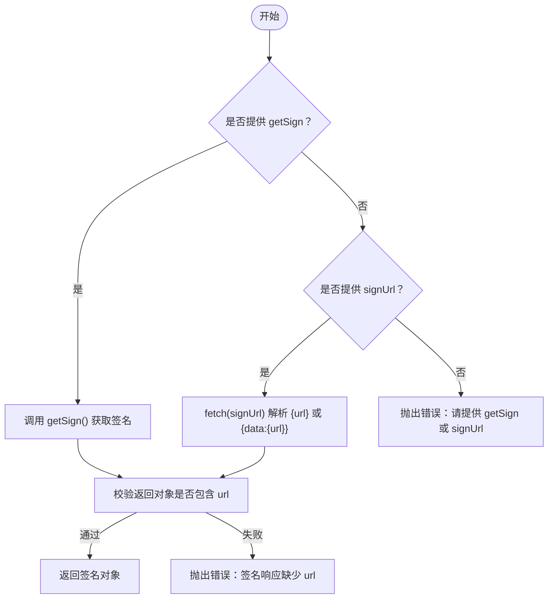
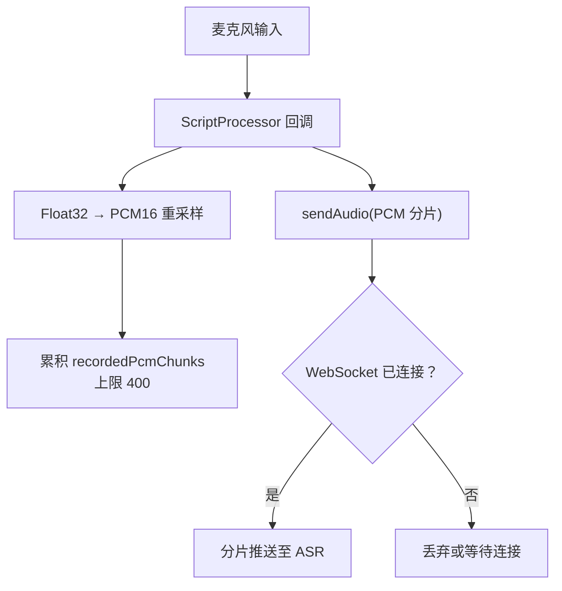
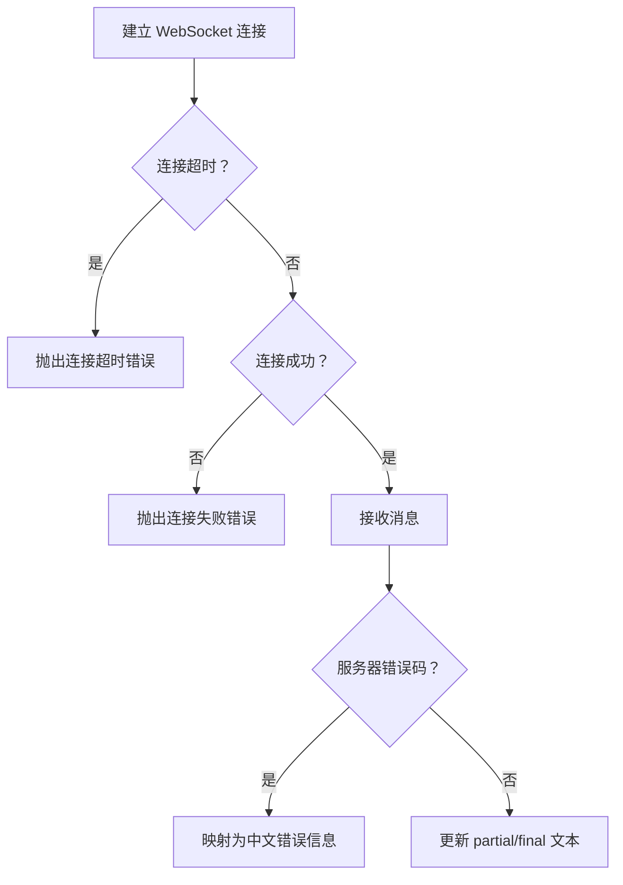

# 高级用法和最佳实践

<cite>
**本文引用的文件**   
- [README.md](file://README.md)
- [index.js](file://uni_modules/uni-web-voice-input/js_sdk/uni-web-voice/index.js)
- [capability.js](file://uni_modules/uni-web-voice-input/js_sdk/uni-web-voice/capability.js)
- [pcm.js](file://uni_modules/uni-web-voice-input/js_sdk/uni-web-voice/pcm.js)
- [realtimeAsr.js](file://uni_modules/uni-web-voice-input/js_sdk/uni-web-voice/realtimeAsr.js)
- [voiceRecorder.js](file://uni_modules/uni-web-voice-input/js_sdk/uni-web-voice/voiceRecorder.js)
- [uni-web-voice-input.vue](file://uni_modules/uni-web-voice-input/components/uni-web-voice-input/uni-web-voice-input.vue)
- [demo index.vue](file://demo/src/pages/index/index.vue)
- [examples demo.vue](file://examples/demo/demo.vue)
</cite>

## 目录
1. [引言](#引言)
2. [项目结构](#项目结构)
3. [核心组件与职责](#核心组件与职责)
4. [架构总览](#架构总览)
5. [自定义 ASR 服务集成：getSign / signUrl / fetchSign](#自定义-asr-服务集成-getsign--signurl--fetchsign)
6. [性能优化技巧](#性能优化技巧)
7. [错误处理策略](#错误处理策略)
8. [调试与监控](#调试与监控)
9. [实际项目集成案例与经验](#实际项目集成案例与经验)
10. [扩展与定制组件行为](#扩展与定制组件行为)
11. [安全与隐私保护](#安全与隐私保护)
12. [常见问题排查](#常见问题排查)
13. [结论](#结论)

## 引言
本仓库提供一套「纯 Web 能力」的跨端语音输入方案，面向 H5、App-vue 以及鸿蒙 ArkWeb WebView 等场景。它通过 `getUserMedia` + Web Audio + WebSocket 实时 ASR，实现「按住说话、松手出字、上滑取消」的交互体验，并通过可注入的签名机制解耦后端 ASR 服务。

该方案的核心价值在于：
- 在原生录音桥不可用的 WebView 环境中，仍能稳定录音并识别。
- 通过 `getSign` / `signUrl` / `fetchSign` 注入机制，不绑定具体厂商密钥或后端协议。
- 针对鸿蒙 ArkWeb、iOS、安卓 WebView 做了关键时序修复，避免权限弹窗不出现、有权限却无 PCM 等问题。
- 同时提供 Vue 组件与 JS SDK 两种使用方式，便于在不同项目中灵活接入。

**章节来源**
- [README.md:1-24](file://README.md#L1-L24)

## 项目结构
仓库采用「插件目录 + 示例工程」的组织方式：
- `uni_modules/uni-web-voice-input`：DCloud 插件市场使用的 uni_modules 目录，包含 Vue 组件与 JS SDK。
- `demo/src`：基于 Vite + uni-app 的演示页面，展示组件用法与 SDK 能力探测。
- `examples/demo`：更轻量的示例，用于快速验证组件基本流程。

**图表来源**
- [demo index.vue:17-24](file://demo/src/pages/index/index.vue#L17-L24)
- [uni-web-voice-input.vue:37-44](file://uni_modules/uni-web-voice-input/components/uni-web-voice-input/uni-web-voice-input.vue#L37-L44)
- [index.js:6-17](file://uni_modules/uni-web-voice-input/js_sdk/uni-web-voice/index.js#L6-L17)

**章节来源**
- [README.md:25-33](file://README.md#L25-L33)
- [demo index.vue:1-32](file://demo/src/pages/index/index.vue#L1-L32)
- [examples demo.vue:1-13](file://examples/demo/demo.vue#L1-L13)

## 核心组件与职责
| 模块 | 主要职责 | 关键特性 |
|---|---|---|
| `uni-web-voice-input.vue` | 提供「按住说话」UI 与手势生命周期，驱动 SDK 录音与识别 | 支持上滑取消、状态提示、Android 运行时权限引导、签名注入 |
| `voiceRecorder.js` | 封装 `getUserMedia` + Web Audio + ScriptProcessor 采音，串联实时 ASR | 用户手势同步窗口内启动、AudioContext resume、整段 PCM 兜底识别 |
| `realtimeAsr.js` | 管理 WebSocket 连接、签名缓存、音频分片推送、识别回调 | 超时控制、错误码映射、提前刷新签名、可选自定义 WebSocket 实现 |
| `capability.js` | 跨端能力探测与环境判断 | 鸿蒙 ArkWeb 判定、安全上下文检查、麦克风权限探测、Android plus 权限申请 |
| `pcm.js` | Float32 → PCM16 重采样与分片拼接 | 对齐腾讯云 voice_format=1，目标采样率可配 |
| `index.js` | SDK 统一导出入口 | 暴露能力探测、PCM 工具、ASR 客户端、录音编排器 |

**章节来源**
- [uni-web-voice-input.vue:28-57](file://uni_modules/uni-web-voice-input/components/uni-web-voice-input/uni-web-voice-input.vue#L28-L57)
- [voiceRecorder.js:1-18](file://uni_modules/uni-web-voice-input/js_sdk/uni-web-voice/voiceRecorder.js#L1-L18)
- [realtimeAsr.js:1-17](file://uni_modules/uni-web-voice-input/js_sdk/uni-web-voice/realtimeAsr.js#L1-L17)
- [capability.js:1-12](file://uni_modules/uni-web-voice-input/js_sdk/uni-web-voice/capability.js#L1-L12)
- [pcm.js:1-6](file://uni_modules/uni-web-voice-input/js_sdk/uni-web-voice/pcm.js#L1-L6)
- [index.js:1-17](file://uni_modules/uni-web-voice-input/js_sdk/uni-web-voice/index.js#L1-L17)

## 架构总览
整体流程分为三层：
- UI 层：Vue 组件负责手势、状态、提示与事件上报。
- 录制与编排层：`createVoiceRecorder` 负责麦克风采集、音频链路、ASR 联动与兜底逻辑。
- ASR 通信层：`createRealtimeAsrClient` 负责签名获取、WebSocket 连接、音频分片发送与识别结果回调。

**图表来源**
- [uni-web-voice-input.vue:180-228](file://uni_modules/uni-web-voice-input/components/uni-web-voice-input/uni-web-voice-input.vue#L180-L228)
- [voiceRecorder.js:152-240](file://uni_modules/uni-web-voice-input/js_sdk/uni-web-voice/voiceRecorder.js#L152-L240)
- [realtimeAsr.js:151-272](file://uni_modules/uni-web-voice-input/js_sdk/uni-web-voice/realtimeAsr.js#L151-L272)

## 自定义 ASR 服务集成：getSign / signUrl / fetchSign
SDK 将 ASR 签名获取逻辑完全解耦，允许你通过三种方式注入：

| 注入方式 | 适用场景 | 行为说明 |
|---|---|---|
| `getSign`（函数） | 需要复杂鉴权、请求头、业务参数、重试逻辑 | 组件内部直接调用，必须返回 Promise，解析为含 `url` 的对象 |
| `signUrl`（字符串） | 简单 GET 即可拿到签名的后端接口 | 组件内部用 `fetch` 拉取并解析 `{data:{url}}` 或 `{url}` |
| `fetchSign`（SDK 级） | 直接使用 JS SDK 时注入 | 由调用方决定如何获取签名，SDK 只消费返回值 |

推荐优先级：
- 优先使用 `getSign`，便于集中处理鉴权、错误、日志与重试。
- 若只需简单地址，可使用 `signUrl`，减少样板代码。
- 在 JS SDK 场景中，直接传入 `fetchSign`，保持框架无关。

签名响应体建议字段：
- `url` / `wsUrl` / `wssUrl` / `ws_url` / `wss_url`：任意一个均可，SDK 会智能选择。
- `expired`：过期时间戳（秒），用于提前刷新签名。
- `voiceId`：可选标识，便于后端关联会话。

**图表来源**
- [uni-web-voice-input.vue:95-103](file://uni_modules/uni-web-voice-input/components/uni-web-voice-input/uni-web-voice-input.vue#L95-L103)
- [demo index.vue:59-75](file://demo/src/pages/index/index.vue#L59-L75)

**章节来源**
- [uni-web-voice-input.vue:46-57](file://uni_modules/uni-web-voice-input/components/uni-web-voice-input/uni-web-voice-input.vue#L46-L57)
- [uni-web-voice-input.vue:95-103](file://uni_modules/uni-web-voice-input/components/uni-web-voice-input/uni-web-voice-input.vue#L95-L103)
- [demo index.vue:59-75](file://demo/src/pages/index/index.vue#L59-L75)
- [realtimeAsr.js:29-41](file://uni_modules/uni-web-voice-input/js_sdk/uni-web-voice/realtimeAsr.js#L29-L41)

## 性能优化技巧
### 音频缓冲策略
- 默认使用 `bufferSize=4096`，可在 `createVoiceRecorder` 中调整，以平衡延迟与 CPU 占用。
- 音频数据按固定字节大小分片推送，避免一次性发送大缓冲区导致卡顿。
- 对未连上的 ASR 连接，先丢弃音频；仅在连接成功后才推流，降低无效开销。

**图表来源**
- [voiceRecorder.js:203-224](file://uni_modules/uni-web-voice-input/js_sdk/uni-web-voice/voiceRecorder.js#L203-L224)
- [realtimeAsr.js:286-296](file://uni_modules/uni-web-voice-input/js_sdk/uni-web-voice/realtimeAsr.js#L286-L296)

**章节来源**
- [voiceRecorder.js:48-71](file://uni_modules/uni-web-voice-input/js_sdk/uni-web-voice/voiceRecorder.js#L48-L71)
- [voiceRecorder.js:203-224](file://uni_modules/uni-web-voice-input/js_sdk/uni-web-voice/voiceRecorder.js#L203-L224)
- [realtimeAsr.js:10-17](file://uni_modules/uni-web-voice-input/js_sdk/uni-web-voice/realtimeAsr.js#L10-L17)

### WebSocket 连接池管理
当前实现为单连接模式，适合「按住说话」短语音场景。若需高并发长语音或批量识别，可考虑：
- 在应用层维护多个 `createRealtimeAsrClient` 实例，按会话或任务分配。
- 对空闲连接进行心跳检测与自动重建。
- 限制最大连接数，避免内存泄漏与资源耗尽。

注意：
- 每个连接都会触发一次签名获取，建议在应用层做签名缓存，避免重复请求。
- 连接关闭后务必清理 `onmessage/onerror/onclose` 监听，防止闭包引用导致内存泄漏。

**章节来源**
- [realtimeAsr.js:105-115](file://uni_modules/uni-web-voice-input/js_sdk/uni-web-voice/realtimeAsr.js#L105-L115)
- [realtimeAsr.js:317-378](file://uni_modules/uni-web-voice-input/js_sdk/uni-web-voice/realtimeAsr.js#L317-L378)

### 内存使用优化
- 音频分片拷贝避免复用底层 buffer，防止数据污染。
- `recordedPcmChunks` 设置上限，避免长时间录音导致内存暴涨。
- 结束录音后及时断开音频节点、关闭 `AudioContext`、停止媒体轨道。
- 对异常路径也执行清理，确保取消、失败、超时均能释放资源。

**章节来源**
- [voiceRecorder.js:116-150](file://uni_modules/uni-web-voice-input/js_sdk/uni-web-voice/voiceRecorder.js#L116-L150)
- [voiceRecorder.js:217-223](file://uni_modules/uni-web-voice-input/js_sdk/uni-web-voice/voiceRecorder.js#L217-L223)
- [voiceRecorder.js:280-294](file://uni_modules/uni-web-voice-input/js_sdk/uni-web-voice/voiceRecorder.js#L280-L294)

## 错误处理策略
### 网络异常
- WebSocket 连接超时：超过 `CONNECT_TIMEOUT_MS` 则拒绝连接。
- 连接失败或关闭：统一抛出可读错误，并清理状态。
- 服务器错误码映射：如额度用尽、鉴权失败等，转换为中文提示。

**图表来源**
- [realtimeAsr.js:214-272](file://uni_modules/uni-web-voice-input/js_sdk/uni-web-voice/realtimeAsr.js#L214-L272)
- [realtimeAsr.js:178-212](file://uni_modules/uni-web-voice-input/js_sdk/uni-web-voice/realtimeAsr.js#L178-L212)

**章节来源**
- [realtimeAsr.js:10-17](file://uni_modules/uni-web-voice-input/js_sdk/uni-web-voice/realtimeAsr.js#L10-L17)
- [realtimeAsr.js:178-212](file://uni_modules/uni-web-voice-input/js_sdk/uni-web-voice/realtimeAsr.js#L178-L212)
- [realtimeAsr.js:214-272](file://uni_modules/uni-web-voice-input/js_sdk/uni-web-voice/realtimeAsr.js#L214-L272)

### 权限拒绝
- 通过 `probeMicPermission` 异步探测授权状态，预显示引导文案。
- 在 Android App-plus 环境下，主动调用 `requestRecordAudioViaPlus` 补申请运行时权限。
- 捕获 `NotAllowedError`、`NotFoundError`、`NotReadableError` 等，映射为中文提示。

**章节来源**
- [capability.js:65-83](file://uni_modules/uni-web-voice-input/js_sdk/uni-web-voice/capability.js#L65-L83)
- [capability.js:106-137](file://uni_modules/uni-web-voice-input/js_sdk/uni-web-voice/capability.js#L106-L137)
- [voiceRecorder.js:25-41](file://uni_modules/uni-web-voice-input/js_sdk/uni-web-voice/voiceRecorder.js#L25-L41)
- [uni-web-voice-input.vue:157-168](file://uni_modules/uni-web-voice-input/components/uni-web-voice-input/uni-web-voice-input.vue#L157-L168)

### 设备不支持
- 检测 `navigator.mediaDevices.getUserMedia` 是否存在。
- 检测 `AudioContext` 是否可用。
- 非浏览器/WebView 环境直接抛出错误。

**章节来源**
- [voiceRecorder.js:73-75](file://uni_modules/uni-web-voice-input/js_sdk/uni-web-voice/voiceRecorder.js#L73-L75)
- [voiceRecorder.js:159-163](file://uni_modules/uni-web-voice-input/js_sdk/uni-web-voice/voiceRecorder.js#L159-L163)

## 调试与监控
### 日志输出
- 组件与 SDK 均支持 `debug` 开关，开启后会打印关键步骤日志。
- 建议在开发阶段开启，生产环境关闭以减少噪音。

### 性能指标收集
- 记录首次签名耗时、WebSocket 连接耗时、音频分片数量、识别时长。
- 统计错误类型分布：网络异常、权限拒绝、设备不支持、服务器错误码。
- 监控内存增长：关注 `recordedPcmChunks` 长度与 `AudioContext` 生命周期。

### 问题诊断工具
- 使用 `getMicBlockReason` 快速定位环境问题。
- 使用 `probeMicPermission` 预判权限状态。
- 在 Android App-plus 下结合 `isAppPlusAndroid` 与 `requestRecordAudioViaPlus` 诊断权限问题。

**章节来源**
- [uni-web-voice-input.vue:130-168](file://uni_modules/uni-web-voice-input/components/uni-web-voice-input/uni-web-voice-input.vue#L130-L168)
- [realtimeAsr.js:89-103](file://uni_modules/uni-web-voice-input/js_sdk/uni-web-voice/realtimeAsr.js#L89-L103)
- [capability.js:52-63](file://uni_modules/uni-web-voice-input/js_sdk/uni-web-voice/capability.js#L52-L63)

## 实际项目集成案例与经验
### 组件用法
在 uni-app 项目中，可直接使用 `<uni-web-voice-input>` 组件，并通过 `getSign` 注入签名逻辑。示例页面展示了完整的事件处理与状态展示。

关键点：
- `getSign` 中应先调用 `getMicBlockReason`，提前拦截环境问题。
- 签名接口返回体需包含 `url`，否则 SDK 会抛出错误。
- 鸿蒙内嵌需宿主 WebView 声明麦克风权限并转发 `onPermissionRequest`，且页面为 HTTPS。

**章节来源**
- [demo index.vue:17-24](file://demo/src/pages/index/index.vue#L17-L24)
- [demo index.vue:59-75](file://demo/src/pages/index/index.vue#L59-L75)
- [demo index.vue:26-30](file://demo/src/pages/index/index.vue#L26-L30)

### 轻量示例
`examples/demo/demo.vue` 展示了最简用法：通过 `signUrl` 直接传入签名地址，适用于快速验证。

**章节来源**
- [examples demo.vue:10-12](file://examples/demo/demo.vue#L10-L12)
- [examples demo.vue:18-26](file://examples/demo/demo.vue#L18-L26)

## 扩展与定制组件行为
### 自定义 WebSocket 实现
可通过 `options.WebSocketImpl` 注入自定义 WebSocket 实现，适用于 App 端或特殊容器环境。

### 自定义音频约束
通过 `mediaConstraints` 配置 `getUserMedia` 的音频参数，例如声道数、回声消除、降噪等。

### 自定义最小录音时长
通过 `minDurationMs` 调整「说得太短」的判断阈值，避免误触发。

### 自定义缓冲帧大小
通过 `bufferSize` 调整 `ScriptProcessor` 的缓冲帧，平衡延迟与性能。

**章节来源**
- [voiceRecorder.js:48-71](file://uni_modules/uni-web-voice-input/js_sdk/uni-web-voice/voiceRecorder.js#L48-L71)
- [realtimeAsr.js:78-93](file://uni_modules/uni-web-voice-input/js_sdk/uni-web-voice/realtimeAsr.js#L78-L93)

## 安全与隐私保护
### 安全上下文
- 必须在 HTTPS 或 localhost 环境下运行，否则 `getUserMedia` 不可用。
- SDK 提供 `isSecureContext` 与 `canUseWebMic` 进行检测。

### 权限最小化
- 仅申请必要的麦克风权限，避免过度索取。
- 在权限被拒时，给出明确的用户引导，而非静默失败。

### 数据传输安全
- WebSocket 建议使用 `wss` 协议，避免明文传输。
- 签名接口应启用鉴权与限流，防止滥用。

### 本地数据清理
- 录音结束后立即清理音频缓冲区与媒体轨道。
- 避免在本地持久化敏感音频数据，除非业务必需且获得用户同意。

**章节来源**
- [capability.js:28-46](file://uni_modules/uni-web-voice-input/js_sdk/uni-web-voice/capability.js#L28-L46)
- [voiceRecorder.js:116-150](file://uni_modules/uni-web-voice-input/js_sdk/uni-web-voice/voiceRecorder.js#L116-L150)

## 常见问题排查
| 现象 | 可能原因 | 解决方案 |
|---|---|---|
| 按住没反应 | 非安全环境或缺少 `getUserMedia` | 检查 HTTPS、控制台报错、使用 `getMicBlockReason` |
| 有权限但无 PCM | `AudioContext` 未 resume 或脚本处理器未回调 | 确认在用户手势同步窗口内创建并 resume |
| 识别结果为空 | 录音太短、未采集到音频、ASR 未返回文本 | 调整 `minDurationMs`，检查网络与签名 |
| 鸿蒙内嵌不弹权限 | 宿主未转发 `onPermissionRequest` | 联系宿主开发者补充权限处理 |
| Android 录音失败 | 系统录音权限未授予 | 调用 `requestRecordAudioViaPlus` 补申请 |

**章节来源**
- [voiceRecorder.js:152-240](file://uni_modules/uni-web-voice-input/js_sdk/uni-web-voice/voiceRecorder.js#L152-L240)
- [uni-web-voice-input.vue:192-206](file://uni_modules/uni-web-voice-input/components/uni-web-voice-input/uni-web-voice-input.vue#L192-L206)
- [capability.js:106-137](file://uni_modules/uni-web-voice-input/js_sdk/uni-web-voice/capability.js#L106-L137)

## 结论
`uni-web-voice-input` 通过可注入的签名机制、跨端能力探测与关键时序修复，提供了稳定、灵活、易用的语音输入方案。在实际项目中，建议：
- 优先使用 `getSign` 集中处理鉴权与错误。
- 开启 `debug` 模式进行开发与问题定位。
- 根据业务需求调整音频缓冲、最小录音时长等参数。
- 重视权限与安全，提供清晰的用户引导与错误提示。
- 在高并发场景下，自行实现连接池与签名缓存，提升性能与稳定性。